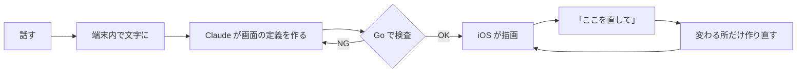

<h3><a href="https://tailor-it.app/">Tailor It</a></h3>

<h4>ひと声で、あなた仕立て。</h4>

話すとアプリが変わる iOS アプリ。声とチャットで、自分専用のアプリをその場で作って直せます。

<!-- TODO(Issue #64): デモ動画(YouTube)のサムネイル付きリンクをここに置く。JPHACKS テンプレの書式: 。写すもの: マイクに話す → 生成中 → 家計簿に変わる → 「合計をもっと大きく」で動く → 「元に戻す」、までを 30〜60 秒で -->

## 使い方

| 1. 話す | 2. 作る | 3. 使う |
|:---:|:---:|:---:|
|  |  |  |
| マイクを押して話す | 数秒で画面ができる | 入力・保存・集計がそのまま動く |

<!-- TODO: 実機・日本語 UI・staging 接続で同じ 3 枚(初期画面 / 生成中 / 完成した家計簿)を撮り直して差し替える。縦長スクショを長辺 1000px の JPEG(1 枚 300KB 以下)に -->

## 製品概要

### 課題設定

Web サービスは、Lovable や v0 などを使えば、エンジニアでなくても言葉で作れるようになりました。
一方でスマホのアプリは、Mac と開発環境の用意や、ストアへのリリースといった壁があり、今もエンジニアでない人には手が届きにくいままです。

### ソリューション

話しかけるだけで、自分専用のアプリ(道具)がその場で手に入るようにしました。
合うアプリを探して妥協する代わりに、話すだけで家計簿や筋トレ記録のようなアプリができ、「合計をもっと大きく」と話せば使いながら直せます。アプリが変わっても、それまでの記録は消えません。

**仕組み**: AI はコードを書きません。画面の定義(DSL: 画面の中身を表す JSON)を作り、アプリに組み込み済みの SwiftUI の部品で描きます(Server-Driven UI)。だから、その場でアプリが変わります。

**特長**

- **AI が画面のレイアウトまで決める**: 6 列 × 12 行のマス目に、部品ごとに `A1:C3` のような書き方で置き場所を決める。重なりはサーバーが見つけて作り直させる。
- **スマホの機能も、計算も作れる**: 57 種の部品から、カメラ・動画・通知・地図・ヘルスケアなどを AI が選んで置く。割り勘の精算や BMI のような計算も組み立てる。
- **チャットで相談しながら育てる**: 足りない点だけ聞き返し、「見やすくして」のようなあいまいな依頼には案を出す。直したあとは「元に戻す」で戻せる。
- **その場で変わり、壊れない**: 画面の定義はサーバー(Go)が厳しく検査し、iOS は知らない部品が届いても落ちない。音声認識は端末内で動くので、声は外に出ない。

**注力したこと: 品質を数字で測って直しました。** 同じ依頼のセットで作らせ、手で採点しています([audit2](docs/backend/ai-eval/2026-10-24-audit2.md) / [audit3](docs/backend/ai-eval/2026-10-24-audit3.md))。

| 指標 | 改善前 | 改善後 |
|---|---:|---:|
| 頼んだ機能が入っている割合 | 49% | 91% |
| 頼んだ機能が全部入ったアプリ | 2/20 | 14/20 |
| 中身と違うラベル | 7/20 | 0/20 |

速さは新規作成 6.6 秒・修正 1.7 秒(中央値・[計測](docs/backend/ai-eval/2026-10-24.md))。

- **1 つのスキーマを正典にした。** Go の検査・iOS の型・AI への部品一覧を同じスキーマから作り、ズレるとテストが落ちる。
- **速さにこだわった。** 出力を軽くし、ストリーミングで画面の枠を約 2.4 秒で出す。

### 使用技術

#### 活用した技術

- **API・データ**: Claude API(`claude-sonnet-5-5`)、Firebase Auth / Firestore、Cloud Run / Secret Manager / Workload Identity Federation
- **フレームワーク・ライブラリ**: SwiftUI(iOS 17+)、Swift Charts、MapKit、HealthKit、WidgetKit、App Intents ほか / WhisperKit(端末内の音声認識)、Foundation Models(端末内の AI) / Go(外部ライブラリは JSON Schema 検証と JSON Patch の 2 つだけ) / GitHub Actions、gitleaks、xcodegen
- **デバイス**: iPhone(iOS 17+)、マイク・カメラ・位置情報・ヘルスケア

全一覧は [活用した技術(全一覧)](docs/README-details.md#活用した技術全一覧)。

#### 独自技術

- **DSL v1 とマス目配置**: 画面を表す JSON の仕様と、`A1:C3` での配置([docs/dsl](docs/dsl/README.md))
- **生成パイプライン**: 作る → 検査 → 作り直す。修正は差分(JSON Patch)だけ作る([backend/internal/ai](backend/internal/ai))
- **部品一覧の自動生成**: AI に渡す部品の説明をスキーマから作る([catalog.go](backend/internal/ai/catalog.go))
- **描画の仕組み**: 1 部品 = 1 ファイルで足せるレンダラー([MetamonRenderer](ios/Packages/MetamonRenderer))
- **品質監査ツール**: 頼んだ機能の抜けや、中身と違うラベルを判定する([backend/cmd](backend/cmd))
- **計測データの公開**: 生成の品質と速さの計測を、生の JSON 付きで公開([docs/backend/ai-eval](docs/backend/ai-eval))

場所と代表 PR の一覧は [独自技術(場所と代表 PR)](docs/README-details.md#独自技術場所と代表-pr)。

### 今後の展望

- 作ったアプリを単体のアプリとして公開する。
- 有料版「Tailor It Pro」。
- 今の DSL で表せない依頼(タイマーの自動切り替えなど)に対応する。

## 審査員向け: 試し方

<!-- TODO: TestFlight など配布リンクがあればここに追記する(無ければこのコメントを消す) -->

シミュレータなら API キー無しで試せます。`METAMON_MOCK=1` を付けて起動してください(手順は [セットアップ](docs/README-details.md#セットアップ))。
話す内容の例は [話してみてほしい内容](docs/README-details.md#話してみてほしい内容) にあります。

## もっと詳しく

- [詳細版 README](docs/README-details.md): 数字の根拠・部品一覧・アーキテクチャ・セットアップ・リポジトリ構成
- [決定事項(正典)](docs/00_decisions.md)
- [DSL の仕様・部品一覧](docs/dsl/README.md)
- 設計: [iOS](docs/ios/architecture.md) / [backend](docs/backend/architecture.md)
- [審査デモの台本](docs/03_demo_script.md)
