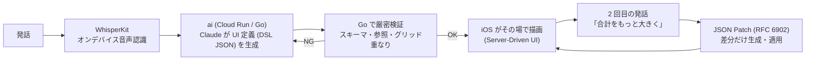
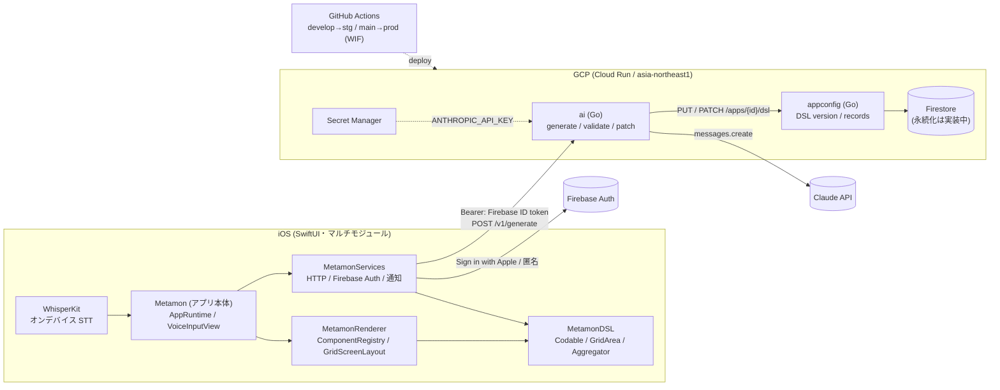

# Tailor It

<!-- プロダクト名は上の H1 と次の由来の行だけに書く(本文は「本アプリ」で統一)。 -->

> 名前の由来: **あなたに合わせて仕立てる(tailor)**。話しかけた人の生活に合わせて、アプリ自身が仕立て直される。内部識別子(ターゲット名 `Metamon`・Bundle ID `jp.kz2601.metamon`・App Group・`Metamon*` パッケージ・`METAMON_*` 環境変数)は Firebase 登録に紐づくため `Metamon` のまま。

[](https://www.youtube.com/watch?v=piaNsc6ilBI)

> **話しかけるだけで、その場でアプリが生まれ変わる iOS アプリ。**
> 初期画面はマイク 1 つ。「コンビニで使ったお金を記録する家計簿が欲しい。レシートの写真も残したい」と話すと、数秒後にアプリ自身がその家計簿に変わる。もう一度「合計をもっと大きく」と話せば、その場でレイアウトが動く。

## 製品概要
### 背景(製品開発のきっかけ、課題等）

「ちょっとした記録用のアプリが欲しい」と思っても、選択肢は 2 つしかありませんでした。

| 選択肢 | 何が起きるか |
|---|---|
| App Store で探す | 自分の生活にぴったり合うものは無い。多機能すぎる・広告・会員登録 |
| 自分で作る | Xcode・Swift・API・配布。「記録したいだけ」の人には高すぎるハードル |

欲しいのは「アプリ」ではなく、**自分の生活に合った道具**です。家計簿も筋トレ記録も散歩メモも、本質は「入力欄が数個と一覧と集計」。違うのはフィールドとレイアウトと、カメラや通知のようなネイティブ機能の組み合わせだけ。

それなら **一度インストールしたアプリが、話しかけるたびに"その道具"に変身すればいい**。生成 AI がコードを書いて配布するのではなく、**画面の定義(DSL)を生成して、手元の iOS アプリがその場で描画する**。これが本アプリの出発点です。

### 製品説明（具体的な製品の説明）

1 画面の音声入力から始まり、発話が数秒でネイティブ iOS アプリになります。



| ステップ | 何が起きるか | 実測 |
|---|---|---|
| 1. 話す | マイクボタンを押して話す。WhisperKit(`small`)が端末内で文字起こし。文字入力に切替可 | オンデバイス・事前 DL |
| 2. 生成 | `POST /v1/generate` が Claude(`claude-sonnet-5-5`)に部品カタログ + few-shot を渡し、DSL v1 JSON を生成 | create p50 **6.6 秒** / p95 8.7 秒 |
| 3. 検証 | Go がスキーマ・id 参照・enum・**グリッド座標の重なり/範囲外**を全件列挙して検証。NG ならエラー一覧を添えて再生成(最大 2 回) | 16 発話 × 2 条件で一発通過 **100%** |
| 4. 描画 | iOS が DSL を受け取り、タブ・画面・部品を SwiftUI で即描画。入力→保存→一覧・集計が動く | 部品 48 種 + アクション 9 種 |
| 5. 育てる | 2 回目以降の発話は **JSON Patch(RFC 6902)** の差分生成。「ここをもっと大きく」「カテゴリにカフェを追加」も通る | edit p50 **1.7 秒** |

アプリ本体にはコードが増えません。増えるのは DSL JSON の version だけです(保存先 Firestore への永続化は実装中・現在はサーバーのインメモリ)。

### 特長
#### 1. 特長1 AI が画面を"レイアウト"する

LLM に「何の部品を置くか」だけでなく、**どこに置くか**まで決めさせます。各画面は **横 A〜F の 6 列 × 縦 12 行(可視高さ基準・13 行目以降はスクロール)** のグリッドで、部品はスプレッドシート記法 `area:"A1:C3"` で矩形を指定します。

```jsonc
{ "type": "hstack", "area": "A1:F2", "children": [ { "type": "stat", "label": "今月の支出", "aggregate": "sum" } ] },
{ "type": "section", "area": "A3:F10", "title": "最近の支出", "children": [ { "type": "list", "entity": "expense" } ] },
{ "type": "button", "area": "D11:F12", "label": "支出を追加", "action": { "type": "navigate", "screen": "expense_form" } }
```

- **重なりはサーバーが検出し、人間可読なエラーで再生成に回す**(例 `components[2] (id "recent") area A3:F10 overlaps components[0] (id "summary") area A1:F4`)。
- **`area` を省略した部品は「最後に使われた行の次」から全幅で積む**決定的フォールバック。LLM が座標を出し損ねても画面は崩れません。
- 実測(`docs/backend/ai-eval/`): 全ランで重なり・範囲外ゼロ、Screen 直下部品の `area` 付与率 100%。「追加ボタンを左上に移して」のような座標操作の編集も一発で整合しました。

#### 2. 特長2 ネイティブ機能も"生成"される

生成されるのは Web ページではなく、**ネイティブ部品の組み合わせ**です。部品は **48 種(Container 7 + Leaf 41)+ アクション 9 種**。カメラ撮影(`photoField`)、ローカル通知(`app.notifications` / `scheduleNotification`)、**カレンダー**(`calendar`)、**地図**(`mapView`)、**現在地**(`locationButton`)、**QR スキャナ**(`qrScanner`)、共有シート、タイマー、Swift Charts のグラフ、日付・時刻ピッカー、ゲージ、タイムライン、テーブルなどを AI が選んで配置します。

| 種別 | 例 |
|---|---|
| 構造 | `vstack` `hstack` `section` `card` `disclosure` `carousel` `grid` |
| 入力 | `textField` `numberField` `datePicker` `timePicker` `picker` `toggle` `slider` `stepper` `rating` `colorPicker` `photoField` `searchBar` |
| 表示 | `text` `label` `icon` `image` `badge` `progressBar` `gauge` `markdown` `avatar` `emptyState` |
| データ | `list`(検索バー連動) `table` `timeline` `calendar` `stat`(端末集計) `chart`(bar/line/pie) |
| ネイティブ | カメラ撮影 / 写真選択(`photoField` → `image`・UIImagePickerController・権限拒否時は設定への導線)、ローカル通知(daily/weekly/once)、地図(`mapView`・MapKit)、現在地(`locationButton`・CoreLocation → `"lat,lng"`)、QR スキャナ(`qrScanner`・AVFoundation)、共有シート(`shareButton`)、Safari(`openUrlButton` / `openUrl`)、タイマー(`timerDisplay`)、音声再入力(`voiceInput`) |

48 種すべてが Go 検証・iOS 描画・AI カタログに揃っています(シミュレータで全種を目視)。実機でしか確認できない QR の読取・GPS の実取得・共有先・タイマーのバックグラウンド継続は**実機検証が一部未了**です。

部品を 1 つ足す手順は **3 ステップ**。JSON Schema に定義(`description` / `x-usage` 付き)→ iOS に View を 1 ファイル + レジストリ 1 行 → テスト。**AI へ渡す部品カタログはスキーマから自動生成**され、Go の検証・iOS の描画・AI のカタログの 3 者がズレるとテストが赤になります。カタログに無い部品を頼まれても、最も近い部品で代替して「○○は△△で代替しました」と読み上げます(カレンダーが無かった時点の実測: 「カレンダー表示は日付順の一覧で代替しました」。現在は `calendar` が本物の部品として選ばれます)。

#### 3. 特長3 その場で変わる・壊れない

| 工夫 | 内容 |
|---|---|
| Server-Driven UI | 画面・遷移・部品はすべてアプリに事前ビルド済み。AI は DSL JSON を書くだけなので、App Store 審査もビルドも不要で**その場で**変わる |
| オンデバイス音声認識 | WhisperKit(`small`・argmax-oss-swift)を端末内で実行。音声は外に出さず、会場 Wi-Fi に依存しない |
| 「生成用スキーマ + Go 厳密検証」 | Claude の構造化出力は DSL 規模のスキーマを受け付けない(実測: 任意プロパティ 16 個で `Schema is too complex`)。そこで正典スキーマから**生成用の緩和スキーマを機械導出してプロンプトに載せ、強制は Go 側に一本化**。再生成ループ(最大 2 回)→ `area` を全部落として再検証、の順に必ず着地する |
| backend 厳格・iOS 寛容 | 未知の type や不正な `area` を iOS が受け取っても落ちない(プレースホルダ/無視)。古いビルドでも新しい DSL で死なない二重防御 |
| 差分で育つ | 2 回目以降は JSON Patch。言及していない画面・entity は構造的に保持され、出力トークンが小さいので速い(edit p50 1.7 秒) |
| 実測 | 16 発話 × effort low/high の 32 回 + 回帰 8 回で検証一発通過 **100%**、再生成 0、`area` フォールバック 0、新規 p50 6.6 秒 |

### 解決出来ること

- **非エンジニアが"自分専用の小さなアプリ"を即席で持てる**。家計簿・トレーニング記録・散歩メモ・読書記録・水分記録・買い物リスト・体重記録(いずれも eval 済み)。
- **「ここをこうして」が通る**。設定画面を探す代わりに、話せばレイアウト・フィールド・通知時刻が変わる。
- **データは残る設計**。記録(records)は uid に紐付けて保存する設計(appconfig の Firestore 永続化は実装中・現在はサーバーのインメモリ)。アプリ自体が変わってもフィールド id を維持するので既存レコードは消えない。

### 今後の展望

| ID | 展望 | 状態 |
|---|---|---|
| G17 | **生成前の対話**。「このアプリ、カメラ使える?」のような確認質問に答えてから生成する `mode: clarify` | 予定(実機で一発生成を試した所感から追加) |
| G14 | 位置情報 + 地図(`mapView` / `locationButton`・`location` フィールド) | 実装済み(実 GPS の実機検証は一部未) |
| G16 | 複数アプリの保持と音声切替 | 予定(現状は 1 ユーザー 1 アプリ) |
| G11 | 「元に戻して」で `versions/{n}/restore` | 予定(appconfig の version 履歴設計済み) |
| G18 | ホーム画面ウィジェット(生成アプリの `stat` 先頭 3 個を App Group 経由で WidgetKit に表示・small=1 個/medium=3 個) | **実装済み**(Issue #39・実機確認済み。更新は本体起動中のみ) |
| — | 生成したアプリの共有(DSL JSON はただの文書なので URL 1 本で配れる) | 構想 |
| — | appconfig の Firestore 永続化(DSL version 履歴・records) | 実装中 |
| — | Container 内グリッド、Firestore リスナーによるホットリロード(現在は 2 秒ポーリング) | 予定 |

### 注力したこと（こだわり等）
* **DSL を唯一の正典にした設計**。`docs/dsl/dsl.schema.json` から Go 型(埋め込み・CI で byte 一致)、Swift 型(examples をバンドルしてデコードテスト)、AI 向け部品カタログの 3 つを導出し、二重定義を禁止。iOS と backend の契約ズレを構造的に防いだ。
* **スキーマ → カタログ自動生成**。手書きのプロンプトを捨て、`description` / `x-usage` / `x-enumDescriptions` から起動時に生成。system prompt は約 9.8K tokens で `cache_control` により 2 回目以降はキャッシュ読み。
* **数値で決める**。effort low/high・Sonnet/Opus を 16 発話で比較し、通過率が同じで遅いだけの high を捨てて low に固定(`docs/backend/ai-eval/2026-10-24.md`)。未要求のグラフ・通知を足す癖もここで発見してプロンプトで抑制。
* **2 日間の demo-first 運用**。マージ済み PR 25 本・コミット 100 超。backend CI は 5 分以内、`develop` への push で Cloud Run staging に自動デプロイ(Workload Identity Federation・鍵ファイル無し)。public リポのため秘密は `.gitignore` + gitleaks の二重防御。
* **失敗しても止まらない UX**。WhisperKit 未 DL/失敗時は文字入力へ、Claude 失敗時は再生成→`area` 落とし、未知の部品はプレースホルダ。デモ用に `METAMON_MOCK=1` の全モック起動(同梱サンプル DSL)も用意。

## 開発技術
### 活用した技術
#### API・データ
* Claude API(`claude-sonnet-5-5`・`anthropic-version: 2026-10-21`・生 HTTP・prompt caching・`fallbacks: "default"`)
* Firebase Auth(Sign in with Apple / 匿名認証。Go 側は ID トークン検証のみ)
* Firestore(Native mode・DSL version 履歴と records の保存先。appconfig 側の永続化は実装中)
* Cloud Run(`appconfig-{stg,prod}` / `ai-{stg,prod}`・asia-northeast1)、Secret Manager(`ANTHROPIC_API_KEY`)、Artifact Registry、Workload Identity Federation
* JSON Schema draft 2020-12(DSL v1)、JSON Patch RFC 6902

#### フレームワーク・ライブラリ・モジュール
* SwiftUI(iOS 17+)、Swift Charts、UserNotifications、PhotosUI、UIKit(UIImagePickerController)、MapKit、CoreLocation、AVFoundation
* WhisperKit(argmax-oss-swift 1.1.1・`small` モデル・CoreML/ANE)
* Go 1.24(Claude 呼び出しは `net/http` 直叩き。依存は `santhosh-tekuri/jsonschema/v6` と `evanphx/json-patch/v5` のみ)
* xcodegen(`.xcodeproj` をコミットしない)、ローカル Swift Package × 3(マルチモジュール)
* GitHub Actions(backend-ci / ios-ci / secrets-scan / deploy-cloudrun)、golangci-lint、gitleaks、Firebase Emulator Suite

#### デバイス
* iPhone(実機 iPhone 13 で検証。iOS 17+)
* マイク(AVFoundation → WhisperKit オンデバイス認識)
* カメラ(UIImagePickerController・背面カメラで撮影 → ≤800px の data URL に縮小)/ フォトライブラリ(PhotosPicker)
* ローカル通知(UNUserNotificationCenter・daily / weekly / once)
* 位置情報(CoreLocation・1 回取得 → `"lat,lng"`)・地図(MapKit)
* QR コード読取(AVFoundation・実機のみ)

### 独自技術
#### ハッカソンで開発した独自機能・技術

| 独自技術 | 内容 | 場所 | 代表 PR |
|---|---|---|---|
| **DSL v1 + グリッド座標配置** | 非再帰 2 段(Screen > Container > Leaf)・閉じた enum・`additionalProperties:false` の UI 定義言語。`area:"A1:C3"` による 6 列グリッド配置、タブ、宣言的通知、22 論点の決定表 | [`docs/dsl/`](docs/dsl/README.md)、[`backend/pkg/dsl/`](backend/pkg/dsl)(`validate.go` 重なり検証・`grid.go`・`patch.go`) | [#8](https://github.com/jphacks/kz_2601/pull/8) DSL v1 統一 + グリッド、[#6](https://github.com/jphacks/kz_2601/pull/6) pkg/dsl 検証・JSON Patch |
| **生成パイプライン** | 発話 → Claude → フル DSL / JSON Patch → 厳密検証 → 再生成ループ → `area` フォールバック。生成用スキーマの機械導出(`Relax`)、読み上げ用 summary | [`backend/internal/ai/`](backend/internal/ai)(`generate.go` `schema.go` `prompt.go`) | [#17](https://github.com/jphacks/kz_2601/pull/17) `POST /v1/generate`、[#19](https://github.com/jphacks/kz_2601/pull/19) 16 発話 eval + プロンプト改善 |
| **スキーマ駆動の部品カタログ** | `dsl.schema.json` の `description` / `x-usage` から AI 向けカタログを自動生成。無い部品は代替して summary で言及。抜けは `catalog_test.go` と iOS `ComponentRegistryTests` で検出 | [`backend/internal/ai/catalog.go`](backend/internal/ai/catalog.go) | [#20](https://github.com/jphacks/kz_2601/pull/20) |
| **レンダラー + レジストリ** | `ComponentRegistry`(type 文字列 → View の辞書・`switch` 無し)、`GridScreenLayout`(GeometryReader 1 個で絶対配置・セル内スクロール)、`DSLNavigationRoot`(タブ/スタック/sheet)。1 部品 = 1 ファイル | [`ios/Packages/MetamonRenderer/`](ios/Packages/MetamonRenderer) | [#18](https://github.com/jphacks/kz_2601/pull/18) マルチモジュール化 + DI |
| **部品 48 種** | 入力系 7 種(slider/stepper/textEditor/secureField/timePicker/colorPicker/rating)、表示系 11 種(label/icon/progressBar/gauge/badge/link/markdown/avatar/table/timeline/emptyState)、構造・ナビ・ネイティブ系 12 種(card/disclosure/carousel/grid/searchBar/calendar/shareButton/openUrlButton/mapView/locationButton/qrScanner/timerDisplay)をスキーマ・Go 検証・iOS View の 3 点セットで追加 | `docs/dsl/examples/gallery-*.json` | [#23](https://github.com/jphacks/kz_2601/pull/23) 入力系、[#24](https://github.com/jphacks/kz_2601/pull/24) 表示系、[#25](https://github.com/jphacks/kz_2601/pull/25) 構造・ナビ・ネイティブ系 |
| **実機カメラ撮影** | `photoField` の `source: camera/library/both` に応じてカメラ起動 / 写真選択 / 選択ダイアログ。カメラ無し端末は自動フォールバック、権限拒否時は設定アプリへの導線、サムネイル + 撮り直し。縮小は ≤800px 固定(画面倍率バグ修正で保存量 約 1/9) | [`ios/Packages/MetamonRenderer/Sources/MetamonRenderer/Support/`](ios/Packages/MetamonRenderer/Sources/MetamonRenderer/Support)(`CameraPicker.swift` `PhotoSourcePolicy.swift` `PhotoCodec.swift`) | [#29](https://github.com/jphacks/kz_2601/pull/29) |
| **オンデバイス音声認識 + 実機接続** | WhisperKit `small` の事前 DL・進捗表示・文字入力フォールバック。Firebase Auth と staging ai への実機接続 | [`ios/Packages/MetamonServices/`](ios/Packages/MetamonServices) | [#10](https://github.com/jphacks/kz_2601/pull/10) WhisperKit、[#21](https://github.com/jphacks/kz_2601/pull/21) Firebase Auth + 実 ai 接続 |
| **インフラ / CI** | Cloud Run × 2・WIF・Secret Manager の手順書、`develop` → staging / `main` → prod の自動デプロイ、5 分以内の backend CI | [`docs/infra/gcp-setup.md`](docs/infra/gcp-setup.md)、[`.github/workflows/`](.github/workflows) | [#2](https://github.com/jphacks/kz_2601/pull/2) CI、[#3](https://github.com/jphacks/kz_2601/pull/3) GCP、[#16](https://github.com/jphacks/kz_2601/pull/16) deploy |

* 設計判断の記録: [`docs/00_decisions.md`](docs/00_decisions.md)(正典)、[`docs/01_goals_and_requirements.md`](docs/01_goals_and_requirements.md)(ゴール・デモ 3 本・要件 F01〜F41)
* 生成品質・速度の実測: [`docs/backend/ai-eval/2026-10-24.md`](docs/backend/ai-eval/2026-10-24.md)、[`2026-10-24-catalog.md`](docs/backend/ai-eval/2026-10-24-catalog.md)(生 JSON は `raw/`)
* 審査デモ台本: [`docs/03_demo_script.md`](docs/03_demo_script.md)

## アーキテクチャ



iOS 側の依存の向きは `App → Renderer → DSL`、`App → Services → DSL`。Renderer は Services を知らず、`DSLRuntime` protocol 経由でアプリ本体から能力を注入されます(詳細: [`docs/ios/architecture.md`](docs/ios/architecture.md))。backend は単一 Go モジュールに `cmd/appconfig` と `cmd/ai` を置き、共有型 `pkg/dsl` に検証・JSON Patch を集約(詳細: [`docs/backend/architecture.md`](docs/backend/architecture.md))。

## セットアップ

### backend(Go 1.24)

```sh
cd backend
make build vet test            # CI と同じ(schema-check + go test)
# ai をローカル起動(ANTHROPIC_API_KEY が必要。appconfig 未指定ならインメモリ store)
set -a; source ~/Desktop/JPHACKS2026/.env; set +a   # リポ外の .env(ANTHROPIC_API_KEY=...)
PORT=8081 go run ./cmd/ai
curl -s localhost:8081/health
# 生成品質 eval(実 API・16 発話)
go run ./cmd/ai-eval -effort low -model claude-sonnet-5-5 -tag local
```

### iOS(Xcode 16+ / xcodegen)

```sh
cd ios
./scripts/sync-firebase-plist.sh               # GoogleService-Info.plist をリポ外からコピー(git-ignored。無ければ認証モック)
METAMON_TEAM_ID=<TEAM_ID> xcodegen generate     # .xcodeproj 生成(コミットしない)
open Metamon.xcodeproj                          # 既定で ai は staging(Cloud Run)に接続
# シミュレータ(音声は MockTranscriber + 文字入力)
xcodebuild -scheme Metamon -destination 'platform=iOS Simulator,name=iPhone 17' build CODE_SIGNING_ALLOWED=NO
# テスト(3 パッケージ一括)
xcodebuild -scheme Metamon -destination 'platform=iOS Simulator,name=iPhone 17' test CODE_SIGNING_ALLOWED=NO
```

- 実機では初回起動時に WhisperKit `small` モデルを DL します(進捗バー表示・一度 DL すればオフラインでロード)。
- `METAMON_AI_BASE_URL` / `METAMON_APPCONFIG_BASE_URL` を空にするとその側はモック(同梱サンプル DSL / インメモリ)。`METAMON_MOCK=1` で全モック起動。

### secrets の置き方(public リポ)

| 秘密 | 置き場 | 流し込み |
|---|---|---|
| `ANTHROPIC_API_KEY` | ローカル: `~/Desktop/JPHACKS2026/.env`(リポ外)/ 本番: GCP Secret Manager | Cloud Run に `--set-secrets` で環境変数注入。iOS はキーを持たない |
| `GoogleService-Info.plist` | `~/Desktop/JPHACKS2026/secrets/`(リポ外) | `ios/scripts/sync-firebase-plist.sh` がコピーし `git check-ignore` で無視を確認 |
| GCP 認証 | 鍵ファイル無し | GitHub Actions は Workload Identity Federation(`assertion.repository == 'jphacks/kz_2601'`) |

`.gitignore` + `secrets-scan.yml`(gitleaks)で二重防御。GCP の構築手順は [`docs/infra/gcp-setup.md`](docs/infra/gcp-setup.md)。

## リポジトリ構成
iOS アプリ(`ios/`)とバックエンド(`backend/`)を同居させたモノレポ。詳細は [docs/00_decisions.md](docs/00_decisions.md)。

| パス | 内容 |
|---|---|
| `ios/` | iOS アプリ本体(Swift / SwiftUI、xcodegen)。`Packages/{MetamonDSL,MetamonRenderer,MetamonServices}` のローカル Swift Package 3 つ + 薄いアプリ本体 `Metamon/` |
| `backend/` | Go サービス群(`cmd/appconfig`, `cmd/ai`, `cmd/ai-eval`)、共有型 `pkg/dsl`、生成パイプライン `internal/ai`、Cloud Run 用 `Dockerfile` |
| `docs/` | 設計・運用ドキュメント(正典は `00_decisions.md`)。`dsl/`(DSL v1 スキーマ・examples)、`backend/`(設計・OpenAPI・ai-eval)、`ios/`、`infra/`、`03_demo_script.md` |
| `.github/` | CI(backend-ci / ios-ci / secrets-scan / deploy-cloudrun)・PR/Issue テンプレート・CODEOWNERS |
| `scripts/` | 運用スクリプト(`github/` ブランチ保護) |
