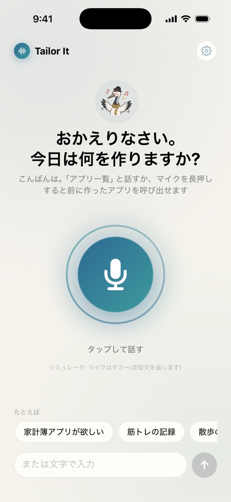
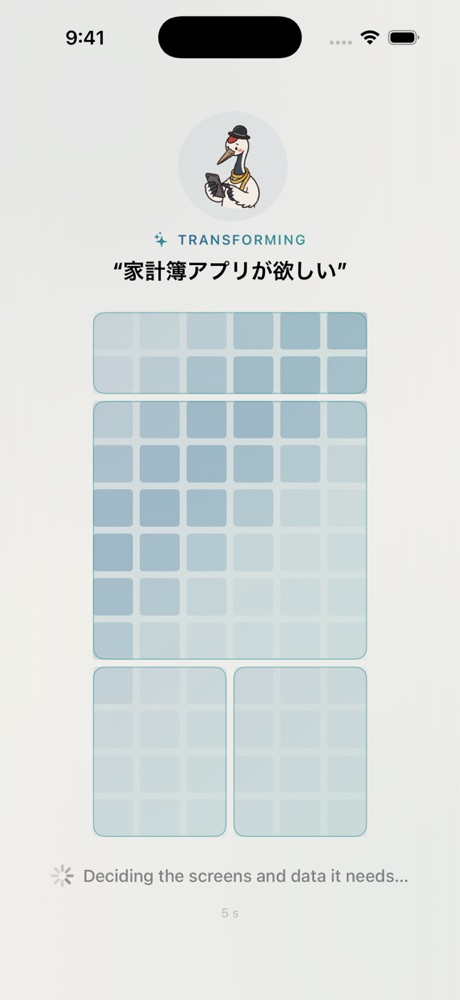
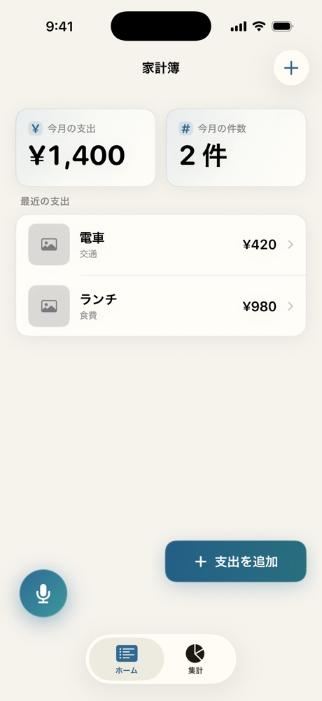
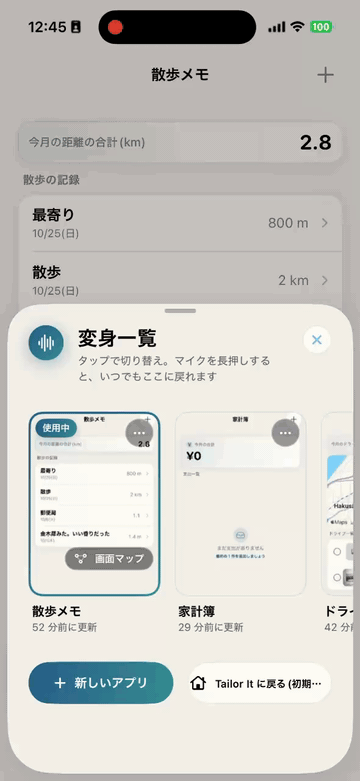
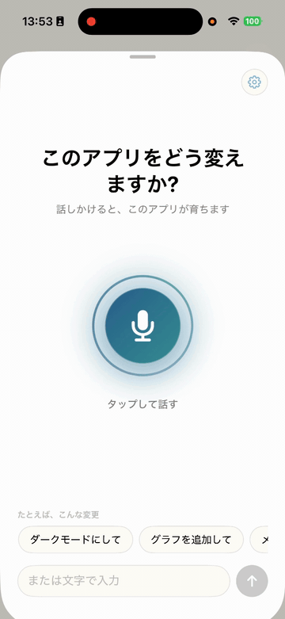
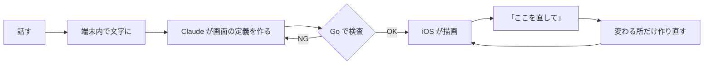
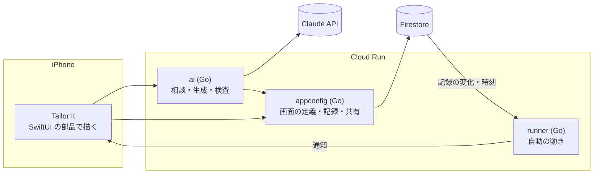

<a href="https://tailor-it.app/">
  <picture>
    <source media="(prefers-color-scheme: dark)" srcset="docs/images/readme/title-dark.png">
    
  </picture>
</a>

<h4>ひと声で、あなた仕立て。</h4>

話すだけで、自分専用のアプリができる iPhone アプリ。 
できたアプリは、使いながら「ここをこうして」と話して直せます。

[公式サイト tailor-it.app](https://tailor-it.app/) ・ App Store: 審査中

## 使い方

| 1. 話す | 2. 作る | 3. 使う |
|:---:|:---:|:---:|
|  |  |  |
| マイクを押して話す | 部品が組み上がって 画面ができる | 入力・保存・集計が そのまま動く |

## 製品概要

### デモ動画

<table align="center">
<tr>
<td align="center"></td>
<td align="center"></td>
</tr>
<tr>
<td align="center">話すだけで、地図付きの ドライブの記録アプリができる</td>
<td align="center">案を選んで色を変え、 続けて円グラフを足す</td>
</tr>
</table>

### 背景(解決する課題)

Web サービスは、[Lovable](https://lovable.dev/) や [v0](https://v0.app/) などを使えば、 
エンジニアでなくても言葉で作れるようになりました。

一方でスマホのアプリには、Mac と開発環境の用意や、ストアへのリリースといった壁があります。 
日常の小さな困りごとは、カメラや通知のようなスマホの力と結びついていることが多いのに、 
エンジニアでない人には今も手が届きにくいままです。

### 製品説明

話しかけるだけで、自分専用の、自分に一番合うアプリを自分で作れるようにしました。

たとえば家計簿や筋トレ記録のようなアプリを作り、 
「合計をもっと大きく」と話せば、使いながら直せます。 
アプリが変わっても、それまでの記録は消えません。

### 特長

1. **話して作り、話して育てる** 
   足りない点だけ聞き返し、「見やすくして」のようなあいまいな依頼には案を出します。 
   AI ボタンはどの画面にもあり、今見ている画面のことだと AI に伝わります。気に入らなければ「元に戻す」で戻せます。
2. **スマホならではの機能も、計算も使える** 
   カメラ・写真の読み取り・位置情報・地図・通知・ウィジェット・Siri やショートカットとの連携を、部品として組み込めます。 
   割り勘の精算や BMI のような計算も、話すだけでできます。
3. **作ったアプリを人と使える** 
   リンクで渡す・みんなが公開したアプリを探して入れる・みんなで同じ記録を見る、ができます。 
   記録に応じてサーバーが通知などを自動で行う仕組みも持っています。

### 主な機能

#### 本体に入っている機能

| 機能 | できること |
|---|---|
| 話して作る | 声か文字で頼むと、要約を確認してから画面ができる。音声の書き起こしは端末の中 |
| 話して直す | 変わる所だけを差分で作り直す。直後に「元に戻す」「やり直す」 |
| 組み立ての演出 | 生成中は部品を選んで画面に置いていく様子を見せる。直した時は変わった部品だけ光る |
| どの画面でも AI ボタン | シート・プッシュ先・部品のシートにも AI ボタンがあり、今の画面を対象に話せる |
| 部品 | 73 種(入れ物 7・部品 66)とアクション 16 種。一覧・表・カレンダー・グラフ・地図・タイマー・QR など |
| 写真の理解 | 撮った写真から文字・金額・日付・分類・説明・関節の角度・ラベル・バーコード・人数・色を端末内で読み取って記録に入れる |
| 文字起こし・読み上げ | 話した内容を文字で記録する欄・記録を読み上げるボタン |
| 手書き | 手で描いた絵を記録に残す欄 |
| ファイルの取り込み | CSV・テキスト・PDF を端末の中で読んで記録に入れる |
| 公開データ | 許可した公開のデータ(天気など)を読んで表示する |
| 記録の削除の取り消し | 記録を消した直後の数秒は「元に戻す」で戻せる |
| アプリの中の AI | Apple Intelligence で、書いた文の要約・分類を端末の中で行う |
| 通知 | 毎日・毎週などの時刻の通知、記録の日付からのリマインド |
| 計算 | 合計・平均・連続日数・割り勘の精算・目標までの残りなどの式 |
| 共有 | リンクや QR でアプリを渡す・「探す」で公開されたアプリを入れる・みんなで同じ記録を見る |
| サーバーの自動の動き | 「記録が作られた・更新された・決まった時刻」をきっかけに、通知・記録の書き込み・集計を行う(専用のサービス runner で実行。本番環境への導入は準備中) |
| Tailor It Pro | 作る・直すだけなら無料。共有のデータ・サーバーの自動の動き・オンラインの AI を使うアプリは Pro(サーバー側で判定) |
| その他 | ホーム画面のウィジェット・ライブアクティビティ・Siri / ショートカット・CSV / PDF の書き出し・横向き・日本語 / English |

#### 開発中

まだ本体に入っていない機能です。番号は Pull Request です。

| 機能 | できること | PR |
|---|---|---|
| 生成のストリーム | 組み立ての演出で、AI が実際に選んだ部品を届いた順に置く | [#669](https://github.com/jphacks/kz_2601/pull/669) |
| 今日の残り | 1 日に使える残りを、音声のシートと設定に出す | [#669](https://github.com/jphacks/kz_2601/pull/669) [#681](https://github.com/jphacks/kz_2601/pull/681) |
| 使い勝手の改善 | 失敗の時の案内・上限の後も会話を残す・初回の手順を減らす・聞き返しの残りの数を出す | [#669](https://github.com/jphacks/kz_2601/pull/669) [#675](https://github.com/jphacks/kz_2601/pull/675) |
| オンラインの AI | Apple Intelligence の無い端末でも、アプリの中の AI を Pro で使う | [#672](https://github.com/jphacks/kz_2601/pull/672) |
| 自動の動きで記録を読む | 「今月の合計が N を超えたら通知」のような、記録の集計を条件にした自動の動き | [#672](https://github.com/jphacks/kz_2601/pull/672) |
| 察しの改善 | 作ってから直せることは聞き返さずに作る | [#672](https://github.com/jphacks/kz_2601/pull/672) |
| 作れた割合の評価 | 過去の JPHACKS の作品 39 件を実際に作らせ、期待どおりにできた割合を測る | [#672](https://github.com/jphacks/kz_2601/pull/672) |
| カレンダーに入れる | 記録を iPhone のカレンダーに予定として入れる | [#674](https://github.com/jphacks/kz_2601/pull/674) |
| アラーム | 止めるまで鳴る目覚まし(iOS 26.1 以降) | [#674](https://github.com/jphacks/kz_2601/pull/674) |
| 管理者 | 「店長だけが確定できる」のように、管理者だけの操作と参加者を選ぶ欄を作れる | [#678](https://github.com/jphacks/kz_2601/pull/678) |
| 重複の防止 | 「同じ時間に 2 人予約できない」「1 人 1 回答」をサーバーで守る | [#678](https://github.com/jphacks/kz_2601/pull/678) |
| プランの上限 | アプリ数・記録の件数・写真の枚数の上限をプランごとに決める | [#678](https://github.com/jphacks/kz_2601/pull/678) |
| 宛先付きメッセージ | 1 対 1・グループ宛てにメッセージを送る | [#678](https://github.com/jphacks/kz_2601/pull/678) |
| フォロー | フォローした人の投稿だけのタイムラインを作れる | [#679](https://github.com/jphacks/kz_2601/pull/679) |

App Store に出す最初の版は、自分専用の記録帳・ツールとして使う機能に絞っています。

### 解決出来ること

| | これまで | Tailor It |
|---|---|---|
| 欲しい道具を手に入れる | 合うアプリを探して妥協する / 作るなら Mac と開発の知識が要る | 話すだけで、自分専用のアプリがその場で手に入る |
| 使いながら直す | 設定画面を探す・開発者に要望を出す | 「ここをこうして」と話せば、項目・見た目・通知・画面のつながりが変わる |
| 記録 | アプリを替えると記録が散らばる | アプリが変わっても、それまでの記録は残る |

### 過去の JPHACKS の作品をどれだけ作れるか

過去 4 年(2022〜2025)の JPHACKS の作品の README を読み、Tailor It の部品で本体の体験を作れるかを数えました([調査](docs/research/jphacks-coverage.md))。

| 項目 | 割合 | 種類 |
|---|---:|---|
| 今の部品で本体が作れる | 43%(148 / 341 作品) | 机上の見込み |
| 足りない部品の上位 5 つを足した後 | 60%(205 / 341 作品) | 机上の見込み |
| 実際に作らせて、期待どおりにできた割合 | ____ | 評価の結果(未計測・[#672](https://github.com/jphacks/kz_2601/pull/672) で測る) |

机上の見込みは README の冒頭を読んだ判定なので、1 作品ずつの判定には誤りがありえます。

### 今後の展望

- App Store での配信を始め、最初の版で外した機能(共有・探す・Pro など)を順に出す。
- 開発中の機能を入れ、過去の作品のように「作れるアプリ」の幅を広げる。
- 使った分だけ払える料金の形を検討する(中身は未定)。
- 作ったアプリを、単体のアプリとして公開できるようにする。

### 注力したこと

1. **品質を数字で測って直した** 
   同じ依頼のセットで作らせて手で採点し、改善を重ねました。 
   結果は [品質の監査 第 2 弾](docs/backend/ai-eval/2026-10-24-audit2.md) と [第 3 弾](docs/backend/ai-eval/2026-10-24-audit3.md) にあります。

   | 指標 | 改善前 | 改善後 |
   |---|---:|---:|
   | 頼んだ機能が入っている割合 | 49% | 91% |
   | 頼んだ機能が全部入ったアプリ | 2/20 | 14/20 |
   | 中身と違うラベル | 7/20 | 0/20 |

2. **速さにこだわった** 
   中央値で、新規作成 6.6 秒・修正 1.7 秒です(2026-10-24 の計測)。 
   [生成の品質と速さの計測](docs/backend/ai-eval/2026-10-24.md)
3. **壊れない仕組みにした** 
   AI が書いた画面の定義はサーバーが毎回検査し、iOS は知らない部品が届いても落ちません。 
   iOS のビルドとテスト、Go のテストと静的解析、秘密情報の検出を、すべての PR で自動で回しています。

## 開発技術

### 仕組み

AI はコードを直接出力するのではなく、[DSL](docs/dsl/README.md) と呼ぶ、画面の中身を表す JSON を作ります。 
その定義を、アプリに組み込み済みの SwiftUI の部品で描くサーバードリブン UI(SDUI)を全面的に採用しています。 
だから、ストアの審査を待たずに、その場でアプリが変わります。

- **マス目でレイアウトを決める**: 画面を 6 列のマス目に分け、部品ごとに座標で置き場所を決める。重なりはサーバーが見つけて作り直させる。
- **1 つの[スキーマ](docs/dsl/dsl.schema.json)を正典にした**: Go の検査・iOS の型・AI への部品一覧を同じスキーマから作り、ズレるとテストが落ちる。
- **直す時は差分だけ**: 2 回目以降は JSON Patch で変わる所だけを作る。
- **自動の動きは宣言で書く**: AI はコードを書かず、「きっかけ → 条件 → 処理」の宣言を作る。実行は専用の runner がアプリごとに分けて行う。

### 活用した技術

#### API・データ

- [Claude API](https://platform.claude.com/docs/en/api/overview)(`claude-sonnet-5-5`)
- [Firebase Auth](https://firebase.google.com/docs/auth)(Sign in with Apple)、[Firestore](https://firebase.google.com/docs/firestore)
- [Cloud Run](https://cloud.google.com/run)(ai・appconfig・runner)、[Secret Manager](https://cloud.google.com/security/products/secret-manager)、[Workload Identity Federation](https://cloud.google.com/iam/docs/workload-identity-federation)
- [JSON Schema](https://json-schema.org/)、[JSON Patch](https://datatracker.ietf.org/doc/html/rfc6902)

#### フレームワーク・ライブラリ・モジュール

- iOS: [SwiftUI](https://developer.apple.com/xcode/swiftui/)、[Swift Charts](https://developer.apple.com/documentation/charts)、[MapKit](https://developer.apple.com/documentation/mapkit)、[WidgetKit](https://developer.apple.com/documentation/widgetkit)、[App Intents](https://developer.apple.com/documentation/appintents)、[Vision](https://developer.apple.com/documentation/vision)、[StoreKit](https://developer.apple.com/documentation/storekit) ほか
- 端末内で音声認識する [WhisperKit](https://github.com/argmaxinc/argmax-oss-swift)、端末内の AI の [Foundation Models](https://developer.apple.com/documentation/foundationmodels)
- バックエンド: [Go](https://go.dev/)。外部ライブラリは JSON Schema の検証と JSON Patch の 2 つだけ
- 開発・CI: [GitHub Actions](https://github.com/features/actions)、[gitleaks](https://github.com/gitleaks/gitleaks)、[xcodegen](https://github.com/yonaskolb/XcodeGen)

#### デバイス

- iOS 17 以降の iPhone(マイク・カメラ・位置情報・通知)
- Apple Intelligence に対応した iPhone では、アプリの中の AI が端末の中で動く

全一覧は [活用した技術の全一覧](docs/README-details.md#活用した技術全一覧) にあります。

### 独自技術

#### ハッカソンで開発した独自機能・技術

- **[DSL v1](docs/dsl/README.md) とマス目配置**: 画面を表す JSON の仕様と、座標での部品の配置
- **[生成パイプライン](backend/internal/ai)**: 作る → 検査 → 作り直す。修正は JSON Patch で差分だけ作る
- **[部品一覧の自動生成](backend/internal/ai/catalog.go)**: AI に渡す部品の説明をスキーマから作る
- **[描画の仕組み](ios/Packages/MetamonRenderer)**: 1 部品 = 1 ファイルで足せるレンダラー
- **[自動の動きの実行基盤](backend/cmd/runner)**: 宣言した自動の動きを、記録の変化や時刻をきっかけに実行する
- **[品質の監査ツール](backend/cmd/ai-audit)**: 頼んだ機能の抜けや、中身と違うラベルを判定する
- **[計測データの公開](docs/backend/ai-eval)**: 生成の品質と速さの計測を、[生の JSON](docs/backend/ai-eval/raw) 付きで公開

場所と代表 PR の一覧は [独自技術の場所と代表 PR](docs/README-details.md#独自技術場所と代表-pr) にあります。

## 審査員向け

### 試し方

シミュレータなら API キー無しで試せます。 
`METAMON_MOCK=1` を付けて起動してください。手順は [セットアップ](docs/README-details.md#セットアップ) にあります。

話す内容の例は [話してみてほしい内容](docs/README-details.md#話してみてほしい内容) にあります。

### アピールポイント

1. **アプリ全体をサーバードリブン UI で作った** 
   一部の画面ではなく、アプリ全体をこの方式で描いています。アプリを増やしても、中で部品の組み合わせを切り替えるだけなので、アプリのサイズは増えません。
2. **スマホならではの機能を自由に組み合わせられる** 
   カメラ・写真の読み取り・位置情報・通知・ウィジェット・Siri やショートカットとの連携などを、部品として使えます。
3. **サーバーの処理も話して作れる** 
   AI がコードを書くのではなく、決まった語彙の宣言を作り、専用のサービスがアプリごとに分けて実行します。
4. **収益を見据えた設計** 
   作る・直すだけなら無料。みんなで共有するデータ・サーバーの自動の動き・オンラインの AI は Pro にし、サーバー側で判定しています。

## チーム

君の心にズッキーニ(JPHACKS 2026)

| メンバー | 担当 |
|---|---|
| [ko-tarou](https://github.com/ko-tarou) | iOS |
| [2410as](https://github.com/2410as) | バックエンド(appconfig) |

## もっと詳しく

- [詳細版 README](docs/README-details.md): 数字の根拠・部品一覧・アーキテクチャ・セットアップ・リポジトリ構成
- [決定事項](docs/00_decisions.md)
- [目標と要件](docs/01_goals_and_requirements.md)
- [DSL の仕様・部品一覧](docs/dsl/README.md)
- 設計: [iOS](docs/ios/architecture.md) / [バックエンド](docs/backend/architecture.md) / [GCP の構成](docs/infra/gcp-setup.md)
- [生成の品質と速さの計測](docs/backend/ai-eval)
- [発表のデモ台本](docs/03_demo_script.md)
