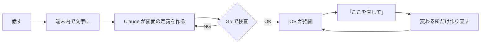

# Tailor It

<!-- プロダクト名は上の H1 と次の由来の行だけに書く(本文は「本アプリ」で統一)。 -->

> 名前は「あなたに合わせて仕立てる(tailor)」から。内部の識別子(`Metamon`)は Firebase の登録に紐づくため、そのままにしています。

<!-- TODO(Issue #64): デモ動画(YouTube)のサムネイル付きリンクをここに置く。JPHACKS テンプレの書式: 。写すもの: マイクに話す → 生成中 → 家計簿に変わる → 「合計をもっと大きく」で動く → 「元に戻す」、までを 30〜60 秒で -->

### 話すと、アプリが変わる。

| 1. 話す | 2. 作る | 3. 使う |
|:---:|:---:|:---:|
|  |  |  |
| マイクを押して話す | 数秒で画面ができる | 入力・保存・集計がそのまま動く |

スクショはシミュレータ(同梱サンプルのモック接続)。1 枚目は英語 UI の設定時。
<!-- TODO: 実機・日本語 UI・staging 接続で同じ 3 枚(初期画面 / 生成中 / 完成した家計簿)を撮り直して差し替える。縦長スクショを長辺 1000px の JPEG(1 枚 300KB 以下)に -->

**何ができるか**

- 話すだけで、家計簿や筋トレ記録のような自分専用のアプリがその場でできる。
- 「合計をもっと大きく」と話せば、使いながら直せる。直後なら元に戻せる。
- カメラ・通知・地図なども使える。ビルドも App Store の審査も要らない。

## 製品概要
### 背景(製品開発のきっかけ、課題等)

ちょっとした記録用のアプリが欲しくても、探すと合うものが無く、作るには Xcode と Swift が要ります。
家計簿も筋トレ記録も、中身は「入力欄と一覧と集計」です。違うのは項目と見た目、カメラや通知の組み合わせだけです。
それなら、一度入れたアプリが話しかけるたびにその道具へ変わればいい。これが出発点です。

### 製品説明(具体的な製品の説明)

AI はコードを書きません。画面の定義(DSL: 画面の中身を表す JSON)を作り、アプリに組み込み済みの SwiftUI の部品で描きます。
この「画面の定義を外から届けて描く」方式を Server-Driven UI(SDUI)と呼びます。だから、その場でアプリが変わります。

### 特長

#### 1. 特長1 AI が画面のレイアウトまで決める

各画面は 6 列 × 12 行のマス目です。AI は部品ごとに `A1:C3` のような書き方で置き場所を決めます。
部品の重なりはサーバーが見つけ、AI に作り直させます。

#### 2. 特長2 スマホの機能も、計算も作れる

部品は 57 種あり、カメラ・動画・通知・地図・ヘルスケアなどを AI が選んで置きます。
割り勘の精算や BMI のような計算も、話すだけで組み立てます。

#### 3. 特長3 チャットで相談しながら育てる

足りない点だけ聞き返し、「見やすくして」のようなあいまいな依頼には案を出します。直したあとは「元に戻す」で戻せます。

| 質問に答える | 案を選んで直す | 直後に戻せる |
|:---:|:---:|:---:|
|  |  |  |

#### 4. 特長4 その場で変わり、壊れない

画面の定義はサーバー(Go)が厳しく検査します。iOS は知らない部品が届いても落ちません。
音声認識は端末内で動くので、声は外に出ません。

### 解決出来ること

- **欲しい道具が手に入る**: 探して妥協する代わりに、話すだけで自分用のアプリができる。
- **使いながら直せる**: 設定画面を探さずに、「ここをこうして」で見た目や項目が変わる。
- **記録が残る**: アプリが変わっても、それまでの記録は消えない。

### 今後の展望

- 作ったアプリを単体のアプリとして公開する(申請の受付までは実装済み)。
- 有料版「Tailor It Pro」(購入の流れまでは実装済み。サーバー側の検証はこれから)。
- 今の DSL で表せない依頼(タイマーの自動切り替えなど)に対応する。
- 実機での検証が一部残っている(QR・実際の GPS・Siri など)。

### 注力したこと(こだわり等)

**品質を数字で測って直しました。** 同じ依頼のセットで作らせ、手で採点しています([audit2](docs/backend/ai-eval/2026-10-24-audit2.md) / [audit3](docs/backend/ai-eval/2026-10-24-audit3.md))。

| 指標 | 改善前 | 改善後 |
|---|---:|---:|
| 頼んだ機能が入っている割合 | 49% | 91% |
| 頼んだ機能が全部入ったアプリ | 2/20 | 14/20 |
| 中身と違うラベル | 7/20 | 0/20 |

1 周ずつの比較なので ±1 件は揺れます。速さは新規作成 6.6 秒・修正 1.7 秒(中央値・[計測](docs/backend/ai-eval/2026-10-24.md))。

- **1 つのスキーマを正典にした。** Go の検査・iOS の型・AI への部品一覧を同じスキーマから作り、ズレるとテストが落ちる。
- **速さにこだわった。** 出力を軽くし、ストリーミングで画面の枠を約 2.4 秒で出す。

## 審査員向け: 試し方

<!-- TODO: TestFlight など配布リンクがあればここに追記する(無ければこのコメントを消す) -->

シミュレータなら API キー無しで試せます。`METAMON_MOCK=1` を付けて起動してください(手順は [セットアップ](docs/README-details.md#セットアップ))。
話す内容の例は [話してみてほしい内容](docs/README-details.md#話してみてほしい内容) にあります。

## 開発技術
### 活用した技術
#### API・データ
* Claude API(`claude-sonnet-5-5`)
* Firebase Auth / Firestore
* Cloud Run / Secret Manager / Workload Identity Federation

#### フレームワーク・ライブラリ・モジュール
* SwiftUI(iOS 17+)、Swift Charts、MapKit、HealthKit、WidgetKit、App Intents ほか
* WhisperKit(端末内の音声認識)、Foundation Models(端末内の AI)
* Go(外部ライブラリは JSON Schema 検証と JSON Patch の 2 つだけ)
* GitHub Actions、gitleaks、xcodegen

#### デバイス
* iPhone(iOS 17+)
* マイク・カメラ・位置情報・ヘルスケア

全一覧は [活用した技術(全一覧)](docs/README-details.md#活用した技術全一覧)。

### 独自技術
#### ハッカソンで開発した独自機能・技術

* **DSL v1 とマス目配置**: 画面を表す JSON の仕様と、`A1:C3` での配置([docs/dsl](docs/dsl/README.md))
* **生成パイプライン**: 作る → 検査 → 作り直す。修正は差分(JSON Patch)だけ作る([backend/internal/ai](backend/internal/ai))
* **部品一覧の自動生成**: AI に渡す部品の説明をスキーマから作る([catalog.go](backend/internal/ai/catalog.go))
* **描画の仕組み**: 1 部品 = 1 ファイルで足せるレンダラー([MetamonRenderer](ios/Packages/MetamonRenderer))
* **品質監査ツール**: 頼んだ機能の抜けや、中身と違うラベルを判定する([backend/cmd](backend/cmd))

場所と代表 PR の一覧は [独自技術(場所と代表 PR)](docs/README-details.md#独自技術場所と代表-pr)。

#### 製品に取り入れた研究内容(データ・ソフトウェアなど)

* 生成の品質と速さの計測を、生の JSON 付きで公開しています: [docs/backend/ai-eval](docs/backend/ai-eval)

## もっと詳しく

- [詳細版 README](docs/README-details.md): 数字の根拠・部品一覧・アーキテクチャ・セットアップ・リポジトリ構成
- [決定事項(正典)](docs/00_decisions.md)
- [DSL の仕様・部品一覧](docs/dsl/README.md)
- 設計: [iOS](docs/ios/architecture.md) / [backend](docs/backend/architecture.md)
- [審査デモの台本](docs/03_demo_script.md)
