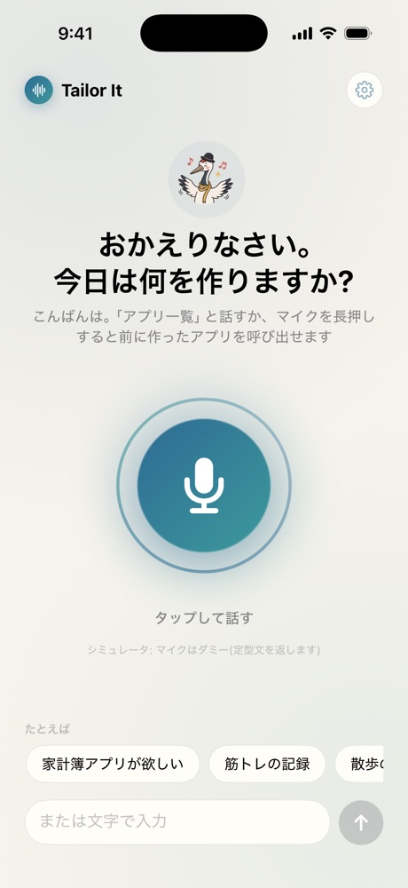
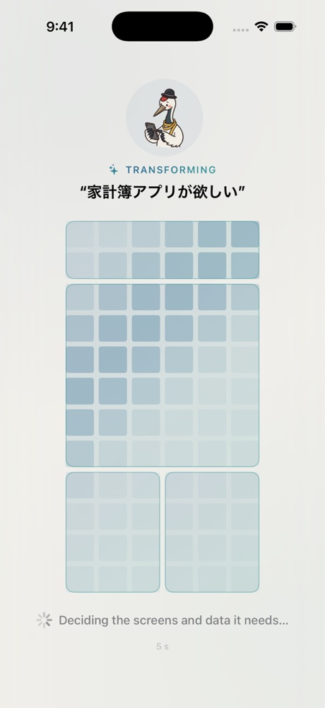
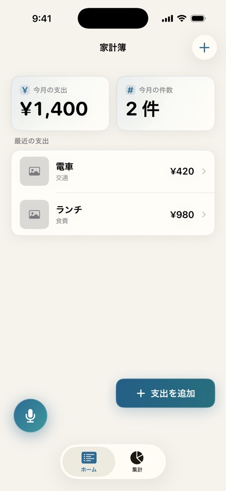
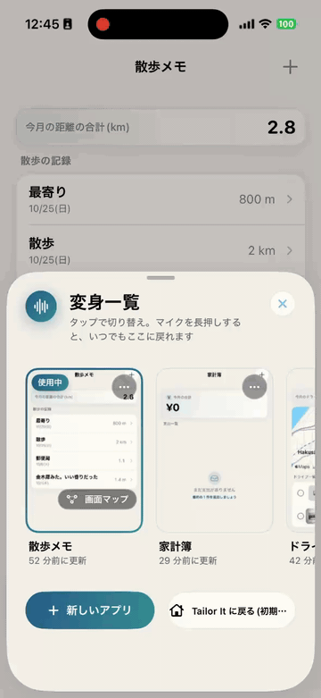
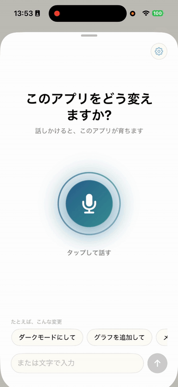
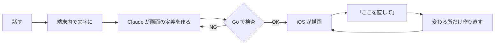

<a href="https://tailor-it.app/">
  <picture>
    <source media="(prefers-color-scheme: dark)" srcset="docs/images/readme/title-dark.png">
    
  </picture>
</a>

<h4>ひと声で、あなた仕立て。</h4>

話すとアプリが変わる iOS アプリ。 
声とチャットで、自分専用のアプリをその場で作って直せます。

<a href="https://tailor-it.app/">https://tailor-it.app</a>

## 使い方

| 1. 話す | 2. 作る | 3. 使う |
|:---:|:---:|:---:|
|  |  |  |
| マイクを押して話す | 数秒で画面ができる | 入力・保存・集計が そのまま動く |

## 製品概要

<table align="center">
<tr>
<td align="center"></td>
<td align="center"></td>
</tr>
<tr>
<td align="center">話すだけで、地図付きの ドライブの記録アプリができる</td>
<td align="center">案を選んで色を変え、 続けて円グラフを足す</td>
</tr>
</table>

### 課題設定

Web サービスは、[Lovable](https://lovable.dev/) や [v0](https://v0.app/) などを使えば、 
エンジニアでなくても言葉で作れるようになりました。

一方でスマホのアプリには、Mac と開発環境の用意や、ストアへのリリースといった壁があります。 
今も、エンジニアでない人には手が届きにくいままです。

### ソリューション

話しかけるだけで、自分専用のアプリがその場で手に入るようにしました。

合うアプリを探して妥協する代わりに、話すだけで家計簿や筋トレ記録のようなアプリができます。 
「合計をもっと大きく」と話せば、使いながら直せます。 
アプリが変わっても、それまでの記録は消えません。

**特長**

- **チャットで相談しながら育てる**: 足りない点だけ聞き返し、「見やすくして」のようなあいまいな依頼には案を出す。 
  気に入らなければ「元に戻す」で戻せる。
- **スマホの機能も、計算も使える**: カメラ・動画・通知・地図などを組み込める。 
  割り勘の精算や BMI のような計算も、話すだけでできる。
- **画面の配置まで整う**: 項目を並べるだけでなく、見やすい配置の画面ができる。
- **声は外に出ない**: 音声の文字起こしは端末の中で行う。

### 仕組み

AI はコードを直接出力するのではなく、[DSL](docs/dsl/README.md) と呼ぶ、画面の中身を表す JSON を作ります。 
その定義を、アプリに組み込み済みの SwiftUI の部品で描くサーバードリブン UI を全面的に採用しています。 
だから、その場でアプリが変わります。

- **マス目でレイアウトを決める**: 画面をマス目に分け、部品ごとに座標を決めて置き場所を設定する。 
  重なりはサーバーが見つけて作り直させる。
- **[57 種の部品](docs/README-details.md#2-ネイティブ機能も計算も生成される)**: カメラ・動画・通知・地図などの部品と、[計算の式](docs/dsl/expressions.md)を組み合わせる。
- **壊れない**: 画面の定義は Go で書いたサーバーが厳しく検査し、iOS は知らない部品が届いても落ちない。
- **1 つの[スキーマ](docs/dsl/dsl.schema.json)を正典にした**: Go の検査・iOS の型・AI への部品一覧を同じスキーマから作り、 
  ズレるとテストが落ちる。
- **速さにこだわった**: 出力を軽くし、ストリーミングで画面の枠を約 2.4 秒で出す。 
  [速さの計測](docs/backend/ai-eval/2026-10-24-latency.md)

### 使用技術

#### 活用した技術

- **API・データ**:
  - [Claude API](https://platform.claude.com/docs/en/api/overview) のモデル `claude-sonnet-5-5`
  - [Firebase Auth](https://firebase.google.com/docs/auth) / [Firestore](https://firebase.google.com/docs/firestore)
  - [Cloud Run](https://cloud.google.com/run) / [Secret Manager](https://cloud.google.com/security/products/secret-manager) / [Workload Identity Federation](https://cloud.google.com/iam/docs/workload-identity-federation)
- **フレームワーク・ライブラリ**:
  - [SwiftUI](https://developer.apple.com/xcode/swiftui/)、[Swift Charts](https://developer.apple.com/documentation/charts)、[MapKit](https://developer.apple.com/documentation/mapkit)、[HealthKit](https://developer.apple.com/documentation/healthkit)、[WidgetKit](https://developer.apple.com/documentation/widgetkit)、[App Intents](https://developer.apple.com/documentation/appintents) ほか
  - 端末内で音声認識する [WhisperKit](https://github.com/argmaxinc/argmax-oss-swift)、端末内の AI の [Foundation Models](https://developer.apple.com/documentation/foundationmodels)
  - [Go](https://go.dev/)。外部ライブラリは [JSON Schema](https://json-schema.org/) の検証と [JSON Patch](https://datatracker.ietf.org/doc/html/rfc6902) の 2 つだけ
  - [GitHub Actions](https://github.com/features/actions)、[gitleaks](https://github.com/gitleaks/gitleaks)、[xcodegen](https://github.com/yonaskolb/XcodeGen)
- **デバイス**: iOS 17 以降の iPhone、マイク・カメラ・位置情報・ヘルスケア

全一覧は [活用した技術の全一覧](docs/README-details.md#活用した技術全一覧) にあります。

#### 独自技術

- **[DSL v1](docs/dsl/README.md) とマス目配置**: 画面を表す JSON の仕様と、座標での部品の配置
- **[生成パイプライン](backend/internal/ai)**: 作る → 検査 → 作り直す。 
  修正は JSON Patch で差分だけ作る
- **[部品一覧の自動生成](backend/internal/ai/catalog.go)**: AI に渡す部品の説明をスキーマから作る
- **[描画の仕組み](ios/Packages/MetamonRenderer)**: 1 部品 = 1 ファイルで足せるレンダラー
- **[品質の監査ツール](backend/cmd/ai-audit)**: 頼んだ機能の抜けや、中身と違うラベルを判定する
- **[計測データの公開](docs/backend/ai-eval)**: 生成の品質と速さの計測を、[生の JSON](docs/backend/ai-eval/raw) 付きで公開

場所と代表 PR の一覧は [独自技術の場所と代表 PR](docs/README-details.md#独自技術場所と代表-pr) にあります。

### 今後の展望

- 作ったアプリを単体のアプリとして公開する。
- 有料版「Tailor It Pro」。
- タイマーの自動切り替えのような、今の DSL で表せない依頼に対応する。

### 注力したこと

品質を数字で測って直しました。 
同じ依頼のセットで作らせ、手で採点しています。 
結果は [品質の監査 第 2 弾](docs/backend/ai-eval/2026-10-24-audit2.md) と [第 3 弾](docs/backend/ai-eval/2026-10-24-audit3.md) にあります。

| 指標 | 改善前 | 改善後 |
|---|---:|---:|
| 頼んだ機能が入っている割合 | 49% | 91% |
| 頼んだ機能が全部入ったアプリ | 2/20 | 14/20 |
| 中身と違うラベル | 7/20 | 0/20 |

速さは中央値で、新規作成 6.6 秒・修正 1.7 秒です。 [生成の品質と速さの計測](docs/backend/ai-eval/2026-10-24.md)

### アピールポイント

1. **アプリ全体をサーバードリブン UI で作った** 
   モバイルで広がっているサーバードリブン UI を iOS で実装し、一部の画面ではなく、アプリ全体をこの方式で描いています。
2. **スマホならではの機能を自由に組み合わせられる** 
   カメラ・位置情報・通知・ウィジェット・近くの端末との共有・Siri やショートカットとの連携などを、部品として使えます。
3. **伸ばせるクラウドの設計** 
   GCP の Cloud Run を staging と本番に分け、JSON の形のデータに合う Firestore と、Sign in with Apple を使っています。 
   ユーザーが増えても広げられる構成です。
4. **収益を見据えた設計** 
   一定の範囲までは無料で使え、みんなで書き込む共有のアプリや、たくさん作る使い方は有料版の対象にしています。
5. **1 つのアプリに、いくつものアプリが入る** 
   アプリを増やしても、中で部品の組み合わせを切り替えるだけなので、アプリのサイズは増えません。

## 審査員向け: 試し方

<!-- TODO: TestFlight など配布リンクがあればここに追記する(無ければこのコメントを消す) -->

シミュレータなら API キー無しで試せます。 
`METAMON_MOCK=1` を付けて起動してください。手順は [セットアップ](docs/README-details.md#セットアップ) にあります。

話す内容の例は [話してみてほしい内容](docs/README-details.md#話してみてほしい内容) にあります。

## もっと詳しく

- [詳細版 README](docs/README-details.md): 
  数字の根拠・部品一覧・アーキテクチャ・セットアップ・リポジトリ構成
- [決定事項の正典](docs/00_decisions.md)
- [目標と要件](docs/01_goals_and_requirements.md)
- [DSL の仕様・部品一覧](docs/dsl/README.md)
- 設計: [iOS](docs/ios/architecture.md) / [backend](docs/backend/architecture.md) / [GCP の構成](docs/infra/gcp-setup.md)
- [生成の品質と速さの計測](docs/backend/ai-eval)
- [審査デモの台本](docs/03_demo_script.md)
