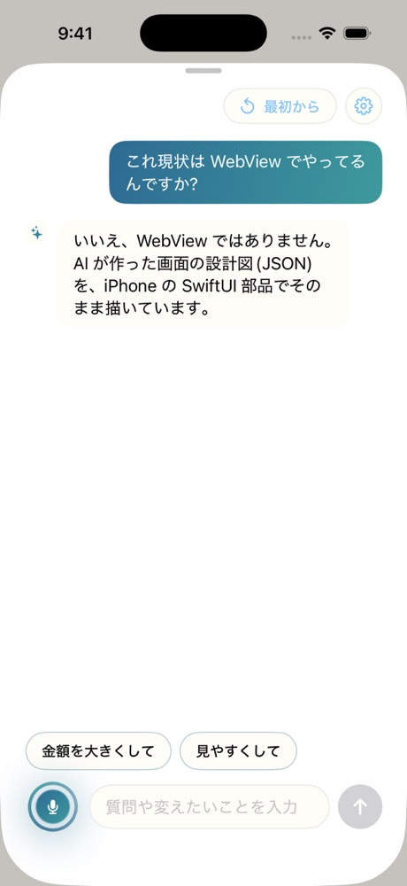
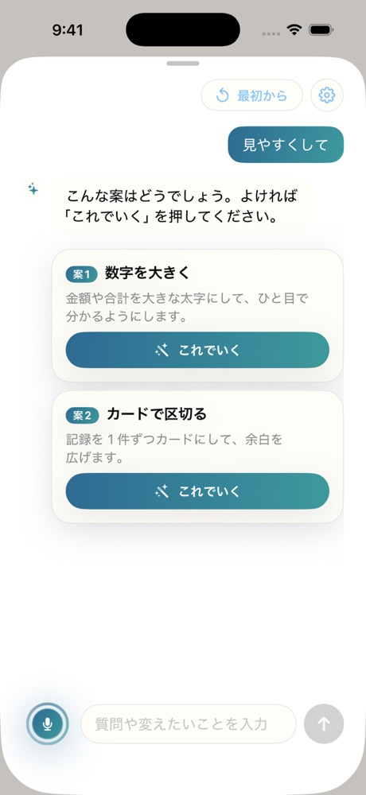
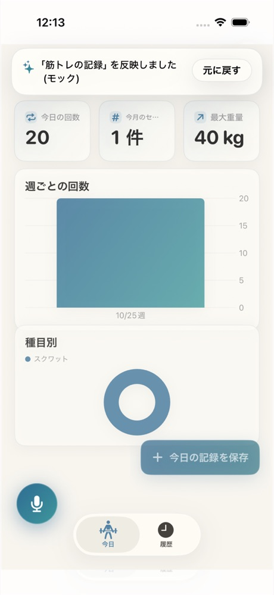
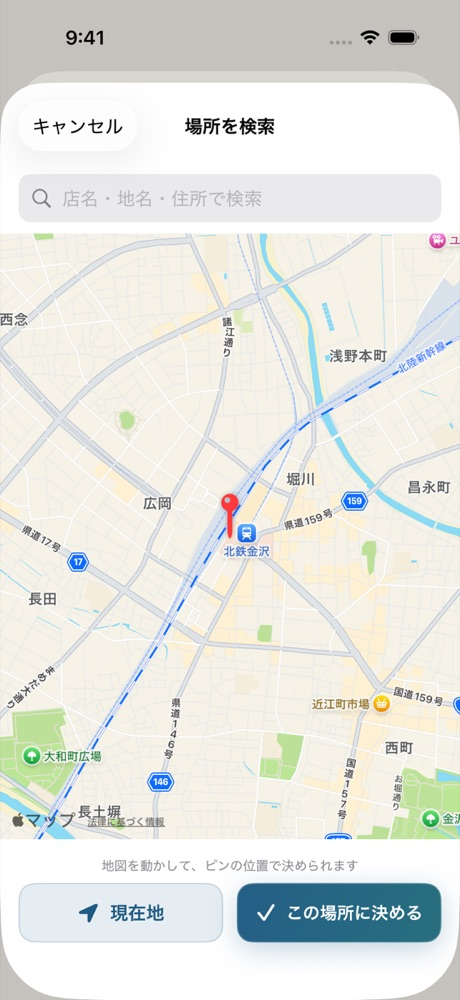
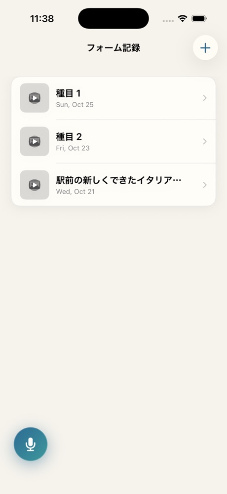
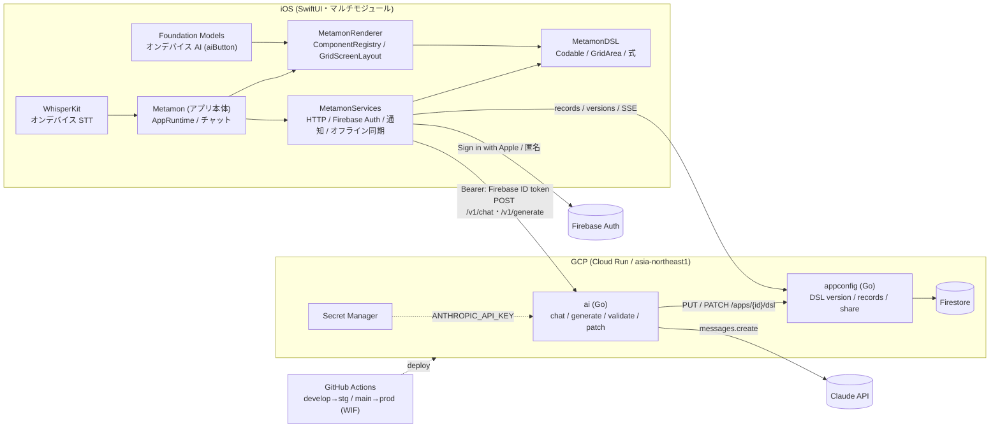

# Tailor It 詳細版

[README](../README.md) から移した詳しい説明です。数字の根拠・部品の一覧・アーキテクチャ・セットアップをまとめています。

## 目次

- [背景(詳細)](#背景詳細)
- [ひと目でわかる表](#ひと目でわかる表)
- [生成の流れ(ステップごと)](#生成の流れステップごと)
- [特長の詳細](#特長の詳細)
- [解決出来ること(詳細)](#解決出来ること詳細)
- [今後の展望(詳細)](#今後の展望詳細)
- [注力したこと(詳細)](#注力したこと詳細)
- [話してみてほしい内容](#話してみてほしい内容)
- [活用した技術(全一覧)](#活用した技術全一覧)
- [独自技術(場所と代表 PR)](#独自技術場所と代表-pr)
- [アーキテクチャ](#アーキテクチャ)
- [セットアップ](#セットアップ)
- [リポジトリ構成とドキュメント](#リポジトリ構成とドキュメント)

## 背景(詳細)

- **Web サービスは作りやすくなった**: Lovable や v0 などを使えば、エンジニアでなくても言葉で Web サービスを作れるようになった。
- **スマホのアプリは今もハードルが高い**: 作るには Mac と開発環境(Xcode・Swift)の用意が要り、手元で使うにはストアへのリリースという壁もある。エンジニアでない人には手が届きにくい。
- **そこで**: 一度入れたアプリが、話しかけるたびに自分専用の道具へ変わるようにした。家計簿も筋トレ記録も、中身は「入力欄と一覧と集計」で、違うのは項目と見た目、カメラや通知の組み合わせだけ。これを画面の定義(DSL)として AI に作らせ、組み込み済みの部品で描く。

## ひと目でわかる表

| | |
|---|---|
| **何をする?** | 話した(書いた)内容から、自分専用の小さなアプリをその場で作り、声やチャットで直し続けられる |
| **どう動く?** | 端末内で音声認識 → Claude が UI 定義(DSL JSON)を生成 → Go が厳密に検証 → iOS がネイティブ部品で描画 |
| **何が作れる?** | 家計簿・筋トレ記録・散歩メモ・割り勘・シフト管理・読書記録・買い物リストなど(いずれも eval 済み)。カメラ・通知・地図・動画・ヘルスケアも部品として AI が選ぶ |
| **どれくらい速い?** | 新規作成 p50 **6.6 秒**、2 回目以降の改変 p50 **1.7 秒**([`2026-10-24.md`](backend/ai-eval/2026-10-24.md)) |
| **どれくらい正しい?** | 検証の一発通過 **100%**(16 発話 × 2 条件)。頼んだ機能の充足は品質監査で **49% → 91%**([`2026-10-24-audit3.md`](backend/ai-eval/2026-10-24-audit3.md)) |

## 生成の流れ(ステップごと)

| ステップ | 何が起きるか | 実測・根拠 |
|---|---|---|
| 1. 話す | マイクを押して話す。WhisperKit(`small`)が端末内で文字起こし。文字入力にも切り替えられる | オンデバイス・音声は端末外に出ない |
| 2. 相談 | 足りない点だけ 1〜3 問聞き返す。「見やすくして」のようなあいまいな依頼には案のカードを出し、「これでいく」で決める(設定でオフ可) | チャット eval 24/24([`2026-10-25-chat-first.md`](backend/ai-eval/2026-10-25-chat-first.md))・#105 #191 |
| 3. 生成 | `POST /v1/generate` が Claude(`claude-sonnet-5-5`)に部品カタログ + few-shot を渡し、DSL v1 JSON を生成。画面の枠は約 2.4 秒で出始める | create p50 **6.6 秒** / p95 8.7 秒・#94 |
| 4. 検証 | Go がスキーマ・id 参照・enum・**グリッド座標の重なり/範囲外**を全件列挙。NG ならエラー一覧を添えて再生成(最大 2 回) | 16 発話 × 2 条件で一発通過 **100%** |
| 5. 描画 | iOS が DSL を受け取り、タブ・画面・部品を SwiftUI で即描画。入力→保存→一覧・集計が動く | 部品 **57 種**(Container 7 + Leaf 50)+ アクション 9 種 |
| 6. 育てる | 2 回目以降は **JSON Patch** の差分生成。「カテゴリにカフェを追加」「集計の画面からも追加できるように」も通る。直後の「元に戻す」「やり直す」で行き来できる | edit p50 **1.7 秒**・#218 |

アプリ本体にはコードが増えません。増えるのは DSL JSON の version だけです(保存先は Firestore・#32)。

| チャットで聞く | 案を選んで直す | 直後に戻せる |
|:---:|:---:|:---:|
|  |  |  |
| 「これ WebView?」のような質問にも答える | あいまいな依頼は案のカードに | 反映の要約に「元に戻す」 |

## 特長の詳細

### 1. AI が画面を"レイアウト"する

LLM に「何の部品を置くか」だけでなく、**どこに置くか**まで決めさせます。各画面は **横 A〜F の 6 列 × 縦 12 行(13 行目以降はスクロール)** のグリッドで、部品はスプレッドシート記法 `area:"A1:C3"` で矩形を指定します。カード・セクションの中でも 2 列に並べられます(#161)。

```jsonc
{ "type": "hstack", "area": "A1:F2", "children": [ { "type": "stat", "label": "今月の支出", "aggregate": "sum" } ] },
{ "type": "section", "area": "A3:F10", "title": "最近の支出", "children": [ { "type": "list", "entity": "expense" } ] },
{ "type": "button", "area": "D11:F12", "label": "支出を追加", "action": { "type": "navigate", "screen": "expense_form" } }
```

- **重なりはサーバーが検出し、人間可読なエラーで再生成に回す**(例 `components[2] (id "recent") area A3:F10 overlaps components[0] (id "summary") area A1:F4`)。
- **`area` を省略した部品は「最後に使われた行の次」から全幅で積む**決定的フォールバック。LLM が座標を出し損ねても画面は崩れません。
- 実測: 全ランで重なり・範囲外ゼロ、Screen 直下部品の `area` 付与率 100%([`2026-10-24.md`](backend/ai-eval/2026-10-24.md))。

### 2. ネイティブ機能も、計算も"生成"される

生成されるのは Web ページではなく、**ネイティブ部品の組み合わせ**です。部品は **57 種 + アクション 9 種**。AI が用途に合わせて選んで配置します。

| 種別 | 例 |
|---|---|
| 構造 | `vstack` `hstack` `section` `card` `disclosure` `carousel` `grid`、タブ |
| 入力 | `textField` `numberField` `datePicker` `timePicker` `picker` `toggle` `slider` `stepper` `rating` `colorPicker` `photoField` `videoField` `searchBar` |
| 表示・データ | `list`(検索連動・ワンタップでチェック) `table` `timeline` `calendar` `stat`(端末集計) `chart`(bar/line/pie) `gauge` `progressBar` `settlement`(割り勘の精算) |
| ネイティブ | カメラ撮影・写真、動画の撮影・再生(`videoField` / `videoPlayer`・#206)、ローカル通知、地図(`mapView`)、現在地(`locationButton`)、**場所の検索・地図で選ぶ**(`locationPicker`・#217)、位置の継続記録と軌跡(`locationTracker`・#168)、歩数・体重とヘルスケアへの保存(`healthStat`・#167)、QR スキャナ、共有シート、タイマー(背面でも正確・#136)、近くの端末へ送る(`nearbyShare`・#138)、**端末内 AI**(`aiButton`・Apple Intelligence で要約・分類。データは端末外に出ない・#137) |

| 場所を地図で選ぶ | 動画を記録する |
|:---:|:---:|
|  |  |

**画面だけでなく計算も作れます**。式 DSL(#117)で、割り勘の精算・BMI・残り予算・勤務時間 × 時給・今年の合計・目標までの残り・連続日数(#172)を、発話だけで組み立てます。

部品を 1 つ足す手順は **3 ステップ**(JSON Schema に定義 → iOS に View 1 ファイル + レジストリ 1 行 → テスト)。**AI へ渡す部品カタログはスキーマから自動生成**され、Go 検証・iOS 描画・AI カタログの 3 者がズレるとテストが赤になります。カタログに無い部品を頼まれても、近い部品で代替して「○○は△△で代替しました」と正直に伝えます。

### 3. チャットで相談しながら育てる

| 工夫 | 内容 |
|---|---|
| 足りない点だけ聞く | 作る前に 1〜3 問だけ確認。種類だけの短い依頼(「家計簿」)には 1 問、具体的な依頼はすぐ作る。設定でオフにできる(#92 #105) |
| 案のカード | 「見やすくして」のようなあいまいな依頼には案を 2 つほど出し、「これでいく」で反映(#189 #191) |
| 理由を言う | 指示が足りない時は理由を言って聞き返し、何も変わらない時も黙らず理由を返す(#211) |
| 戻せる・残る | 直後に「元に戻す」「やり直す」(#218)。チャット履歴はアプリごとに残り、反映の区切りが見える(#222) |
| 画面のつながりも | 「集計の画面からも支出を追加できるように」が 1.6 秒の差分で通る。画面マップで画面を選んで直せる(#128 #144) |

### 4. その場で変わる・壊れない

| 工夫 | 内容 |
|---|---|
| Server-Driven UI | 画面・遷移・部品はアプリに事前ビルド済み。AI は DSL JSON を書くだけなので、ビルドも審査も不要で**その場で**変わる |
| オンデバイス音声認識 | WhisperKit(`small`)を端末内で実行。音声は外に出さず、会場 Wi-Fi に依存しない |
| 生成用スキーマ + Go 厳密検証 | Claude の構造化出力は DSL 規模のスキーマを受け付けない(実測: 任意プロパティ 16 個で `Schema is too complex`)。正典スキーマから**生成用の緩和スキーマを機械導出**し、強制は Go 側に一本化。再生成(最大 2 回)→ `area` を落として再検証、の順に必ず着地する |
| backend 厳格・iOS 寛容 | 未知の type や不正な `area` を iOS が受け取っても落ちない(プレースホルダ/無視)。古いビルドでも新しい DSL で死なない |
| 失敗しても止まらない | 圏外でも記録を先に保存して後で同期(#70)。401 再取得・429/圏外の自動再送・「もう一度」(#96) |

## 解決出来ること(詳細)

| | これまで | 本アプリ |
|---|---|---|
| 欲しい道具を手に入れる | 合うアプリを探して妥協する / 作るなら Mac と Xcode・Swift が要る | **話すだけで、自分専用の小さなアプリがその場で手に入る** |
| 使いながら直す | 設定画面を探す・開発者に要望を出す | **「ここをこうして」と話せば、レイアウト・項目・通知時刻・画面のつながりが変わる** |
| データ | アプリを替えると記録が散らばる | 記録は uid に紐付けて Firestore に保存(#32)。アプリが変わってもフィールド id を維持するので既存の記録は消えない |
| 生活の中で使う | 毎回アプリを開いて入力 | Siri / ショートカットから記録(#120)、ホーム画面ウィジェット(#55)、QR・リンクで家族や友人に共有(#118) |

## 今後の展望(詳細)

| 展望 | 状態 |
|---|---|
| 作ったアプリを**単体のアプリとしてリリース**する | 申請の受付(申請 API・変身一覧の申請シート)は実装済み(#145)。審査・配布の仕組みはこれから |
| アプリ内課金「Tailor It Pro」 | 有料機能(共有データ)を含む時の確認カードと購入の流れは実装済み(#166 #204)。サーバー側のレシート検証はこれから |
| DSL の表現力 | 連続日数(#172)・計算(#117)は実装済み。タイマーの自動切り替え・一括削除など、DSL で表せない依頼が品質監査で残っている([`audit3`](backend/ai-eval/2026-10-24-audit3.md) §6) |
| 実機での検証 | QR の読取・実 GPS・共有先・Siri の音声実行・近距離共有の 2 台など、**実機検証が一部未了**のものを詰める |

## 注力したこと(詳細)

* **DSL を唯一の正典にした設計**。`docs/dsl/dsl.schema.json` から Go 型(埋め込み・CI で byte 一致)、Swift 型(examples をバンドルしてデコードテスト)、AI 向け部品カタログの 3 つを導出し、二重定義を禁止。iOS と backend の契約ズレを構造的に防いだ。
* **品質を数字で測って直した**。同じ発話セットを手で採点し、頼んだ機能の充足 49% → 91%、全部満たしたアプリ 2/20 → 14/20、中身と違うラベル 7/20 → 0/20([`audit2`](backend/ai-eval/2026-10-24-audit2.md) / [`audit3`](backend/ai-eval/2026-10-24-audit3.md)。1 周ずつの比較なので ±1 件は揺れる)。英語 12 本でも充足 95%。effort low/high・Sonnet/Opus も比較し、通過率が同じで遅いだけの high を捨てて low に固定。
* **速さ**。出力トークン −26%(compact JSON + 既定値補完)とストリーミングで画面の枠を約 2.4 秒で表示(#94)、対話の質問は最初のトークン以降 955ms → 340ms(#159)。system prompt は `cache_control` で 2 回目以降キャッシュ読み。
* **2 日間でマージ済み PR 109 本**。backend CI は 5 分以内、`develop` への push で Cloud Run staging に自動デプロイ(Workload Identity Federation・鍵ファイル無し)、デプロイ後にスモークテスト。public リポのため秘密は `.gitignore` + gitleaks の二重防御。
* **アクセシビリティと多言語**。AA コントラストのパレット・Dynamic Type・VoiceOver ラベル・視差効果を減らす設定に対応(#98)。日本語 / English を即時切替(#129)。

## 話してみてほしい内容

**話してみてほしい内容**([`docs/03_demo_script.md`](03_demo_script.md) §3.4。すべて eval で 1 回で通過したもの):

| 見たい機能 | 話す内容(このまま) |
|---|---|
| 新規作成 | 毎日の出費をメモできる家計簿アプリを作って。今月いくら使ったかと支出の一覧、カテゴリ別のグラフも見たい。レシートの写真も残せるようにして |
| 見た目を直す | 今月の合計をもっと大きく表示して / 追加ボタンを左上に移して |
| 項目を直す | カテゴリにカフェを追加して |
| 戻す | 元に戻して |
| 通知 | 筋トレの記録アプリ。腕立てとスクワットの回数を毎日つけて、朝8時にリマインドして |
| カメラ | 散歩で見つけたいい場所を写真とひとことで残すメモアプリ。夜に見返したい |
| 計算 | 旅行の割り勘アプリ。メンバーごとに誰がいくら払ったかと精算額が見たい |
| 画面のつながり | 集計の画面からも支出を追加できるようにして |
| 英語 | A walk journal. Save a photo of each nice spot I find with a one-line comment |

## 活用した技術(全一覧)

### API・データ
* Claude API(`claude-sonnet-5-5`・生 HTTP・prompt caching・ストリーミング)
* Firebase Auth(Sign in with Apple / 匿名認証。Go 側は ID トークン検証のみ)
* Firestore(Native mode・DSL version 履歴・records・共有データ。リスナー + SSE で他端末に約 0.5 秒で反映・#104)
* Cloud Run(`appconfig` / `ai` × stg/prod・asia-northeast1)、Secret Manager、Artifact Registry、Workload Identity Federation
* JSON Schema draft 2020-12(DSL v1)、JSON Patch RFC 6902

### フレームワーク・ライブラリ・モジュール
* SwiftUI(iOS 17+)、Swift Charts、UserNotifications、PhotosUI、UIKit(UIImagePickerController)、AVFoundation、MapKit、CoreLocation、CoreMotion、HealthKit、MultipeerConnectivity、WidgetKit、App Intents(Siri / ショートカット)、StoreKit
* FoundationModels(iOS 26+・Apple Intelligence のオンデバイス LLM。`aiButton` だけが使い、iOS 17〜25 でも起動可)
* WhisperKit(argmax-oss-swift・`small` モデル・CoreML/ANE)
* Go(Claude 呼び出しは `net/http` 直叩き。外部依存は `santhosh-tekuri/jsonschema/v6` と `evanphx/json-patch/v5` のみ)
* xcodegen(`.xcodeproj` をコミットしない)、ローカル Swift Package × 3(マルチモジュール)
* GitHub Actions(backend-ci / ios-ci / secrets-scan / deploy-cloudrun)、golangci-lint、gitleaks、Firebase Emulator Suite、XCUITest

### デバイス
* iPhone(iOS 17+。実機は iPhone 13 で検証・デモ端末は iPhone 16)
* マイク(WhisperKit オンデバイス認識)、カメラ(写真・動画)、フォトライブラリ
* 位置情報・地図、モーションセンサー(歩数)、ヘルスケア
* Apple Intelligence(iPhone 15 Pro 以降 / iOS 26+。`aiButton` の要約・分類を端末内で実行)

## 独自技術(場所と代表 PR)

| 独自技術 | 内容 | 場所 | 代表 PR |
|---|---|---|---|
| **DSL v1 + グリッド座標配置** | 非再帰 2 段(Screen > Container > Leaf)・閉じた enum・`additionalProperties:false` の UI 定義言語。`area:"A1:C3"` の 6 列グリッド、タブ、宣言的通知、式 DSL | [`docs/dsl/`](dsl/README.md)、[`backend/pkg/dsl/`](../backend/pkg/dsl) | [#8](https://github.com/jphacks/kz_2601/pull/8)、[#6](https://github.com/jphacks/kz_2601/pull/6)、[#117](https://github.com/jphacks/kz_2601/pull/117) |
| **生成パイプライン** | 発話 → Claude → フル DSL / JSON Patch → 厳密検証 → 再生成 → `area` フォールバック。生成用スキーマの機械導出(`Relax`)、ストリーミング | [`backend/internal/ai/`](../backend/internal/ai) | [#17](https://github.com/jphacks/kz_2601/pull/17)、[#94](https://github.com/jphacks/kz_2601/pull/94) |
| **チャット基本化** | `POST /v1/chat` の question / answer / proposal / ready。作る時も直す時もチャットで相談し、案のカードから反映 | [`backend/internal/ai/`](../backend/internal/ai)、[`docs/ios/architecture.md`](ios/architecture.md) | [#189](https://github.com/jphacks/kz_2601/pull/189)、[#191](https://github.com/jphacks/kz_2601/pull/191) |
| **スキーマ駆動の部品カタログ** | `dsl.schema.json` の `description` / `x-usage` から AI 向けカタログを自動生成。抜けはテストで検出 | [`backend/internal/ai/catalog.go`](../backend/internal/ai/catalog.go) | [#20](https://github.com/jphacks/kz_2601/pull/20) |
| **レンダラー + レジストリ** | `ComponentRegistry`(type → View の辞書・`switch` 無し)、`GridScreenLayout`(GeometryReader 1 個で絶対配置)、`DSLNavigationRoot`(タブ/スタック/sheet)。1 部品 = 1 ファイル | [`ios/Packages/MetamonRenderer/`](../ios/Packages/MetamonRenderer) | [#18](https://github.com/jphacks/kz_2601/pull/18) |
| **品質監査ツール** | 発話セットで生成し、頼んだ機能の欠落・嘘ラベルを判定する `ai-eval` / `ai-audit` | [`backend/cmd/`](../backend/cmd)、[`docs/backend/ai-eval/`](backend/ai-eval) | [#19](https://github.com/jphacks/kz_2601/pull/19)、[#111](https://github.com/jphacks/kz_2601/pull/111) |
| **オフライン + ホットリロード** | 記録のローカル先出し・同期キュー、Firestore リスナー + SSE で共有データを他端末に反映 | [`ios/Packages/MetamonServices/`](../ios/Packages/MetamonServices) | [#70](https://github.com/jphacks/kz_2601/pull/70)、[#104](https://github.com/jphacks/kz_2601/pull/104) |
| **インフラ / CI** | Cloud Run × 2・WIF・Secret Manager、`develop` → staging / `main` → prod の自動デプロイとスモーク | [`docs/infra/gcp-setup.md`](infra/gcp-setup.md)、[`.github/workflows/`](../.github/workflows) | [#16](https://github.com/jphacks/kz_2601/pull/16)、[#71](https://github.com/jphacks/kz_2601/pull/71) |

### 製品に取り入れた研究内容(データ・ソフトウェアなど)

* 生成品質・速度の実測は、すべて生 JSON 付きで公開しています: [`docs/backend/ai-eval/`](backend/ai-eval)(`2026-10-24.md` 速度と通過率、`audit2` / `audit3` 品質監査、`english` 英語、`2026-10-25-chat-first` チャット)

## アーキテクチャ



iOS の依存の向きは `App → Renderer → DSL`、`App → Services → DSL`。Renderer は Services を知らず、`DSLRuntime` protocol 経由で能力を注入されます(詳細: [`docs/ios/architecture.md`](ios/architecture.md))。backend は単一 Go モジュールに `cmd/appconfig` と `cmd/ai` を置き、共有型 `pkg/dsl` に検証・JSON Patch を集約(詳細: [`docs/backend/architecture.md`](backend/architecture.md))。API は [`openapi-ai.yaml`](backend/openapi-ai.yaml) / [`openapi-appconfig.yaml`](backend/openapi-appconfig.yaml)。

## セットアップ

### backend(Go)

```sh
cd backend
make build vet test            # CI と同じ(schema-check + go test)
# ai をローカル起動(ANTHROPIC_API_KEY が必要。appconfig 未指定ならインメモリ store)
set -a; source ~/Desktop/JPHACKS2026/.env; set +a   # リポ外の .env(ANTHROPIC_API_KEY=...)
PORT=8081 go run ./cmd/ai
curl -s localhost:8081/health
# 生成品質 eval(実 API)
go run ./cmd/ai-eval -effort low -model claude-sonnet-5-5 -tag local
```

### iOS(Xcode 16+ / xcodegen)

```sh
cd ios
./scripts/sync-firebase-plist.sh               # GoogleService-Info.plist をリポ外からコピー(git-ignored。無ければ認証モック)
METAMON_TEAM_ID=<TEAM_ID> xcodegen generate     # .xcodeproj 生成(コミットしない)
open Metamon.xcodeproj                          # 既定で ai は staging(Cloud Run)に接続
# シミュレータ(音声は MockTranscriber + 文字入力)
xcodebuild -scheme Metamon -destination 'platform=iOS Simulator,name=iPhone 17' build CODE_SIGNING_ALLOWED=NO
# テスト
xcodebuild -scheme Metamon -destination 'platform=iOS Simulator,name=iPhone 17' test CODE_SIGNING_ALLOWED=NO
```

- `METAMON_MOCK=1` で全モック起動(同梱サンプル DSL・API キー不要)。`METAMON_AI_BASE_URL` / `METAMON_APPCONFIG_BASE_URL` を空にするとその側だけモック。
- 実機では初回起動時に WhisperKit `small` モデルを DL します(進捗表示・一度 DL すればオフラインでロード)。
- 対応言語: 日本語 / English。設定 >「言語」で即時に切り替え、生成・対話・音声認識も連動します(#129)。

### secrets の置き方(public リポ)

| 秘密 | 置き場 | 流し込み |
|---|---|---|
| `ANTHROPIC_API_KEY` | ローカル: リポ外の `.env` / 本番: GCP Secret Manager | Cloud Run に `--set-secrets` で注入。iOS はキーを持たない |
| `GoogleService-Info.plist` | リポ外 | `ios/scripts/sync-firebase-plist.sh` がコピーし `git check-ignore` で無視を確認 |
| GCP 認証 | 鍵ファイル無し | GitHub Actions は Workload Identity Federation(`jphacks/kz_2601` に限定) |

`.gitignore` + `secrets-scan.yml`(gitleaks)で二重防御。GCP の構築手順は [`docs/infra/gcp-setup.md`](infra/gcp-setup.md)。認証情報の置き場所と差し替え手順は [`docs/infra/credentials-inventory.md`](infra/credentials-inventory.md)。

## リポジトリ構成とドキュメント

iOS アプリ(`ios/`)とバックエンド(`backend/`)を同居させたモノレポ。

| パス | 内容 |
|---|---|
| `ios/` | iOS アプリ本体(SwiftUI、xcodegen)。`Packages/{MetamonDSL,MetamonRenderer,MetamonServices}` + 薄いアプリ本体 `Metamon/` + ウィジェット・UI テスト |
| `backend/` | Go サービス群(`cmd/appconfig`, `cmd/ai`, `cmd/ai-eval`, `cmd/ai-audit`)、共有型 `pkg/dsl`、生成パイプライン `internal/ai` |
| `docs/` | 設計・運用ドキュメント(正典は `00_decisions.md`) |
| `.github/` | CI・PR/Issue テンプレート・CODEOWNERS |
| `scripts/` | 運用スクリプト(`github/` ブランチ保護) |

| ドキュメント | 内容 |
|---|---|
| [`docs/00_decisions.md`](00_decisions.md) | 決定事項(正典)・判断ログ |
| [`docs/01_goals_and_requirements.md`](01_goals_and_requirements.md) | ゴール・要件 |
| [`docs/dsl/README.md`](dsl/README.md) | DSL v1 の決定表・グリッド仕様・部品一覧 |
| [`docs/backend/ai-eval/`](backend/ai-eval) | 生成品質・速度の実測 |
| [`docs/03_demo_script.md`](03_demo_script.md) | 審査デモ台本 |
| [`docs/release/2026-10-25-release-notes.md`](release/2026-10-25-release-notes.md) | 10/25 のリリースノート |
