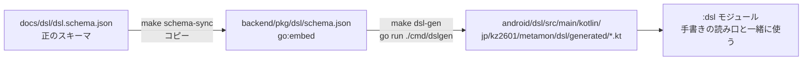

# Android の DSL の型の生成(dslgen → :dsl/generated)

Android の DSL の型は手で書かず、DSL のスキーマから `backend/cmd/dslgen` が作る(#351 §7)。iOS・backend と型がずれないようにするため。

## 目次

1. [流れ](#流れ)
2. [作り直す](#作り直す)
3. [手で直さない](#手で直さない)
4. [どう型にするか](#どう型にするか)
5. [JsonElement のまま残るキー](#jsonelement-のまま残るキー)
6. [決めること](#決めること)

## 流れ



| 段 | 置き場 | 役割 |
|---|---|---|
| スキーマ | [`docs/dsl/dsl.schema.json`](../dsl/dsl.schema.json) | DSL の形の正。ここを直す |
| 埋め込み用のコピー | `backend/pkg/dsl/schema.json` | backend が `go:embed` で読む写し(`dsl.SchemaJSON()`)。`make schema-check` が 2 つが同じかを見る |
| 生成器 | `backend/cmd/dslgen/`(`gen.go`・`render.go`・`schema.go`) | スキーマを読んで Kotlin を書く |
| 生成物 | `android/dsl/src/main/kotlin/jp/kz2601/metamon/dsl/generated/` | `Component.kt`・`DslKeys.kt`・`Enums.kt`・`Expr.kt`・`Models.kt`。コミットする |

## 作り直す

スキーマを変えた PR では、同じ PR で次を回して生成物もコミットする。

```sh
cd backend
make schema-sync   # docs/dsl/dsl.schema.json を pkg/dsl/schema.json に写す
make dsl-gen       # schema-check(2 つが同じか)→ go run ./cmd/dslgen
```

- `dslgen` は出力先の `*.kt` を作り直し、生成しなくなったファイルは消す(名前が変わった古いファイルが残らない)。
- 出力先を変える時は `go run ./cmd/dslgen -out <dir>`(既定は上の `generated/`・backend からの相対)。
- スキーマを変えていない時に `make dsl-gen` を回すと、差分は出ない(同じ入力からは同じ出力・`TestGenerateIsDeterministic`)。

### 古いままだと落ちるテスト

| テスト | どこで回るか | 何を見るか |
|---|---|---|
| `TestGeneratedKotlinIsUpToDate`(`backend/cmd/dslgen/main_test.go`) | backend-ci(`go test ./...`)。`generated/` だけを変えた PR でも backend-ci が回る | ディスクの生成物が、今のスキーマから作った物と 1 文字も違わないか。違えば「`make dsl-gen` を回してコミット」と出る |
| `make schema-check`(`make test` の前に回る) | 手元の `make -C backend test`・`make dsl-gen` | `docs/dsl/dsl.schema.json` と `backend/pkg/dsl/schema.json` が同じか |

生成物を変えた PR では Android の CI(`android-ci`)も回る([ci.md](ci.md#形))。

## 手で直さない

- `generated/` の下のファイルの頭には `Code generated by backend/cmd/dslgen ... DO NOT EDIT.` がある。手で直しても次の `make dsl-gen` で消え、その前に `TestGeneratedKotlinIsUpToDate` が落ちる。
- 型を変えたい時は、スキーマ(`docs/dsl/dsl.schema.json`)か生成器(`backend/cmd/dslgen`)を直して作り直す。
- 生成した型に読み口を足したい時は、`generated/` の外(`android/dsl/src/main/kotlin/jp/kz2601/metamon/dsl/` の `TypedReaders.kt`・`Lenient.kt`・`AppDSL.kt` など)に拡張プロパティとして書く。

## どう型にするか

生成器の決まり(`backend/cmd/dslgen/gen.go` の頭のコメント):

- スキーマの `$defs` のオブジェクトは `@Serializable` の `data class` に、enum は enum class にする(知らない値は `UNKNOWN`。`VoiceEntry` だけ `FLOATING`・`enumFallbacks`)。
- 部品(Container と各 Leaf)は 1 つの `Component` にまとめる。同じキーで型が部品ごとに違えば、その型は `JsonElement` になる。
- `anyOf` は、`Expr` だけ sealed interface にする(必須キーで形を見分け、どれにも合わない値は `ExprUnknown` に持つ)。ほかの `anyOf` は `JsonElement` のまま。
- 必須の値が無い時の既定(`AppMeta.name` など)は iOS に合わせて `defaultOverrides` に書く。

## JsonElement のまま残るキー

形が 2 通り以上あるため、生成した型では `JsonElement?` のまま残るキー。型付きの読み口を足す作業は [#1007](https://github.com/jphacks/kz_2601/issues/1007)。

| 型.キー | 形 | 手書きの読み口(`TypedReaders.kt`) |
|---|---|---|
| `Component.target` | 数 か 式(`ExprSetting` など) | `targetNumber`・`targetExpr` |
| `Component.saveTo` | AI の保存先 か AI チャットの保存先 | `aiSaveTo`・`chatSaveTo` |
| `Component.rawFilter` | 元の `filter`(1 つ か 配列) | 生成器が `@Transient` で残す。読み口は `records/RecordQuery.kt` の `Component.filters` |
| `Field.defaultValue` | 項目の型ごとに違う値 | `defaultJSONValue` |
| `Filter.value` | 比べる値(型は項目しだい) | まだ無い |
| `ExprAgg.filter` | `Filter` か `Filter[]` | `filters` |
| `PatchOp.value` | 差し替える値(何でも) | まだ無い |
| `FilterMe.me`・`FilterMyFollows.myFollows` | スキーマでは `const`(目印の値) | まだ無い |

- この一覧は 2026-11 の `generated/` を `JsonElement?` で探したもの。スキーマが変わると増減するので、見る時は `generated/` を `grep -n 'JsonElement?' ` で探し直す。
- 推測: `FilterMe.me`・`FilterMyFollows.myFollows` は値が決まっている目印(`const`)なので、読み口は要らないかもしれない(#1007 の一覧にも無い)。

## 決めること

- 「まだ無い」のキーに読み口を足すか、スキーマの側で形を 1 つにするか(#1007)。
