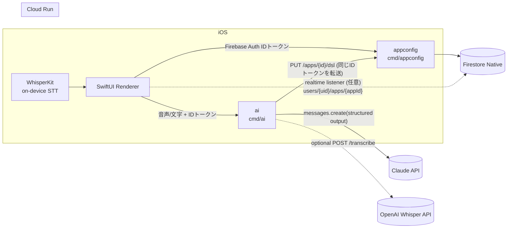
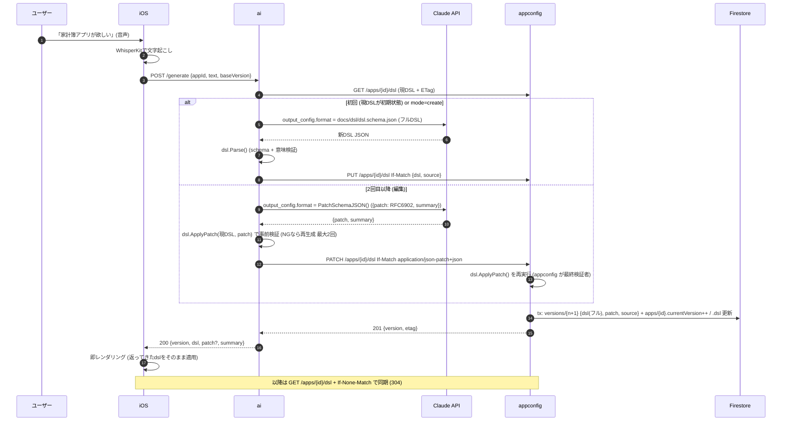

# バックエンド設計 (Go / GCP) v0

> 正典は `docs/00_decisions.md`。本書はそれを実装可能な粒度に落としたもの。契約は `openapi-appconfig.yaml` / `openapi-ai.yaml`、DSLは `docs/dsl/README.md`(v1 正典) + `docs/dsl/dsl.schema.json`(旧案: `dsl-proposal.md`)。

## 1. サービス構成とリクエストフロー





| 項目 | 値 |
|---|---|
| ai→appconfig 認証 | ユーザーのFirebase IDトークンを**そのまま転送**。サービスアカウント/IAM不要、appconfigが唯一のFirestore書き込み口 |
| Cloud Run ingress | 両方 public (iOSから直接叩く)。認可はアプリ層のIDトークン検証 |
| タイムアウト | ai: Cloud Run 60s / 内部 Claude 呼び出し 25s×最大2回。appconfig: 10s |

## 2. DB選定の検証: Firestore 維持

| 観点 | Firestore (Native) | Cloud SQL (Postgres) | 判定 |
|---|---|---|---|
| DSL JSON の保存 | ドキュメント=JSON。そのまま保存・取得 | `jsonb` 1列で可能。差は小さい | 引き分け |
| 生成アプリの「ユーザーデータ」(家計簿明細等) | スキーマレス。エンティティ定義がAIで変わっても移行不要 | `jsonb` 列か EAV。型付き列にすると AI が entity を変える度に DDL | **Firestore** |
| 集計 (今月合計・カテゴリ別) | `sum()/count()/avg()` 集計クエリあり。グループ化は無い→ v0 は**クライアント側(iOS)で集計** (1ユーザーのレコードは高々数百件) | SQL で一発 | Cloud SQL 優位だが v0 の規模では不要 |
| ユーザー分離 | `users/{uid}/...` のパス構造で構造的に分離 | `WHERE user_id=` を全クエリで徹底 | **Firestore** |
| Cloud Run からの接続 | SDK のみ。VPC/Proxy/接続プール不要。コールドスタートに強い | Cloud SQL Auth Proxy or Connector、最小構成でも ~$10/月、接続上限管理 | **Firestore** |
| ローカル開発 | Firebase Emulator Suite (auth と同居) | Docker Postgres | 同等 |
| iOS ホットリロード | iOS の Firebase SDK で**リアルタイムリスナー**が無料で付いてくる | ポーリング or 独自 push | **Firestore** |
| 2日間の実装コスト | ORM/マイグレーション不要 | sqlc + migrate の整備が要る | **Firestore** |

**結論: Firestore 維持。** 覆す根拠(複雑な JOIN/集計、トランザクション越しの整合性、全文検索)は v0 のスコープに存在しない。
ハッカソン後に「複数ユーザー共有アプリ」「大量データの集計」が要件化したら、`records` だけ Cloud SQL / BigQuery へ寄せる(DSL はそのまま Firestore)という段階移行が可能な構造にしておく(§3 で `records` を独立サブコレクションに切る理由)。

## 3. Firestore データモデル

**確定事項**: DSL JSON も生成アプリのユーザーデータ(明細・記録)も **Firestore にユーザー(uid)紐付けで保存**する(端末引き継ぎ前提・ログインあり)。汎用エンティティ/レコード API は appconfig の**必須スコープ**。

```
users/{uid}                                   # Firebase Auth uid。プロフィール
└─ apps/{appId}                               # 1ユーザー複数アプリ可 (v0 UIは1つだけ使う)
   ├─ versions/{version:08d}                  # DSL のフルスナップショット (append-only)
   └─ entities/{entityId}/records/{recordId}  # 生成アプリのユーザーデータ (汎用)
```

| ドキュメント | 例 |
|---|---|
| `users/{uid}` | `{ "displayName": "Kota", "createdAt": ts, "lastAppId": "app_01HX..." }` |
| `users/{uid}/apps/{appId}` | `{ "name": "家計簿", "currentVersion": 7, "status": "active", "createdAt": ts, "updatedAt": ts, "dsl": {...現行DSLの複製...} }` |
| `.../versions/00000007` | `{ "version": 7, "parentVersion": 6, "dsl": {...フル...}, "patch": [{"op":"add","path":"/screens/0/components/1","value":{...}}], "source": {"kind":"ai","mode":"patch","transcript":"カテゴリ別の円グラフも欲しい","model":"claude-sonnet-5-5","summary":"ホームに円グラフを追加"}, "createdAt": ts }` |
| `.../entities/expense/records/{id}` | `{ "id": "rec_01HX...", "entity": "expense", "data": {"amount": 1200, "category": "食費", "memo": "ランチ", "date": "2026-10-24"}, "createdAt": ts, "updatedAt": ts }` |
| `.../entities/memo/records/{id}` (散歩メモ) | `{ "data": {"photo": "https://firebasestorage.googleapis.com/.../users/{uid}/apps/{appId}/photos/01HX.jpg", "note": "きれいな紅葉", "place": "36.56,136.65", "date": "2026-10-24T15:02:00+09:00"} }` |

写真(P0 カメラ)は **iOS が Firebase Storage に直接アップロード**(`users/{uid}/apps/{appId}/photos/{ulid}.jpg`、Storage ルールで自分の uid 配下のみ)し、レコードには **URL 文字列だけ**を入れる。Go は `photo` 型フィールドを「https URL の文字列」として検証するだけ(バイナリを扱わない)。

設計上のポイント:

| 論点 | 決定 |
|---|---|
| 現行 DSL の置き場 | `apps/{appId}.dsl` に**複製**を持つ(1 read でホットリロード・iOS リスナーが1ドキュメントで済む)。履歴は `versions/`。書き込みは同一トランザクションで両方更新 |
| エンティティ定義の正 | **DSL の `entities[]` が正**。`entities/{entityId}` ドキュメント自体は作らない(サブコレクションの親は存在しなくてよい)。レコード書き込み時に現行 DSL の定義で `data` を型チェック |
| レコードの `data` | map。フィールド型は DSL に従い Go で検証・正規化(`currency/integer`→int64、`date`→"YYYY-MM-DD"文字列、`datetime`→RFC3339)。未知キーは拒否(400) |
| AI が entity を変更した時 | 既存レコードは**そのまま残す**(スキーマレスの利点)。削除されたフィールドは iOS が無視、追加フィールドは `defaultValue` 補完。entity 削除時もレコードは消さない(ロールバック可能性) |
| ID 生成 | appId / recordId は ULID (`rec_01HX...`)。version は連番 int(ETag と兼用) |
| 削除 | records は物理削除。apps は `status: "archived"` の論理削除 |

インデックス(`firestore.indexes.json`、infra 担当が `gcloud firestore indexes composite create` で作成):

| コレクショングループ | フィールド | 用途 |
|---|---|---|
| `records` | `createdAt desc` (単一・自動) | 一覧の既定ソート |
| `records` | `data.date desc, createdAt desc` | 家計簿の日付ソート(`sort.field` が date 系の時) |
| `records` | `data.category asc, data.date desc` | カテゴリ絞り込み+日付順 |

v0 のルール: **`sort`/`filter` が複合インデックスを要求する組み合わせは、appconfig がサーバー側でメモリソート**(1 entity 上限 2,000 件・それ以上は 413)。デモ規模では十分で、インデックス作成待ち(数分)で詰まるのを避ける。

Firestore セキュリティルール(iOS がリスナーを使う場合のみ必要・書き込みは全面禁止):
```
match /users/{uid}/{document=**} {
  allow read: if request.auth != null && request.auth.uid == uid;
  allow write: if false;   // 書き込みは appconfig (Admin SDK) のみ
}
```

## 4. 認証・認可

| 項目 | 決定 |
|---|---|
| トークン | `Authorization: Bearer <Firebase ID token>`。Go は `firebase.google.com/go/v4/auth` の `VerifyIDToken` |
| プロバイダ | **Sign in with Apple** が第一候補、詰まったら **Firebase 匿名認証**で代替。どちらも同じ Firebase ID トークンなので **Go 側は無変更**(`firebase.sign_in_provider` claim が `apple.com` / `anonymous` になるだけ)。匿名→Apple への **アカウントリンク**で uid は維持されるため、後から Apple を足してもデータ移行不要 |
| uid の扱い | **URL に uid を含めない**。全パスは `/v1/apps/...` で、uid はトークンから取り出して `users/{uid}/...` に束縛。他人のデータに辿り着く URL が存在しない |
| 失敗 | 401 `unauthenticated`(欠落/期限切れ/署名不正)。403 は現状使わない(自分の木しか触れないため) |
| ローカル | `AUTH_MODE=dev` かつ `FIREBASE_AUTH_EMULATOR_HOST` 設定時のみ `X-Debug-Uid: <uid>` を受理。加えて dev では verifier が `auth.DevVerifier`(Bearer 値をそのまま uid として受理)になるので、Authorization を転送するだけの ai 経由でも通る。本番では `AUTH_MODE=firebase` 固定(`auth.FirebaseVerifier`)で、dev ヘッダは無視 |
| ai→appconfig | 受け取った Bearer をそのまま転送(`internal/appconfigclient`)。トークン残寿命が 60s 未満なら iOS 側で refresh してから呼ぶ(Firebase SDK が自動) |

```go
// internal/auth/middleware.go (骨格)
type ctxKey struct{}

func Middleware(v *auth.Client, mode string) func(http.Handler) http.Handler {
	return func(next http.Handler) http.Handler {
		return http.HandlerFunc(func(w http.ResponseWriter, r *http.Request) {
			if mode == "dev" && os.Getenv("FIREBASE_AUTH_EMULATOR_HOST") != "" {
				if uid := r.Header.Get("X-Debug-Uid"); uid != "" {
					next.ServeHTTP(w, r.WithContext(context.WithValue(r.Context(), ctxKey{}, uid)))
					return
				}
			}
			raw, ok := strings.CutPrefix(r.Header.Get("Authorization"), "Bearer ")
			if !ok {
				httpx.Error(w, http.StatusUnauthorized, "unauthenticated", "missing bearer token")
				return
			}
			tok, err := v.VerifyIDToken(r.Context(), raw)
			if err != nil {
				httpx.Error(w, http.StatusUnauthorized, "unauthenticated", "invalid token")
				return
			}
			next.ServeHTTP(w, r.WithContext(context.WithValue(r.Context(), ctxKey{}, tok.UID)))
		})
	}
}

func UID(ctx context.Context) string { s, _ := ctx.Value(ctxKey{}).(string); return s }
```

## 5. DSL のバージョニングと差分適用

**確定: 2 モード。初回生成 = フル DSL(`PUT`)、2 回目以降の改変 = JSON Patch RFC 6902(`PATCH`)。** ai が Patch を生成し、**appconfig が適用・スキーマ検証・バージョン保存・ロールバックを担う**。

| 論点 | 決定 | 理由 |
|---|---|---|
| 初回 / create | ai → Claude 構造化出力(root=`AppDSL`)→ `dsl.Parse` → `PUT /apps/{id}/dsl` | 白紙からの生成は全体を出す方が速く確実 |
| 2 回目以降 / edit | ai → Claude 構造化出力(root=`$defs/PatchDocument` = `{patch:[RFC6902 op], summary}`)→ ai 側で `dsl.ApplyPatch` 事前検証 → `PATCH /apps/{id}/dsl`(`Content-Type: application/json-patch+json`)→ **appconfig が再度 `dsl.ApplyPatch`**(最終検証者) | 出力トークンが小さくレイテンシ減。「言及していない部分を保持」が構造的に保証される。`summary` も同じ出力で取れる |
| Patch の値の型 | `value` は **プリミティブ or DSL の部分文書($defs)に限定**(自由な object は不可) | Claude 構造化出力の制約(`additionalProperties:false` 必須)を満たしつつ、入れられるものは全部入る。`move/copy/test` も許可 |
| 失敗時 | Patch 検証 NG → エラー一覧付きで再生成(最大 2 回)→ **フル DSL 生成に降格**(1 回)→ ルールベーステンプレ → 422 | Patch は path ずれで壊れ得るので、フルへの降格経路を必ず持つ |
| 保存形式 | 各 version に **フルスナップショット `dsl` + 適用した `patch`**(PUT 時は `patch` 無し) | ロールバックは「コピー」。差分表示・デバッグは `patch` を見る |
| 楽観ロック | `PUT`/`PATCH` とも `If-Match: "<version>"` 必須。トランザクション内で `currentVersion` と照合し不一致は **409 `version_conflict`**(ボディに現行 version) | Patch は**基底バージョン依存**なので 409 時は再生成が必須(ai は最新を取り直して 1 回だけ再試行) |
| ロールバック | `POST /v1/apps/{id}/versions/{v}/restore` → version v の `dsl` で **新 version N+1**(`source.kind=restore`)。履歴は消さない | 「元に戻して」と言われた時 ai は Claude を呼ばず **restore を直接叩く**(発話の意図分類は Claude に `{intent: edit|create|undo}` を出させてもよいが v0 はキーワード) |
| ETag | `ETag: "<currentVersion>"`(例 `"7"`)。`GET /dsl` は `If-None-Match` 一致で **304** | 単調増加 int なので比較が自明。iOS は 2s ポーリングか Firestore リスナー |
| 変更の説明 | version.source に `summary`・`transcript`・`mode(full|patch)`・`model` | iOS が「円グラフを追加しました」と読み上げる材料 |
| 実装 | `pkg/dsl.ApplyPatch(current, ops)`(evanphx/json-patch v5 + `Parse`)、`dsl.PatchSchemaJSON()`、`dsl.ValidatePatchDocument()` は**実装済み・テスト済み** | appconfig/ai が同じ関数を呼ぶので結果が一致する |

## 6. ai サービス詳細

### 6.1 Claude 呼び出し

> 実装: `backend/internal/ai/{client.go,schema.go,prompt.go,generate.go,handler.go}` + `backend/internal/appconfigclient`。実 API の応答サンプルは `docs/backend/ai-samples/*.response.json`、発話 16 本の品質/速度 eval は `docs/backend/ai-eval/`(ランナー `backend/cmd/ai-eval`・ケース `backend/internal/ai/eval/cases.json`)。

| 項目 | 値(実装済み) |
|---|---|
| 呼び出し | **生 HTTP**(`net/http` → `POST /v1/messages`、`anthropic-version: 2026-10-21`)。SDK 依存なし(go.mod を増やさない・テストは `Caller` インターフェースでモック)。429/5xx/接続エラーは指数バックオフで最大 2 回リトライ、1 呼び出し `GENERATE_TIMEOUT_SEC`(既定 45s) |
| モデル | 既定 `claude-sonnet-5-5`。`CLAUDE_MODEL=claude-opus-5-5` で品質側へ切替。モデルIDに日付サフィックスは付けない |
| 思考 | adaptive(省略時既定)。`output_config.effort = CLAUDE_EFFORT`(既定 `low`)。**2026-10-24 の 16 本 eval で low/high とも検証一発通過 16/16・create p50 は low 6.6s / high 8.2s、p95 8.7s / 17.0s → high は遅いだけなので `low` 固定**(`docs/backend/ai-eval/2026-10-24.md`) |
| 出力 | **既定は「スキーマをプロンプトに載せて JSON のみを出させ、Go で厳密検証」**。`output_config.format`(構造化出力)は `CLAUDE_STRUCTURED_OUTPUT=1` のときだけ送る(下記「構造化出力の制約」参照)。応答テキストは `extractJSON`(コードフェンス/前置き除去)→ 初回 `dsl.Parse`、編集 `dsl.ApplyPatch` |
| max_tokens | 16000(非ストリーミング)。DSL 64KB 上限内 |
| 拒否 | `stop_reason == "refusal"` → 400 `refused`。`fallbacks: "default"`(beta `server-side-fallback-2026-07-01`)を常時送付 |
| キャッシュ | system(設計原則・部品カタログ・few-shot `examples/kakeibo.json`・生成用スキーマ ≈8.6K tokens)は固定文字列で `cache_control: ephemeral`。可変部(現 DSL・発話・前回の Problems)は user に置く。実測: 2 回目以降 `cache_read_input_tokens=8588` |
| 再生成ループ | 検証 NG(`dsl.ValidationError.Problems`: 重なり・範囲外・参照不整合・スキーマ違反)は **Problems を user に添付して最大 2 回再生成**(計 3 回)。それでも NG → **`area` を全部落として再検証**(省略=上から積むフォールバック)→ それも NG なら **400 `generation_failed`**(`details.problems`/`details.attempts`)。編集は Patch 3 回 NG → `area` 落とし → **フル生成 1 回に降格**(`meta.downgradedToFull`)→ 400 |
| summary | 編集 = PatchDocument の `summary`(モデル生成・読み上げ用 1 文 40 字程度「。」止め、満たされていれば `test` 1 つの patch +「すでに〜になっています。」)。初回 = `app.name`/tabs/追加ボタンの `area`/notifications から **読み上げ用の自然文**をテンプレ生成(例「家計簿アプリを作りました。ホームと集計の2タブで、右下のボタンから支出を追加できます。毎朝8時に通知が届きます。」) |

**構造化出力の制約(2026-10-24 実測)**: `output_config.format` の文法コンパイラは DSL 規模のスキーマを受け付けない。正典スキーマそのまま・Leaf 15 種を 1 オブジェクトに平坦化した版、いずれも `The compiled grammar is too large`。単体プローブでは **任意プロパティ 12 個の平坦オブジェクトは OK、16 個で `Schema is too complex`、入れ子合計 25 個で `too many optional parameters`**。Component は最低でも 30 個の任意プロパティを持つため、現状の上限では構造化出力に載らない。そのため生成用スキーマは **プロンプト埋め込み(モデルへの参照)** として使い、強制は Go 側に一本化した。上限が緩和されたら `CLAUDE_STRUCTURED_OUTPUT=1` で即切替できる。

**生成用スキーマの派生ルール**(`internal/ai/schema.go` `Relax` → `compact`、正典 `docs/dsl/dsl.schema.json` から機械導出・手書き禁止):
1. `$schema`/`$id` を削除、ルートの `$ref`(PatchDocument)はインライン化(ルートは object)。
2. 構造化出力非対応キーワードを除去: `pattern`・`format`・`min/maxLength`・`minimum/maximum`・`min/maxItems` 等(`properties` 配下の同名プロパティ、例 `Stat.format` は残す)。
3. `Leaf`(15 種の `anyOf`)と `Component`(Container|Leaf)を **1 つの平坦オブジェクト**に併合: `type` は全 const の enum、プロパティは和集合(同名 enum は和集合)、`required` は `["type"]`、`children` は Leaf 配列。
4. `PatchValue` は `string|number|boolean|null | PatchNode | string[] | PatchNode[]`(PatchNode = AppMeta/Tab/Theme/Notification/Entity/Field/Screen/ToolbarButton/Action/Component/ListItem/Sort/Filter の平坦和集合)。
5. 到達不能な `$defs` を枝刈り。テスト `TestRelaxedSchemaAcceptsExamples` が「緩和スキーマは正典 examples 4 本を受理する(=正典の上位集合)」ことを保証。

### 6.2 プロンプト骨格

```
[system / cached]
あなたは iOS アプリの Server-Driven UI 設計者。ユーザーの発話から AppDSL v0.1 を出力する。
## ルール
- 出力は AppDSL JSON のみ。schemaVersion は "0.1"。
- 既存 DSL を「編集」する。ユーザーが言及していない画面・entity・レコード構造は保持する。
- entity を変更する時は既存フィールド id を維持する(リネームしない)。
- voiceEntry は "none" にしない(ユーザーが声で変更し続けられること)。
- 画面は最大 12、entity は最大 6、コンテナは 1 段のみ。
- 日本語 UI。金額は type "currency"。写真は type "photo" + photoField(camera)。リマインドは app.notifications か scheduleNotification。
## コンポーネントカタログ(型ごとに 1 行: 用途・必須プロパティ)
...
## 例(フル2本: 初期→家計簿 / 初期→散歩メモ。Patch 2本: 家計簿に店名追加 / トレーニングに毎朝8時通知追加)
...

[user]  ※編集ターン
## 現在の DSL (version 6)
{...}
## これまでの指示(新しい順・最大5件)
- v6: カテゴリ別の円グラフも欲しい
- v5: 家計簿アプリが欲しい
## 今回の指示
「メモじゃなくて店名にして」
## 出力
{patch: 現在の DSL に対する RFC 6902 操作の配列, summary: 変更の一文}
配列 index は上の DSL のものを使う。末尾追加は "/-"。言及されていない要素は触らない。
```

初回ターンは user に「現在の DSL」を載せず、`## 今回の指示` + `## 出力: AppDSL 全体` のみ。`summary` は初回ターンでは構造化出力に含まれないので、ai が **`app.name`/画面数/entity 名から日本語テンプレで機械生成**する(「家計簿アプリを作成しました。支出を記録して…」)。

### 6.3 処理パイプラインと失敗時フォールバック

```mermaid
flowchart TD
  I[入力: text or audio] --> T{audio?}
  T -- yes --> W[Whisper API /transcribe] --> X[text]
  T -- no --> X
  X --> U{「元に戻して」?}
  U -- yes --> RS[POST versions/{n-1}/restore] --> O
  U -- no --> M{初回 or create?}
  M -- yes --> GF[Claude: フルDSL] --> VF[dsl.Parse]
  M -- no --> GP[Claude: PatchDocument] --> VP[dsl.ApplyPatch 事前検証]
  VP -- OK --> PP[PATCH appconfig If-Match]
  VP -- NG(≤2回) --> GP2[再生成: エラー一覧添付] --> VP
  VP -- NG(3回目) --> GF
  VF -- OK --> PF[PUT appconfig If-Match]
  VF -- NG(≤2回) --> GF2[再生成: エラー一覧添付] --> VF
  VF -- NG --> R{ルールベース<br/>テンプレ一致?}
  R -- 家計簿/トレーニング/散歩メモ --> TP[テンプレDSLに名前差替] --> PF
  R -- 不一致 --> E[422 generation_failed<br/>iOSが「うまく聞き取れませんでした」]
  PP -- 409 --> RE[最新DSL取得→Patch再生成1回] --> GP
  PF -- 201 --> O[200 {version, dsl, summary}]
  PP -- 201 --> O
```

ルールベース fallback(`internal/ai/fallback`): キーワード辞書 → `templates/*.json` = **デモ3本(家計簿・トレーニング記録・散歩メモ)** + ToDo。テンプレは `docs/dsl/examples/*.json` をそのまま埋め込み、`dsl_test.go` が CI で検証済み。デモ当日に Claude が落ちても 3 本は必ず動く保険。

### 6.4 レイテンシ目標

| 区間 | 目標 p50 / p95 |
|---|---|
| WhisperKit(端末) | iOS 側 |
| `/generate` 全体(text 入力・初回フル) | **4s / 10s** |
| `/generate` 全体(編集 Patch) | **2.5s / 6s** |
| Claude 1回(Sonnet 5.5, effort low, フル出力 ~0.9-1.7K tokens / Patch ~0.1-0.4K tokens) | 目標 3s / 7s ・ 1.5s / 4s。**実測(2026-10-24・16 本)**: create p50 6.6s / p95 8.7s ・ edit p50 1.7s / p95 5.0s |
| 検証 + appconfig PUT | 150ms / 400ms |
| `/transcribe`(Whisper API, 10s 音声) | 1.5s / 4s |

Cloud Run: ai は `min-instances=1`(コールドスタート回避・デモ中のみ)、`concurrency=20`、`timeout=60s`、CPU 1 / mem 512Mi。

### 6.5 Whisper エンドポイント(optional)

`POST /v1/transcribe` multipart(`audio`: m4a/wav/mp3 ≤ 25MB ≤ 60s, `language=ja`)→ OpenAI `whisper-1` → `{text, language, durationMs}`。`OPENAI_API_KEY` 未設定なら **501 `not_configured`**。`/generate` も `multipart/form-data` で `audio` を受けた時は内部で同じ処理を通す。

## 7. ローカル開発・デプロイ・環境変数

### ローカル

```sh
# 前提: firebase-tools, Go 1.24
cd backend
make emulator   # Firestore :8089 / Auth :9099 (firebase.json は infra 担当が配置)
make dev        # appconfig :8080, ai :8081 (AUTH_MODE=dev, X-Debug-Uid で叩ける)
curl -H 'X-Debug-Uid: u1' localhost:8080/v1/apps
```

### Cloud Run(概要・詳細は infra 担当)

1. `backend/Dockerfile`(multi-stage, `ARG SERVICE`)を `gcloud builds submit --config cloudbuild.yaml --substitutions=_SERVICE=appconfig` でビルド
2. `gcloud run deploy appconfig --image ... --region asia-northeast1 --allow-unauthenticated --set-env-vars AUTH_MODE=firebase,GOOGLE_CLOUD_PROJECT=$PROJECT`
3. ai は `--set-secrets ANTHROPIC_API_KEY=anthropic-api-key:latest,OPENAI_API_KEY=openai-api-key:latest --set-env-vars APPCONFIG_BASE_URL=https://appconfig-xxxx.a.run.app --min-instances 1`
4. Cloud Run のサービスアカウントに `roles/datastore.user`(Firestore)と `roles/firebaseauth.viewer`(トークン検証に不要だが Admin SDK 初期化のため project 参照権限)

### CI(5 分以内必須)

`.github/workflows/backend-ci.yml`(GitHub 整備担当が配置。`paths: backend/**, docs/backend/**` で発火、Draft では発火しない):

```yaml
on:
  pull_request: { types: [opened, synchronize, ready_for_review], paths: ['backend/**', 'docs/backend/**'] }
jobs:
  go:
    if: ${{ !github.event.pull_request.draft }}
    runs-on: ubuntu-latest
    timeout-minutes: 5
    defaults: { run: { working-directory: backend } }
    steps:
      - uses: actions/checkout@v4
      - uses: actions/setup-go@v5
        with: { go-version-file: backend/go.mod, cache-dependency-path: backend/go.sum }
      - run: make schema-check
      - run: go build ./... && go vet ./...
      - run: go test ./... -count=1
```

実測: 現状 `go test ./...` 0.4s、依存ダウンロード込みでも ~1 分(モジュールキャッシュが効けば 20s)。Firestore エミュレータを使う統合テストは `//go:build integration` タグで CI から外し、ローカル `make test-integration` のみ。staticcheck を足す時も 5 分枠を超えないか確認。

### 環境変数

| 変数 | appconfig | ai | 既定 / 備考 |
|---|---|---|---|
| `PORT` | o | o | Cloud Run が注入。ローカル 8080/8081 |
| `GOOGLE_CLOUD_PROJECT` | o | o | Firebase Admin 初期化 |
| `AUTH_MODE` | o | o | `firebase`(本番) / `dev` |
| `FIRESTORE_EMULATOR_HOST` | o | - | ローカルのみ |
| `FIREBASE_AUTH_EMULATOR_HOST` | o | o | ローカルのみ(dev ヘッダの有効条件) |
| `LOG_LEVEL` | o | o | `info` |
| `APPCONFIG_BASE_URL` | - | o | ai→appconfig。**未設定ならインメモリのスタブ store**(未知 appId は `dsl.Initial()` version 1 で seed。Cloud Run 上でも可・永続なし) |
| `ANTHROPIC_API_KEY` | - | o | **Secret Manager**。コード/ログ/サンプルに出さない |
| `CLAUDE_MODEL` | - | o | `claude-sonnet-5-5` |
| `CLAUDE_EFFORT` | - | o | `low`(eval で確定。`high` は品質同等で p50 +1.5s・p95 2 倍) |
| `CLAUDE_STRUCTURED_OUTPUT` | - | o | 未設定(=off)。`1` で `output_config.format` を送る(現状は文法サイズ超過で 400) |
| `OPENAI_API_KEY` | - | o | Secret Manager・任意(無ければ /transcribe 501) |
| `GENERATE_TIMEOUT_SEC` | - | o | `45` |
| `MAX_AUDIO_BYTES` | - | o | `26214400` |

## 8. ディレクトリ構成

```
backend/
├── go.mod                      # module github.com/jphacks/kz_2601/backend
├── Makefile                    # build/vet/test/schema-sync/dev
├── Dockerfile                  # ARG SERVICE=appconfig|ai (infra 担当)
├── cmd/
│   ├── appconfig/main.go       # 配線のみ: env → store → handlers → http.Server
│   └── ai/main.go
├── internal/                   # サービス実装(外部 import 不可)
│   ├── httpx/                  # JSON 書き出し・エラー封筒・RequestID・recover・ログ middleware
│   ├── auth/                   # Firebase IDトークン検証 middleware, UID(ctx)
│   ├── store/                  # Firestore クライアント + repo (apps / versions / records)
│   │   ├── firestore.go
│   │   ├── apps.go             # Get/Create/PutDSL(tx, If-Match)/Restore/List
│   │   └── records.go          # List(cursor)/Create/Update/Delete + data 正規化
│   ├── appconfig/              # HTTP handlers (openapi-appconfig.yaml の実装)
│   │   ├── router.go           # Go 1.22+ の method pattern mux
│   │   ├── apps.go  dsl.go  entities.go  records.go
│   ├── appconfigclient/        # ai が使う appconfig の薄い HTTP クライアント(Bearer 転送)
│   └── ai/
│       ├── router.go  generate.go  transcribe.go
│       ├── claude/             # SDK 呼び出し・構造化出力・リトライ・refusal 処理
│       ├── prompt/             # system.md(embed)・few-shot・差分→summary
│       ├── fallback/           # キーワード→テンプレ DSL
│       └── templates/*.json
└── pkg/dsl/                    # 共有: 型・schema.json(embed)・Parse/Validate・Initial()
    ├── dsl.go  validate.go  dsl_test.go  schema.json
```

規約: ハンドラは `store` の interface に依存(テストで fake 差替)。エラーは `httpx.Error(w, status, code, message)` の1経路。すべての書き込みは `dsl.Parse` / `dsl.ApplyPatch` を通過した `*dsl.App` だけを受け取る。

## 9. appconfig 実装状況(2026-10-24)

| # | タスク | 状態 | 備考 |
|---|---|---|---|
| 1 | `internal/httpx` + `internal/auth` + `cmd/appconfig` の配線 | **実装済み**(PR #26 / #27 / #28、@2410as) | `httpx.WriteJSON/Error/ErrorWithDetails/DecodeBody(DisallowUnknownFields・1MiB)/Chain/WithRequestID/Log/Recover/ErrorEnvelope`、`auth.Middleware(verifier, mode)` / `auth.UID(ctx)`。verifier は `auth.FirebaseVerifier`(firebase・ADC)/ `auth.DevVerifier`(dev・Bearer 値=uid) |
| 2 | `internal/store` + apps/dsl/versions API | **実装済み**(`feature/appconfig-store-api`) | `store.Store`(Firestore / Memory)。`GET /dsl` は未知 appId を `dsl.Initial()` version 1 で自動作成(iOS は端末固定 UUID を appId に使う)。`PUT`/`PATCH` は `If-Match` 必須(欠落 412 `bad_request`・不一致 409 `version_conflict` + `details.currentVersion`)、422 `invalid_dsl` + `details.problems`。`PATCH` は `application/json-patch+json`(配列)と `application/json`(`{patch, source}`・ai が使う)の両方。`GET /versions`、`GET /versions/{n}`、`POST /versions/{n}/restore`、`GET /entities[/{id}]` |
| 3 | records API | **実装済み**(同上) | list(`pageSize`/`pageToken`・`sortField`/`sortDir`・`filterField`/`filterOp`/`filterValue`・メモリソート上限 2000 → 413)、POST(`clientId` 冪等=同じ id を返す・`defaultValue` 補完・`required` 422・未知キー 400)、PATCH(キー単位マージ・`null` で削除)、DELETE、DELETE 全件(`?confirm=true`)。`photo` は `data:image/...` か `https://`、1 レコード 300KB 上限 |
| 4 | ai との実プロセス結合 | **確認済み** | `AUTH_MODE=dev` の appconfig(Firestore エミュレータ)+ ai で `POST /v1/generate`(create → `PUT`、edit → `PATCH`)→ `GET /dsl` の version が 1→2→3 と増え、`GET /versions` に `source.kind=ai`・`patch` が残ることを curl で実測 |
| - | 残課題 | | `PUT /entities/{id}`(糖衣・未実装)、`PATCH /apps/{id}` の `name` 変更後も version 書き込み時に `dsl.app.name` で上書きされる、`GET /dsl` 封筒に `source`/`createdAt` を含めない(読み 1 回で返すため)、Firestore 複合インデックス未作成(メモリソートで代替)、staging での Firebase 実トークン疎通 |

**書き込み形式(Firestore)**: `apps/{appId}` は `dsl`(map・iOS リスナー用)と `dslJson`(正規化 JSON 文字列・API が返す本体)の両方を持つ。`versions/{n:08d}` は `dslJson` + `patchJson` + `source`。`records/{id}` の `data` はネイティブ map(将来のクエリ用)。
