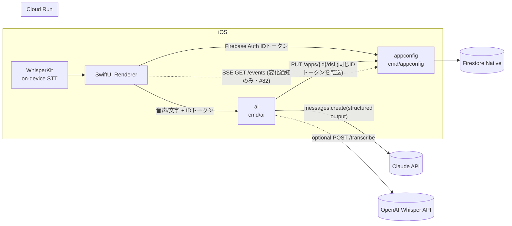
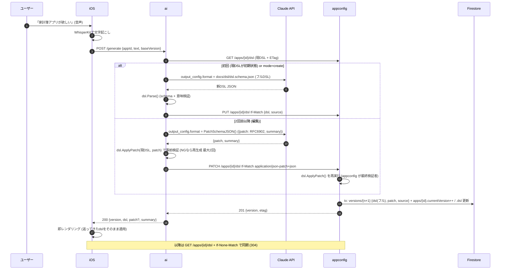

# バックエンド設計 (Go / GCP) v0

> 正典は `docs/00_decisions.md`。本書はそれを実装可能な粒度に落としたもの。契約は `openapi-appconfig.yaml` / `openapi-ai.yaml`、DSLは `docs/dsl/README.md`(v1 正典) + `docs/dsl/dsl.schema.json`(旧案: `dsl-proposal.md`)。

## 1. サービス構成とリクエストフロー





| 項目 | 値 |
|---|---|
| ai→appconfig 認証 | ユーザーのFirebase IDトークンを**そのまま転送**。サービスアカウント/IAM不要、appconfigが唯一のFirestore書き込み口 |
| Cloud Run ingress | 両方 public (iOSから直接叩く)。認可はアプリ層のIDトークン検証 |
| タイムアウト | ai: Cloud Run 60s / 内部 Claude 呼び出し 25s×最大2回。appconfig: 10s |

## 2. DB選定の検証: Firestore 維持

| 観点 | Firestore (Native) | Cloud SQL (Postgres) | 判定 |
|---|---|---|---|
| DSL JSON の保存 | ドキュメント=JSON。そのまま保存・取得 | `jsonb` 1列で可能。差は小さい | 引き分け |
| 生成アプリの「ユーザーデータ」(家計簿明細等) | スキーマレス。エンティティ定義がAIで変わっても移行不要 | `jsonb` 列か EAV。型付き列にすると AI が entity を変える度に DDL | **Firestore** |
| 集計 (今月合計・カテゴリ別) | `sum()/count()/avg()` 集計クエリあり。グループ化は無い→ v0 は**クライアント側(iOS)で集計** (1ユーザーのレコードは高々数百件) | SQL で一発 | Cloud SQL 優位だが v0 の規模では不要 |
| ユーザー分離 | `users/{uid}/...` のパス構造で構造的に分離 | `WHERE user_id=` を全クエリで徹底 | **Firestore** |
| Cloud Run からの接続 | SDK のみ。VPC/Proxy/接続プール不要。コールドスタートに強い | Cloud SQL Auth Proxy or Connector、最小構成でも ~$10/月、接続上限管理 | **Firestore** |
| ローカル開発 | Firebase Emulator Suite (auth と同居) | Docker Postgres | 同等 |
| iOS ホットリロード | iOS の Firebase SDK で**リアルタイムリスナー**が無料で付いてくる | ポーリング or 独自 push | **Firestore** |
| 2日間の実装コスト | ORM/マイグレーション不要 | sqlc + migrate の整備が要る | **Firestore** |

**結論: Firestore 維持。** 覆す根拠(複雑な JOIN/集計、トランザクション越しの整合性、全文検索)は v0 のスコープに存在しない。
ハッカソン後に「複数ユーザー共有アプリ」「大量データの集計」が要件化したら、`records` だけ Cloud SQL / BigQuery へ寄せる(DSL はそのまま Firestore)という段階移行が可能な構造にしておく(§3 で `records` を独立サブコレクションに切る理由)。

## 3. Firestore データモデル

**確定事項**: DSL JSON も生成アプリのユーザーデータ(明細・記録)も **Firestore にユーザー(uid)紐付けで保存**する(端末引き継ぎ前提・ログインあり)。汎用エンティティ/レコード API は appconfig の**必須スコープ**。

```
users/{uid}                                   # Firebase Auth uid。プロフィール
└─ apps/{appId}                               # 1ユーザー複数アプリ可 (v0 UIは1つだけ使う)
   ├─ versions/{version:08d}                  # DSL のフルスナップショット (append-only)
   └─ entities/{entityId}/records/{recordId}  # 生成アプリのユーザーデータ (汎用)
```

| ドキュメント | 例 |
|---|---|
| `users/{uid}` | `{ "displayName": "Kota", "createdAt": ts, "lastAppId": "app_01HX..." }` |
| `users/{uid}/apps/{appId}` | `{ "name": "家計簿", "currentVersion": 7, "status": "active", "createdAt": ts, "updatedAt": ts, "dsl": {...現行DSLの複製...} }` |
| `.../versions/00000007` | `{ "version": 7, "parentVersion": 6, "dsl": {...フル...}, "patch": [{"op":"add","path":"/screens/0/components/1","value":{...}}], "source": {"kind":"ai","mode":"patch","transcript":"カテゴリ別の円グラフも欲しい","model":"claude-sonnet-5-5","summary":"ホームに円グラフを追加"}, "createdAt": ts }` |
| `.../entities/expense/records/{id}` | `{ "id": "rec_01HX...", "entity": "expense", "data": {"amount": 1200, "category": "食費", "memo": "ランチ", "date": "2026-10-24"}, "createdAt": ts, "updatedAt": ts }` |
| `.../entities/memo/records/{id}` (散歩メモ) | `{ "data": {"photo": "https://firebasestorage.googleapis.com/.../users/{uid}/apps/{appId}/photos/01HX.jpg", "note": "きれいな紅葉", "place": "36.56,136.65", "date": "2026-10-24T15:02:00+09:00"} }` |

写真(P0 カメラ)は **iOS が Firebase Storage に直接アップロード**(`users/{uid}/apps/{appId}/photos/{ulid}.jpg`、Storage ルールで自分の uid 配下のみ)し、レコードには **URL 文字列だけ**を入れる。Go は `photo` 型フィールドを「https URL の文字列」として検証するだけ(バイナリを扱わない)。

設計上のポイント:

| 論点 | 決定 |
|---|---|
| 現行 DSL の置き場 | `apps/{appId}.dsl` に**複製**を持つ(1 read でホットリロード・iOS リスナーが1ドキュメントで済む)。履歴は `versions/`。書き込みは同一トランザクションで両方更新 |
| エンティティ定義の正 | **DSL の `entities[]` が正**。`entities/{entityId}` ドキュメント自体は作らない(サブコレクションの親は存在しなくてよい)。レコード書き込み時に現行 DSL の定義で `data` を型チェック |
| レコードの `data` | map。フィールド型は DSL に従い Go で検証・正規化(`currency/integer`→int64、`date`→"YYYY-MM-DD"文字列、`datetime`→RFC3339)。未知キーは拒否(400) |
| AI が entity を変更した時 | 既存レコードは**そのまま残す**(スキーマレスの利点)。削除されたフィールドは iOS が無視、追加フィールドは `defaultValue` 補完。entity 削除時もレコードは消さない(ロールバック可能性) |
| ID 生成 | appId / recordId は ULID (`rec_01HX...`)。version は連番 int(ETag と兼用) |
| 削除 | records は物理削除。apps も `DELETE /v1/apps/{appId}` で物理削除(#180: 配下の versions/records・自分のシェア/掲載/共有ミラーごと。`status: "archived"` は PATCH でのみ付く) |

インデックス(`firestore.indexes.json`、infra 担当が `gcloud firestore indexes composite create` で作成):

| コレクショングループ | フィールド | 用途 |
|---|---|---|
| `records` | `createdAt desc` (単一・自動) | 一覧の既定ソート |
| `records` | `data.date desc, createdAt desc` | 家計簿の日付ソート(`sort.field` が date 系の時) |
| `records` | `data.category asc, data.date desc` | カテゴリ絞り込み+日付順 |

v0 のルール: **`sort`/`filter` が複合インデックスを要求する組み合わせは、appconfig がサーバー側でメモリソート**(1 entity 上限 2,000 件・それ以上は 413)。デモ規模では十分で、インデックス作成待ち(数分)で詰まるのを避ける。

Firestore セキュリティルール: **#82 で iOS 直読み(案 A)は採らず SSE(案 B)にしたため、現行の全面拒否(`allow read, write: if false`)のまま変更不要**。下は将来 iOS が直接リスナーを張る場合の案(未適用):
```
match /users/{uid}/{document=**} {
  allow read: if request.auth != null && request.auth.uid == uid;
  allow write: if false;   // 書き込みは appconfig (Admin SDK) のみ
}
match /apps_public/{appId}/{document=**} {
  allow read: if request.auth != null;   // 共有データはログイン済みなら誰でも読める
  allow write: if false;
}
```

### 3.1 共有データ(entity.scope・#47)

DSL の `Entity.scope`(`private` 既定 / `shared` / `public`)でレコードの置き場と権限が変わる。`shared` の置き場は `public` と同じで、読み書きできるのは作成者と参加者だけ(§3.4・#254)。下の表の public / shared 列の「認証ユーザー全員」は shared では「参加者全員」と読む。

```
apps_public/{appId}                                   # 公開 DSL: {ownerUid, name, version, dsl(map), dslJson, createdAt, updatedAt}
└─ entities/{entityId}/records/{recordId}             # 共有レコード: {entity, data, clientId, author, authorName, createdAt, updatedAt}
```

| 項目 | private(従来) | public / shared |
|---|---|---|
| レコードの置き場 | `users/{uid}/apps/{appId}/entities/{e}/records` | `apps_public/{appId}/entities/{e}/records`(uid 非依存。appId は iOS の UUID なので単独で一意) |
| 読み取り | 本人のみ | 認証ユーザー全員 |
| 印(いいね・保存 #255) | 無し(DSL がエラー) | `entity.marks` に宣言した印を 1 人 1 回。件数はレコードの `markCounts.{markId}`、誰が付けたかは `.../records/{id}/marks/{markId}/by/{uid}`(トランザクションで両方を更新)。`PUT` / `DELETE .../records/{id}/marks/{markId}`。レコード削除で一緒に消える |
| create | 本人 | 認証ユーザー全員。`author`=uid・`authorName`=リクエストの `authorName`(無ければ "匿名")を自動付与。`clientId` の冪等 id は `uid/clientId` から導出(他人と衝突しない) |
| update / delete | 本人 | `author == uid` のみ(他人のレコードは **403 forbidden**) |
| delete all(`?confirm=true`) | 全件 | **自分の投稿だけ**削除 |
| `GET /records` | 従来どおり | 各レコードに `author`/`authorName` を含む。`filterField=author&filterOp=eq&filterValue=<uid>` で「自分の投稿」 |
| DSL | `users/{uid}/apps/{appId}` | 作成者の `PUT/PATCH /dsl`・`POST /apps`・restore 時に public entity を 1 つでも含めば `apps_public/{appId}` に複製(所有者=最初に公開した uid・他人は上書き不可)。他ユーザーの `GET /dsl` は自分の下に無ければ公開 DSL を複製して version 1 を作る(=インストール) |

実装: `store.RecordSet{UID, AppID, Entity, Public}` でコレクションを選ぶ(`store.PrivateRecords` / `store.PublicRecords`)。`store.PublishApp` / `GetPublicApp` が公開 DSL。handler は `appconfig/records.go` の `recordSet()` と `ownRecord()`(403 判定)。レコード検証は従来どおり呼び出し側ユーザーの現行 DSL で行うので、インストール後に各自が entity を変えても他人のレコードは消えない(スキーマレス)。

### 3.2 シェアリンクと公開カタログ「探す」(#49 #50)

```
shares/{token}        # {appId, ownerUid, name, dslVersion, dslJson, revoked, createdAt}  token = 192bit base64url
public_apps/{appId}   # {ownerUid, name, description, tags[], authorName, components[], dslVersion, dslJson, installs, createdAt, updatedAt}
public_apps/{appId}/installs/{uid}  # {appId(その人の複製先), createdAt}  installs を uid ごとに 1 回だけ数える(#154)
app_owners/{appId}    # {uid, createdAt}  appId の作成者(publish できる人・#153)
```

`public_apps`(探すの掲載)は §3.1 の `apps_public`(共有レコードの置き場)とは**別物**。名前が近いので注意。

| 項目 | 決定 |
|---|---|
| シェア | `POST /apps/{appId}/share` が現行 DSL を**スナップショット**して token を返す(後から作者が変えてもリンク先は変わらない)。`DELETE /shares/{token}` で取り消し(発行者のみ)。取り消し後の import / プレビュー / Web ページは 404 |
| 複製(import / install 共通 `installCopy`) | 受け取った人の木に version 1(初期)→ version 2(複製 DSL・`source.kind=import`)で作る(iOS の変身一覧は version 1 を「未生成」として隠すため)。**レコードは複製しない** |
| 共有データ(scope: shared/public)の扱い | 共有 entity を含むアプリは**新しい appId を振らず元の appId に参加**する。理由: #93 の共有レコードは `apps_public/{appId}` で appId 単位、かつ「他人が同じ appId を開く = インストール」という設計なので、新 appId だと受け取った人は空の掲示板を見るだけになり共有の意味が無い。既に持っていれば何もしない(`created:false`)。private だけのアプリは新しい UUID の appId に独立コピー |
| 公開 | `POST /apps/{appId}/publish`(name/description/tags/authorName)で作成・更新、`DELETE` で取り下げ。**その appId の作成者だけ**が掲載できる(#153)。作成者 = 最初に実コミット(生成 / PUT・PATCH /dsl / restore / `POST /apps` に dsl 付き / 新規 appId への複製)した uid を `app_owners/{appId}` に Create(既にあれば上書きしない)で記録。GET /dsl の seed(参加)と共有アプリへの参加 install は記録しないので、他人の appId を開いた人・参加者は 403。記録の無い既存アプリは「探す」の掲載者 → `apps_public` の持ち主の順で作成者とみなして記録し、どちらも無ければ最初に publish した人(空のアプリでは不可)を記録する。中身が初期 DSL のまま(components / entities 空)は 400 |
| 検索 | `GET /public-apps?q=&sort=popular`(または `new`): installs 降順で最大 500 件を読み、名前・説明・タグ・作者名の部分一致をメモリ内で絞る(全文検索なし・複合インデックス不要) |
| installs | `POST /public-apps/{id}/install` は `installs/{uid}` を見て、2 回目以降は最初の複製を返す(`created:false`・アーカイブ済みなら active に戻す。複製が削除済み(#180)なら新しく複製する)。installs は uid ごとに 1 回だけ、マーカーと同じトランザクションで +1。掲載者本人・参加済みの再インストールは数えない(#154) |
| 認可 | publish = appId の作成者のみ(`app_owners`)。unpublish = 掲載の ownerUid。revoke = 発行者。share = 自分の木にあるアプリなら誰でも(参加者が友だちを招ける・#118。空のアプリは 400)。import / install / 検索 = 認証済みなら誰でも |
| Web フォールバック | 認証不要の `GET /s/{token}`(appconfig 直下・`/v1` の外)。アプリ名と `tailorit://import/<token>` を開くボタンだけを出し、DSL は返さない。ベース URL は `SHARE_WEB_BASE_URL`、無ければリクエストのホスト |
| モデレーション | 通報・運営による強制非公開は未実装。掲載者が `DELETE /publish` で取り下げられるだけ(後続) |

デモ用シード: `scripts/seed-public-apps.sh <appconfig URL>` が `docs/dsl/examples` の kakeibo / training / walk を `catalog-<name>` として公開する(再実行は上書き)。

### 3.3 リリース申請(#76)

```
release_requests/{id}  # {appId, ownerUid, name, dslVersion, dslJson, purpose, contact, status, createdAt, updatedAt}  id = rr_<ULID 風>
```

| 項目 | 決定 |
|---|---|
| 申請 | `POST /apps/{appId}/release-requests`(`purpose` 必須 200 字・`contact` 任意 100 字)。所有者のみ(自分の木に無いアプリは 404)。現行 DSL をスナップショットして `status=received` で保存 |
| 冪等 | 同じ (ownerUid, appId) に `declined` 以外の申請があれば何も書かず既存を 200 で返す(409 にしない)。Firestore はクエリ + 作成を 1 トランザクションで行うので連打でも 1 件 |
| 取得 | `GET /apps/{appId}/release-requests`(そのアプリ)/ `GET /release-requests`(全アプリ・変身一覧のバッジ用)。DSL 本体は返さない |
| status | `received`(受付)→ `reviewing`(検討中)→ `planned`(リリース予定)/ `declined`(見送り)。**API では変えない**。管理者が Firestore コンソールで書き換える(下記) |
| インデックス | `ownerUid ==`(+ `appId ==`)の等価フィルタのみ・並びはメモリ。単一フィールドの自動インデックスで足りるので複合インデックス不要 |

**管理者の運用手順(Firestore コンソール)**

1. GCP コンソール → Firestore → データ → コレクション `release_requests` を開く(新しい申請は `status = received`)。
2. 申請のドキュメントで `purpose` / `contact` / `name` / `dslVersion` を確認する。DSL 本体は `dslJson`(文字列)。同種の申請を探すときはコレクションのフィルタで `appId` や `name` を指定する。
3. `status` フィールドを編集して `reviewing` / `planned` / `declined` のいずれかに書き換える(小文字・この 4 値以外は iOS で「受付」扱い)。`updatedAt` も手で今の時刻にしておくと履歴が追いやすい(任意)。
4. 申請者の iOS では次に変身一覧を開いたときカードのバッジが変わる。`declined` にすると、申請者は同じアプリで再申請できる。
5. 連絡が必要なら `contact` へ運営から直接連絡する(アプリ内通知は未実装)。

ローカルではエミュレータの REST で同じ操作ができる: `curl -X PATCH -H 'Authorization: Bearer owner' "http://localhost:8089/v1/projects/demo-kz2601/databases/(default)/documents/release_requests/<id>?updateMask.fieldPaths=status" -d '{"fields":{"status":{"stringValue":"planned"}}}'`。

**セキュリティルール**: クライアントは Firestore を直接読まず API 経由のみ。`release_requests` には連絡先(個人情報)が入るので、ルールでクライアントからの読み書きを許可しないこと(既存の `shares` / `public_apps` と同じ扱い)。

### 3.4 shared の参加者(#254)

`scope:"shared"` は「シェアリンク / QR で参加した人だけ」(家族・サークル・友達・チーム)。`public` は従来どおり誰でも(掲示板・ランキング)。レコードの置き場はどちらも `apps_public/{appId}/entities/{e}/records` のまま変えず、**誰が読み書きできるか**だけを参加者表で絞る。

```
apps_public/{appId}/members/{uid}   # {displayName?, via: share|legacy, invitedBy?, joinedAt}
```

| 項目 | 決定 |
|---|---|
| 参加者 | 作成者(`app_owners/{appId}`・ドキュメント無しで常に参加者)+ `members/{uid}` がある人。作成者の判定は publish と同じ `appOwner`(記録が無ければ「探す」の掲載者 → `apps_public` の持ち主) |
| 参加 | `POST /shares/{token}/import`(任意で `{displayName}`)。シェアの DSL に shared の entity があれば呼び出したユーザーを `members/{uid}` に入れる(`via: share`・`invitedBy` = リンクの発行者)。既に参加していれば表示名だけ更新。**リンクの発行者がもう参加者でなければ 403 `inviter_left`**(外された人の古いリンクを止める)。上限 100 人(`members_full`) |
| 招待 | shared の entity を含むアプリの `POST /apps/{appId}/share` は参加者だけ(appId を知っているだけの人が自分宛てにリンクを作って入るのを防ぐ)。参加者が友だちを招けるのは #118 のまま |
| records | shared の entity の records の全操作(一覧・取得・作成・更新・削除・全件削除)で `entityOf` が参加者か確かめ、違えば **403 `forbidden` / `details.reason: not_member`**。`GET /entities/{e}`(定義)は DSL に入っているので絞らない。public の entity は確かめない |
| 更新の権限(#252 / PR #378 と合わせる) | `entity.edit: "members"` の「参加者なら誰でも更新」の参加者はこの表の参加者。参加者でなければ `ownRecord` に届く前に 403 になるので、#378 の「同じ appId を開いた全員」は shared ではこの表に絞られる(public の `edit: members` は従来どおり全員) |
| 退出・外す | `DELETE /apps/{appId}/members/me` で退出(冪等)。`DELETE /apps/{appId}/members/{uid}` は作成者だけ。作成者は抜けられない(400)。外された人の木のコピーと過去の投稿は残る。作成者が出したリンクは取り消すまで有効なので、再参加させたくなければ `DELETE /shares/{token}` も行う |
| 一覧 | `GET /apps/{appId}/members`(参加者だけ)。作成者を先頭に参加順。`{uid, displayName, role: owner / member, via?, joinedAt?, you}` |
| GET /events | 参加者でなければ shared の entity の records を購読しない(何も漏らさない・エラーにもしない) |
| GET /dsl | appId を開けば DSL のインストール(seed)は従来どおり起きる。レコードは参加しないと読めない |
| 探す | 誰でも見られるので、共有が shared だけのアプリは**新しい appId の独立コピー**(追加した人が作成者)。public も含むアプリは元 appId に参加するが、shared の entity は参加者でないので 403 |
| アプリ削除 | 作成者の `DELETE /apps/{appId}` は `apps_public/{appId}` ごと消すので参加者表も消える(Firestore の再帰削除)。参加者が自分のコピーを消しても参加は残る(後続) |
| コスト | shared の records の 1 リクエストにつき `app_owners` と `members/{uid}` の読み取りが最大 2 回増える。キャッシュはしない(外した直後から確実に 403 にするため) |

**移行(#254 以前に shared で共有していたアプリ)**

- 作成者は計算で常に参加者なので、既存アプリの作成者が急に読めなくなることは無い。
- それ以外の人(リンクや appId で開いて使っていた家族)は、既定では参加し直しが要る(作成者がリンクを送り直す)。急に 403 にしたくない環境では **`SHARED_MEMBERS_LEGACY_BEFORE`(RFC3339)** をデプロイ時刻にして出す。その時刻より前に作られた自分のコピー(`users/{uid}/apps/{appId}.createdAt`)を持つ人は、初回アクセスで `via: legacy` の参加者として記録される。時刻より後に開いた人は対象外なので、appId を知っているだけの人は入れない。全員が一度開いた頃に外してよい。
- `public` の挙動は何も変えていない。今の AI は共有の依頼を主に `public` で作るので(#385)、影響を受ける既存データは `scope:"shared"` を明示したアプリだけ。

## 4. 認証・認可

| 項目 | 決定 |
|---|---|
| トークン | `Authorization: Bearer <Firebase ID token>`。Go は `firebase.google.com/go/v4/auth` の `VerifyIDToken` |
| プロバイダ | **Sign in with Apple** が第一候補、詰まったら **Firebase 匿名認証**で代替。どちらも同じ Firebase ID トークンなので **Go 側は無変更**(`firebase.sign_in_provider` claim が `apple.com` / `anonymous` になるだけ)。匿名→Apple への **アカウントリンク**で uid は維持されるため、後から Apple を足してもデータ移行不要 |
| uid の扱い | **URL に uid を含めない**。全パスは `/v1/apps/...` で、uid はトークンから取り出して `users/{uid}/...` に束縛。他人のデータに辿り着く URL が存在しない |
| 失敗 | 401 `unauthenticated`(欠落/期限切れ/署名不正)。403 は現状使わない(自分の木しか触れないため) |
| ローカル | `AUTH_MODE=dev` かつ `FIREBASE_AUTH_EMULATOR_HOST` 設定時のみ `X-Debug-Uid: <uid>` を受理。加えて dev では verifier が `auth.DevVerifier`(Bearer 値をそのまま uid として受理)になるので、Authorization を転送するだけの ai 経由でも通る。本番では `AUTH_MODE=firebase` 固定(`auth.FirebaseVerifier`)で、dev ヘッダは無視 |
| ai→appconfig | 受け取った Bearer をそのまま転送(`internal/appconfigclient`)。トークン残寿命が 60s 未満なら iOS 側で refresh してから呼ぶ(Firebase SDK が自動) |

```go
// internal/auth/middleware.go (骨格)
type ctxKey struct{}

func Middleware(v *auth.Client, mode string) func(http.Handler) http.Handler {
	return func(next http.Handler) http.Handler {
		return http.HandlerFunc(func(w http.ResponseWriter, r *http.Request) {
			if mode == "dev" && os.Getenv("FIREBASE_AUTH_EMULATOR_HOST") != "" {
				if uid := r.Header.Get("X-Debug-Uid"); uid != "" {
					next.ServeHTTP(w, r.WithContext(context.WithValue(r.Context(), ctxKey{}, uid)))
					return
				}
			}
			raw, ok := strings.CutPrefix(r.Header.Get("Authorization"), "Bearer ")
			if !ok {
				httpx.Error(w, http.StatusUnauthorized, "unauthenticated", "missing bearer token")
				return
			}
			tok, err := v.VerifyIDToken(r.Context(), raw)
			if err != nil {
				httpx.Error(w, http.StatusUnauthorized, "unauthenticated", "invalid token")
				return
			}
			next.ServeHTTP(w, r.WithContext(context.WithValue(r.Context(), ctxKey{}, tok.UID)))
		})
	}
}

func UID(ctx context.Context) string { s, _ := ctx.Value(ctxKey{}).(string); return s }
```

### 4.1 アカウント削除(`DELETE /v1/me`・#119)

App Store 審査ガイドライン 5.1.1(v)(アカウントを作れるアプリはアプリ内から削除を開始できること)への対応。iOS の設定シート「アカウントを削除」から呼ぶ。**論理削除**(2026-10-25 ユーザー判断: 物理削除と Firebase Auth のユーザー削除はしない。Cloud Run に `roles/firebaseauth.admin` を足さずに済む)。

| 対象 | 扱い |
|---|---|
| `users/{uid}` | `{status: "deleted", deletedAt}` を書く(このドキュメントは他に書かれないので、無ければ有効なユーザー) |
| `users/{uid}/apps/*` | `status: "archived"`(`DELETE /v1/apps/{appId}` と同じ)。versions・records は残る |
| `shares/*`(`ownerUid == uid`) | `revoked: true`(受け取り側の取り込み・プレビューは 404) |
| `public_apps/*`(`ownerUid == uid`) | 取り下げ(「探す」から消える) |
| `apps_public/*`(共有アプリの DSL と共有レコード) | 残す。他人の投稿も自分の投稿も消えない |
| Firebase Auth のユーザー | サーバーは削除しない(iOS がクライアント SDK で削除する。下記「再登録」) |

- **以後のリクエスト**: `appconfig.RejectDeleted`(auth.Middleware の内側)が削除済み uid の認証済みリクエストに **410 `account_deleted`** を返す。`DELETE /v1/me` だけは通して何度でも 204。uid ごとに「削除済み」は永続キャッシュ、「有効」は 30 秒キャッシュ(別インスタンスへの反映は最大 30 秒遅れる)
- **冪等性**: 削除済みの印を最初に書き(トランザクションで最初の `deletedAt` を保持)、アプリ・シェア・掲載の更新は何度やっても同じ結果。途中で失敗しても再実行で終わる
- **実装**: `store.Accounts`(`DeactivateUser` / `UserDeleted`。`account.go` / `memory_account.go` / `firestore_account.go`)。`ownerUid` の等価クエリだけなのでインデックス追加は不要
- **再登録**: サーバーは Firebase Auth のユーザーを消さないが、iOS が `DELETE /v1/me` の 204 の後にクライアント SDK で自分のユーザーを削除する(`User.delete()`・管理者権限不要)。そのため同じ Apple ID でサインインし直すと**新しい uid = 新規ユーザー**になる(古い uid のデータは論理削除のまま残る)。クライアント側の削除が失敗した場合だけ、同じ uid に戻って 410 になる(ログに残る)
- **Sign in with Apple のトークン取り消し**: iOS が削除直前に Apple の再認証で `authorizationCode` を得て `Auth.revokeToken(withAuthorizationCode:)`(Firebase が Apple の `auth/revoke` を呼ぶ)。Firebase コンソールの Apple プロバイダに Services ID・Team ID・Key ID・秘密鍵(OAuth コードフロー構成)が要る。失敗しても削除は続ける

## 5. DSL のバージョニングと差分適用

**確定: 2 モード。初回生成 = フル DSL(`PUT`)、2 回目以降の改変 = JSON Patch RFC 6902(`PATCH`)。** ai が Patch を生成し、**appconfig が適用・スキーマ検証・バージョン保存・ロールバックを担う**。

| 論点 | 決定 | 理由 |
|---|---|---|
| 初回 / create | ai → Claude 構造化出力(root=`AppDSL`)→ `dsl.Parse` → `PUT /apps/{id}/dsl` | 白紙からの生成は全体を出す方が速く確実 |
| 2 回目以降 / edit | ai → Claude 構造化出力(root=`$defs/PatchDocument` = `{patch:[RFC6902 op], summary}`)→ ai 側で `dsl.ApplyPatch` 事前検証 → `PATCH /apps/{id}/dsl`(`Content-Type: application/json-patch+json`)→ **appconfig が再度 `dsl.ApplyPatch`**(最終検証者) | 出力トークンが小さくレイテンシ減。「言及していない部分を保持」が構造的に保証される。`summary` も同じ出力で取れる |
| Patch の値の型 | `value` は **プリミティブ or DSL の部分文書($defs)に限定**(自由な object は不可) | Claude 構造化出力の制約(`additionalProperties:false` 必須)を満たしつつ、入れられるものは全部入る。`move/copy/test` も許可 |
| 失敗時 | Patch 検証 NG → エラー一覧付きで再生成(最大 2 回)→ **フル DSL 生成に降格**(1 回)→ ルールベーステンプレ → 422 | Patch は path ずれで壊れ得るので、フルへの降格経路を必ず持つ |
| 保存形式 | 各 version に **フルスナップショット `dsl` + 適用した `patch`**(PUT 時は `patch` 無し) | ロールバックは「コピー」。差分表示・デバッグは `patch` を見る |
| 楽観ロック | `PUT`/`PATCH` とも `If-Match: "<version>"` 必須。トランザクション内で `currentVersion` と照合し不一致は **409 `version_conflict`**(ボディに現行 version) | Patch は**基底バージョン依存**なので 409 時は再生成が必須(ai は最新を取り直して 1 回だけ再試行) |
| ロールバック | `POST /v1/apps/{id}/versions/{v}/restore` → version v の `dsl` で **新 version N+1**(`source.kind=restore`)。履歴は消さない | 「元に戻して」と言われた時 ai は Claude を呼ばず **restore を直接叩く**(発話の意図分類は Claude に `{intent: edit|create|undo}` を出させてもよいが v0 はキーワード) |
| ETag | `ETag: "<currentVersion>"`(例 `"7"`)。`GET /dsl` は `If-None-Match` 一致で **304** | 単調増加 int なので比較が自明。iOS は SSE(§5.1)で変化を知り、フォールバックでポーリング |
| 変更の説明 | version.source に `summary`・`transcript`・`mode(full|patch)`・`model` | iOS が「円グラフを追加しました」と読み上げる材料 |
| 実装 | `pkg/dsl.ApplyPatch(current, ops)`(evanphx/json-patch v5 + `Parse`)、`dsl.PatchSchemaJSON()`、`dsl.ValidatePatchDocument()` は**実装済み・テスト済み** | appconfig/ai が同じ関数を呼ぶので結果が一致する |

### 5.1 ホットリロードの変化通知(`GET /v1/apps/{appId}/events`・SSE・#82)

| 論点 | 決定 | 理由 |
|---|---|---|
| 方式 | **backend が Firestore snapshot listener を持ち SSE で通知**(案 B)。iOS が Firestore SDK で直接購読する案 A は不採用 | ルールは全面拒否のまま(クライアント直読みを開けない=認可は API の 1 箇所)。iOS に FirebaseFirestore(gRPC/abseil/leveldb)を足さない=ビルド時間・バイナリ増を避ける。エミュレータ + curl でローカル完結して検証できる |
| 流すもの | `hello{version,entities}` / `dsl{version}` / `records{entity}` / `bye` のみ。本体は既存 API で再取得 | データの正は API のまま。SSE の認可漏れが即データ漏れにならない |
| 購読対象 | `users/{uid}/apps/{appId}`(自分の DSL)+ 現行 DSL の各 entity の records(private は自分の下、public/shared は `apps_public/{appId}/entities/{e}/records`) | 共有掲示板(public)で他ユーザーの投稿が数百 ms で出る |
| records の窓 | `orderBy(updatedAt desc).limit(100)` | 接続ごとに一致件数ぶん読み取り課金されるため。作成/更新は必ず窓の先頭に入る。窓外の古いレコードの削除は通知されない(次の pull で消える) |
| 寿命 | 1 本 **50 秒**(`EVENTS_MAX_STREAM`)で `bye` → クライアント即再接続。心拍 15 秒 | appconfig の Cloud Run `--timeout=60` 内に収める(デプロイ設定は変更不要)。DSL が変わったら entity 構成が変わり得るので `dsl` の直後にも `bye` |
| 多インスタンス | 各インスタンスが自分で Firestore を listen するので、別インスタンスへの書き込みも届く | in-process pub/sub だと max-instances=3 で取りこぼす |
| store | `store.Watcher`(`WatchApp` / `WatchRecords`)。Firestore = snapshot listener、Memory = in-process hub(ローカル・テスト) | ハンドラは interface 依存のまま |
| 実測 | Firestore エミュレータ: 投稿 → SSE `records` まで **38〜39 ms**。シミュレータ表示まで(250 ms デバウンス + pull 込み)**442 ms** | `scripts/realtime-smoke.sh` |

コスト目安: 1 クライアント 1 entity あたり再接続ごとに最大 100 読み取り(50 秒周期で ≒7,200/時)。無料枠 5 万/日に対し、デモ数台・数時間なら収まるが、常時多数接続は不可。必要なら `EVENTS_MAX_STREAM` と Cloud Run `--timeout` を伸ばす(例 3600s / 55m)と読み取りが約 1/60 になる(Cloud Run は接続中ずっと課金対象になる点とのトレードオフ)。

## 6. ai サービス詳細

### 6.1 Claude 呼び出し

> 実装: `backend/internal/ai/{client.go,schema.go,prompt.go,defaults.go,stream.go,generate.go,chat.go,handler.go}` + `backend/internal/appconfigclient`。実 API の応答サンプルは `docs/backend/ai-samples/*.response.json`、発話 16 本の品質/速度 eval は `docs/backend/ai-eval/`(ランナー `backend/cmd/ai-eval`・ケース `backend/internal/ai/eval/cases.json`、対話フェーズは `-chat` + `chat_cases.json`)。

| 項目 | 値(実装済み) |
|---|---|
| 呼び出し | **生 HTTP**(`net/http` → `POST /v1/messages`、`anthropic-version: 2026-10-21`)。SDK 依存なし(go.mod を増やさない・テストは `Caller` インターフェースでモック)。429/5xx/接続エラーは指数バックオフで最大 2 回リトライ、1 呼び出し `GENERATE_TIMEOUT_SEC`(既定 45s) |
| モデル | 既定 `claude-sonnet-5-5`。`CLAUDE_MODEL=claude-opus-5-5` で品質側へ切替。モデルIDに日付サフィックスは付けない |
| 思考 | adaptive(省略時既定)。`output_config.effort = CLAUDE_EFFORT`(既定 `low`)。**2026-10-24 の 16 本 eval で low/high とも検証一発通過 16/16・create p50 は low 6.6s / high 8.2s、p95 8.7s / 17.0s → high は遅いだけなので `low` 固定**(`docs/backend/ai-eval/2026-10-24.md`) |
| 出力 | **既定は「スキーマをプロンプトに載せて JSON のみを出させ、Go で厳密検証」**。`output_config.format`(構造化出力)は `CLAUDE_STRUCTURED_OUTPUT=1` のときだけ送る(下記「構造化出力の制約」参照)。応答テキストは `extractJSON`(コードフェンス/前置き除去)→ 初回 `dsl.Parse`、編集 `dsl.ApplyPatch` |
| max_tokens | 16000。DSL 64KB 上限内 |
| 出力の短縮(#61) | プロンプトで **1 行の compact JSON**(改行・インデント無し)と **既定値の省略** を指示し、Go 側 `internal/ai/defaults.go` `fillDefaults` / `fillPatchDefaults` が `dsl.Parse` の前に補完する(schemaVersion 1・voiceEntry floating・navigate.presentation = フォームへ sheet / 行タップ push・filter.value null・sort.direction desc・list.swipeToDelete true・stat/chart.aggregate sum・date の defaultValue now)。few-shot も同じ省略形で埋め込む(`abbreviateExample`、round-trip テスト付き)。`pkg/dsl` の検証は不変・iOS には明示値が届く。**実測(2026-10-24・create 5 本 × 2): 出力 1,300 → 964 tokens(−26%)、p50 6.5 → 6.0s、品質 10/10 維持**(`docs/backend/ai-eval/2026-10-24-latency.md`) |
| ストリーミング(#61) | `POST /v1/generate?stream=1` は SSE。`client.go` が `stream: true` を読み(`Completion.OnText`)、`stream.go` `keyWatcher` が出力先頭の `app` ブロック(edit は `summary`)の完了を検出 → `event: app` / `event: summary`(名前・タブ名・仮の読み上げ文「家計簿アプリを作っています。ホームと集計の2タブです。」)→ 検証・保存後に `event: result`(JSON モードと同じ応答)か `event: error`。create のキー順 app → initialScreen → entities → screens、edit は `{"summary":…,"patch":[…]}` をプロンプトで固定。**first event p50 2.4s(完了 6.0s)、edit は 0.9〜1.0s(完了 1.3s)**。JSON モード(`stream` 無し)は従来どおり |
| 拒否 | `stop_reason == "refusal"` → 400 `refused`。`fallbacks: "default"`(beta `server-side-fallback-2026-07-01`)を常時送付 |
| キャッシュ | system(設計原則・部品カタログ・few-shot `examples/kakeibo.json`・生成用スキーマ ≈8.6K tokens)は固定文字列で `cache_control: ephemeral`。可変部(現 DSL・発話・前回の Problems)は user に置く。実測: 2 回目以降 `cache_read_input_tokens=8588` |
| 再生成ループ | 検証 NG(`dsl.ValidationError.Problems`: 重なり・範囲外・参照不整合・スキーマ違反)は **Problems を user に添付して最大 2 回再生成**(計 3 回)。それでも NG → **`area` を全部落として再検証**(省略=上から積むフォールバック)→ それも NG なら **400 `generation_failed`**(`details.problems`/`details.attempts`)。編集は Patch 3 回 NG → `area` 落とし → **フル生成 1 回に降格**(`meta.downgradedToFull`)→ 400 |
| summary | 編集 = PatchDocument の `summary`(モデル生成・読み上げ用 1 文 40 字程度「。」止め、満たされていれば `test` 1 つの patch +「すでに〜になっています。」)。初回 = `app.name`/tabs/追加ボタンの `area`/notifications から **読み上げ用の自然文**をテンプレ生成(例「家計簿アプリを作りました。ホームと集計の2タブで、右下のボタンから支出を追加できます。毎朝8時に通知が届きます。」)。**locale=en** は英語テンプレ `summarizeEN`(「I made an Expense Tracker app. Use the button at the bottom right to add expenses. You'll get a reminder every evening at 8.」) |
| 表示言語(locale) | `Request.locale`(ja/en)。省略時は発話にかな・漢字があれば ja、無ければ en(`ai.DetectLocale`)。system prompt は固定のまま(キャッシュ維持)で、user ターン先頭の「## 表示言語(locale)」1 行だけで切り替える。en few-shot `examples/expense_en.json`(home+form+通知 1 本)を例 2 として同梱。応答 `locale` に実際の言語を返す。undo / 新規作成のキーワードも英語対応(`undo / go back / revert / never mind`、`new app / start over / from scratch`) |

**構造化出力の制約(2026-10-24 実測)**: `output_config.format` の文法コンパイラは DSL 規模のスキーマを受け付けない。正典スキーマそのまま・Leaf 15 種を 1 オブジェクトに平坦化した版、いずれも `The compiled grammar is too large`。単体プローブでは **任意プロパティ 12 個の平坦オブジェクトは OK、16 個で `Schema is too complex`、入れ子合計 25 個で `too many optional parameters`**。Component は最低でも 30 個の任意プロパティを持つため、現状の上限では構造化出力に載らない。そのため生成用スキーマは **プロンプト埋め込み(モデルへの参照)** として使い、強制は Go 側に一本化した。上限が緩和されたら `CLAUDE_STRUCTURED_OUTPUT=1` で即切替できる。

**生成用スキーマの派生ルール**(`internal/ai/schema.go` `Relax` → `compact`、正典 `docs/dsl/dsl.schema.json` から機械導出・手書き禁止):
1. `$schema`/`$id` を削除、ルートの `$ref`(PatchDocument)はインライン化(ルートは object)。
2. 構造化出力非対応キーワードを除去: `pattern`・`format`・`min/maxLength`・`minimum/maximum`・`min/maxItems` 等(`properties` 配下の同名プロパティ、例 `Stat.format` は残す)。
3. `Leaf`(15 種の `anyOf`)と `Component`(Container|Leaf)を **1 つの平坦オブジェクト**に併合: `type` は全 const の enum、プロパティは和集合(同名 enum は和集合)、`required` は `["type"]`、`children` は Leaf 配列。
4. `PatchValue` は `string|number|boolean|null | PatchNode | string[] | PatchNode[]`(PatchNode = AppMeta/Tab/Theme/Notification/Entity/Field/Screen/ToolbarButton/Action/Component/ListItem/Sort/Filter の平坦和集合)。
5. 到達不能な `$defs` を枝刈り。テスト `TestRelaxedSchemaAcceptsExamples` が「緩和スキーマは正典 examples 4 本を受理する(=正典の上位集合)」ことを保証。

### 6.2 プロンプト骨格

```
[system / cached]
あなたは iOS アプリの Server-Driven UI 設計者。ユーザーの発話から AppDSL v0.1 を出力する。
## ルール
- 出力は AppDSL JSON のみ。schemaVersion は "0.1"。
- 既存 DSL を「編集」する。ユーザーが言及していない画面・entity・レコード構造は保持する。
- entity を変更する時は既存フィールド id を維持する(リネームしない)。
- voiceEntry は "none" にしない(ユーザーが声で変更し続けられること)。
- 画面は最大 12、entity は最大 6、コンテナは 1 段のみ。
- UI 文言は user ターンの「表示言語(locale)」(ja/en)に従う。金額は type "currency"。写真は type "photo" + photoField(camera)。リマインドは app.notifications か scheduleNotification。
## コンポーネントカタログ(型ごとに 1 行: 用途・必須プロパティ)
...
## 例(フル2本: 初期→家計簿 / 初期→散歩メモ。Patch 2本: 家計簿に店名追加 / トレーニングに毎朝8時通知追加)
...

[user]  ※編集ターン
## 現在の DSL (version 6)
{...}
## これまでの指示(新しい順・最大5件)
- v6: カテゴリ別の円グラフも欲しい
- v5: 家計簿アプリが欲しい
## 今回の指示
「メモじゃなくて店名にして」
## 出力
{patch: 現在の DSL に対する RFC 6902 操作の配列, summary: 変更の一文}
配列 index は上の DSL のものを使う。末尾追加は "/-"。言及されていない要素は触らない。
```

初回ターンは user に「現在の DSL」を載せず、`## 今回の指示` + `## 出力: AppDSL 全体` のみ。`summary` は初回ターンでは構造化出力に含まれないので、ai が **`app.name`/画面数/entity 名から locale のテンプレ(ja `summarize` / en `summarizeEN`)で機械生成**する(「家計簿アプリを作成しました。支出を記録して…」)。

### 6.3 処理パイプラインと失敗時フォールバック

```mermaid
flowchart TD
  I[入力: text or audio] --> T{audio?}
  T -- yes --> W[Whisper API /transcribe] --> X[text]
  T -- no --> X
  X --> U{「元に戻して」?}
  U -- yes --> RS[POST versions/{n-1}/restore] --> O
  U -- no --> M{初回 or create?}
  M -- yes --> GF[Claude: フルDSL] --> VF[dsl.Parse]
  M -- no --> GP[Claude: PatchDocument] --> VP[dsl.ApplyPatch 事前検証]
  VP -- OK --> PP[PATCH appconfig If-Match]
  VP -- NG(≤2回) --> GP2[再生成: エラー一覧添付] --> VP
  VP -- NG(3回目) --> GF
  VF -- OK --> PF[PUT appconfig If-Match]
  VF -- NG(≤2回) --> GF2[再生成: エラー一覧添付] --> VF
  VF -- NG --> R{ルールベース<br/>テンプレ一致?}
  R -- 家計簿/トレーニング/散歩メモ --> TP[テンプレDSLに名前差替] --> PF
  R -- 不一致 --> E[422 generation_failed<br/>iOSが「うまく聞き取れませんでした」]
  PP -- 409 --> RE[最新DSL取得→Patch再生成1回] --> GP
  PF -- 201 --> O[200 {version, dsl, summary}]
  PP -- 201 --> O
```

**undo(「元に戻して」・実装済み)**: `mode=undo` の明示、または `mode=auto` で発話が**短く(16 文字以内)かつ undo 語で始まる**とき(`元に戻し / 戻して / 取り消し / さっきのやめ / やっぱりやめ / アンドゥ / undo / ひとつ前に戻` 等。英語は `undo / go back / revert / roll back / never mind / scrap that` 等で 32 文字以内 = `ai.wantsUndo`。「一覧を元の位置に戻して」「戻すボタンを追加して」は文頭一致しないので edit)に、**Claude を呼ばず** appconfig を直接叩く。

1. `GET /versions` で現行 version の `source` を見て戻し先 n を決める: 現行が `restore` なら `restoredFrom - 1`、それ以外は `現行 - 1`(連続「戻して」が redo にならず、さらに前へ戻る)
2. `n < 1`(version 1 = 初期状態しか無い)なら何もせず現状の DSL を `summary: "戻せる変更がありません。"`(en: "There is nothing to undo.")で返す
3. `POST /versions/{n}/restore`(appconfig が新 version N+1 を `source.kind=restore` で積む)→ `GET /dsl` で新 version の DSL を取り直して返す

応答は `mode: "restore"`, `restoredFrom: n`, `source: "restore"`, `summary: "ひとつ前の状態(version n)に戻しました。"`(en: "I went back to the previous state (version n)."・openapi-ai.yaml)。`appconfigclient.Memory`(インメモリ stub)も履歴を持つので `APPCONFIG_BASE_URL` 無しでも同じ挙動。実測(ローカル 2 プロセス・2026-10-24): create v2 → edit v3 → 「元に戻して」→ v4(= v2 の DSL)で **9 ms**、`GET /versions` の最新が `restore←v2`。

ルールベース fallback(`internal/ai/fallback`): キーワード辞書 → `templates/*.json` = **デモ3本(家計簿・トレーニング記録・散歩メモ)** + ToDo。テンプレは `docs/dsl/examples/*.json` をそのまま埋め込み、`dsl_test.go` が CI で検証済み。デモ当日に Claude が落ちても 3 本は必ず動く保険。

### 6.4 レイテンシ目標

| 区間 | 目標 p50 / p95 |
|---|---|
| WhisperKit(端末) | iOS 側 |
| `/generate` 全体(text 入力・初回フル) | **4s / 10s** |
| `/generate` 全体(編集 Patch) | **2.5s / 6s** |
| Claude 1回(Sonnet 5.5, effort low, フル出力 ~0.8-1.2K tokens / Patch ~0.1-0.4K tokens) | 目標 3s / 7s ・ 1.5s / 4s。**実測(2026-10-24・16 本)**: create p50 6.6s / p95 8.7s ・ edit p50 1.7s / p95 5.0s → **compact 出力+既定値省略後(create 5 本 × 2)**: create p50 6.0s・平均出力 964 tokens(−26%)。`?stream=1` なら **先頭 `app` ブロックが p50 2.4s** で届く(iOS が名前と仮要約を先出し) |
| 検証 + appconfig PUT | 150ms / 400ms |
| `/transcribe`(Whisper API, 10s 音声) | 1.5s / 4s |

Cloud Run: ai は `min-instances=1`(コールドスタート回避・デモ中のみ)、`concurrency=20`、`timeout=60s`、CPU 1 / mem 512Mi。

### 6.5 Whisper エンドポイント(optional)

`POST /v1/transcribe` multipart(`audio`: m4a/wav/mp3 ≤ 25MB ≤ 60s, `language=ja`)→ OpenAI `whisper-1` → `{text, language, durationMs}`。`OPENAI_API_KEY` 未設定なら **501 `not_configured`**。`/generate` も `multipart/form-data` で `audio` を受けた時は内部で同じ処理を通す。

### 6.6 生成前の対話フェーズ(`POST /v1/chat`・Issue #74 / G17・2026-10-24 実装)

初回生成の前に数ラリーで要件を固める。`/generate` は無変更で、iOS(#75)は `ready.transcript` を既存の create 経路に渡す。実装は `backend/internal/ai/chat.go`、eval は [ai-eval/2026-10-24-chat.md](ai-eval/2026-10-24-chat.md)。

```mermaid
flowchart LR
  U[user: 家計簿] --> S{go-ahead 語?<br/>もう作って / お任せ / just build it}
  S -- yes & 直前の brief あり --> R0[ready source=shortcut<br/>Claude 不使用 0ms]
  S -- no --> T{ラリー ≤ 3?}
  T -- no --> F[Claude: 強制 ready]
  T -- yes --> C[Claude 構造化出力<br/>{kind,text,suggestions,brief,transcript}]
  C -- question --> Q[1 問 + 選択肢 ≤3<br/>brief/transcript は保持]
  C -- ready --> R[ready: brief + transcript]
  F --> R
  Q --> U2[user: はい] --> S
  R --> G[POST /v1/generate text=transcript]
  R0 --> G
```

| 項目 | 決定 |
|---|---|
| Claude 呼び出し | `Completion.Structured=true` で小さな `ChatSchema`(全 required・closed)を `output_config.format` に送る(DSL 用の大きなスキーマは従来どおりプロンプト埋め込み)。system prompt は固定で約 1.4K tok(キャッシュ)、user ターンに `## 表示言語(locale)` / `## ラリー n/3` / 会話全文。`max_tokens` 1024。JSON が壊れていれば 1 回だけ問題点付きで再要求、2 回失敗で 502 `generation_failed` |
| 判定基準(プロンプト) | 「目的・記録する項目・見たい一覧/集計・必要なネイティブ機能(camera/notification/calendar/map/location/share)」が推定できれば ready。常識で埋まる点(家計簿なら金額・カテゴリ・日付)は聞かない。曖昧なら**最重要の 1 点だけ**、20 字程度、選択肢 2〜3 個。transcript にユーザーが言っていない機能を足さない |
| 即 ready | `ai.wantsBuildNow`: 短い発話(ja ≤12 字 / en ≤32 字)に go-ahead 語(もう作って / それでいい / お任せ / よろしく / just build it / go ahead / that's fine …)を含む → 直前ターンで Claude が書いた brief / transcript をそのまま返す。brief がまだ無い 1 発目(「お任せで家計簿」)は Claude を 1 回呼び強制 ready |
| 上限 | Claude が質問できるのは 3 ラリー。4 ラリー目は `## 強制 ready` を付けて呼び、質問が返っても ready に寄せる(`source=forced`) |
| 会話状態 | ai プロセス内 `map[appId]`(直近 10 メッセージ・TTL 30 分・アクセス時に lazy sweep)。`messages` は全履歴でも最新 1 件でもよい(2 件以上=置換、1 件=追記)。`DELETE /v1/chat/{appId}` でクリア。**永続化(appconfig `conversations/{appId}`・再起動で続きから)は後段**(Cloud Run `min-instances=1` の単一インスタンスなら 30 分内は同じプロセスに当たる前提) |
| 既存アプリがある時 | `/chat` は呼ばれない想定(iOS が初期状態の時だけ対話 UI を出す)。`/generate` の `mode: auto` 判定は従来どおり |
| 速度(#147) | chat は生成と別設定(`AI_CHAT_MODEL` / `AI_CHAT_EFFORT` / `AI_CHAT_THINKING`、既定 Sonnet 5.5 / low / adaptive)。1 回目の呼び出しはストリーミングし、`kind=question` で `text` と `suggestions` が出そろった時点で**質問を先に返す**(スキーマ順が kind→text→suggestions→brief→transcript)。brief / transcript は裏で最後まで生成して会話に保存し、同じ appId の次のターンはそれを待つ。ready は全体が必要なので従来どおり。実測は [ai-eval/2026-10-24-chat-latency.md](ai-eval/2026-10-24-chat-latency.md) |
| 実測(Sonnet 5.5 / low・6 ケース 8 ステップ全通過) | Claude 1 回 **p50 2.4s**(初回キャッシュ作成 7.5s を除くと 2.05〜2.6s)、即 ready は 0ms。Haiku 5.5 は速くならず(2.2 / 2.8s)英語の具体発話で質問に戻ったので採用せず |

### 6.7 計算ロジック(Expr・Issue #100)

割り勘で「割る」計算が DSL に書けなかった問題への対応。仕様は [../dsl/expressions.md](../dsl/expressions.md)、eval は [ai-eval/2026-10-24-logic.md](ai-eval/2026-10-24-logic.md)。

| 項目 | 決定 |
|---|---|
| 表現 | 小さな式ツリー `Expr`(リテラル / ref / agg / op / if・op は閉じた 38 種・深さ 8)を `Field.computed`(行ごとの算出列)と `stat.value`(画面スカラー)に置く。他 entity 参照は `Field.type:"ref"`、精算は Leaf `settlement`。評価は iOS、backend は `pkg/dsl/expr.go` で検証(op/引数/ref 文脈/agg/循環/深さ/粗い型) |
| AI への教え方 | カタログ末尾に `$defs/Expr` から自動生成した「計算式 Expr」節(形・op 一覧・レシピ 5 本)+ few-shot 例 3(割り勘)+ プロンプト規則「計算が要る発話では UI だけで終わらせない」 |
| 既定 = **1 パス** | UI と計算を 1 回の生成で出す。新 5 ケースで計算 5/5・一発通過 5/5・p50 6.5s / p95 8.1s。入力は約 +5.8K tok(キャッシュ対象) |
| 2 パス(opt-in) | `AI_LOGIC_PASS=1` か `Request.logicPass:true`。create の後に計算カタログだけの小さな system prompt(約 2.9K tok)で「計算を足す JSON Patch」を 1 回(+1 回再試行)。検証に通らなければ 1 パス目を返す。計算 5/5 は同じで p50 10.7s(1 パス 6.5s)と遅いので既定にしない。edit ターンでは動かない(後続対応) |
| ストリーミング | 1 パス目の `event: app` はそのまま先に届く。2 パス目の結果は最終 DSL(`event: result`)に反映 |

### 6.8 有料機能の判定(`requiresPro`・Issue #77・2026-10-25)

チャットの ready / proposal に「作る予定の内容が Tailor It Pro(¥500 / 月)を要するか」を付ける。**課金の強制はしない**(iOS が確認カードを出すための情報だけ)。

| 項目 | 決定 |
|---|---|
| 有料リスト(1 か所) | **`backend/internal/ai/paid_features.json`**(`//go:embed`)。初期は **`sharedData`(みんなで共有するデータ = entity.scope shared/public・apps_public の同期)だけ**。他の機能を有料にする時はここに 1 要素足す(`id`・`title`/`reason`/`withoutInstruction` の ja/en・`keywords`・`excludeKeywords`・`dslEntityScopes`)。一時的に外す時は `enabled: false`。id の重複は起動時に panic(テスト `TestPaidCatalog_ParseEditable`) |
| 判定の材料 | **generate に渡る文そのもの**(ready の `transcript` / 案の `instruction`)に `keywords` が含まれるか(`excludeKeywords` を先に取り除く。「共有ボタン」「共有しない」は有料にしない)。sharedData の語は生成プロンプトの `entity.scope` 規則(「みんなで」「共有」「投稿」「ランキング」「掲示板」「友達と」→ scope:public)と揃えてあるので、生成前に生成結果を予測できる |
| edit | 今のアプリが既に持つ有料機能(`dslEntityScopes` で現 DSL を判定)は除く(既に共有のアプリを直すたびに聞かない) |
| 応答(追加フィールド・すべて省略可) | ready: `requiresPro` / `paidFeatures[{id,title,reason}]` / `freeTranscript`。proposal: `options[].requiresPro` / `paidFeatures` / `freeInstruction`。無料なら一切出さない(旧 iOS は今と同じ JSON を受け取る) |
| 「この機能なしで作る」 | `freeTranscript` / `freeInstruction` = 元の文 + `withoutInstruction`(「無料版で作る: 他のユーザーとデータを共有する機能は入れない…scope は private」)。iOS はこれを generate に渡す |
| 実装 | `internal/ai/paid.go`(`PaidCatalog.Detect` / `InApp` / `Without` / `annotate`)。`Service.Chat`(旧 clarify)と `chatFirst` の戻り値に defer で付ける。テスト `paid_test.go` |

**iOS の生成後 DSL で判定しなかった理由**: ai の generate は生成した DSL を **その場で appconfig に保存する**(version が増え、共有アプリなら apps_public にも公開される)。生成後に判定すると、確認カードを出す前に有料機能入りのアプリがサーバーに出来てしまい(「元に戻して」やアプリ一覧から無料で開ける)、「この機能なしで作る」はもう 1 回の生成(LLM 費用・待ち時間)になる。チャットの ready / 案の時点なら生成前に止められ、判定に LLM 呼び出しも増えない。

**後続(今回やらない)**: サーバー側のエンタイトルメント。App Store Server API(または RevenueCat webhook)でレシートを検証して uid の Pro を appconfig に保存し、ai の generate / appconfig の共有 entity の書き込みで `requiresPro` な内容を 402 で止める。それまでは iOS のカードだけのソフトなゲート(チャット OFF の即生成・「このまま作る」の予備文・改造クライアントは素通り)。

## 7. ローカル開発・デプロイ・環境変数

### ローカル

```sh
# 前提: firebase-tools, Go 1.24
cd backend
make emulator   # Firestore :8089 / Auth :9099 (firebase.json は infra 担当が配置)
make dev        # appconfig :8080, ai :8081 (AUTH_MODE=dev, X-Debug-Uid で叩ける)
curl -H 'X-Debug-Uid: u1' localhost:8080/v1/apps
```

### Cloud Run(概要・詳細は infra 担当)

1. `backend/Dockerfile`(multi-stage, `ARG SERVICE`)を `gcloud builds submit --config cloudbuild.yaml --substitutions=_SERVICE=appconfig` でビルド
2. `gcloud run deploy appconfig --image ... --region asia-northeast1 --allow-unauthenticated --set-env-vars AUTH_MODE=firebase,GOOGLE_CLOUD_PROJECT=$PROJECT`
3. ai は `--set-secrets ANTHROPIC_API_KEY=anthropic-api-key:latest,OPENAI_API_KEY=openai-api-key:latest --set-env-vars APPCONFIG_BASE_URL=https://appconfig-xxxx.a.run.app --min-instances 1`
4. Cloud Run のサービスアカウントに `roles/datastore.user`(Firestore)と `roles/firebaseauth.viewer`(トークン検証に不要だが Admin SDK 初期化のため project 参照権限)

### CI(5 分以内必須)

`.github/workflows/backend-ci.yml`(GitHub 整備担当が配置。`paths: backend/**, docs/backend/**` で発火、Draft では発火しない):

```yaml
on:
  pull_request: { types: [opened, synchronize, ready_for_review], paths: ['backend/**', 'docs/backend/**'] }
jobs:
  go:
    if: ${{ !github.event.pull_request.draft }}
    runs-on: ubuntu-latest
    timeout-minutes: 5
    defaults: { run: { working-directory: backend } }
    steps:
      - uses: actions/checkout@v4
      - uses: actions/setup-go@v5
        with: { go-version-file: backend/go.mod, cache-dependency-path: backend/go.sum }
      - run: make schema-check
      - run: go build ./... && go vet ./...
      - run: go test ./... -count=1
```

実測: 現状 `go test ./...` 0.4s、依存ダウンロード込みでも ~1 分(モジュールキャッシュが効けば 20s)。Firestore エミュレータを使う統合テストは `//go:build integration` タグで CI から外し、ローカル `make test-integration` のみ。staticcheck を足す時も 5 分枠を超えないか確認。

### スモークテスト(`backend/cmd/smoke`・Day2 の保険)

デモ 3 本 + undo を実 API で順に流し、各ステップの ms / Claude ms / トークンを Markdown 表で出す(どれか失敗で非 0 終了)。`GET /dsl`(自動作成) → 家計簿 create(`dsl.Parse` OK・画面数・area 重なり 0) → 「今月の合計をもっと大きく表示して」edit(patch) → 「元に戻して」undo(version が進み DSL が create 時と一致) → appconfig `GET /versions` の最新が restore → 筋トレ create(daily 08:00 通知) → 散歩 create(`photoField` camera/both)。

| 入口 | 内容 |
|---|---|
| `make smoke-local` | appconfig(memory store・`AUTH_MODE=dev`・:18080)と ai(`../.env` の key・:18081)を起動 → smoke → 終了。Claude 3 回(約 30 秒) |
| `FIREBASE_WEB_API_KEY=<Firebase Web API key> make smoke-stg` | staging。appconfig-stg は `AUTH_MODE=firebase` なので identitytoolkit REST の匿名 `signUp` で ID トークンを取る(Web API key はクライアント配布される公開情報・GitHub Variables に置く)。取れなければ health と「未認証 generate が 401」の確認だけにフォールバック |
| `deploy-cloudrun.yml` | staging デプロイ後に同じものを **非ブロッキング**(`continue-on-error`)で実行し job summary に表を貼る |
| `-only kakeibo\|training\|walk` / `SMOKE_ONLY=` | 1 本だけ |

### 環境変数

| 変数 | appconfig | ai | 既定 / 備考 |
|---|---|---|---|
| `PORT` | o | o | Cloud Run が注入。ローカル 8080/8081 |
| `GOOGLE_CLOUD_PROJECT` | o | o | Firebase Admin 初期化 |
| `AUTH_MODE` | o | o | `firebase`(本番) / `dev` |
| `FIRESTORE_EMULATOR_HOST` | o | - | ローカルのみ |
| `FIREBASE_AUTH_EMULATOR_HOST` | o | o | ローカルのみ(dev ヘッダの有効条件) |
| `LOG_LEVEL` | o | o | `info` |
| `EVENTS_MAX_STREAM` | o | - | `50s`。`GET /events` 1 本の寿命(Cloud Run `--timeout` 未満にする) |
| `APPCONFIG_BASE_URL` | - | o | ai→appconfig。**未設定ならインメモリのスタブ store**(未知 appId は `dsl.Initial()` version 1 で seed。Cloud Run 上でも可・永続なし) |
| `ANTHROPIC_API_KEY` | - | o | **Secret Manager**。コード/ログ/サンプルに出さない |
| `CLAUDE_MODEL` | - | o | `claude-sonnet-5-5` |
| `CLAUDE_EFFORT` | - | o | `low`(eval で確定。`high` は品質同等で p50 +1.5s・p95 2 倍) |
| `CLAUDE_STRUCTURED_OUTPUT` | - | o | 未設定(=off)。`1` で `output_config.format` を送る(現状は文法サイズ超過で 400) |
| `OPENAI_API_KEY` | - | o | Secret Manager・任意(無ければ /transcribe 501) |
| `GENERATE_TIMEOUT_SEC` | - | o | `45` |
| `AI_LOGIC_PASS` | - | o | 未設定(=off)。`1` で create 後に計算ロジックの 2 パス目を実行(§6.7) |
| `AI_CHAT_MODEL` | - | o | 未設定 = `claude-sonnet-5-5`。生成前の対話(§6.6)だけのモデル。速さ優先なら `claude-haiku-5-5`(+`AI_CHAT_THINKING=disabled`) |
| `AI_CHAT_EFFORT` | - | o | 未設定 = `low` |
| `AI_CHAT_THINKING` | - | o | 未設定 = 送らない(adaptive)。`disabled`(Haiku)/ `between_tools`(Sonnet 5.5)で思考オフ。#147 の eval では速くならなかった |
| `MAX_AUDIO_BYTES` | - | o | `26214400` |

## 8. ディレクトリ構成

```
backend/
├── go.mod                      # module github.com/jphacks/kz_2601/backend
├── Makefile                    # build/vet/test/schema-sync/dev
├── Dockerfile                  # ARG SERVICE=appconfig|ai (infra 担当)
├── cmd/
│   ├── appconfig/main.go       # 配線のみ: env → store → handlers → http.Server
│   └── ai/main.go
├── internal/                   # サービス実装(外部 import 不可)
│   ├── httpx/                  # JSON 書き出し・エラー封筒・RequestID・recover・ログ middleware
│   ├── auth/                   # Firebase IDトークン検証 middleware, UID(ctx)
│   ├── store/                  # Firestore クライアント + repo (apps / versions / records)
│   │   ├── firestore.go
│   │   ├── apps.go             # Get/Create/PutDSL(tx, If-Match)/Restore/List
│   │   └── records.go          # List(cursor)/Create/Update/Delete + data 正規化
│   ├── appconfig/              # HTTP handlers (openapi-appconfig.yaml の実装)
│   │   ├── router.go           # Go 1.22+ の method pattern mux
│   │   ├── apps.go  dsl.go  entities.go  records.go
│   ├── appconfigclient/        # ai が使う appconfig の薄い HTTP クライアント(Bearer 転送)
│   └── ai/
│       ├── router.go  generate.go  transcribe.go
│       ├── claude/             # SDK 呼び出し・構造化出力・リトライ・refusal 処理
│       ├── prompt/             # system.md(embed)・few-shot・差分→summary
│       ├── fallback/           # キーワード→テンプレ DSL
│       └── templates/*.json
└── pkg/dsl/                    # 共有: 型・schema.json(embed)・Parse/Validate・Initial()
    ├── dsl.go  validate.go  dsl_test.go  schema.json
```

規約: ハンドラは `store` の interface に依存(テストで fake 差替)。エラーは `httpx.Error(w, status, code, message)` の1経路。すべての書き込みは `dsl.Parse` / `dsl.ApplyPatch` を通過した `*dsl.App` だけを受け取る。

## 9. appconfig 実装状況(2026-10-24)

| # | タスク | 状態 | 備考 |
|---|---|---|---|
| 1 | `internal/httpx` + `internal/auth` + `cmd/appconfig` の配線 | **実装済み**(PR #26 / #27 / #28、@2410as) | `httpx.WriteJSON/Error/ErrorWithDetails/DecodeBody(DisallowUnknownFields・1MiB)/Chain/WithRequestID/Log/Recover/ErrorEnvelope`、`auth.Middleware(verifier, mode)` / `auth.UID(ctx)`。verifier は `auth.FirebaseVerifier`(firebase・ADC)/ `auth.DevVerifier`(dev・Bearer 値=uid) |
| 2 | `internal/store` + apps/dsl/versions API | **実装済み**(`feature/appconfig-store-api`) | `store.Store`(Firestore / Memory)。`GET /dsl` は未知 appId を `dsl.Initial()` version 1 で自動作成(iOS は端末固定 UUID を appId に使う)。`PUT`/`PATCH` は `If-Match` 必須(欠落 412 `bad_request`・不一致 409 `version_conflict` + `details.currentVersion`)、422 `invalid_dsl` + `details.problems`。`PATCH` は `application/json-patch+json`(配列)と `application/json`(`{patch, source}`・ai が使う)の両方。`GET /versions`、`GET /versions/{n}`、`POST /versions/{n}/restore`、`GET /entities[/{id}]` |
| 3 | records API | **実装済み**(同上) | list(`pageSize`/`pageToken`・`sortField`/`sortDir`・`filterField`/`filterOp`/`filterValue`・メモリソート上限 2000 → 413)、POST(`clientId` 冪等=同じ id を返す・`defaultValue` 補完・`required` 422・未知キー 400)、PATCH(キー単位マージ・`null` で削除)、DELETE、DELETE 全件(`?confirm=true`)。`photo` は `data:image/...` か `https://`、1 レコード 300KB 上限 |
| 4 | ai との実プロセス結合 | **確認済み** | `AUTH_MODE=dev` の appconfig(Firestore エミュレータ)+ ai で `POST /v1/generate`(create → `PUT`、edit → `PATCH`)→ `GET /dsl` の version が 1→2→3 と増え、`GET /versions` に `source.kind=ai`・`patch` が残ることを curl で実測 |
| - | 残課題 | | `PUT /entities/{id}`(糖衣・未実装)、`PATCH /apps/{id}` の `name` 変更後も version 書き込み時に `dsl.app.name` で上書きされる、`GET /dsl` 封筒に `source`/`createdAt` を含めない(読み 1 回で返すため)、Firestore 複合インデックス未作成(メモリソートで代替)、staging での Firebase 実トークン疎通 |

**書き込み形式(Firestore)**: `apps/{appId}` は `dsl`(map・iOS リスナー用)と `dslJson`(正規化 JSON 文字列・API が返す本体)の両方を持つ。`versions/{n:08d}` は `dslJson` + `patchJson` + `source`。`records/{id}` の `data` はネイティブ map(将来のクエリ用)。
