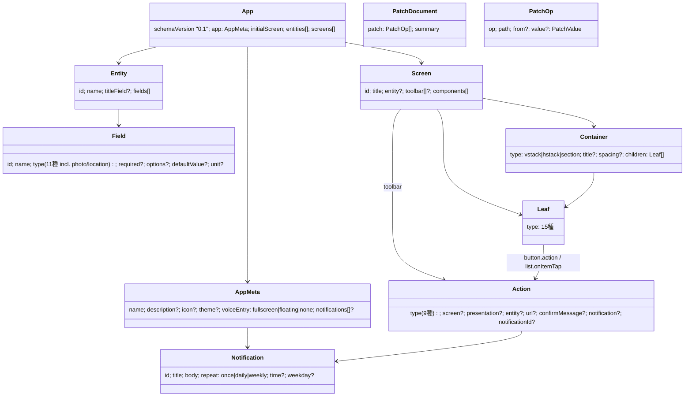

# AppDSL v0.1 提案 (バックエンド側案・iOS 案とすり合わせ用)

> **【旧案・参考】** 2026-10-24 昼に iOS 案とすり合わせ、統一版 **DSL v1** を `docs/dsl/README.md` + `docs/dsl/dsl.schema.json` に確定した。以下は提案時点の記録で、v1 と食い違う箇所(`schemaVersion` が `"0.1"` 文字列、スキーマ/examples のパス等)は v1 が正。

> スキーマ本体: `dsl.schema.json` (JSON Schema draft 2020-12)。Go 型: `backend/pkg/dsl`。実例(全て CI で検証済み): `examples/initial.json`(初期・音声画面のみ)、デモ3本 `examples/kakeibo.json`(家計簿)・`examples/training.json`(トレーニング記録・毎朝通知)・`examples/walk.json`(散歩メモ・カメラ)。

## 1. 設計原則(Claude 構造化出力に最適化)

| 原則 | 内容 | 理由 |
|---|---|---|
| **非再帰** | `Screen > Container(vstack/hstack/section) > Leaf` の **2 段固定**。Leaf は children を持てない | Claude 構造化出力は**再帰スキーマ非対応**。iOS レンダラーも有界で済む |
| `type` で判別 | 全コンポーネント・アクションは `type` の `const/enum` で閉じる | discriminator が1箇所、Swift の `enum Codable` に素直に落ちる |
| enum で閉じる | スタイル・集計・フィルタ演算子・遷移方法は全て enum | AI が勝手な値を発明しない |
| 制約は Go 側 | `minItems/maxLength/pattern` を**スキーマに書かない**。上限(画面12・entity6・フィールド20・1段30個)と id 形式(`^[a-z][a-z0-9_-]{0,39}$`)は `dsl.Validate()` | 構造化出力が数値/文字列制約を受け付けないため、同じ JSON を Claude にもバリデータにも使える |
| `additionalProperties: false` | 全オブジェクト | 構造化出力の必須条件・未知プロパティ混入防止 |
| 参照は id 文字列 | 画面遷移・entity・field は全て id 参照。整合性は `Validate()` が検査(存在しない画面へ navigate 等を列挙して AI に返す) | |
| データは DSL 外 | DSL は**定義のみ**。レコード(家計簿の明細)は appconfig の `records` API | DSL が肥大化しない・AI がデータを壊せない |
| 初回フル / 以後 Patch | 初回は DSL 全体(root `AppDSL`)、2 回目以降は `$defs/PatchDocument` = `{patch: RFC 6902 ops, summary}` を構造化出力させる。Patch の `value` は **プリミティブ or DSL 部分文書(`$defs/PatchValue`)に限定** | 編集の出力トークンが 1/5 以下・未言及部分の保持が構造的に保証。`value` を閉じることで構造化出力の `additionalProperties:false` 制約を満たす。appconfig が `dsl.ApplyPatch` で適用+検証(実装済み) |

## 2. 構造



## 3. コンポーネント一覧(18 種 = コンテナ 3 + リーフ 15)

| type | 役割 | 必須 | 任意 | SwiftUI 対応の目安 |
|---|---|---|---|---|
| `vstack` / `hstack` | 縦/横並び | `children` | `spacing` | VStack/HStack |
| `section` | 見出し付きグループ | `children` | `title` | Section (List/Form 内) |
| `text` | 静的テキスト | `text` | `style`(title/headline/body/caption), `align` | Text |
| `button` | アクション起動 | `label`, `action` | `icon`, `style`(primary/secondary/destructive/plain) | Button |
| `textField` | 文字入力(要 `screen.entity`) | `field` | `label`, `placeholder`, `multiline` | TextField/TextEditor |
| `numberField` | 数値入力 | `field` | `label`, `placeholder`, `unit` | TextField(.numberPad) |
| `datePicker` | 日付入力 | `field` | `label`, `includeTime` | DatePicker |
| `picker` | enum 選択(`options` は Field から) | `field` | `label`, `style`(menu/segmented/wheel) | Picker |
| `toggle` | 真偽 | `field`, `label` | | Toggle |
| `photoField` **(P0 カメラ)** | 撮影/選択→Firebase Storage へアップ→URL を photo フィールドへ | `field`(photo 型) | `label`, `source`(camera/library/both) | UIImagePickerController / PhotosPicker |
| `image` | photo フィールドの表示 | `field`(photo 型) | `height` | AsyncImage |
| `list` | entity のレコード一覧 | `entity`, `item{title}` | `item.subtitle/trailing/icon`, `sort`, `filter`, `emptyText`, `onItemTap`, `swipeToDelete` | List + ForEach |
| `stat` | 集計値 1 つ | `label`, `entity`, `aggregate` | `field`(count 以外必須), `filter`, `format` | カード |
| `chart` | 集計グラフ | `entity`, `kind`, `groupBy`, `aggregate` | `title`, `field`, `bucket`, `filter` | Swift Charts |
| `voiceInput` | マイク UI(初期画面の主役) | | `prompt`, `size` | 独自 |
| `spacer` / `divider` | 余白/罫線 | | `size` | Spacer/Divider |

未知の `type` を受け取った iOS は**クラッシュせずプレースホルダ**(「未対応: xxx」)を出す。これが前方互換の約束。

## 4. 画面・遷移・アクション・データバインディング

| 概念 | 仕様 |
|---|---|
| 画面 | `screens[]`。`initialScreen` が起動画面。`title` はナビバー |
| フォーム画面 | `screen.entity` を持つ画面は、その entity の**ドラフト 1 件**を文脈として持つ。入力系 Leaf の `field` はこのドラフトのキー。`recordId` 付きで開かれたら**編集モード**(既存値をロード) |
| 遷移 | `action.type=navigate` + `screen` + `presentation`(push/sheet/fullScreen)。`list.onItemTap` の navigate は iOS が**タップした recordId を暗黙に渡す** |
| 保存/削除 | `saveRecord{entity}`: ドラフトを `POST/PATCH records` → 成功したら `screen` 指定があればそこへ、無ければ `back`。`deleteRecord{entity}`: 現在の recordId を DELETE → back。`confirmMessage` があれば確認ダイアログ |
| 音声への復帰 | `openVoice` アクション、または `app.voiceEntry`(`fullscreen`=初期状態 / `floating`=右下マイクFAB / `none`) |
| **ローカル通知 (P0)** | 2 経路。(a) `app.notifications[]`: DSL ロード時に iOS が `UNUserNotificationCenter` へ**同期**(id 一致で置換・無くなった id は取消)。AI が「毎朝8時に通知して」を受けたらここに追加。(b) `scheduleNotification{notification}` / `cancelNotification{notificationId}` アクション: ボタン押下で予約/取消。`repeat: once|daily|weekly`, `time: HH:MM`, `weekday` |
| **カメラ (P0)** | Field `type: photo`(値 = https URL)。`photoField` が撮影→iOS が Firebase Storage `users/{uid}/apps/{appId}/photos/{ulid}.jpg` へアップ→URL をドラフトに入れる→`saveRecord`。バックエンドはバイナリを扱わない。`location` 型(`"lat,lng"`)も用意(散歩メモ用・P1) |
| 集計 | `stat`/`chart` の `aggregate` と `filter` は **iOS がレコード一覧を取得してクライアント集計**(v0)。`thisMonth/today` は端末ローカル時刻基準 |
| フィルタ値 | `filter.value` は `eq/neq/gt...` では必須、`thisMonth/today` では `null` |
| 並び替え | `sort{field,direction}`。無指定は `createdAt desc` |
| テーマ | `theme.primaryColor`(#RRGGBB)と `mode` のみ。それ以外は iOS のデザインシステム |

## 5. 実例

### 5.1 初期状態(音声画面のみ)— `examples/initial.json`

```json
{
  "schemaVersion": "0.1",
  "app": { "name": "はじめてのアプリ", "icon": "waveform", "voiceEntry": "fullscreen" },
  "initialScreen": "home",
  "entities": [],
  "screens": [{
    "id": "home", "title": "",
    "components": [
      { "type": "spacer", "size": "flexible" },
      { "type": "voiceInput", "id": "mic", "prompt": "どんなアプリが欲しい？", "size": "large" },
      { "type": "spacer", "size": "flexible" }
    ]
  }]
}
```

### 5.2 家計簿 — `examples/kakeibo.json`(抜粋。全文はファイル参照)

```json
{
  "schemaVersion": "0.1",
  "app": { "name": "家計簿", "icon": "yensign.circle", "theme": { "primaryColor": "#2E7D32" }, "voiceEntry": "floating" },
  "initialScreen": "home",
  "entities": [{
    "id": "expense", "name": "支出", "titleField": "memo",
    "fields": [
      { "id": "amount",   "name": "金額",     "type": "currency", "required": true, "unit": "円" },
      { "id": "category", "name": "カテゴリ", "type": "enum", "required": true, "options": ["食費","交通","日用品","娯楽","その他"], "defaultValue": "食費" },
      { "id": "memo",     "name": "メモ",     "type": "string" },
      { "id": "date",     "name": "日付",     "type": "date", "required": true, "defaultValue": "now" }
    ]
  }],
  "screens": [
    {
      "id": "home", "title": "家計簿",
      "toolbar": [{ "label": "追加", "icon": "plus", "action": { "type": "navigate", "screen": "expense_form", "presentation": "sheet" } }],
      "components": [
        { "type": "hstack", "children": [
          { "type": "stat", "label": "今月の支出", "entity": "expense", "aggregate": "sum", "field": "amount", "format": "currency",
            "filter": { "field": "date", "op": "thisMonth", "value": null } },
          { "type": "stat", "label": "件数", "entity": "expense", "aggregate": "count", "filter": { "field": "date", "op": "thisMonth", "value": null } }
        ]},
        { "type": "chart", "title": "カテゴリ別", "entity": "expense", "kind": "pie", "groupBy": "category", "aggregate": "sum", "field": "amount" },
        { "type": "section", "title": "最近の支出", "children": [
          { "type": "list", "entity": "expense", "item": { "title": "memo", "subtitle": "category", "trailing": "amount" },
            "sort": { "field": "date", "direction": "desc" }, "swipeToDelete": true,
            "onItemTap": { "type": "navigate", "screen": "expense_form", "presentation": "push" } }
        ]}
      ]
    },
    {
      "id": "expense_form", "title": "支出を記録", "entity": "expense",
      "toolbar": [{ "label": "保存", "icon": "checkmark", "action": { "type": "saveRecord", "entity": "expense" } }],
      "components": [
        { "type": "section", "title": "内容", "children": [
          { "type": "numberField", "field": "amount", "label": "金額", "unit": "円" },
          { "type": "picker", "field": "category", "label": "カテゴリ", "style": "segmented" },
          { "type": "textField", "field": "memo", "label": "メモ" },
          { "type": "datePicker", "field": "date", "label": "日付" }
        ]},
        { "type": "button", "label": "削除", "style": "destructive",
          "action": { "type": "deleteRecord", "entity": "expense", "confirmMessage": "この支出を削除しますか？" } }
      ]
    }
  ]
}
```

### 5.3 編集ターンの Patch 例(家計簿 → 「店名も記録したい。毎晩20時に思い出させて」)

```json
{
  "summary": "店名を記録できるようにし、毎晩20時のリマインドを追加しました",
  "patch": [
    { "op": "add", "path": "/entities/0/fields/-", "value": { "id": "shop", "name": "店名", "type": "string" } },
    { "op": "add", "path": "/screens/1/components/0/children/-", "value": { "type": "textField", "field": "shop", "label": "店名" } },
    { "op": "replace", "path": "/screens/0/components/2/children/0/item/subtitle", "value": "shop" },
    { "op": "add", "path": "/app/notifications", "value": [
      { "id": "nightly", "title": "家計簿", "body": "今日の支出を記録しましょう", "repeat": "daily", "time": "20:00" } ] }
  ]
}
```

`backend/pkg/dsl/patch_test.go` がこの Patch を `examples/kakeibo.json` に適用して検証している。

### 5.4 デモ 3 本の DSL の見どころ

| デモ | ファイル | 使う機能 |
|---|---|---|
| 家計簿 | `examples/kakeibo.json` | currency / enum picker(segmented) / stat(thisMonth sum) / pie chart / list → form(sheet) / swipeToDelete |
| トレーニング記録 | `examples/training.json` | **app.notifications(毎朝 8:00)** / toggle / datetime / bar chart(week bucket) / stat max |
| 散歩メモ | `examples/walk.json` | **photo + photoField(camera) + image** / location / list thumbnail / **scheduleNotification ボタン** / fullScreen presentation |

## 6. iOS 側とのすり合わせ: 譲れない点 / 柔軟な点

| 区分 | 項目 | 理由 |
|---|---|---|
| **譲れない** | 非再帰(2 段固定)・`additionalProperties:false`・数値/文字列制約なし | Claude 構造化出力の制約。ここを崩すと生成の信頼性が落ちる |
| **譲れない** | `type` 判別子 + 閉じた enum | AI の出力安定・バリデーション・Swift enum 化 |
| **譲れない** | `schemaVersion` 必須・未知 type はプレースホルダ描画 | 前方互換。Day2 にコンポーネントを足しても古いビルドが死なない |
| **譲れない** | entity 定義は DSL 内、レコードは API(DSL 外) | 保存先・バージョニングの単純化 |
| **譲れない** | id は `^[a-z][a-z0-9_-]{0,39}$`、参照は id 文字列 | 検証・Firestore パス安全性 |
| **譲れない** | 常に声で変更可能(`voiceEntry` / `openVoice`) | プロダクトのコア体験 |
| **譲れない** | 編集は JSON Patch(RFC 6902)。iOS は Patch を見ない(常に適用後のフル DSL を受け取る) | ユーザー決定。iOS 側に Patch 適用ロジックを持たせない |
| **譲れない** | 写真はバイナリでなく URL(iOS→Storage 直アップ) | Firestore 1MB 制限・バックエンド単純化 |
| 柔軟 | コンポーネント名・プロパティ名(camelCase 前提) | iOS の Codable に合わせて rename 可 |
| 柔軟 | 18 種のラインナップ(減らす・`webview`/`map` 追加) | スキーマ + Go 型 + プロンプトカタログの 3 点を同時更新 |
| 柔軟 | 通知の同期セマンティクス(id 置換 vs 全消し再登録)・`once` の発火時刻解釈(今日の time を過ぎていたら翌日) | iOS 実装都合で決めてよい |
| 柔軟 | `list.item` の形(title/subtitle/trailing)→ テンプレ文字列 `"{{memo}}"` 等 | iOS の描画都合で決めてよい |
| 柔軟 | 集計をサーバー側(appconfig `GET /records?aggregate=`)に移す | 件数が増えたら |
| 柔軟 | `theme`・`style`・`spacing` の語彙 | デザイン担当の裁量 |
| 柔軟 | 画面の `kind`(list/form/detail テンプレ)を追加してコンポーネント列挙を省く | AI の出力トークン削減になるが表現力が落ちる。Day1 午後に判断 |
| 要相談 | フォームのドラフト・`recordId` 暗黙受け渡しのセマンティクス | iOS のナビゲーション実装に直結 |
| 要相談 | `voiceInput` を Leaf にするか、画面種別 `kind: "voice"` にするか | 初期画面の見た目を iOS がどこまで固定したいか |
