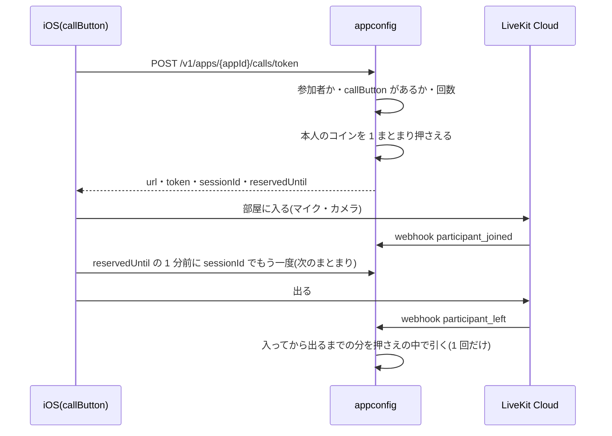

# 通話(#447)

共有のアプリの参加者どうしで、アプリを開いている間に音声・ビデオで話せるようにする。着信(相手を呼び出す)は無い。音声・映像の中継は自前で立てず、**LiveKit Cloud** を使う(2026-11-10 オーナーの判断)。使った分は**使った人自身のコイン**で分単位に払う([#630 の設計](../../decisions/630-token-billing.md)の「使う人が自分の分を払う」と同じ)。DSL の書き方は [DSL README の callButton](../../dsl/README.md)。

## 目次
- [1. 流れ](#1-流れ)
- [2. API](#2-api)
- [3. コイン](#3-コイン)
- [4. 入れる人と安全](#4-入れる人と安全)
- [5. データ](#5-データ)
- [6. 設定(環境変数)](#6-設定環境変数)
- [7. iOS](#7-ios)
- [8. 人がすること](#8-人がすること)
- [9. 分かっている制約](#9-分かっている制約)

## 1. 流れ

## 2. API

| メソッド | パス | 認証 | 返す |
|---|---|---|---|
| POST | `/v1/apps/{appId}/calls/token` `{room?, video?, name?, sessionId?}` | Firebase(App Check) | `{url, token, room, identity, sessionId, expiresAt, video, blockMinutes, reservedUntil, coinsReserved, coinsPerMinute}` |
| POST | `/v1/calls/webhook` | LiveKit の署名(`Authorization` の JWT・本文の sha256) | 204 |

- 部屋の名前は `app:{appId}`(callButton に `room` があれば `app:{appId}:{room}`)。
- トークンの権限: 部屋に入る・聞く・マイク。**カメラは部品が `video: true` で、body も `video: true` の時だけ**。データの送信・自分の metadata の変更はできない。部屋の人数は `CALL_MAX_PARTICIPANTS`(部屋を作る時の設定としてトークンに入れる)。
- `identity` は `sessionId`(その人の 1 回の通話)。uid は LiveKit に渡さない。名前は本人が決めた投稿の名前(#250)だけ(無ければ空 = 「匿名」)。
- エラー: 402 `coins_insufficient`(`details.payer: self`)・403 `not_member`・404(`calls_disabled` / `no_shared_data` / `no_call_button` / `call_ended`)・429(1 時間の回数)。詳しくは `docs/backend/openapi-appconfig.yaml`。

## 3. コイン

| 段 | 中身 |
|---|---|
| 押さえる | トークンを出すたびに、**呼び出した本人の財布**から `COIN_PER_CALL_MINUTE × CALL_BLOCK_MINUTES` を押さえる(`coins.Biller` の Reserve・op `call`)。押さえの鍵は `call/{sessionId}/{n}` |
| 続ける | アプリは `reservedUntil` の 1 分前に同じ `sessionId` でもう一度呼び、次のまとまりを押さえる。足りなければ 402 で、アプリは通話を出る |
| 引く | webhook の `participant_left`(または `room_finished`)で、入った時刻から出た時刻まで(始まった分は 1 分)× `COIN_PER_CALL_MINUTE` を、押さえたまとまりの順に、それぞれ押さえた量まで引く(履歴の種類 `spend_call`)。押さえより長い分は引かない(ログ `calls.uncovered_minutes`) |
| 1 回だけ | 精算は `callSessions/{sessionId}` に `settled`・分・まとまりごとの量を 1 回だけ書く。同じ webhook がもう一度来ても同じ量を確定するだけ(`SettleHold` は確定済みならそのまま) |
| webhook が来ない | 押さえは `CALL_BLOCK_MINUTES + CALL_HOLD_GRACE` で期限が切れ、全部戻る(利用者に損をさせない側。ログ `coins.hold_expired`)。押さえ直した時は、前のまとまりの期限も新しいまとまりと同じ時刻まで延ばす(精算は出る時なので、長い通話の途中で前のまとまりが戻らないように) |
| 押さえの終わり | 入った時刻から「押さえたまとまりの数 × `CALL_BLOCK_MINUTES`」が、その通話の終わり(`paidUntil`)。押さえ直すと延びる。`paidUntil` になったら、サーバーが LiveKit の RoomService(`RemoveParticipant`)でその人を部屋から外し、`paidUntil` までで精算する。外すのに失敗したら 30 秒おきに数回やり直す(精算は外せてから) |
| トークンの期限 | トークンで入れる期限は `CALL_TOKEN_TTL` と `paidUntil`(まだ入っていなければ、今から押さえた分)の短い方 |
| 精算の後 | 精算した通話(`settled`)の `sessionId` で部屋に入り直すと、`participant_joined` の webhook で外す。押さえ直しも 404 `call_ended` |
| 止める | `COIN_BILLING_MODE=off` なら押さえない・引かない。`log` は押さえず、引くはずの量をログ `coins.would_spend` に出すだけ。`COIN_PER_CALL_MINUTE=0`(既定)なら数えない |

値段(`COIN_PER_CALL_MINUTE`)は非公開の資料で決め、この repo には書かない。

## 4. 入れる人と安全

- トークンを出すのは、**公開済みの DSL に callButton がある共有のアプリ**(scope `shared` / `public` の entity がある)の、作成者と参加者(共有リンクで参加した人)だけ。appId を知っているだけの人は 403。
- 運営が非公開にしたアプリ(#321)は 403 `unpublished`。
- callButton の `room` に無い部屋のトークンは出さない(404 `no_call_button`)。
- 1 人 1 時間 `CALL_TOKENS_PER_HOUR` 回まで(インスタンスごと・`feeds` と同じ数え方)。
- webhook は LiveKit の SDK(`github.com/livekit/protocol/webhook`)で署名を確かめ、違えば 401。本文は 64 KiB まで。
- 録音・録画はしない(LiveKit の Egress を使わない)。音声・映像はサーバーに残らない。

## 5. データ

| 置き場 | 中身 |
|---|---|
| `callSessions/{sessionId}` | `{uid, appId, room, video, blocks: [{holdId, amount, dryRun}], createdAt, joinedAt, endedAt, paidUntil, settled, minutes, charges: {holdId: coins}, deleteAt}` |
| `coinReservations/{holdId}` | 押さえ(#630 と同じ・op `call`) |
| `users/{uid}/coinLedger/*` | 引いた分は `spend_call` |

- `deleteAt`(30 日後)に Firestore の TTL を付ける(人がすること)。退会の消去(`cmd/purge`)はまだ `callSessions` を消さない(TTL で 30 日以内に消える・下の制約)。

## 6. 設定(環境変数)

`docs/infra/runtime-config.md` の「運用で変える値」。`CALLS_ENABLED`(appconfig と ai の両方・既定 off)・`LIVEKIT_URL`・`LIVEKIT_API_KEY`・`LIVEKIT_API_SECRET`(Secret Manager)・`COIN_PER_CALL_MINUTE`(既定 0)・`CALL_BLOCK_MINUTES`(30)・`CALL_HOLD_GRACE`(10m)・`CALL_TOKEN_TTL`(10m)・`CALL_MAX_PARTICIPANTS`(8)・`CALL_TOKENS_PER_HOUR`(30)。

- `CALLS_ENABLED` が off: appconfig は 404 `calls_disabled` を返し webhook の受け口も出さない。ai は callButton を作らず、今までどおり「通話はできない」と答える。
- `CALLS_ENABLED` が on なのに `LIVEKIT_*` が無い・形が違う: appconfig は起動しない(設定の間違いに早く気づくため)。

## 7. iOS

- 部品 `CallButtonLeaf`(MetamonRenderer)→ ホストの `CallHost.startCall` → `CallView`(全画面)。
- `CallSession`(MetamonServices): トークン → LiveKit の部屋に入る → マイク(と許されればカメラ)→ `reservedUntil` の 1 分前に押さえ直す → 402 なら出て「コインが足りない」。`CallRoom` の本物は `LiveKitCallRoom`(LiveKit Swift SDK 2.18.0・Apache-2.0)、テストは偽の部屋。
- マイク・カメラの説明文は今の Info.plist のもの(通話を足した)。バックグラウンドでの通話・着信(CallKit・VoIP プッシュ)は無い。
- 審査用の版はコードごと外す(`docs/ios/review-build.md`)。
- 402 のコインの購入画面: #630 の iOS のコインの画面(#822)が入ったら `CallUI.openCoinShop` をつなぐ。それまでは案内の文だけ。

## 8. 人がすること

1. LiveKit Cloud の契約・プロジェクト作成(地域は東京に近いもの)。API キーと秘密を Secret Manager に置き、appconfig に参照を付ける(repo・ログ・Issue に書かない)。
2. LiveKit のプロジェクトの webhook に `https://<appconfig の URL>/v1/calls/webhook` を登録する(stg・prod それぞれ)。
3. `callSessions` の `deleteAt` に Firestore の TTL を付ける。
4. プライバシーポリシー・App Store の栄養ラベルに「音声・映像(通話の中継だけ・保存しない・LiveKit が中継)」を足す。
5. 審査用の版で通話を戻す時は、審査メモに説明を足す(`docs/ios/review-build.md`)。
6. `COIN_PER_CALL_MINUTE`(値段)を決める。決まるまでは 0 のまま(数えない)。

## 9. 分かっている制約

- 押さえ直しはアプリがする。押さえ直さないまま `paidUntil` を過ぎると、サーバーが部屋から外す。
- `paidUntil` の見張りは appconfig のインスタンスの中のタイマー。インスタンスが止まるとタイマーは消えるが、同じ部屋に次の webhook が来た時か、押さえ直しの時に追いつく(誰も来ない部屋では遅れる)。
- `COIN_BILLING_MODE=log`・`COIN_PER_CALL_MINUTE=0` の時は外さない(押さえていないため)。
- 人数の上限は部屋を作る時だけ効く(先に入った人の設定)。
- 回数の上限はインスタンスごと(Cloud Run の台数ぶん緩くなる)。
- ブロック(#321)した相手と同じ部屋に入るのは止めていない。
- 退会しても `callSessions` は TTL(30 日)まで残る(uid と分だけ。中身の音声・映像は無い)。
- LiveKit の Go SDK(`github.com/livekit/protocol`)は依存が多く、appconfig のバイナリが大きくなる(ai は使わない)。
