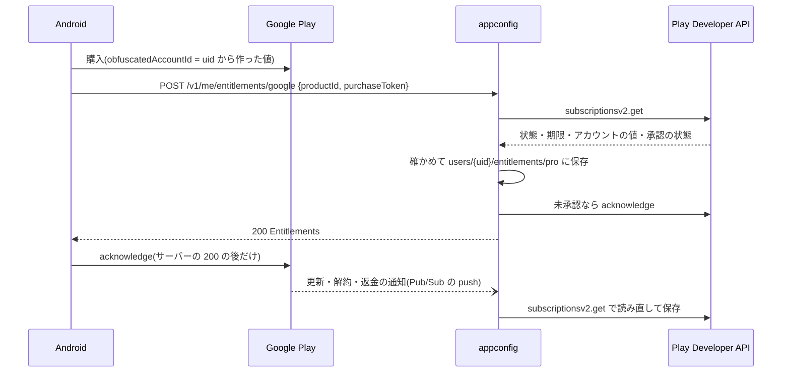

# Google Play の課金(サーバーの側)(#2515)

> [バックエンド設計](../architecture.md) の機能の文書。Android の側の動き(購入の画面・承認・復元)と人の設定の手順は [docs/android/play-billing.md](../../android/play-billing.md)。形の正は [openapi-appconfig.yaml](../openapi-appconfig.yaml) の `/me/entitlements/google` と `/googleplay/notifications`。Pro の権利そのものは [pro.md](pro.md)。

## 目次

- [考え方: 権利の正はサーバー](#考え方-権利の正はサーバー)
- [購入の確かめ(POST /v1/me/entitlements/google)](#購入の確かめpost-v1meentitlementsgoogle)
- [通知の受け方(POST /v1/googleplay/notifications)](#通知の受け方post-v1googleplaynotifications)
- [App Store の分との違い](#app-store-の分との違い)
- [設定(環境変数)](#設定環境変数)
- [コードの場所](#コードの場所)
- [決めること](#決めること)

## 考え方: 権利の正はサーバー

- Pro かどうかの正は `users/{uid}/entitlements/pro`。App Store で買っても Google Play で買っても**同じ文書**に書く(Play の分は `platform: googlePlay`)。`GET /v1/me/entitlements` と ai の Pro の判定はこの文書だけを読むので、どちらで買っても同じアカウントなら両方の端末で効く。
- 端末の購入の結果は信じない。端末は購入の token を送るだけで、サーバーが Google Play Developer API(`purchases.subscriptionsv2.get`)で**読み直して**から保存する。
- 1 つの購入 = 1 つの uid。`googleplay_purchases/{PlayKey}` に uid を記録する。`PlayKey` は購入の token の SHA-256 で、token そのものは保存しない。
- 保存した権利は前にしか進まない(期限の切れた購入も保存するが、新しい購入を上書きしない)。

## 購入の確かめ(POST /v1/me/entitlements/google)

本文 `{"productId", "purchaseToken"}`(8 KB まで・token は 4096 文字まで)。Firebase の認証と App Check は他の `/v1/me` と同じ。

1. `productId` が許可リスト(`GOOGLE_PLAY_PRODUCT_IDS`)にあること。
2. Play Developer API で購入を読み直す。無ければ 422(`not_found`)。API に届かなければ 503 `upstream_unavailable`(端末は送り直す)。
3. 購入にその `productId` の行があること。期限(`expiryTime`)が無い = まだ払われていない時は 422(`pending`)。
4. `obfuscatedExternalAccountId` があれば、`entitlement.AccountToken(uid)`(iOS の `appAccountToken` と同じ計算)と合うこと。合わなければ 409 `account_mismatch`。
5. 前の購入を置き換えた購入(`linkedPurchaseToken`)は、前の購入が別の有効な uid のものなら 409 `transaction_owned_by_other`。
6. この購入が別の有効な uid に結びついていれば 409 `transaction_owned_by_other`。結びついた uid が退会済みなら、呼び出した人に移す。
7. 保存する。状態が `ACTIVE`・`IN_GRACE_PERIOD`・`CANCELED`(自動更新を止めただけ)なら期限まで Pro。`ON_HOLD`・`PAUSED`・`EXPIRED` などは期限が先でも今で Pro を終える。ライセンス テスターの購入は `environment: Sandbox`。
8. 未承認で Pro になる購入は、サーバーも `purchases.subscriptions.acknowledge` で承認する(端末の承認と二重でも害は無い・失敗はログだけ)。
9. 200 で `GET /v1/me/entitlements` と同じ形を返す。

鍵(`GOOGLE_PLAY_SERVICE_ACCOUNT_JSON`)の無いサーバーは 503 `not_configured`。

| 状態 | code | `details.reason` |
|---|---|---|
| 400 | `bad_request` | `productId` / `purchaseToken` が無い・長すぎる |
| 409 | `account_mismatch` | 別のアカウントのための購入 |
| 409 | `transaction_owned_by_other` | 別のアカウントに結びついた購入 |
| 422 | `invalid_transaction` | `product_id`(許可リストに無い・購入に行が無い)・`not_found`・`pending` |
| 503 | `not_configured` | 鍵が無い |
| 503 | `upstream_unavailable` | Play Developer API に届かない |

## 通知の受け方(POST /v1/googleplay/notifications)

Real-time developer notifications(RTDN)を Pub/Sub の push サブスクリプションで受ける。

- **認証**: Firebase の ID トークン・App Check は使わない。Pub/Sub が付ける OIDC トークンの audience(`GOOGLE_PLAY_RTDN_AUDIENCE`)と、メール(`GOOGLE_PLAY_RTDN_SERVICE_ACCOUNT`・確認済み)を確かめる。合わなければ 401。
- **本文**: Pub/Sub の push の形(`message.data` が base64 の JSON)。64 KB まで。`message.data` が無ければ 400。
- **中身の扱い**: 通知は購入の token しか持たないので、通知の種類で分けず、いつも Play Developer API で**読み直して**保存する(更新・解約・猶予・保留・返金を同じ道で)。
- **結果**(200 `{"outcome": ...}`):

| `outcome` | いつ |
|---|---|
| `applied` | 結びついた uid があり、読み直して保存した |
| `unbound` | まだ誰もこの購入を `POST /v1/me/entitlements/google` で送っていない(端末が送った時に保存される) |
| `test` | Play Console の「テスト通知を送信」 |
| `ignored` | 別のパッケージ・定期購入でない取り消し・JSON でない・購入が見つからない・許可リストの商品が無い |

- 500 は一時的な失敗で、Pub/Sub が送り直す。
- 3 つの設定(`GOOGLE_PLAY_SERVICE_ACCOUNT_JSON`・`GOOGLE_PLAY_RTDN_AUDIENCE`・`GOOGLE_PLAY_RTDN_SERVICE_ACCOUNT`)がそろった時だけ、この経路を作る。どれかが無ければ経路が無い(404)。

## App Store の分との違い

App Store の分は [app-store-notifications.md](../../infra/app-store-notifications.md)(通知)と [pro.md](pro.md)(購入の確かめ)。

| 項目 | App Store | Google Play |
|---|---|---|
| 購入の確かめ | 端末が送る署名付きの取引(JWS)を Apple のルート証明書まで検証する。外の API は呼ばない | 端末が送る token で Play Developer API を呼んで読み直す(サービスアカウントの鍵が要る) |
| アカウントの照合 | `appAccountToken` | `obfuscatedExternalAccountId`(同じ `AccountToken(uid)`) |
| 結びつきの置き場 | `appstore_transactions/{originalTransactionId}` | `googleplay_purchases/{PlayKey}`(token のハッシュ) |
| 通知の認証 | 通知の本文の JWS の署名 | Pub/Sub の OIDC トークン |
| 通知の中身 | 取引と更新情報そのもの(種類ごとに重ねる) | token だけ(いつも API で読み直す) |
| 同じ通知の 2 回目 | `appstore_notifications/{notificationUUID}` で `duplicate` | 記録しない(読み直すので結果は同じ) |
| 承認 | 無い | サーバーと端末の両方で acknowledge。3 日以内に承認しないと Play が返金する |
| 届かなかった通知を拾う | 照合ジョブ(`cmd/appstore-reconcile`) | 無い(端末の復元で読み直す) |
| テスト購入 | Sandbox の環境 | ライセンス テスター(`testPurchase`)を `environment: Sandbox` として保存。`APPSTORE_ENVIRONMENTS` で Production だけにすると Pro にならない |

## 設定(環境変数)

appconfig が読む。値と人の設定の手順は [docs/android/play-billing.md](../../android/play-billing.md#appconfig-の設定)。

| 名前 | 中身 |
|---|---|
| `GOOGLE_PLAY_PACKAGE_NAME` | アプリのパッケージ(既定 `jp.kz2601.metamon`)。通知の `packageName` もこれと比べる |
| `GOOGLE_PLAY_PRODUCT_IDS` | Pro の商品 id(カンマ区切り・既定 `jp.kz2601.metamon.pro.monthly`) |
| `GOOGLE_PLAY_RTDN_AUDIENCE` | push サブスクリプションの OIDC の audience |
| `GOOGLE_PLAY_RTDN_SERVICE_ACCOUNT` | push サブスクリプションが使うサービスアカウントのメール |
| `GOOGLE_PLAY_SERVICE_ACCOUNT_JSON` | Play Developer API のサービスアカウントの鍵。Secret Manager から入れる。ログに出さない |

## コードの場所

| ファイル | 中身 |
|---|---|
| `backend/internal/googleplay/googleplay.go` | Play Developer API の呼び出し(`Subscription` / `Acknowledge`)・状態の定数・`Entitles` |
| `backend/internal/entitlement/google.go` | 購入の確かめと保存(`SubmitGoogle`)・`PlayKey`・`FromPlay` |
| `backend/internal/entitlement/google_notify.go` | 通知の口(`RegisterPlayNotifications`)・OIDC の確かめ・読み直し(`PlayNotifications`) |
| `backend/internal/entitlement/handler.go` | `POST /v1/me/entitlements/google` の HTTP と失敗のコード |
| `backend/internal/entitlement/firestore.go` | 結びつき(`googleplay_purchases`)と権利の保存 |
| `backend/cmd/appconfig/googleplay.go` | 環境変数の読み取りと通知の経路を作るか |

## 決めること

- 届かなかった通知を拾う照合ジョブ: App Store にはあるが Play には無い。端末が開かれないと、通知を落とした更新・解約が反映されない。Play にも作るか。
- 通知の 2 回目の記録: 読み直すので結果は同じだが、API を毎回呼ぶ。数が増えたら App Store と同じように記録するか(推測: 今の規模では不要)。
