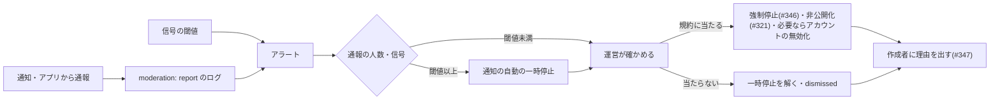

# #339 悪用と脅威のモデル(スパム・フィッシング・外部への送信・計算の乱用・データの持ち出し)

> 状態: **提案(オーナーの判断待ち)**。2026-11-02 作成。この PR は設計の下書きだけで、コード・スキーマ・[`docs/00_decisions.md`](../00_decisions.md)・GCP・Firebase・App Store Connect は変えない。
> 対象 Issue: [#339](https://github.com/jphacks/kz_2601/issues/339)(エピック [#335](https://github.com/jphacks/kz_2601/issues/335)。依存: [#336](https://github.com/jphacks/kz_2601/issues/336)・[#337](https://github.com/jphacks/kz_2601/issues/337)。これに従う実装: [#343](https://github.com/jphacks/kz_2601/issues/343) 生成と検証・[#345](https://github.com/jphacks/kz_2601/issues/345) 計量と上限・[#346](https://github.com/jphacks/kz_2601/issues/346) 停止スイッチ・[#347](https://github.com/jphacks/kz_2601/issues/347) 見える化・[#348](https://github.com/jphacks/kz_2601/issues/348) 外部連携・[#349](https://github.com/jphacks/kz_2601/issues/349) 審査・[#269](https://github.com/jphacks/kz_2601/issues/269) 他人の行動で届くプッシュ)
> 前提: #336 の推奨「**A = 宣言的なサーバー機能**(閉じた語彙・新しいサービス `runner`)」、#337 の推奨「テナントは appId・共有データに効くのは作成者の公開 DSL だけ・runner は専用の SA と縛られた取っ手」、#338 の推奨「無料の小さい枠 + Pro・上限で自動の動きだけを止める」。3 本の下書きは [PR #543](https://github.com/jphacks/kz_2601/pull/543) にまとめてあり、**この文書からのリンクは PR #543 のマージ後に有効になる**。B(AI がコードを書く)は対象にしない。
> **この文書には攻め方の手順・文面・今のコードの弱い所を書かない**(公開リポジトリのため)。書くのは脅威の**種類**と**守り方**だけ。試験ケースも種類と期待する安全な結果だけを書く。

## 目次

1. [結論(推奨)](#結論推奨)
2. [守るものと登場する人](#守るものと登場する人)
3. [止める段: 生成の段と実行の段](#止める段-生成の段と実行の段)
4. [脅威の一覧](#脅威の一覧)
5. [通知の規則](#通知の規則)
6. [見つける・止める・対応する](#見つける止める対応する)
7. [試験の計画(種類だけ)](#試験の計画種類だけ)
8. [審査(#349)との関係](#審査349との関係)
9. [#336・#337 の問いへの答え](#336337-の問いへの答え)
10. [残る危険](#残る危険)
11. [決めてほしいこと](#決めてほしいこと)
12. [参考](#参考)

## 結論(推奨)

**「AI がどんな宣言を作っても、エンジンが許す範囲の外には届かない」ことを、実行の段の強制で保証する。生成の段の検証は早めに断って説明するためのもので、守りの根拠にしない。**

- **一番の守りは語彙の狭さ**: 任意の宛先・任意の URL・外部への送信・全件の削除・AI の呼び出し・処理の連鎖は、最初の語彙に**無い**(#336)。無いものは、指示文に何が紛れ込んでも作れない。
- **通知は「閉じた宛先 × 決まった枠の本文 × 受け取る人ごとの上限 × 受け取る人の同意」**。本文に自由な URL を入れない。送り主(どのアプリか)を必ず出す。通知から通報・通知の停止ができる。
- **public(誰でも読める)アプリの通知は参加者のアプリより狭くする**: 作成者本人と、ref 先のレコードの作者(返信の知らせ)だけ。「全員」は無し。仲間探しのアプリには最初は自動の動きを付けない(#337 の問いへの答え)。
- **外部への送信(#348)は作らない**。作る前に満たす条件を下に列挙する(運営の許可リスト・仲介・内部のアドレスに届かない・送る項目の最小化・同意・審査の説明)。
- **見つける**: `runner.usage`(#338)に悪用の兆しの数(宛先の上限に当たった回数・通知の停止・通報・ブロック)を足す。中身と生の uid は出さない。
- **止める**: 停止スイッチ 3 段(#346)に「通知だけを止める」を足す案。**自動で止めるのは通知の一時停止まで**、非公開化・削除・アカウントの無効化は人が決める。
- **試験**: 決まった結果になるもの(宛先・本文・上限・越境・停止)は Go のテストで毎回の PR に、LLM を通すもの(悪い依頼を断る・紛れ込んだ指示に従っても禁止の宣言が通らない)は ai-eval に置く。

## 守るものと登場する人

### 守るもの

| 守るもの | 失うとどうなるか | 主な守り(この文書・関係する文書) |
|---|---|---|
| 利用者の注意(通知) | うるさくて Tailor It ごと通知を切られる・アンインストール | 通知の規則(下)・上限(#338) |
| 利用者の信頼(送り主の見分け) | 生成アプリの通知を公式や他社の知らせと取り違える | 決まった枠の本文・送り主の表示・URL を入れない |
| 他人のデータ(他のアプリ・他の人の private) | 個人情報の漏れ | 隔離(#337)・差し込める値の制限(下) |
| 費用(Cloud Run・Firestore・APNs・将来の AI) | 料金の暴走(SEV1) | 回数の上限・全体の遮断(#338) |
| 運営の評判とストアへの掲載 | 却下・取り下げ・法的な責任 | 審査の説明(#349)・通報と非公開化(#321)・仲間探しの範囲(#507) |
| 秘密(APNs の鍵・将来の連携の鍵) | なりすましの通知・他のサービスへの侵入 | APNs の鍵は runner だけ(#337)・連携の鍵は DSL に置かない(#348) |

### 登場する人

| 人 | できること | 信じる度合い |
|---|---|---|
| 利用者(自分だけのアプリ) | 自分のアプリに自動の動きを付ける。宛先は自分だけ | 自分のデータの範囲で信じる |
| アプリの作成者 | 共有アプリの公開 DSL(ルール)を決める。費用はこの人の枠 | **信じない**(悪意のある作成者を想定する) |
| 参加者 | 共有データを読み書きし、きっかけを起こす | **信じない**(連打・いたずらを想定する) |
| 外の人(参加していない・appId を知っている・シェアリンクを持っている) | 何もできない(読めない・きっかけを起こせない)べき | 信じない |
| 悪意のある作成者 | 語彙の範囲で、参加者に迷惑をかける・情報を集める・他人を装う宣言を作ろうとする | 信じない。**この文書の主な相手** |
| 運営 | 停止・非公開化・削除・アカウントの無効化 | 信じる(操作は記録に残す) |
| AI(生成の LLM) | 依頼から宣言を作る | **信じない**(出力は検証の対象。紛れ込んだ指示に従うことがある前提) |

信じるもの: エンジン(`runner`・appconfig)のコード、運営の操作、検証器の判定。**信じないもの**: 利用者の依頼文、レコードの値、AI の出力、作成者の公開 DSL の中身。

## 止める段: 生成の段と実行の段

| 止めるもの | 生成の段(AI の規則 + 保存の時の検証 #343) | 実行の段(`runner`・appconfig) |
|---|---|---|
| 語彙に無い処理(任意の宛先・URL・外部・全件の削除・AI・連鎖) | 規則で作らない。スキーマ(閉じた enum・`additionalProperties:false`)で保存を拒む | エンジンに実装が無い(呼べない) |
| 宛先の種類 | アプリの種類(private / shared / public / match)ごとに許す種類だけ | **実行の時点の**参加者・同意・ブロックで絞る |
| 本文の枠 | 長さ・URL の形・電話番号・制御文字・見えない文字・禁止語を検証して拒む | 差し込む値をもう一度無害化し、長さで切る |
| 差し込める値 | 宛先が読めない entity の値を参照する宣言を拒む | 宛先ごとに「読めるか」を確かめ、読めなければ送らない |
| 回数・宛先の数・ルールの数 | 形の上限(#338 の表)を超える宣言を拒む | 1 日の上限・受け取る人ごとの上限を数えて止める |
| 定期の細かさ | 1 日 1 回より細かいものを拒む | 予定の表で強制 |
| 恋愛・出会い目的・他人を装う・個人情報の収集が目的のアプリ | AI の規則で断る(理由を出す)・ai-eval | 通報 → 停止・非公開化 |
| 悪用の兆しが出たアプリ | — | 通知の自動の一時停止・運営の停止(#346) |

**原則**: 生成の段で通ったものも、実行の段で必ず同じ規則を当てる(公開 DSL は作成者が書き換えられる・古い版が残る・検証器に漏れがありうる)。逆に、実行の段にしか無い規則は作らない(作成者に「なぜ動かないか」を生成の段で説明できるように)。

**指示の紛れ込み**: 依頼文に紛れ込んだ命令は、語彙に無いものなら作れない。語彙の中のもの(例: 参加者全員に通知)は、作成者がそれを望んだのと区別できないので、上限・同意・見える化(#347)で害を小さくする。**レコードの値は runner の中で「データ」としてだけ扱い**、命令として解釈する部品(LLM など)を runner に置かない。AI を使う処理を語彙に足す時は、[#366](366-feedback-prompt-injection.md) と同じ「LLM が従っても禁止の操作に届かない」作りを先に決める(**#366 のリンクは PR #535 のマージ後に有効になる**)。

## 脅威の一覧

見方: **起きやすさ**・**影響**は 高 / 中 / 低。守りは **予防**(起きないようにする)/ **発見**(起きたら気づく)/ **対応**(気づいたら止める)。「残る危険」は守りの後にも残るもの。STRIDE で言うと、なりすまし(S)= フィッシング・アカウントの量産、改ざん(T)= 越境の書き込み、否認(R)= 記録の不足、情報の漏えい(I)= 越境・外部への送信、サービス妨害(D)= スパム・計算の乱用、権限の昇格(E)= 越境・語彙の外の処理、に当たる。

### 1. スパム・通知の乱用

| 項目 | 中身 |
|---|---|
| 想定 | 作成者・参加者が自動の動きで大量・頻繁な通知を出す。宣伝・勧誘に使う |
| 起きやすさ / 影響 | **高 / 中**(通知が使えるようになれば最初に起きる。費用より利用者の離脱が痛い) |
| 予防 | 閉じた宛先(参加者だけ・public はさらに狭い)・受け取る人ごとの上限・1 回の宛先の数の上限(#338)・受け取る人の同意・本文の枠・処理の連鎖なし・匿名では使えない |
| 発見 | 宛先の上限に当たった回数・通知の停止(ミュート)の数・通知からの通報の数(アプリごと) |
| 対応 | 通知の自動の一時停止(下)・運営のアプリ停止(#346)・作成者への理由の表示 |
| 残る危険 | 上限の内側の迷惑(1 日数通でもうるさい)。受け取る人のミュートと退出で各自が止める |

### 2. 生成アプリ・通知を使ったフィッシング

| 項目 | 中身 |
|---|---|
| 想定 | 公式・金融機関・他社を装った通知や画面で、外のページに誘う・情報を入力させる |
| 起きやすさ / 影響 | **中 / 高**(1 件でも審査・評判に響く) |
| 予防 | 本文に URL・電話番号・メールアドレスを入れない(下)・通知に送り主(アプリ名 + Tailor It)を必ず出す・押すとそのアプリを開くだけ・アプリ名と本文の枠に公式・他社を装う語を検証で拒む・AI の規則で「他人を装う」「秘密を集める」アプリを断る・パスワードやカードの番号を集める入力を作らない |
| 発見 | 通報の理由(既存の 7 種。「なりすまし」を足すかは決めてほしいこと)・禁止語で拒んだ回数(アプリごと) |
| 対応 | アプリの停止(#346)と非公開化(#321)・悪質ならアカウントの無効化(人) |
| 残る危険 | 枠の中の普通の言葉だけで誤解させる文。通報と人の確認に頼る |

### 3. 外部への送信(今は作らない)

外部との連携(#348)は最初の語彙に入れない。**作る前に、次がすべて成り立つこと**を条件にする。

| 条件 | 中身 |
|---|---|
| 宛先は運営の許可リストだけ | 作成者・AI が任意の URL を書けない。許可リストへの追加は人の判断 |
| 仲介を通す | 外への通信は runner から直接出さず、専用の仲介(固定の出口)だけを通す。内部のアドレス・クラウドのメタデータ・自分たちのサービスには届かない |
| 送る項目を最小にする | 連携ごとに送ってよい項目を決め、それ以外のレコードの値・uid を送らない |
| 秘密は DSL に置かない | アプリごとの鍵は Secret Manager などに置き、DSL・ログ・AI の文脈に出さない |
| 量の上限 | 連携ごと・アプリごとの回数・応答の大きさ・時間の上限。超えたら止める |
| 同意と開示 | 第三者への提供の同意・プライバシーポリシーの追記(#246)・App Privacy の見直し・審査の説明(5.1.2) |
| 止められる | 連携ごとの停止スイッチ(#346 に 1 段足す) |
| 試験 | 許可リストの外・内部のアドレスに届かないことを、連携を入れる PR の CI で確かめる |

起きやすさ / 影響(作った場合): **中 / 高**。今の残る危険: なし(作らない)。

### 4. 計算・費用の乱用

| 項目 | 中身 |
|---|---|
| 想定 | 定期処理・扇形の通知・連打・アカウントの量産で、原価を利用者の操作と比例させずに増やす |
| 起きやすさ / 影響 | **中 / 中**(原価は小さいが、全体の遮断に当たると全員の自動の動きが止まる) |
| 予防・発見・対応 | **#338 で決める**(1 日の上限・形の上限・`RUNNER_GLOBAL_DAILY`・`RUNNER_PAUSED`・30 日の放置で停止・`runner.usage`)。この文書から足すのは「1 つのアプリが全体の遮断の大きな割合を使ったら発見の信号にする」だけ |
| 残る危険 | 全体の遮断に当たった日は、まじめなアプリも止まる(悪用の巻き添え)。アプリごとの上限を全体より十分小さくして減らす |

### 5. テナントをまたぐデータの持ち出し

| 項目 | 中身 |
|---|---|
| 想定 | 自動の動きを経由して、他のアプリ・読む権限の無いレコード・他の人の private の値を、通知の本文・書き込み先・SSE に出す |
| 起きやすさ / 影響 | **低 / 高**(作りで防ぐが、漏れれば SEV1) |
| 予防 | **隔離の仕組みは #337**(appId に縛られた取っ手・公開 DSL だけが正・専用の SA)。この文書から足す規則: (1) 通知に差し込める値は**宛先が読めるレコードの値だけ**、(2) private の宣言は共有の entity に書けない・共有の宣言は private を読めない、(3) 通知の本文に uid・内部の id を出さない |
| 発見 | 監査のログ(#337)・「差し込みを宛先の権限で落とした」回数(0 でなければ調べる) |
| 対応 | 全体の停止(`RUNNER_PAUSED`)→ 原因の修正 → 漏れた範囲の特定(SEV1・[障害対応の手順書](../ops/incident-runbook.md)) |
| 残る危険 | 共有アプリの中では、作成者・参加者が読めるデータは読める(仕様)。プライバシーポリシーで説明する |

### 6. 仲間探し・共有アプリでのいやがらせ

| 項目 | 中身 |
|---|---|
| 想定 | 特定の参加者に通知を集中させる・ブロックした相手から通知が届く・外された人に届く・仲間探しでつながる前に接触する |
| 起きやすさ / 影響 | **中 / 高**(1 人への被害でも重い) |
| 予防 | 受け取る人ごとの上限・**ブロックした人(どちら向きでも)がきっかけの通知は届けない**・宛先は実行の時点の参加者だけ(抜けた・外された人には届かない)・仲間探しのアプリには最初は自動の動きを付けない(付ける時も宛先は「つながった相手」だけ・つながる前の通知は無し・断られたことを知らせない #507 の規則に合わせる) |
| 発見 | 通知の後のブロック・退出・通報の数(アプリごと・受け取る人ごとは数だけ) |
| 対応 | ブロック・退出(各自)・作成者による除外・運営の停止 |
| 残る危険 | 自動の動きを使わない普通の書き込み(投稿)でのいやがらせ。これは #321 の通報・ブロックの範囲 |

### 7. AI が作る有害な内容

| 項目 | 中身 |
|---|---|
| 想定 | AI が作る通知の本文の枠・アプリ名・説明に、性的・暴力・差別・違法な内容が入る(依頼による・誤って) |
| 起きやすさ / 影響 | **中 / 中** |
| 予防 | 今の生成の規則(断る依頼の種類)を通知の枠にも当てる・禁止語の検証(#321 の残りの NG ワードと共通にする)・枠の長さを短くする |
| 発見 | 通報・生成で断った依頼の分類(#336 の段階 4 の計測と共通) |
| 対応 | アプリの停止・非公開化・生成の規則の修正(ai-eval に種類を足す) |
| 残る危険 | 差し込まれるレコードの値(参加者が書いた文)は AI を通らない。投稿と同じく通報で扱う |

### 8. アカウントの量産

| 項目 | 中身 |
|---|---|
| 想定 | 使い捨てのアカウントで無料の枠を増やす・通報やブロックを逃れる・共有アプリに大量に参加する |
| 起きやすさ / 影響 | **中 / 中** |
| 予防 | 自動の動きは匿名では使えない(#338)・作成者ごとの上限・App Check([app-check.md](../infra/app-check.md))を強制にする(人の作業)・匿名サインインにも App Check をかける([rate-limit.md](../backend/rate-limit.md) の人の作業)・作ったばかりのアカウントは他人宛ての通知を出せない期間を置く案(決めてほしいこと) |
| 発見 | 新しいアカウントからの扇形の通知・同じアプリへの短時間の大量参加(数だけ) |
| 対応 | アプリの停止・アカウントの無効化(人) |
| 残る危険 | 本物の端末を多数使う相手は止めきれない。上限で被害の大きさを抑える |

### 9. 法令・規約への抵触

| 項目 | 中身 |
|---|---|
| 想定 | 生成アプリの機能や通知が、法令・ストアの規約に触れる |
| 起きやすさ / 影響 | **低 / 高** |
| 予防 | **出会い系サイト規制法**: 仲間探しの範囲(恋愛・出会い目的は作らない・18 歳以上の確認)は #507 の方針([matching.md](../backend/features/matching.md) §1・§6・§7)に合わせ、自動の動きでもその範囲を越えない(つながる前の通知は無し)。**宣伝の通知**: 規約で、通知を広告・勧誘に使うことを禁じる(App Store 4.5.4 と同じ考え)。**個人情報**: 越境の防止(上)・外部への送信は同意の後(上)。**利用者同士のメッセージを運営が仲介することの扱い**(電気通信事業の届出の要否など)は**要確認**(人・必要なら専門家) |
| 発見 | 通報(`illegal` など)・審査の指摘 |
| 対応 | 該当する語彙・アプリの種類を止める(#346)・規約の改定 |
| 残る危険 | 法令の解釈は人の判断。この文書は最終の確認ではない |

## 通知の規則

#269 の最初の 1 本から当てる規則(案)。値は #338 の表を出発点にする。

| 規則 | 中身 |
|---|---|
| 閉じた宛先 | 種類だけで書く: 自分・作成者・このレコードの作者・ref 先のレコードの作者・宛先の field の人・役割・参加者全員。**任意の uid・メールアドレス・電話・外部の宛先は無し**。アプリの種類ごとの許す範囲は下の表 |
| 実行の時点で絞る | 宛先は実行の時点の参加者の中からだけ。抜けた・外された・退会した人、同意していない人、きっかけの人をブロックしている(どちら向きでも)人には送らない |
| 決まった枠の本文 | 題と本文は「AI が作った枠 + レコードの値の差し込み」だけ。枠は生成の段で検証し、作成者が後から自由な文に書き換えられない(書き換えは公開 DSL の新しい版として同じ検証を通る) |
| URL を入れない | 枠にも差し込む値にも、URL・ドメインの形・電話番号・メールアドレスを入れない(見つけたら生成の段は拒む・実行の段は伏せる)。押すとそのアプリの中を開くだけで、外のページには行かない |
| 長さと文字 | 題・本文の長さの上限(例: 題 30 字・本文 80 字・差し込み 1 つ 30 字。値は決めてほしいこと)。制御文字・見えない文字・向きを変える文字は捨てる |
| 送り主を出す | 通知には必ずアプリ名を出す(iOS の通知の上で Tailor It からと分かる)。公式・運営を名乗る語はアプリ名・枠に使えない |
| 受け取る人ごとの上限 | 1 つのアプリから 1 日 20 通・全アプリの合計 100 通(#338)。超えた分は送らず、まとめて後から送ることもしない |
| 同意(opt-in) | 共有アプリに参加した時に「このアプリからの通知を受け取る」を本人が選ぶ。**既定は shared では確認つきで有効、public では無効**(案)。アプリごとにいつでも止められる。iOS の通知の許可は Tailor It 本体が求める |
| 通知からの通報 | 通知を開いた画面(または通知のアクション)から「このアプリの通知を止める」「通報する」ができる。通報は既存の `POST /v1/reports` に対象の種類(自動の動き・ルール)を足す |
| 静かな時間(案) | 受け取る人の夜間(例 22:00〜7:00)は送らない、または iOS の時間指定の要約に任せる。決めてほしいこと |
| 本文を残さない | 送った本文はログに出さない。実行の記録(#347)には「どのルールが何人に送ったか」だけ |

### アプリの種類ごとの宛先

| 種類 | 許す宛先 | 理由 |
|---|---|---|
| 自分だけ(private) | 自分だけ | 他人を巻き込まない(#337) |
| 共有・参加者(shared) | 上の種類すべて(参加者の中から) | 招待された人の集まり。同意と上限で抑える |
| 共有・誰でも(public) | **作成者本人・ref 先のレコードの作者だけ**(「全員」・役割・宛先の field は無し) | 知らない人同士の集まりで、扇形の通知はスパムになりやすい |
| 仲間探し(match) | **最初は無し**。付ける時も「つながった相手」だけ | #507 の安全の規則(つながる前の接触なし) |

## 見つける・止める・対応する

### 記録する信号(個人情報なし)

#338 の `runner.usage` に足すか、同じ形の `runner.abuse` を足す(案)。生の uid・本文・レコードの値は出さない。人は `*_uid_hash`(`ai.usage` と同じ作り方)だけ。

| 信号 | 何に気づくか |
|---|---|
| 生成の段で拒んだ宣言の数(理由の種類ごと: 宛先・URL・禁止語・形の上限) | 悪い依頼の傾向・検証の厳しすぎ |
| 実行の段で落とした数(宛先の権限・同意なし・ブロック・受け取る人の上限) | 生成の段の漏れ・特定の人への集中 |
| 宛先の上限・アプリの上限に当たった回数 | 扇形の通知・連打 |
| 通知を止めた(ミュート)・退出・ブロックの数(通知の後 24 時間・アプリごと) | うるさいアプリ |
| 通知・ルールへの通報の数(アプリごと・通報した人の数) | スパム・フィッシング・有害な内容 |
| 新しいアカウントが作ったアプリの他人宛ての通知の数 | アカウントの量産 |
| 1 つのアプリが全体の遮断に占める割合 | 費用の乱用 |

### 知らせ(アラート)

| 条件(案。値は決めてほしいこと) | 重さ | 届け先 |
|---|---|---|
| 差し込みを宛先の権限で落とした回数が 1 以上 | SEV1 の疑い(越境の守りが働いた = どこかに漏れがある) | 運営(すぐ) |
| 1 つのアプリへの通報が 24 時間で 3 人以上 | 対応待ち | 運営(#321 のアラートと同じ所) |
| ミュート・退出の率がアプリで急に上がる | 調べる | 運営(日次) |
| `RUNNER_GLOBAL_DAILY` の 80% | 費用 | 運営(#338) |

### 止めるスイッチ(#346)

| 段 | 止める範囲 | 誰が |
|---|---|---|
| `RUNNER_PAUSED` | 環境の自動の動きを全部 | 運営 |
| `RUNNER_NOTIFY_PAUSED`(案) | 環境の**通知だけ**(書き込み・集計は動かす) | 運営 |
| アプリの停止 / 強制停止 | 1 つのアプリ。非公開化(#321)でも止まる | 運営(作成者は解けない) |
| アプリの通知の一時停止(案) | 1 つのアプリの通知だけ | **自動**(下の条件)か運営 |
| ルールの停止 | 1 つのルール | 運営・作成者 |

**自動で止めるのは「アプリの通知の一時停止」まで**(案)。条件は「24 時間で通報した人が N 人以上」か「ミュートの率が閾値以上」。作成者には理由を出し、運営が確かめて解くか、強制停止・非公開化に進む。非公開化・削除・アカウントの無効化は誤りの影響が大きいので人が決める。

### 運営の対応の流れ(#321 の拡張)

- 通報の対象の種類に「自動の動き(ルール)」を足し、`cmd/moderate` に停止・解除の操作を足す(#346 の実装の時)。運用は [moderation.md](../infra/moderation.md) の「通報を受けたら」に 1 行足す。
- [障害対応の手順書](../ops/incident-runbook.md)に「手順 F: 悪用(スパム・フィッシング・越境の疑い)」を足す(#346 の実装の時)。越境の疑いは SEV1、スパム・フィッシングは広がり方で SEV1〜2。最初の 15 分は「通知だけを止める → 範囲を確かめる → アプリを止める」の順にする。
- 24 時間の当番は #321 の未決と同じ(決めてほしいこと)。

## 試験の計画(種類だけ)

**合格の条件は「AI が断った」ではなく、「どんな宣言でも、禁止の結果が起きない」**(#366 と同じ考え)。攻め方の文面は書かない。各種類に「害のない対照」(普通の依頼・宣言で、正しく通るべきもの)を混ぜて、厳しすぎを見る。

| # | 種類 | 期待する安全な結果 | 置き場所 | 通す Issue |
|---|---|---|---|---|
| T1 | 宛先の外 | 参加者でない・抜けた・外された・同意していない・ブロックの関係にある人に届かない。public・match の種類ごとの制限が効く | Go のテスト(runner・メモリの store) | #345・#269 |
| T2 | 本文の枠 | URL・電話番号・メールアドレス・制御文字・見えない文字・長すぎる値・禁止語が、生成の段で拒まれ、実行の段でも出ない | Go のテスト(検証器・runner) | #343 |
| T3 | 頻度と扇形 | 受け取る人ごと・アプリごと・1 回の宛先の上限で止まり、後でまとめて送らない | Go のテスト | #345 |
| T4 | 越境 | 差し込み・書き込み・SSE で、他のアプリ・読めない値が出ない(#337 の表の試験に「差し込みの権限」を足す) | Go のテスト(メモリとエミュレータ) | #341・#345 |
| T5 | 語彙の外 | 任意の宛先・URL・外部・全件の削除・連鎖を含む宣言が、スキーマと検証で保存できない | Go のテスト(スキーマ・`Validate()`) | #343 |
| T6 | 悪い依頼 | 恋愛・出会い目的・他人を装う・秘密を集める・大量の通知を求める依頼は、断るか語彙の範囲に狭めて作る。断りの理由が出る | ai-eval(新しい案件の集まり) | #343 |
| T7 | 紛れ込んだ指示 | 依頼文・添付・レコードの値に命令が混ざっても、出てくる宣言が T5 の検証を通らない・runner の動きが変わらない | ai-eval(依頼文)・Go のテスト(レコードの値) | #343・#345 |
| T8 | 停止 | 全体・通知だけ・アプリ・ルールの各段で止めた後、きっかけで何も送られない。自動の一時停止の条件で止まる | Go のテスト | #346 |
| T9 | 記録 | ログ・実行の記録に本文・レコードの値・生の uid が出ない | Go のテスト | #345・#347 |
| T10 | 費用 | #338 の最悪の場面の表がそのまま上限で止まる | Go のテスト | #345 |

### 置き場所と回し方(案)

| 層 | 中身 | いつ回すか |
|---|---|---|
| 1. 決まった結果の試験 | T1〜T5・T7(レコードの値)・T8〜T10。種(乱数)を固定し、語彙から宣言を機械的に組み合わせる(#337 の試験と共通の道具) | **毎回の PR**(backend-ci) |
| 2. LLM を通す試験 | T6・T7(依頼文)。`backend/internal/ai/eval/` に新しい案件の集まりを足し、合否は「出てきた宣言が検証を通るか・断りの文があるか」を機械で判定 | プロンプト・語彙・検証器を変える PR と、週 1 回(費用の上限つき) |

ai-eval の入力は公開リポジトリに入るので、**依頼文は「何を求めているか」が分かる普通の言葉に留め、実際に使える文面は入れない**。それで足りない種類は、リポジトリの外に置くか作らないかを決める(決めてほしいこと)。

## 審査(#349)との関係

| ガイドライン | 論点 | 答え方(案) |
|---|---|---|
| 2.5.2(コードのダウンロード) | 自動の動きはアプリの機能を後から変えていないか | 自動の動きはサーバーで動き、端末にコードを送らない。端末に届くのは今と同じ DSL(データ)と通知だけ。語彙はサーバーとバイナリに固定([app-review-notes.md](../store/app-review-notes.md) の説明に 1 段足す) |
| 4.7(ミニアプリ等) | 作ったものが別のアプリとして振る舞っていないか | 作ったものは Tailor It の中だけで動き、通知も Tailor It から来る(送り主の表示) |
| 4.5.4(プッシュ通知) | 通知を宣伝に使っていないか・必須にしていないか | 通知は同意の後だけ・アプリごとに止められる・規約で宣伝を禁止・通知を許可しなくても使える |
| 1.2(利用者の作る内容) | 通知も含めて通報・ブロック・運営の対応があるか | 通知からの通報・ブロックで通知も止まる・運営の停止と非公開化(#321・#346) |
| 5.1.1 / 5.1.2(データ) | 外部への送信 | 今は無い。作る時は同意と開示が先(上の条件) |
| 審査用の版 | 共有を外した版(`APP_STORE_REVIEW`) | 他人宛ての自動の動きは共有アプリでしか起きないので、審査用の版には出ない。自分宛ての通知を審査用の版に残すかは #349 で決める |

## #336・#337 の問いへの答え

| 問い | この文書の答え(案) |
|---|---|
| 生成の段と実行の段の分け方(#336) | 両方で同じ規則を当て、**実行の段の強制を正**にする。生成の段は早めに断って説明するため([止める段](#止める段-生成の段と実行の段)) |
| 通知の本文の差し込みの制限と、宛先・頻度の上限の値(#336) | 決まった枠 + 差し込み・URL / 電話 / メールなし・長さの上限・制御文字を捨てる。宛先・頻度の値は #338 の表から始める([通知の規則](#通知の規則)) |
| 「全員のレコードを消して」を、語彙に全件の削除を入れないことで防ぐ方針でよいか(#336) | **よい**。加えて「処理が書いたレコードではきっかけを起こさない」「1 回の書き込みの数の上限」で、語彙の中の処理の組み合わせでも大量に消せないようにする。複数のレコードの更新を後で足す時は件数の上限つき(#336 のとおり) |
| 通報から停止までの流れ・通報の多いアプリを自動で止めるか(#336) | 通知だけを自動で一時停止し、強制停止・非公開化は人([運営の対応の流れ](#運営の対応の流れ321-の拡張)) |
| 試験ケースを ai-eval とテストのどちらに置くか(#336・#337) | 決まった結果になるものは Go のテスト(毎回の PR)、LLM を通すものは ai-eval([試験の計画](#試験の計画種類だけ)) |
| public のアプリの宛先(#337) | 作成者本人・ref 先のレコードの作者だけ(「全員」は無し) |
| 仲間探しのアプリの自動の動き(#337) | 最初は付けない。付ける時は「つながった相手」だけ |

## 残る危険

この設計で消えないもの。人が受け入れるかを決める。

- **上限の内側の迷惑**: 1 日数通でも、望まない通知は迷惑。ミュート・退出・通報で各自が止める前提。
- **普通の言葉での誤解・だまし**: URL を入れなくても、枠の中の文で誤解させることはできる。通報と人の確認に頼る。
- **共有アプリの中の見え方**: 作成者・参加者が読めるデータは、自動の動きでも読める(仕様)。プライバシーポリシーで説明する。
- **当番の不在**: 24 時間の当番が決まるまで、自動の一時停止の後の判断が遅れる。
- **法令の解釈**: 出会い系・利用者同士のメッセージの扱いの最終確認は人(必要なら専門家)。
- **アカウントの量産**: 本物の端末を多く持つ相手は止めきれない。上限で被害を抑えるだけ。

## 決めてほしいこと

- [ ] **原則**: 実行の段の強制を正にし、生成の段は同じ規則で早めに断る(推奨)
- [ ] **public のアプリの宛先**: 作成者本人・ref 先のレコードの作者だけ(推奨) / 参加者のアプリと同じ
- [ ] **仲間探しのアプリの自動の動き**: 最初は付けない(推奨)
- [ ] **通知の本文**: URL・電話番号・メールアドレスを入れない・押すとアプリの中だけ(推奨)
- [ ] **本文の長さの上限**: 題 30 字・本文 80 字・差し込み 1 つ 30 字で始める(推奨) / 別の値
- [ ] **受け取る人ごとの上限**: #338 の 20 通 / アプリ・100 通 / 合計で始める(推奨)
- [ ] **同意の既定**: shared は参加の時に確認つきで有効・public は無効(推奨) / どちらも無効
- [ ] **静かな時間**: 入れる(22:00〜7:00 は送らない) / 入れない(iOS に任せる)
- [ ] **ブロックの関係にある人がきっかけの通知を届けない**(推奨)
- [ ] **通報の対象と理由**: 対象に「自動の動き(ルール)」を足す(推奨)。理由に「なりすまし」を足すか
- [ ] **自動で止める範囲**: 通知の一時停止まで・強制停止と非公開化は人(推奨)。通報の人数 N(案 3 人 / 24 時間)とミュートの率の閾値
- [ ] **通知だけを止めるスイッチ**(`RUNNER_NOTIFY_PAUSED`・アプリの通知の一時停止)を #346 に足す(推奨)
- [ ] **新しいアカウントの待ち期間**: 作ってすぐは他人宛ての通知を出せない期間を置くか(置くなら何時間か)
- [ ] **App Check を強制にする時期**: 他人宛ての自動の動きを出す前に `enforce` にする(推奨・人の作業)
- [ ] **外部への送信**: 上の条件がすべて成り立つまで作らない(推奨)
- [ ] **規約の追記**: 通知を宣伝・勧誘に使うことの禁止・自動の動きの通報と停止(#246 と一緒に)
- [ ] **法令の確認**: 利用者同士の通知・メッセージの運営による仲介の扱い(電気通信事業の届出の要否など)を人が確かめる。出会い系は #507 の方針のまま
- [ ] **試験の置き場所**: 決まった結果は Go のテスト(毎回の PR)・LLM は ai-eval(関係する PR と週 1 回)(推奨)
- [ ] **ai-eval の入力の公開**: 普通の言葉に留めてリポジトリに置く(推奨) / 一部はリポジトリの外に置く
- [ ] **24 時間の当番**: #321 の未決と一緒に決める
- [ ] **手順書**: incident-runbook に「手順 F: 悪用」を足す(#346 の実装の時)
- [ ] 決まった内容は人が `docs/00_decisions.md` に追記し、この文書を「決定」に変える

## 参考

- Issue: [#335](https://github.com/jphacks/kz_2601/issues/335)〜[#349](https://github.com/jphacks/kz_2601/issues/349)・[#269](https://github.com/jphacks/kz_2601/issues/269)・[#246](https://github.com/jphacks/kz_2601/issues/246)・[#318](https://github.com/jphacks/kz_2601/issues/318)・[#321](https://github.com/jphacks/kz_2601/issues/321)・[#333](https://github.com/jphacks/kz_2601/issues/333)・[#507](https://github.com/jphacks/kz_2601/issues/507)・[#511](https://github.com/jphacks/kz_2601/issues/511)
- 判断の文書:
  - [#336 バックエンドの自動構築の方式](336-backend-autogen-approach.md)・[#337 隔離とマルチテナント](337-isolation-multitenancy.md)・[#338 サーバー機能の費用モデル](338-server-feature-cost-model.md)(**PR #543 のマージ後にリンクが有効になる**)
  - [#366 フィードバックに紛れ込む指示への対策](366-feedback-prompt-injection.md)(**PR #535 のマージ後にリンクが有効になる**)
  - [#288 本番と staging の DB の分け方](288-prod-staging-db-split.md)
- リポジトリ内:
  - [`docs/infra/moderation.md`](../infra/moderation.md)(#321)・[`docs/legal/moderation-policy-draft.md`](../legal/moderation-policy-draft.md)・[`docs/legal/terms.md`](../legal/terms.md)
  - [`docs/backend/rate-limit.md`](../backend/rate-limit.md)・[`docs/infra/app-check.md`](../infra/app-check.md)(#318)・[`docs/infra/ai-pause.md`](../infra/ai-pause.md)(#511)・[`docs/infra/ai-cost.md`](../infra/ai-cost.md)・[`docs/infra/observability.md`](../infra/observability.md)
  - [`docs/backend/features/matching.md`](../backend/features/matching.md)(#507・**PR #529 のマージ後にリンクが有効になる**)・[`docs/backend/features/members.md`](../backend/features/members.md)・[`docs/backend/features/shared-data.md`](../backend/features/shared-data.md)
  - [`docs/ops/incident-runbook.md`](../ops/incident-runbook.md)(#333)
  - [`docs/store/app-review-notes.md`](../store/app-review-notes.md)(2.5.2・4.7 の言い方)
  - [`docs/roadmap/roadmap-m1-m6.md`](../roadmap/roadmap-m1-m6.md)(M4)
