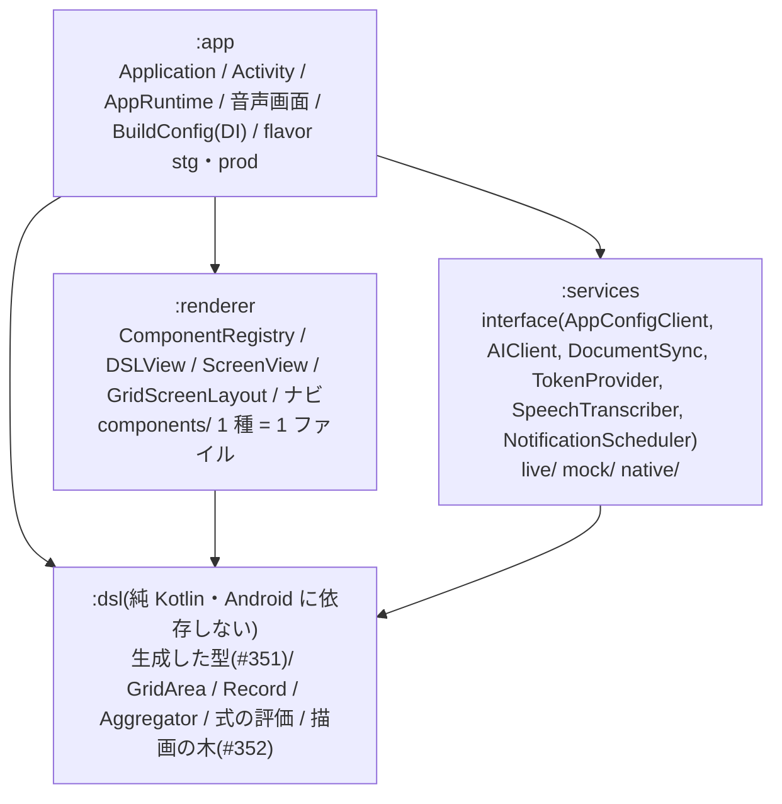

# #354 Android の技術を選ぶ(UI・音声認識・最低 API レベル・モジュール・DSL の型)

> 状態: **提案(オーナーの判断待ち)**。2026-11-02 作成。
> 対象 Issue: [#354](https://github.com/jphacks/kz_2601/issues/354)(依存 #351・この後に #356〜#360)
> 調べた日: 2026-11-02。API レベル・Play の要件・ライブラリの版は変わるので、決める前にもう一度「参考」のページを見ること。確かめきれなかった事実は **要確認** と書いた。
> 調べた元: `origin/develop` の iOS のコード・[`docs/ios/architecture.md`](../ios/architecture.md)・[`docs/legal/privacy-policy.md`](../legal/privacy-policy.md)・[`docs/02_github_workflow.md`](../02_github_workflow.md)、親の下書き #351(`docs/decisions/351-dsl-cross-platform.md`。**統合 PR #535 に入っていて develop にはまだ無い**)。
> **この文書は下書き**。決まったら、結論を [`docs/00_decisions.md`](../00_decisions.md) に移す(Issue の「完了の条件」)。この PR では正典は変えない。正典の 6 行目「iOS専用アプリ」も、Android を出すと決めた時に人間が直す。

## 目次

1. [結論(推奨)](#結論推奨)
2. [UI の技術](#ui-の技術)
3. [音声認識](#音声認識)
4. [最低 API レベルと対象の端末](#最低-api-レベルと対象の端末)
5. [モジュールの分け方](#モジュールの分け方)
6. [DSL の型(スキーマから生成)](#dsl-の型スキーマから生成)
7. [認証・課金・ネイティブ機能](#認証課金ネイティブ機能)
8. [CI と費用](#ci-と費用)
9. [決めてほしいこと](#決めてほしいこと)
10. [要確認の一覧](#要確認の一覧)
11. [参考](#参考)

## 結論(推奨)

1. **UI は Kotlin + Jetpack Compose**(ネイティブ)。iOS の SwiftUI と同じ宣言的な書き方で、`GridScreenLayout` は Compose の `Layout`(自前の measure / place)にそのまま写せる。Compose Multiplatform・Flutter・React Native は「iOS がもう SwiftUI で完成している」ので得が小さい(§2)。
2. **音声は「端末の中」を守る順に段を落とす**: ① Android の `SpeechRecognizer` の端末内モード(`createOnDeviceSpeechRecognizer`・`ja-JP`)→ ② 使えない端末は文字入力(iOS にもある)。whisper.cpp は**測ってから**決める任意の段、サーバーの音声認識は**入れない**(今のプライバシーポリシー「音声そのものはサーバーに送りません」を変えずに済むのは ① と whisper.cpp だけ)(§3)。
3. **minSdk 31(Android 12)・targetSdk / compileSdk 36**。31 は端末内の音声認識の API の下限。Compose 自体は 23 から動く。対応率は **要確認**(§4)。
4. **Gradle のモジュールを iOS と同じ 4 つに分ける**: `:dsl`(純 Kotlin・JVM でテスト)/ `:renderer`(Compose)/ `:services`(I/O)/ `:app`。依存の向きも iOS と同じ(§5)。
5. **DSL の型は #351 の自前の生成器(`backend/cmd/dslgen`)が出す Kotlin だけを使う**。手で型を書かない。形は #351 のとおり「平らな 1 クラス + `UNKNOWN` に丸める enum」で、知らない `type` は `@JsonClassDiscriminator` の多態ではなく**寛容な enum の serializer** で受ける(§6)。
6. 認証は Firebase Auth(Google・匿名・Apple)、課金は Play Billing + サーバー検証(#360)、ネイティブ機能の対応は **#351 の対応表を正**にして、ここでは Android だけの制約(API レベル・権限)を足す(§7)。
7. **CI は ubuntu の runner だけ**で回す(JVM のテスト + Robolectric)。エミュレータは develop への push か手動だけ(§8)。

## UI の技術

### 選択肢

| 選択肢 | ネイティブの見た目 | SwiftUI のグリッド配置との揃え方 | チーム(2 人・Swift と Go が得意) | 使い回し |
|---|---|---|---|---|
| **A. Jetpack Compose(推奨)** | ◎ Material 3 の部品そのもの | ◎ `Layout { measurables, constraints -> }` で 6 列 × 12 行の絶対配置を書ける(SwiftUI の `Layout` と同じ考え方)。`LazyRow` / `LazyVerticalGrid` など #351 §3 の「Android の候補」がそのまま使える | ○ Kotlin は Swift に近い(null 安全・data class ≒ struct・sealed ≒ enum)。`@Composable` ≒ `View`・`remember` / `State` ≒ `@State` / `@Observable` | 型は生成(#351)、正しさは適合テスト(#352)で揃える。コードは共有しない |
| B. Compose Multiplatform | △ iOS 側は Compose の自前描画(UIKit の部品ではない) | ○ Android は A と同じ | ○ A と同じ言語 | iOS の描画を置き換えれば 1 本にできる。ただし **iOS は SwiftUI で完成しているので、置き換えは大きな作り直し**。Android だけに使うなら A と同じ |
| C. Flutter | △ 自前描画。Material / Cupertino 風の部品 | ○ `CustomMultiChildLayout` で書ける | × Dart を新しく覚える | 3 つ目の描画器になる。ネイティブ機能は platform channel 越し |
| D. React Native | ○ ネイティブ部品をラップ | △ 絶対配置は書けるが、66 部品をネイティブ部品のラッパーで揃える手間が大きい | × JS / TS とブリッジ | 3 つ目の描画器。Web(#362)と共有できる余地はあるが、#362 は読むだけの表示 |

### 推奨の理由

- **「同じでなければならない」所(#351 §4: 並び・グリッドの位置・値・動き)は描画器の言語に依らず、適合テストで揃える**。だから共有コードの多さより、各 OS のネイティブらしさと書きやすさを取る。
- Compose Multiplatform が得になるのは「iOS の描画も Compose に寄せる」と決めた時だけ。今は iOS の 66 部品・ナビの規則(#113)・審査用ビルドの仕組みが SwiftUI にあり、寄せる理由が無い。
- 将来、`:dsl` の純粋な計算(式の評価・集計・`GridArea`)を Kotlin Multiplatform で iOS と共有する道は残る(§5)。今は選ばない。

## 音声認識

### iOS の今(比べる元)

- WhisperKit(argmax-oss-swift 1.1.1)の `small`(約 500MB)を、初回に確認してから Hugging Face から取得し、端末の中で文字にする([`WhisperKitRecognizer.swift`](../../ios/Packages/MetamonServices/Sources/MetamonServices/Live/WhisperKitRecognizer.swift)・[`architecture.md`](../ios/architecture.md) §6)。停止してから一括で認識(途中結果なし)。
- **サーバーへの退避は無い**。シミュレータは `MockTranscriber`、どの端末でも文字入力がある。
- プライバシーポリシー §1.2: 「音声は端末の中で文字にします」「**音声そのもの(録音データ)はサーバーに送りません**」(日本語・英語の両方)。
- 意図の判定(「元に戻して」など)は `VoiceIntent` が句読点・空白を落としてから比べる。Android でも同じ正規化を使う(認識器が違うと句読点の付き方が違う)。

### 選択肢

| 選択肢 | 大きさ | 精度・速さ | 費用 | プライバシーポリシーへの影響 |
|---|---|---|---|---|
| **S1. `SpeechRecognizer` の端末内モード(推奨・第 1 段)** | アプリは 0。言語のモデルは OS が持つ / OS が取得 | 途中結果が出る(iOS より体感が速い見込み)。日本語の端末内モデルがある端末は限られる(**要確認**: Pixel 以外のメーカーでの `ja-JP` の端末内対応) | 0 | 小さい。「音声は端末の中で(OS の音声認識の機能で)文字にします」と書き換えるだけ。送り先は増えない。Hugging Face の記載は Android には当てはまらない |
| S2. `SpeechRecognizer` の通常モード(`createSpeechRecognizer`) | 0 | 良い | 0(Google の負担) | **大きい**。公式の説明で「音声を遠くのサーバーへ送ることが多い」実装。「音声をサーバーに送りません」が Android では偽になる。送り先に Google を書き、データセーフティのフォームで音声の収集を申告 |
| S3. whisper.cpp(端末内) | モデルを取得: tiny 約 75MB・base 約 142MB・small 約 466MB(ggml。量子化でさらに小さい。**要確認**) | iOS と同じモデルの系統なので結果が揃いやすい。中位の端末で small が実用の速さか **要確認(実測が要る)**。NDK のビルドと、ABI ごとの .so の保守が要る | 0(配信の通信だけ) | iOS と同じ書き方(取得元を書く)。取得元を Hugging Face にするなら今の記載をそのまま Android にも広げる |
| S4. サーバーの Whisper / 音声 API(OpenAI・Google Cloud Speech-to-Text など) | 0 | 良い。通信の分だけ遅い | 従量(分単価は **要確認**)。利用者が増えると比例して増える | **大きい**。録音データを第三者に送るので、ポリシー §1.2・§(第三者の一覧)・英語版・データセーフティ・App Store のプライバシーの表示(iOS にも入れるなら)を変え、同意の画面が要る。backend に音声の受け口とレート制限が増える |
| S5. 文字入力 | 0 | — | 0 | なし(今もある) |

> 補足: ML Kit の GenAI の音声認識(端末内)という選択肢も出てきている(**要確認**: 日本語の対応・対応端末・正式版かどうか)。S1 と同じ「端末の中」の扱いになるなら、S1 の代わりの候補に入れる。

### 推奨の段(端末ごとに上から試す)

```
1. SpeechRecognizer.isOnDeviceRecognitionAvailable() かつ ja-JP が使える
   (API 33+ は checkRecognitionSupport で確かめ、無ければ triggerModelDownload で OS に取得を頼む)
   → S1
2. それ以外 → S5(文字入力)。マイクのボタンに「この端末では音声入力を使えません」と理由を出す
(3. 実測の結果しだいで、2 の前に S3 を「任意の追加の取得」として入れる)
```

- **S2・S4 は既定では使わない**。使うなら、それぞれ上の表の「ポリシーへの影響」を先に済ませ、利用者の明示の同意(設定のスイッチ)の後ろに置く。人間の判断(§9 の 4)。
- 抽象は iOS の `SpeechTranscriber`(`prepare` / `startRecording` / `stopAndTranscribe` / `status`)と同じ形の interface を `:services` に置き、実装を差し替える。S3 を入れる時は NDK を `:services:whisper` という別モジュールに閉じる(ビルドが重くなるのを他に広げない)。
- 決める前にやる実測(#359 の前・半日): 手元の端末 2〜3 台(Pixel・中位の Galaxy / AQUOS など)で S1 の日本語の可否と、S3 の base / small の認識時間(5 秒の発話)を測る。

## 最低 API レベルと対象の端末

### 効いてくる事実(2026-11-02 に公式のページで確かめた)

| 事実 | API | 影響 |
|---|---|---|
| Compose の既定の minSdk は 23(1.10 で 21 → 23)。安定版は 1.12.1(2026-09-09) | 23 | 下限としては効かない |
| `createOnDeviceSpeechRecognizer` / `isOnDeviceRecognitionAvailable` | **31** | 音声の第 1 段の下限 |
| `checkRecognitionSupport` / `triggerModelDownload`(言語のモデルの有無・取得) | 33(進み具合の受け取りは 34) | 31〜32 は「試して失敗したら文字入力」 |
| 写真の選択(Photo Picker)は 30+ で標準。4.4〜10 は Google Play 開発者サービス経由の移植版。無い端末は `ACTION_OPEN_DOCUMENT` に自動で落ちる | 30 | 下限としては効かない(androidx.activity が吸収) |
| Health Connect は 34+ で OS の一部。28〜33 は Play のアプリを入れれば使える。SDK は 26+ | 28 / 34 | `healthStat` は B(#351)なので、無い端末は代わりの表示 |
| Android 14: 新しく入れたアプリ(target 33+)は `SCHEDULE_EXACT_ALARM` が既定で許可されない。`USE_EXACT_ALARM` は Play のポリシーで目覚まし・カレンダーのアプリに限られる | target 34+ | 通知は「正確でない」アラーム(`setWindow` など)を既定にし、#351 の決めてほしいこと 3(数分のずれを許す)に合わせる |
| 通知の権限 `POST_NOTIFICATIONS` は 33+ で実行時に聞く | 33 | 権限の取り方(#358) |
| Play の要件: 2026-08-31 から、新しいアプリ・更新は **target 36(Android 16)以上**(延長は 2026-11-01 まで) | target 36 | targetSdk 36・compileSdk 36。Health Connect の client 1.1.0+ も compileSdk 36 を求める |

### 選択肢

| 選択肢 | 良い点 | 悪い点 |
|---|---|---|
| minSdk 26(Android 8) | 対応する端末が最も多い | 31 未満では音声が文字入力だけ。古い端末の試験が増える(2 人で回らない) |
| minSdk 29(Android 10) | 対象が広い。範囲別ストレージ・位置の裏の権限の分離が揃う | 29〜30 は音声が文字入力だけ。話すとアプリが変わる体験が欠ける端末が混ざる |
| **minSdk 31(Android 12・推奨)** | **全端末で端末内の音声認識の API がある**(使えるかは端末と言語しだい)。おおよその位置・Splash Screen API・`SCHEDULE_EXACT_ALARM` の仕組みが揃う。試す OS の版が 31〜36 に減る | 30 以下の利用者を切る。その割合は **要確認**(日本の Android の版の分布) |
| minSdk 33(Android 13) | 言語のモデルの確認・取得まで全端末で使える。通知の権限が全端末で同じ | 切る利用者が多い見込み(**要確認**) |

- 公開は 2027-07 の予定(ロードマップ M5)。その頃の Play の target の要件(2027-08 に target 37 になるか)は **要確認**。targetSdk は公開の直前に上げる前提にする。
- 対象の端末: スマートフォン(縦)を正とする。タブレット・折りたたみは「崩れない」だけ(iOS も iPhone が正)。Wear OS・TV・車は対象外。
- 試験の端末(案): Pixel(最新の OS)・中位の国内機(Galaxy A / AQUOS sense など・3 年前の版の OS)・エミュレータ(minSdk の版)。手元にあるかは **要確認**。

## モジュールの分け方

iOS の `Metamon{DSL,Renderer,Services}` + アプリ本体と 1 対 1 にする。依存の向きは Gradle の `dependencies` で固定し、逆向きは compile error になる(iOS の `Package.swift` と同じ)。



| モジュール | Gradle の種類 | iOS の対応 | テスト |
|---|---|---|---|
| `:dsl` | `org.jetbrains.kotlin.jvm`(Android に依存しない) | `MetamonDSL` | JVM の単体テスト。`docs/dsl/examples/*.json` を全部デコード・適合テスト(#352)の「DSL → 描画の木」 |
| `:renderer` | `com.android.library` + Compose | `MetamonRenderer` | Robolectric + Compose の UI テスト(JVM)。レジストリと「Android で描く部品(A + 作った B)」の突き合わせ(#351 §7) |
| `:services` | `com.android.library` | `MetamonServices` | JVM の単体テスト(mock の HTTP) |
| `:app` | `com.android.application` | `ios/Metamon` | 起動の確認だけ(ロジックは下のモジュールへ) |

- `:renderer` は `:services` を知らない。必要な能力は `DSLRuntime` 相当の interface を `:renderer` に置き、`:app` の `AppRuntime` が実装する(iOS §1.1 と同じ)。機能ごとの能力は `XHost` の形で足す(iOS の #516 の形)。
- DI は iOS と同じく**手書きの組み立て 1 か所**(`BuildConfig.make(environment)` 相当)を推奨。Hilt は使わない(2 人で読む量を減らす・iOS と形を揃える)。選択肢として §9 に置く。
- stg / prod は product flavor で分け、`google-services.json` は flavor ごとのディレクトリに置いて**コミットしない**(#356・`.gitignore` と secrets-scan)。
- API クライアントは OpenAPI([`openapi-ai.yaml`](../backend/openapi-ai.yaml)・[`openapi-appconfig.yaml`](../backend/openapi-appconfig.yaml))から生成(#356)。HTTP は OkHttp(または Ktor client)、JSON は kotlinx.serialization に揃える。
- 置き場所は `android/`(リポジトリの直下・`ios/` と並べる)。版の管理は Gradle の version catalog(`gradle/libs.versions.toml`)。

## DSL の型(スキーマから生成)

### #351 に合わせること

- 正典は [`dsl.schema.json`](../dsl/dsl.schema.json)。#351 §7 の推奨は **自前の生成器 `backend/cmd/dslgen`(Go)**。quicktype は「平らな 1 クラス」と「知らない値を丸める寛容さ」に合わないので使わない。
- **Kotlin は最初から生成だけ**(手書きの型を作らない)。生成物はリポジトリにコミットし(`android/dsl/src/main/kotlin/.../generated/`)、backend の CI の `make dsl-gen && git diff --exit-code` で古さを検出する。
- 生成するもの: (1) `ComponentType` / `ActionType` / `FieldType` の enum(`UNKNOWN` 付き)、(2) 平らな `Component` / `Action` / `Screen` / `Entity` / `Field` / `AppDSL`(全キー省略可)、(3) 部品ごとの「使ってよいキー」の表。

### 知らない `type` の受け方

| 選択肢 | 形 | 良い点 | 悪い点 |
|---|---|---|---|
| P. 多態(`sealed class Component` + `@JsonClassDiscriminator("type")` + `polymorphicDefaultDeserializer` で `Unknown`) | 部品ごとに別のクラス | 部品ごとの型が厳密 | #351 の「平らな 1 クラス」と違う形になり、iOS・Go と構造が揃わない。`@JsonClassDiscriminator` は実験扱いの API(`@ExperimentalSerializationApi`)。66 クラスの生成とレジストリの型が増える |
| **F. 平らな 1 クラス + 寛容な enum(推奨・#351 のとおり)** | `data class Component(val type: ComponentType, val id: String? = null, ...)`。`ComponentType` の serializer が知らない文字列を `UNKNOWN(raw)` に丸める | iOS の `Lenient` と同じ動き。描画器は `registry[type]` を引くだけ。知らない部品は #351 §5 の 2 種類の枠(「使えません」/「更新すると表示」)に分けられる | 部品ごとに要らないキーも型にある(キー表(3)で検証) |

F の生成物のイメージ(生成器が出す形の案):

```kotlin
val DslJson = Json {
    ignoreUnknownKeys = true   // 新しいキーは無視(iOS と同じ)
    coerceInputValues = true   // 型の合わない値・null は既定値へ
    explicitNulls = false
}

@Serializable(with = ComponentTypeSerializer::class)
sealed interface ComponentType {
    data object Text : ComponentType
    // ... スキーマの Container の enum + Leaf の const
    data class Unknown(val raw: String) : ComponentType
}

@Serializable
data class Component(
    val type: ComponentType,
    val id: String? = null,
    val area: String? = null,
    @Serializable(with = LossyListSerializer::class) val children: List<Component>? = null,
    // ... 全部品の props(すべて省略可)
)
```

- 知らない enum の値(`style` など)も同じく既定に丸める(iOS の `Lenient.decode(..., fallback:)`)。
- 配列の壊れた要素は、その要素だけ捨てる `LossyListSerializer`(iOS の `@Lossy`)。
- 知らないアクションは iOS と同じトースト(#351 §5)。
- `Action` が `type` で形が大きく変わるなら、`Action` だけ P にする余地はある。生成器を作る時(#351 の後続)に決める。

## 認証・課金・ネイティブ機能

### 認証・Firebase

| 項目 | Android での作り方 | 注意 |
|---|---|---|
| Google | Credential Manager で ID トークン → Firebase Auth | iOS には無い(Android で足す)。backend は Firebase の ID トークンを見るだけなので変更なし([`00_decisions.md`](../00_decisions.md) の認証) |
| Apple | Firebase の `OAuthProvider("apple.com")`(Web の画面での sign-in) | Apple 側の Services ID と戻り先の設定が要る(**要確認**: 今の Firebase / Apple の設定で Android から使えるか)。設定の変更は人間が行う |
| 匿名 | Firebase Auth の匿名 | iOS と同じ。後で連携 |
| App Check | Play Integrity | Firebase の設定の変更は人間 |
| クラッシュ | Firebase Crashlytics | iOS の [`crash-reporting.md`](../ios/crash-reporting.md) に揃える |
| stg / prod | flavor ごとの `google-services.json`(コミットしない) | #356 |

### 課金(#360)

- Play Billing Library で購入・復元。権利の正はサーバー(#314)。backend が購入トークンを Google Play Developer API で検証し、RTDN(Pub/Sub)で更新・解約を反映する。iOS で買った Pro は同じアカウントなら Android でも効く(逆も)。
- Play Billing Library の必須の版(Play が古い版を受け付けなくなる期限)は **要確認**。
- 生成アプリの中の決済は [#413 の下書き](413-generated-app-payments.md) の判断に従う(Play のポリシーは別に確かめる)。

### ネイティブ機能

部品ごとの区分(A / B / C)と Android の候補(CameraX・Photo Picker・Fused Location・Health Connect・SensorManager・Nearby Connections など)は **#351 の対応表(§3)を正**にする。ここでは Android だけの制約を足す。

| 機能 | Android だけの制約 | 関係する部品 |
|---|---|---|
| カメラ・写真 | 撮るは `CAMERA` の実行時の権限。選ぶは Photo Picker(権限なし) | `photoField` `videoField` |
| 通知 | 33+ で `POST_NOTIFICATIONS`。正確な時刻のアラームは Android 14 で既定不可(§4) | 通知のアクション |
| 位置 | 使用中だけは `ACCESS_FINE/COARSE_LOCATION`。裏で続ける `locationTracker`(B)は Foreground Service(type `location`)+ 常に出る通知 + Play の申告 | `locationButton` `locationTracker` |
| ヘルス | Health Connect(28+ はアプリ・34+ は OS)。Play Console でデータの種類を申告し、権限の理由を出す Activity が要る | `healthStat` `Field.health` |
| 音声の録音 | `RECORD_AUDIO` | `voiceInput` `audioRecorder` |

Play の申告(データセーフティ・Foreground Service・Health Connect)は #355 の作業に入る。

## CI と費用

- [`02_github_workflow.md`](../02_github_workflow.md) のとおり macOS の runner は Linux の 10 倍の分単価。**Android は ubuntu の runner だけでビルド・テストできる**ので、iOS より安く速い。なお公開リポジトリでは標準の runner の分数が無料になる扱いがある(**要確認**: この org の設定で課金があるか)。無料でも、待ち時間は ubuntu の方が短い。
- 形は `ios-ci` と同じにする(#356 で作る):
  - ubuntu の `android-changes`(`dorny/paths-filter`)で `android/**`・`docs/dsl/**`・ワークフローの変更を見る。
  - `android-dsl`: `./gradlew :dsl:test`(JVM だけ・数分)。
  - `android-build`: `:renderer:testDebugUnitTest`(Robolectric)・`:services:test`・`lint`・`assembleStgDebug`。
  - required check は集約ジョブ `android-ci`(スキップでも成功で終わる)。
  - エミュレータの試験(ubuntu + KVM)は develop への push か手動のラベルだけ。
  - Gradle のキャッシュは `gradle/actions/setup-gradle`。`google-services.json` は CI ではダミー(本物は使わない・Secret にも入れない)。
- 署名と Play への配布(Fastlane / Gradle Play Publisher)は #355 の後に別 Issue で決める。

## 決めてほしいこと

| # | 決めること | 推奨 |
|---|---|---|
| 1 | UI の技術 | Kotlin + Jetpack Compose |
| 2 | 音声の第 1 段 | `SpeechRecognizer` の端末内モード(`ja-JP`) |
| 3 | 端末内で使えない時 | 文字入力に落とす(理由を出す)。whisper.cpp は実測(§3)の後で入れるか決める |
| 4 | 音声をサーバー / Google の通常モードに送る段を作るか | 作らない。作るならプライバシーポリシー(日・英)・データセーフティ・同意の画面を先に変える |
| 5 | minSdk | 31(Android 12)。日本の版の分布を見て 29 も比べる |
| 6 | targetSdk / compileSdk | 36。公開の直前に Play の要件を見て上げる |
| 7 | モジュール | `:dsl`(純 Kotlin)/ `:renderer` / `:services` / `:app` |
| 8 | DI | 手書きの組み立て 1 か所(Hilt を使わない) |
| 9 | DSL の型 | #351 の `dslgen` が出す Kotlin だけ。平らな 1 クラス + `UNKNOWN` に丸める enum(多態にしない) |
| 10 | 通知の時刻 | 正確でないアラームを既定にする(#351 の 3 と同じ) |
| 11 | 試験の端末 | Pixel + 中位の国内機 + minSdk のエミュレータ。手元の端末を確認する |
| 12 | 正典の更新 | 決まったら `00_decisions.md` の「iOS専用アプリ」と STT の行に Android を足す(人間) |

## 要確認の一覧

| 項目 | 確かめ方 |
|---|---|
| `ja-JP` の端末内の音声認識が使える端末(Pixel 以外・国内の中位機) | 実機で `isOnDeviceRecognitionAvailable` + `checkRecognitionSupport` |
| ML Kit GenAI の音声認識の日本語の対応・対応端末・正式版か | 公式のページ |
| whisper.cpp のモデルの大きさ(量子化後)と、中位の端末での認識時間 | 実機で base / small を 5 秒の発話で測る |
| サーバーの音声認識の分単価(使う場合だけ) | 各社の料金のページ |
| 日本の Android の版の分布(API 29 / 31 / 33 以上の割合) | Android Studio の分布の表・StatCounter など |
| 2027-08 以降の Play の target の要件 | Play の target API の要件のページ(公開の直前) |
| Play Billing Library の必須の版と期限 | Play Billing の版のページ |
| Firebase の Apple のサインインを Android から使う設定が今の構成で足りるか | Firebase / Apple Developer の設定(人間) |
| 公開リポジトリの Actions の分数が無料か(org の設定) | GitHub の org の Billing(人間) |
| 試験に使える実機があるか | チーム |

## 参考

- リポジトリ内: [`docs/00_decisions.md`](../00_decisions.md)、[`docs/ios/architecture.md`](../ios/architecture.md)(§1 モジュール・§1.1 DI・§1.2 レジストリ・§6 音声)、[`WhisperKitRecognizer.swift`](../../ios/Packages/MetamonServices/Sources/MetamonServices/Live/WhisperKitRecognizer.swift)、[`docs/legal/privacy-policy.md`](../legal/privacy-policy.md)(§1.2 音声)、[`docs/02_github_workflow.md`](../02_github_workflow.md)(ios-ci の仕組み)、[`docs/dsl/README.md`](../dsl/README.md)、[`docs/dsl/dsl.schema.json`](../dsl/dsl.schema.json)、[`docs/roadmap/roadmap-m1-m6.md`](../roadmap/roadmap-m1-m6.md)(M5)、[#413 の下書き](413-generated-app-payments.md)
- 親の下書き: [`351-dsl-cross-platform.md`](351-dsl-cross-platform.md) — **統合 PR #535 がマージされるまでリンク切れ**(今は `git show origin/docs/dsl-cross-platform-351:docs/decisions/351-dsl-cross-platform.md` で読める)
- 関連 Issue: [#351](https://github.com/jphacks/kz_2601/issues/351)・[#352](https://github.com/jphacks/kz_2601/issues/352)・[#355](https://github.com/jphacks/kz_2601/issues/355)・[#356](https://github.com/jphacks/kz_2601/issues/356)・[#357](https://github.com/jphacks/kz_2601/issues/357)・[#358](https://github.com/jphacks/kz_2601/issues/358)・[#359](https://github.com/jphacks/kz_2601/issues/359)・[#360](https://github.com/jphacks/kz_2601/issues/360)
- 外部(2026-11-02 に確認): [Play の target API の要件](https://developer.android.com/google/play/requirements/target-sdk)、[SpeechRecognizer](https://developer.android.com/reference/android/speech/SpeechRecognizer)、[Compose Runtime のリリース](https://developer.android.com/jetpack/androidx/releases/compose-runtime)、[Photo Picker](https://developer.android.com/training/data-storage/shared/photo-picker)、[Health Connect を始める](https://developer.android.com/health-and-fitness/guides/health-connect/develop/get-started)、[正確なアラームの制限(Android 14)](https://developer.android.com/about/versions/14/changes/schedule-exact-alarms)
- 外部(未確認・決める前に見る): [whisper.cpp](https://github.com/ggml-org/whisper.cpp)、[kotlinx.serialization](https://github.com/Kotlin/kotlinx.serialization)、[Compose Multiplatform](https://www.jetbrains.com/compose-multiplatform/)、[Play Billing Library](https://developer.android.com/google/play/billing)、[ML Kit GenAI](https://developers.google.com/ml-kit/genai)
