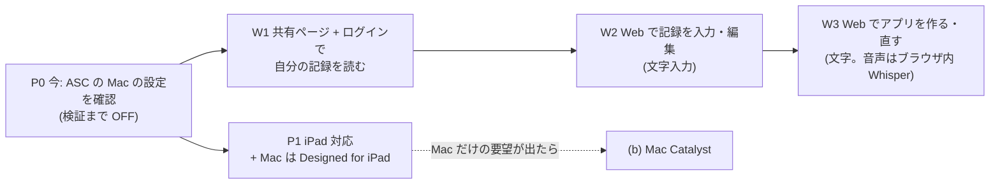

# #363 デスクトップの方針(iPad 対応・Mac・Web の拡張)

> 状態: **提案(オーナーの判断待ち)**。2026-11-02 作成。
> 対象 Issue: [#363](https://github.com/jphacks/kz_2601/issues/363)(依存 #362・関係 #351 #354 #253 #314)
> 調べた日: 2026-11-02。Apple の規約・OS の仕様は変わるので、決める前にもう一度「参考」のページを見ること。確かめきれなかった事実は **要確認** と書いた。
> 調べた元: `origin/develop`(e576869d)の [`ios/project.yml`](../../ios/project.yml)・iOS のコード・[`sharepage.go`](../../backend/internal/appconfig/sharepage.go)・[`shareview.go`](../../backend/internal/appconfig/shareview.go)・[`sharing.md`](../backend/features/sharing.md)・[`privacy-policy.md`](../legal/privacy-policy.md)、親の下書き [#351](351-dsl-cross-platform.md) と [#354](354-android-tech.md)(**どちらも統合 PR #535 に入っていて develop にはまだ無い**。この 2 つへのリンクは #535 がマージされるまで切れる)。
> **この文書は下書き**。決まったら、結論を [`docs/00_decisions.md`](../00_decisions.md) に移す(Issue の「完了の条件」)。この PR では正典は変えない。**着手は別のマイルストーン**(Issue のとおり)。

## 目次

1. [結論(推奨)](#結論推奨)
2. [今の状態(コードから)](#今の状態コードから)
3. [選択肢の表](#選択肢の表)
4. [部品の対応(#351 の表に Mac / Web の列を足す)](#部品の対応351-の表に-mac--web-の列を足す)
5. [音声入力](#音声入力)
6. [認証・課金・審査](#認証課金審査)
7. [段階の案](#段階の案)
8. [決めてほしいこと](#決めてほしいこと)
9. [要確認の一覧](#要確認の一覧)
10. [参考](#参考)

## 結論(推奨)

1. **Mac は「iPad 版を作る → それを Apple シリコンの Mac でそのまま動かす(Designed for iPad)」が最も安い**。Mac Catalyst・ネイティブの macOS アプリは、Mac だけの要望(メニュー・複数ウィンドウ・Intel Mac)が数字で出るまで作らない。
2. **Windows(と Linux・Chromebook)は Web でしか届かない**。ただし Web を「完全なクライアント(編集・音声・認証・課金)」にするのは 3 つ目の描画器を作ることになり、2 人では重い。**Web は #362 の共有ページを段階的に伸ばす**(まず「ログインして自分の記録を読む」、次に「記録を入力する」)。Web で音声からアプリを作るのは最後で、作るなら音声はブラウザの中の Whisper(WASM / WebGPU)か文字入力にする(Web Speech API はサーバーに音声が行くので使わない)。
3. **今すぐ要る作業が 1 つある**: App Store Connect の「Mac で利用可能にする」の設定を人が確かめる。Apple は互換の iPhone アプリを**既定で** Apple シリコンの Mac に出す。今の Tailor It は iPhone だけ・縦だけ・ヘルスやセンサーが Mac に無いまま、**検証せずに Mac で配られている可能性がある**(§2)。検証するまでは **OFF(Mac では出さない)** を推奨。
4. デスクトップの需要(大きな画面で記録を見る・編集する)は、β / 正式版のフィードバックと計測(iPad での利用・共有ページのデスクトップからの閲覧)で確かめてから着手を決める(Issue の 3 つ目)。

## 今の状態(コードから)

| 項目 | 今 | 元 | デスクトップへの影響 |
|---|---|---|---|
| 対象の端末 | **iPhone だけ**(全ターゲットが `TARGETED_DEVICE_FAMILY: "1"`) | [`project.yml`](../../ios/project.yml) | iPad では「iPhone 用アプリの互換モード」(拡大表示)で動く。iPad 用の画面ではない |
| 向き | **縦だけ**(`UIInterfaceOrientationPortrait`) | [`Info.plist`](../../ios/Metamon/Resources/Info.plist) | iPad で 1,2 にするなら向き・ウィンドウの大きさの変化に対応が要る(**要確認**: iPadOS 26 の新しいウィンドウでの `UIRequiresFullScreen` の扱い) |
| 最低 OS | iOS 17 | 同上 | Mac で動かす時の最低 macOS は iOS の版に対応して決まる(**要確認**) |
| 画面の配置 | 6 列 × 12 行。**列の幅 = 見えている幅 ÷ 6、行の高さ = 見えている高さ ÷ 12**(`GeometryReader`)。サイズクラス(`horizontalSizeClass`)はどこも見ていない | [`GridScreenLayout.swift`](../../ios/Packages/MetamonRenderer/Sources/MetamonRenderer/Screen/GridScreenLayout.swift)・[`GridArea.swift`](../../ios/Packages/MetamonDSL/Sources/MetamonDSL/Layout/GridArea.swift) | 縦長の iPhone 前提の比率。iPad の横向き・Mac の横長ウィンドウでは**セルが横に広く・縦に低くなる**。幅の上限(中央寄せ)か比率の固定が要る |
| パッケージの対応 OS | `MetamonDSL`・`MetamonServices` は `iOS 17 / macOS 14`、`MetamonRenderer` は **iOS だけ** | 各 `Package.swift` | ネイティブ macOS(案 c)は描画を移す必要がある。`UIKit` を import しているファイルが Renderer に 12・アプリに 4 |
| App Check | App Attest を優先、使えなければ DeviceCheck | [`FirebaseAppCheck.swift`](../../ios/Packages/MetamonServices/Sources/MetamonServices/Live/FirebaseAppCheck.swift)・[`app-check.md`](../infra/app-check.md) | **Mac では App Attest は常に使えない**(Mac Catalyst・Mac で動く iOS アプリも `isSupported == false`。Apple の文書)。DeviceCheck が Mac で通るかは**要確認(実機)**。backend を `enforce` にした時、Mac の利用者が 401 になりうる |
| 使っている iOS の仕組み | HealthKit・CoreMotion・ActivityKit・WidgetKit・NearbyInteraction・MultipeerConnectivity・MusicKit・FoundationModels・WhisperKit(CoreML)・AVFoundation・BackgroundTasks・MapKit・Vision・StoreKit 2 など | `import` を数えた | 下の §4 |
| Web | 共有ページ `GET /s/{token}`: スナップショットの DSL を**読むだけ**で描く。JS なし・レコードなし・CSP は `<style>` の nonce だけ・最大幅 480px | [`sharepage.go`](../../backend/internal/appconfig/sharepage.go)・[`shareview.go`](../../backend/internal/appconfig/shareview.go)・[`docs/dsl/README.md`](../dsl/README.md) §3.8 | 6 列の CSS grid はもうある。認証・入力・データの取得は何も無い |

## 選択肢の表

作業量は「2 人・1 人が主担当」の目安(**要実測**)。いずれも M5 の Android(#356〜#361)の後に始める前提。

| | (a) iPad 対応 + Mac は Designed for iPad | (b) Mac Catalyst | (c) ネイティブ macOS(SwiftUI) | (d) Web を完全なクライアントに | (e) 組み合わせ(推奨: a → d の一部) |
|---|---|---|---|---|---|
| 中身 | `TARGETED_DEVICE_FAMILY` を `1,2` に。グリッドの幅の上限・向き・シートの大きさを iPad 向けに直す。Mac では同じバイナリが動く(再コンパイルなし) | 同じコードを Mac 用にビルドする(`SUPPORTS_MACCATALYST`)。メニュー・ウィンドウ・キーボードを Mac 向けに | AppKit / macOS の SwiftUI で別アプリ。Renderer を iOS / macOS 両対応にする | 共有ページを、ログイン・記録の読み書き・アプリの作成(音声 / 文字)・課金まで広げる。JS(TS)の描画器を新しく作る | (a) で Mac を、(d) を段階的に(記録を読む → 入力する)で Windows を |
| 作業量 | **iPad 1〜2 週**(グリッド・向き・シート・iPad のスクショ・試験)+ **Mac 2〜3 日**(機能の有無の確認・App Check・キーボード・音声の実測) | (a) + **3〜5 週**(ビルドの通し・Mac に無い仕組みの `#if`・Firebase の Catalyst 対応・署名と Bundle ID・CI に Mac のビルド) | **8〜12 週以上**(Renderer の UIKit 依存を外す・66 部品の確認・別の審査) | **10〜16 週以上**(66 部品 + 12 アクションの描画器・記録の同期・認証・音声・課金・CSP の作り直し)。段階に切れば最初の段は 2〜3 週 | (a) 2 週 + (d) の第 1 段 2〜3 週 |
| 部品の対応(§4) | iPad: ほぼ全部(ヘルスは iPadOS 17 から使える)。Mac: B の部品が多く「使えません」になる(#351 の代わりの表示で受ける) | Mac は (a) とほぼ同じ。Mac に合わせた見た目にできる | 同じだが、全部品を作り直す | A の部品を全部 JS で作り直す。B / C は大半が「アプリで見られます」 | — |
| 音声(§5) | WhisperKit は Mac でも CoreML で動く見込み(**要実測**)。方針はそのまま守れる | 同じ | 同じ(WhisperKit は macOS 対応) | Web Speech API は**サーバーに音声が行く**ので方針に反する。ブラウザ内の Whisper なら守れるが重い | — |
| 認証 | 今と同じ(Sign in with Apple・匿名) | 同じ。Catalyst は Bundle ID の扱い次第で Firebase に Mac のアプリの登録が要る(**要確認**) | Firebase の macOS アプリの登録が要る | Firebase Auth の Web SDK。Sign in with Apple の Services ID と戻り先の設定(#354 の Android と同じ作業)。Google を足すか | — |
| 課金 | iOS のアプリ内課金がそのまま Mac でも使える(Apple の文書) | 同じ Bundle ID ならユニバーサル購入で共有(**要確認**) | Mac 用の商品か、ユニバーサル購入 | Web の決済(Stripe など)。権利はサーバー(#314)。特定商取引法の表示が要る。§6 | — |
| 審査 | iPad も審査の対象になる(iPad のスクショが要る)。Mac は ASC の設定 1 つ | Mac App Store の審査が別に増える(2.4.5 のサンドボックスなど) | 同上 | App Store の審査の外。ただし iOS アプリから Web の購入へ誘導できない(§6) | — |
| 保守 | **ほぼ増えない**(同じバイナリ。iPad の画面の試験が増える) | 中(Mac のビルドが CI に増える・Mac だけの不具合) | 大(4 つ目のクライアント) | 大(iOS・Android・Web の 3 つの描画器を #352 の適合テストで揃え続ける) | 小〜中 |
| 届く人 | iPad・**Apple シリコンの Mac** | iPad・Mac(Intel も) | Mac | **Windows・Linux・Chromebook を含む全員**(ブラウザ) | iPad・Mac・全ブラウザ |

## 部品の対応(#351 の表に Mac / Web の列を足す)

#351 の区分: **A** 全 OS 必須 / **B** OS ごとに代わり / **C** iOS だけ。iPad・Mac で動かない部品は、#351 §5 の「この端末では使えません」の枠と、`allowedComponents`・`supportedFeatures` の申告(#353)で受ける。**新しい仕組みは要らない**(審査用ビルドで 8 部品を外しているのと同じ形)。

Mac 列は「Designed for iPad / Catalyst」の両方(同じ iOS のフレームワークで動くため。Apple の文書)。API が Catalyst に「ある」ことと、Mac に**データやハードがある**ことは別なので分けて書いた。

| 部品・機能 | 区分 | iPad | Mac(Designed for iPad / Catalyst) | Web(完全なクライアントにした場合) |
|---|---|---|---|---|
| A の部品(並び・入力・一覧・集計・グラフ・表・カレンダー・QR の表示など 56 種) | A | ○ | ○(グリッドの比率は §2 の直しが要る) | JS で作り直し。今の共有ページは §3.8 のとおり「読むだけ」 |
| `voiceInput` / `openVoice` | A | ○ WhisperKit | ○ の見込み(CoreML・Mac のマイク。**要実測**) | §5。方針を守るなら文字入力かブラウザ内 Whisper |
| `photoField` `videoField` `qrScanner` | A | ○ | △ Mac の内蔵カメラ / 連係カメラ。背面カメラを前提にしない(Apple の文書) | `getUserMedia`。QR の読み取りはライブラリ |
| `locationButton` | A | ○(Wi-Fi のモデルは精度が低い) | △ Wi-Fi の位置(GPS なし) | Geolocation API |
| `mapView` `locationPicker` `routeGuide` | B | ○ MapKit | ○ MapKit | 地図の SDK(費用・キー)→ #351 の代わり(場所の一覧・外部の地図を開く) |
| `healthStat` / `Field.health` | B | ○(**iPadOS 17 から HealthKit のデータあり**) | × フレームワークはあるが**読み書きできない**(Apple の文書)→「使えません」 | × |
| `sensorValue` | B | △ 機種による(気圧計の有無) | × 加速度・ジャイロ・気圧が無い | △ ブラウザの DeviceMotion(デスクトップは無い) |
| `locationTracker` | B | △(Wi-Fi のモデル) | × 実用にならない(持ち歩かない・GPS なし)→「使えません」 | × |
| `dashcam` | B | △ | × | × |
| `nearbyShare` | B | ○ MultipeerConnectivity(UWB は機種による) | △ MultipeerConnectivity は Catalyst にある。UWB(NearbyInteraction)は Mac に無い見込み(**要確認**) | × |
| `aiButton` | B | ○ Apple Intelligence 対応の iPad(M1 以降など) | ○ Foundation Models は macOS / Catalyst 26 にある。Apple シリコンの Mac は対応(**要確認**: Mac で動く iOS アプリからの可否) | オンラインの `generate` だけ |
| `timerDisplay.liveActivity` / `startActivity` `endActivity` | B | ○ | × Live Activities は「iPhone と iPad で使える」(Apple の文書)。Mac には iPhone のものが映るだけ → 機能だけ無視 | × |
| `musicPlayer` | C | ○ | ○ MusicKit は Catalyst にある(**要実測**) | × |
| ウィジェット(WidgetKit) | — | ○ | △ Catalyst / macOS にはある。Designed for iPad での表示は**要確認** | × |
| 裏の同期(BackgroundTasks) | — | ○ | △ Catalyst 13.1 からある。Designed for iPad での動きは**要確認** | × |
| 通知の予約(`scheduleNotification`) | A | ○ | ○ | △ Web Push(許可と Service Worker が要る) |

まとめ: **iPad はほぼ iPhone と同じ**。**Mac は B のうち `healthStat` `sensorValue` `locationTracker` `dashcam` `liveActivity` が使えなくなる**(#351 の代わりで受けられる)。**Web は A を全部作り直す**のが本体の作業で、B / C は大半が代わりの表示。

## 音声入力

前提: プライバシーポリシー §1.2「**音声そのもの(録音データ)はサーバーに送りません**」(日本語・英語)。#354 の Android も「サーバーへ送る段は作らない」を推奨している。デスクトップもこれに揃える。

| 場所 | やり方 | 方針を守れるか | メモ |
|---|---|---|---|
| iPad | WhisperKit(今と同じ) | ○ | 変更なし |
| Mac(a / b / c) | WhisperKit(CoreML) | ○ | Apple シリコンなら速い見込み。初回のモデルの取得(約 500MB・Hugging Face)も同じ。**要実測**: Designed for iPad での読み込みと認識時間 |
| Web: Web Speech API(`SpeechRecognition`) | ブラウザの音声認識 | **× 既定では守れない** | 仕様上、`processLocally` が false(既定)だとブラウザは端末内 / 遠隔のどちらで処理してもよい。Chrome は Google のサーバーで認識するのが一般的とされる(**要確認**: Google の公式の記載)。Safari の処理場所も**要確認**。`processLocally = true` は実験的な機能で、対応ブラウザが限られる(MDN) |
| Web: ブラウザ内の Whisper(WASM / WebGPU。transformers.js・whisper.cpp の WASM など) | 端末の中で認識 | ○ | モデルの取得が tiny 約 75MB〜small 約 466MB。初回が重い・端末の性能でかなり遅い(**要実測**)。取得元をポリシーに書く(今の Hugging Face の記載を広げる) |
| Web: 文字入力 | — | ○ | 今も iOS にある。デスクトップはキーボードがあるので**最初の段はこれで十分**な見込み |

推奨: Web の最初の段は**文字入力だけ**(デスクトップはキーボード前提)。音声を足すならブラウザ内の Whisper。Web Speech API を使うなら、ポリシー(日・英)の書き換えと同意の画面が先に要る。

## 認証・課金・審査

### 認証

| 場所 | やり方 | 人の作業 |
|---|---|---|
| iPad・Mac(a) | 今と同じ(Firebase Auth・Sign in with Apple・匿名) | なし |
| Mac(b) | 同じ。Catalyst の Bundle ID を iOS と同じにするか(ユニバーサル購入)別にするかで、Firebase のアプリの登録・App ID の capability が変わる(**要確認**) | Apple / Firebase の設定(人) |
| Web(d) | Firebase Auth の Web SDK。Sign in with Apple(Services ID・戻り先のドメイン)、匿名は Web では意味が薄い(端末をまたいで引き継げない)。Google を足すかは #361 と一緒に決める | Apple の Services ID・Firebase の承認済みドメイン(人)。#354 の Android の Apple ログインと同じ作業なので一緒にする |
| App Check | Mac は App Attest が使えない(Apple の文書)→ 今のコードは DeviceCheck に落ちる。Web は reCAPTCHA Enterprise が必要 | `enforce` にする前に Mac で実測(人の実機) |

backend は Firebase の ID トークンを見るだけなので、どの場所でも変更はほぼ無い([`00_decisions.md`](../00_decisions.md) の認証)。Web で書き込みを許すなら、レート制限([`rate-limit.md`](../backend/rate-limit.md))と CSRF・CSP の設計を共有ページとは別に作る(今の共有ページは JS もフォームも禁止の CSP)。

### 課金

- **Mac で動く iOS アプリ**: アプリ内課金・サブスクリプションはそのまま動く(Apple の文書「App Store features for iOS continue to work」)。Tailor It Pro(StoreKit 2・[`architecture.md`](../ios/architecture.md) §22)の変更は要らない見込み。
- **Mac Catalyst**: 同じ Bundle ID でユニバーサル購入にすれば、iPhone で買った Pro が Mac でも効く(**要確認**: Catalyst での設定の手順)。権利の正はサーバー(#314)なので、別の Bundle ID でもアカウントで共有はできる。
- **Web の決済**:
  - 審査 3.1.3(b)(マルチプラットフォーム): 他の場所(Web)で買った中身・サブスクリプションを iOS アプリで使ってよい。**ただし同じものをアプリ内課金でも買えること**。Pro を Web でも売るなら、iOS 側の IAP は残す。
  - 審査 3.1.1(a): **米国以外のストアでは、アプリの中に App 外の購入へのボタン・リンク・誘導を置けない**(米国のストアは例外)。日本のストアでは、2025-12-18 施行のスマホソフトウェア競争促進法に合わせた Apple の変更(外部の決済・リンク)があるが、手数料と条件は**要確認**。
  - Web で売るなら、特定商取引法の表示・決済事業者(Stripe など)・返金・税の扱いが増える。権利の反映は #314 のサーバーの判定に足す。
  - 推奨: **Web での決済は作らない**(Web で使う人も、Pro は iPhone / Android で買ってアカウントで共有する)。Windows だけの利用者が多いと分かったら再検討。

### 審査・配布

| 案 | 影響 |
|---|---|
| (a) iPad | iPad の画面も審査の対象。iPad のスクリーンショットが要る。iPad で崩れると 2.1 / 4.0 で落ちうる |
| (a) Mac | 審査は増えない。ASC の「Make this app available on Mac」の 1 つ。**既定で ON**(Apple の文書)。OFF にすると以後の販売が止まる(入れた人は使い続けられる) |
| (b)(c) | Mac App Store の審査が増える(2.4.5: サンドボックス・更新は Mac App Store だけ など) |
| (d) | App Store の審査の外。ただし iOS の審査メモ・説明文で Web の購入に触れない(3.1.1)。Web の公開は #331(公式サイト)のドメインと合わせる |

## 段階の案

| 段 | いつ | 中身 | 始める条件 |
|---|---|---|---|
| **P0** | 今(M5 の中・人が 10 分) | ASC で Mac の配布の設定を確認。検証するまで **OFF**。方針を `00_decisions.md` に書く | — |
| **P1** | Android の公開(2027-07 の予定)の後 | iPad: `1,2`・グリッドの幅の上限(中央寄せ)・向き・シート。Mac: 機能の有無で枠を出す(#351 §5)・App Check の実測・キーボードのショートカット。終わったら ASC の Mac を ON | iPad / Mac の要望が β・正式版のフィードバックで出る。互換モードの iPad の利用者の割合を計測で見る |
| **W1** | #362 の後・#253 の判断の後 | 共有ページにログインを足し、**自分の記録(と共有された記録)を読むだけ**で出す。「大きな画面で記録を見る」に答える最小の形 | 共有ページのデスクトップからの閲覧の数・「PC で見たい」の声 |
| **W2** | W1 の後 | 記録の入力・編集(フォーム)。オフラインは扱わない | W1 が使われている |
| **W3** | 需要が強い時だけ | Web でアプリを作る・直す。最初は文字入力 | Windows の利用者の要望が多い |
| (b) | 原則やらない | Mac Catalyst | Mac だけの要望(メニュー・複数ウィンドウ・Intel Mac)が数字で出た時 |
| (c) | やらない | ネイティブ macOS | — |

計測の案(個人の文は送らない・#295〜#298 の仕組みに乗せる): iOS の起動時のイベントに「端末の種類(iPhone / iPad / Mac)」を足す(`ProcessInfo.isiOSAppOnMac`・`userInterfaceIdiom`)。共有ページは User-Agent からデスクトップ / モバイルの割合だけ数える。

## 決めてほしいこと

- [ ] **1. ASC の「Mac で利用可能にする」**: 推奨 **今は OFF**(検証してから P1 で ON)。まず人が今の設定を確かめる
- [ ] **2. Mac の作り方**: 推奨 **(a) Designed for iPad**。Catalyst(b)・ネイティブ(c)は今はやらない
- [ ] **3. iPad 対応をするか・いつ**: 推奨 **する。Android の後(P1)**。グリッドは「幅の上限 + 中央寄せ」で始める(比率の固定・列数を増やす案は DSL の互換に響くので取らない)
- [ ] **4. Windows は Web で足りるか**: 推奨 **足りる**(デスクトップのネイティブアプリは作らない)
- [ ] **5. Web をどこまで伸ばすか**: 推奨 **W1(ログインして記録を読む)→ W2(入力)まで**。アプリの作成(W3)は需要が出てから
- [ ] **6. Web の音声**: 推奨 **最初は文字入力だけ**。足すならブラウザ内の Whisper。Web Speech API は使わない(使うならポリシーの書き換えと同意が先)
- [ ] **7. Web の決済**: 推奨 **作らない**(Pro は iOS / Android で買い、アカウントで共有)
- [ ] **8. Web の認証**: 推奨 Firebase Auth の Web SDK・Sign in with Apple。Android(#354)の Apple ログインの設定と一緒に人が行う。Google を足すかは #361 で
- [ ] **9. 需要の測り方**: 推奨 端末の種類のイベント・共有ページのデスクトップの割合・フィードバックの「PC / iPad」の数
- [ ] **10. `00_decisions.md` に書く範囲**: 推奨 「Mac = iPad 版を Designed for iPad で・Windows = Web(共有ページの拡張)・音声は Web でもサーバーに送らない・着手は M5 の後」の 4 行

## 要確認の一覧

| 何を | どう確かめる |
|---|---|
| 今 ASC で「Make this app available on Mac」が ON か | 人が App Store Connect の「価格および配信状況」を見る |
| Mac で DeviceCheck(App Check の代わり)が通るか | Apple シリコンの Mac で実機に入れ、`APP_CHECK_MODE=log` のログを見る |
| WhisperKit が Designed for iPad で動くか・認識時間 | Mac で実機に入れて 5 秒の発話で測る |
| Foundation Models(`aiButton`)が Mac で動く iOS アプリから使えるか | 実機 |
| Mac で動かす時の最低 macOS(iOS 17 が対象の場合) | Apple の文書 / Xcode の表示 |
| iPadOS 26 での `UIRequiresFullScreen` と縦固定の扱い | Apple の文書(iPadOS 26 の新しいウィンドウ) |
| NearbyInteraction(UWB)・ウィジェット・BackgroundTasks の Mac での動き | 実機 |
| Mac Catalyst のユニバーサル購入と Firebase のアプリの登録 | Apple / Firebase の文書(b を選ぶ時だけ) |
| Chrome・Safari の Web Speech API がどこで音声を処理するか | Google / Apple の公式の記載(使う時だけ) |
| 日本のスマホ新法に合わせた Apple の外部決済・リンクの手数料と条件 | Apple の「日本における iOS の変更」のページ(Web で売る時だけ) |
| 互換モード(iPhone アプリを iPad で使う)の利用者の割合 | 計測を足した後の β の数字 |

## 参考

- Apple(2026-11-02 に確認):
  - [Running your iOS apps in macOS](https://developer.apple.com/documentation/apple-silicon/running-your-ios-apps-in-macos) — 既定で Mac に出る・ASC で OFF にできる・IAP / サブスクリプションはそのまま動く・iPhone アプリは固定の大きさのウィンドウ・背面カメラや GPS を前提にしない
  - [DCAppAttestService.isSupported](https://developer.apple.com/documentation/devicecheck/dcappattestservice/issupported) — Mac(Catalyst・Mac で動く iOS アプリを含む)では false
  - [HKHealthStore.isHealthDataAvailable()](https://developer.apple.com/documentation/healthkit/hkhealthstore/ishealthdataavailable()) — iPadOS 17 以降はデータあり・macOS 13 以降はフレームワークがあるが読み書きできない
  - [Displaying live data with Live Activities](https://developer.apple.com/documentation/activitykit/displaying-live-data-with-live-activities) — Live Activities は iPhone と iPad
  - [Mac Catalyst](https://developer.apple.com/documentation/uikit/mac-catalyst)・[Foundation Models](https://developer.apple.com/documentation/foundationmodels)(macOS / Catalyst 26)
  - [App Store Review Guidelines](https://developer.apple.com/app-store/review/guidelines/)(2.4.5・3.1.1・3.1.1(a)・3.1.3(b))
  - [日本における iOS の変更](https://developer.apple.com/jp/support/app-distribution-in-japan/)
- Web:
  - [Web Speech API(仕様)](https://webaudio.github.io/web-speech-api/)・[SpeechRecognition.processLocally(MDN)](https://developer.mozilla.org/docs/Web/API/SpeechRecognition/processLocally)
  - [whisper.cpp](https://github.com/ggml-org/whisper.cpp)
- リポジトリ内: [#351 の下書き](351-dsl-cross-platform.md)(対応表・§5 の代わりの表示)・[#354 の下書き](354-android-tech.md)(音声・認証)・[#413 の下書き](413-generated-app-payments.md)(3.1.1)・[`docs/dsl/README.md`](../dsl/README.md) §3.8・[`sharing.md`](../backend/features/sharing.md)・[`privacy-policy.md`](../legal/privacy-policy.md) §1.2・[`app-check.md`](../infra/app-check.md)・[`architecture.md`](../ios/architecture.md)・[`roadmap-m1-m6.md`](../roadmap/roadmap-m1-m6.md)(R-76・R-77)
