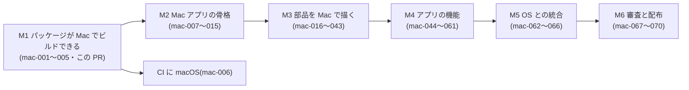

# #363 デスクトップの方針(Mac はネイティブ SwiftUI・Windows は Web)

> 状態: **Mac の作り方はオーナーが決定(2026-11-11)。それ以外の細かい既定値は「推奨(未確定)」**。2026-11-02 に下書き、2026-11-11 に書き直し。
> 対象 Issue: [#363](https://github.com/jphacks/kz_2601/issues/363)(依存 #362・関係 #351 #353 #354 #253 #314)
> 調べた日: 2026-11-11。Apple の規約・OS の仕様は変わるので、決める前にもう一度「参考」のページを見ること。確かめきれなかった事実は **要確認** と書いた。
> 調べた元: `origin/develop`(9cf10491)の [`ios/project.yml`](../../ios/project.yml)・`ios/Packages/*/Package.swift`・iOS のコード。Mac の親 Issue の下書き(mac-001〜mac-070)。
> **この文書は下書き**。オーナーが「推奨(未確定)」を確定したら、結論を [`docs/00_decisions.md`](../00_decisions.md) に移す。この PR では正典は変えない。

## 目次

1. [決まったこと](#決まったこと)
2. [推奨(未確定)の既定値](#推奨未確定の既定値)
3. [コードの共有の形](#コードの共有の形)
4. [Bundle ID と購入(ユニバーサル購入)](#bundle-id-と購入ユニバーサル購入)
5. [今の状態(コードから)](#今の状態コードから)
6. [部品の対応(Mac の列)](#部品の対応mac-の列)
7. [音声入力](#音声入力)
8. [認証・App Check・審査](#認証app-check審査)
9. [Windows・Web](#windowsweb)
10. [段階の案](#段階の案)
11. [決めてほしいこと](#決めてほしいこと)
12. [要確認の一覧](#要確認の一覧)
13. [参考](#参考)

## 決まったこと

**オーナーの決定(2026-11-11)**: Mac は **ネイティブの macOS アプリを SwiftUI で作る**。Mac Catalyst でも、iPad 版を Mac で動かす「Designed for iPad」でもない。**iOS の機能はすべて Mac でも使えるようにする**(Mac にハードやデータが無い物は代わりを作るか「この Mac では使えません」の枠にする)。3 つの Swift パッケージ(`MetamonDSL`・`MetamonRenderer`・`MetamonServices`)は iOS と Mac で共有する。

前の下書き(2026-11-02)の推奨「(a) iPad 版を Designed for iPad で Mac に出す・(c) ネイティブはやらない」は**取り下げる**。

## 推奨(未確定)の既定値

オーナーがまだ決めていない所は、エージェントが下の既定値で作り始める。**どれも推奨(未確定)**で、オーナーが変えれば直す。

| 項目 | 推奨(未確定) | 理由 |
|---|---|---|
| 最低の macOS | **macOS 14 Sonoma** | `MetamonDSL`・`MetamonServices` は前から macOS 14 を宣言している。SwiftUI の `@Observable`・`ContentUnavailableView`・`onChange(of:_:)` の 2 引数版が macOS 14 から。macOS 15 / 26 の機能は可用性の判定で出し分ける(下の行) |
| 新しい OS だけの機能 | `#available` で出し分け。Image Playground は **macOS 15.1** 以上、Foundation Models(`aiButton` の端末内 AI)は **macOS 26** 以上、位置の更新の `authorizationDenied` 系は macOS 15 以上 | iOS で `#available(iOS 18.1, *)` などにしている所に `macOS` の版を足すだけ(iOS の動きは変わらない) |
| CPU | **Apple シリコンと Intel の両方**(Universal 2 のバイナリ) | macOS 14 は Intel の Mac も対象。WhisperKit は Intel でも CoreML で動くが**遅い**(Neural Engine が無い。要実測)。Foundation Models・Image Playground は Apple Intelligence が要るので Apple シリコンだけ(判定で出し分け済み) |
| Bundle ID | **iOS と同じ `jp.kz2601.metamon`**(Mac 用の別ターゲットからアップロード) | 同じ App Store Connect のアプリに macOS を足すユニバーサル購入にするため(§4)。Firebase の登録・Sign in with Apple の App ID も同じものを使える見込み(**要確認**) |
| 購入 | **ユニバーサル購入**。Tailor It Pro は iPhone で買えば Mac でも使える | §4 |
| コードの共有 | パッケージを両 OS 対応にし、Mac の殻は **`ios/MetamonMac/`** の新しいアプリのターゲット(同じ `ios/project.yml`) | §3 |
| OS の差の置き場 | `MetamonRenderer/Support/Platform/` の薄い置き換え層。`#if os(macOS)` はなるべくここに閉じ込める | ファイルごとに `#if` を散らさない(mac-002) |
| Mac で使えない機能 | ヘルスケア・センサー・ドラレコ・位置の追跡・ライブアクティビティ・アラーム・UWB は **「この Mac では使えません」の枠**。カメラ・QR の読み取り・手書き・道案内は **Mac 版を作る**(mac-027〜mac-035) | Mac にハード / データが無い物に代わりを作っても使われない。カメラ・手書き・地図は Mac にもある |
| AI への申告 | `ClientCapabilities` に OS を足し、Mac で描けない部品は AI に作らせない(`X-Client-Platform: macos`) | 審査用ビルドで 8 部品を外しているのと同じ形(#353・mac-003) |
| iOS 版の「Mac で利用可能にする」(Designed for iPad) | ネイティブ版を出すまでは **OFF**(検証していない iPhone 版を Mac に出さない) | 前の下書きと同じ。ネイティブ版を同じアプリのレコードに足すと iPhone 版は Mac に出なくなる見込み(**要確認**) |
| 審査用ビルド(Review) | Mac にも作る(`APP_STORE_REVIEW` を Mac のターゲットにも渡す) | 外す部品は iOS と同じ考え方(mac-067) |
| 着手の順 | Android(#356〜#361)と並べてよい。まず「パッケージが Mac でビルドできる」まで(この PR) | 部品の作り込みはその後 |

## コードの共有の形

```
ios/
  project.yml              … iOS のターゲットに加え、Mac のターゲット MetamonMac を足す(mac-007)
  Packages/
    MetamonDSL/            … 両 OS(Foundation だけ)
    MetamonRenderer/       … 両 OS。OS の差は Support/Platform/ に集める
      Sources/MetamonRenderer/Support/Platform/
        PlatformImage.swift          UIImage / NSImage・画像の描画
        PlatformSystem.swift         色・設定を開く・VoiceOver・触覚・画面を消さない など
        PlatformViewModifiers.swift  iOS だけの SwiftUI 修飾子を Mac では何もしない / 同等品に
        PlatformPDF.swift            PDF の書き出し
        MacUnavailableView.swift     Mac でまだ作っていない部品の仮の枠
    MetamonServices/       … 両 OS(AVAudioSession など iOS だけの所は #if os(iOS))
  Metamon/                 … iOS のアプリ本体。Features/ のうち OS に依らない物は Mac のターゲットでも同じファイルをコンパイルする
  MetamonMac/              … Mac だけの殻(App・ウィンドウ・メニュー・設定ウィンドウ・サイドバー)(mac-007〜mac-012)
```

- iOS の挙動を変えないことが最優先。iOS 側の差分は「同じ API を置き換え層の名前で呼ぶ」機械的な置き換えだけにする。
- Mac Catalyst を取らない理由: オーナーの決定。加えて、ネイティブなら Mac のメニュー・ウィンドウ・キーボード・ツールバーを SwiftUI の Mac 版で素直に使える。

## Bundle ID と購入(ユニバーサル購入)

Apple の「Universal Purchase」のページ(2026-11-11 に確認)より:

- macOS(や tvOS・visionOS)を既存の iOS アプリのレコードに足すと、**iOS アプリと同じ Apple ID(アプリの識別子)・SKU・Bundle ID を使う**。「Xcode のプロジェクトで、Bundle ID を iOS アプリの Bundle ID に合わせる」。版の番号とビルド番号は OS ごとに別でよい。
- macOS のビルドは **別の Xcode のターゲットから**アップロードする。
- **ネイティブの macOS アプリもこの対象**(Catalyst だけの制限は「Xcode 11.3 以前で作った Catalyst のアプリには他の OS を足せない」だけ)。
- 2 つ以上の OS の版が審査を通るとユニバーサル購入になり、**以後は 1 つの OS の版をレコードから外せない**。
- 利用者は 1 回の購入でアプリと**アプリ内課金**を複数の OS で使える(ページの説明)。商品の設定の細かい手順はこのページには無い(**要確認**: StoreKit の文書で、自動更新サブスクリプションが Mac でそのまま効くこと・Mac の価格の設定)。

したがって、**「Mac App Store で同じ Bundle ID が使えるのは Catalyst / iPad アプリだけ」は誤り**。ネイティブの Mac アプリでも、**同じ Bundle ID `jp.kz2601.metamon` で同じレコードに macOS を足す**のが正しい選び方。別の Bundle ID にすると別のアプリ(別の購入)になる。権利の正はサーバー(#314)なので別アプリでもアカウントで Pro を共有はできるが、App Store の上では別売りになる。

注意:

- ユニバーサル購入にすると **macOS の版を後からレコードから外せない**。Mac 版を出すのを取りやめる時は「販売をやめる」しかない。
- Bundle ID が同じなので、Firebase の `GoogleService-Info.plist` は iOS と同じ物を使える見込み(Firebase の Apple アプリは Bundle ID で見分ける。**要確認**)。
- ウィジェット(`jp.kz2601.metamon.widget`)は Mac 用に別のターゲットが要る(mac-062)。

## 今の状態(コードから)

| 項目 | 今(このブランチ `feat/mac-foundation`) | Mac の作業 |
|---|---|---|
| `MetamonDSL` | iOS 17 / macOS 14。macOS で `swift test` が通る(英語の文言のテスト 1 件は SwiftPM のコマンドラインでは文字列カタログを訳さないので落ちる。xcodebuild では通る) | OS の申告(mac-003) |
| `MetamonRenderer` | **macOS 14 を追加し、macOS でビルドが通る**。UIKit を直接使っていた 18 ファイルを置き換え層に寄せた。カメラ・動画の撮影・手書き・QR の読み取り・ドラレコは Mac では仮の枠 | 各部品の Mac 版(mac-016〜mac-043) |
| `MetamonServices` | iOS 17 / macOS 14。**macOS でビルドが通る**(AVAudioSession の部分を `#if os(iOS)` に。Mac は既定の入力装置を診断に残す) | App Check(mac-008)・音声の作り込み(mac-044) |
| アプリ本体 | iOS だけ(`TARGETED_DEVICE_FAMILY: "1"`・縦だけ) | `ios/MetamonMac/`(mac-007) |
| 画面の配置 | 6 列 × 12 行。列の幅 = 見えている幅 ÷ 6([`GridScreenLayout.swift`](../../ios/Packages/MetamonRenderer/Sources/MetamonRenderer/Screen/GridScreenLayout.swift)) | 横長のウィンドウでは幅の上限 + 中央寄せ(mac-016) |
| App Check | App Attest を優先、使えなければ DeviceCheck | Mac のネイティブアプリで App Attest が使えるか**要確認(実機)**。backend を `enforce` にする前に確かめる(mac-008) |

## 部品の対応(Mac の列)

#351 の区分: **A** 全 OS 必須 / **B** OS ごとに代わり / **C** iOS だけ。正式な全 76 部品の表は mac-025 で作る。

| 部品・機能 | 区分 | Mac(ネイティブ) | このブランチでの状態 |
|---|---|---|---|
| A の部品(並び・入力・一覧・集計・グラフ・表・カレンダー・QR の表示など) | A | ○ | ビルドは通る。見た目の作り込みは mac-016〜mac-024 |
| `voiceInput` / `openVoice` | A | ○ WhisperKit(CoreML)。Intel は遅い | Services がビルドできる。実測は mac-044 |
| `photoField` | A | ○ ライブラリ・ファイルから。撮影は内蔵 / 連係カメラ | 撮影のボタンは出ない(`CameraPicker.isAvailable == false`)。mac-027 |
| `videoField` | A | ○ 同上 | 同上。mac-029 |
| `qrScanner` | A | △ カメラ / 画像から読む | 手入力だけの仮の形。mac-033 |
| `drawingField` | A | ○ マウス・トラックパッドで描く(PencilKit の `PKCanvasView` は Mac に無い) | マウス・トラックパッドで描ける(#1369)。保存の形式(JPEG)は同じ。mac-032 |
| `webView` | A | ○ `WKWebView` | **Mac でも動く形にした**(`NSViewRepresentable`) |
| `export`(CSV / PDF) | A | ○ | **PDF も Mac で書ける形にした**(CoreGraphics の PDF)。共有・保存の UI は mac-031 |
| `locationButton` | A | △ Wi-Fi の位置 | 許可の判定を Mac に合わせた(「使用中のみ」が無い) |
| `mapView` `locationPicker` `routeGuide` | B | ○ MapKit | 道案内の読み上げは Mac の音声のまま。mac-034・mac-035 |
| `healthStat` / `Field.health` | B | × 読み書きできない | 「使えません」の枠(mac-036) |
| `sensorValue` | B | × 加速度・気圧が無い | 同上(mac-037) |
| `locationTracker` | B | × | 同上(mac-037) |
| `dashcam` | B | × | **「この Mac では使えません」の仮の枠にした** |
| `nearbyShare` | B | △ MultipeerConnectivity は Mac にある。UWB は無い | mac-042 |
| `aiButton` 端末内 AI | B | ○ macOS 26・Apple シリコン | 判定で出し分け済み |
| `timerDisplay.liveActivity` | B | × → メニューバーで代わり(mac-063) | — |
| `musicPlayer` | C | ○ MusicKit(要実測) | ビルドは通る。mac-038 |

## 音声入力

前提: プライバシーポリシー §1.2「音声そのもの(録音データ)はサーバーに送りません」。Mac も WhisperKit(端末の中)で守る。

| 場所 | やり方 | メモ |
|---|---|---|
| Mac(Apple シリコン) | WhisperKit(CoreML) | 速い見込み。初回のモデルの取得(約 500MB)は iOS と同じ |
| Mac(Intel) | WhisperKit(CoreML・CPU / GPU) | **遅い**(要実測)。遅すぎれば Apple の端末内の文字起こし(`SFSpeechRecognizer` の `requiresOnDeviceRecognition`)に切り替える案 |
| 入力装置 | AVAudioSession は Mac に無い。既定の入力装置をそのまま使い、装置名・サンプルレートを診断に残す(このブランチで実装) | 装置の選び方は mac-044 |

## 認証・App Check・審査

- **認証**: Firebase Auth・Sign in with Apple・匿名は macOS でも使える。Mac では Keychain の共有の entitlement(`keychain-access-groups`)が要る見込み(mac-009・**要確認**)。
- **App Check**: Mac Catalyst と「Mac で動く iOS アプリ」では App Attest が使えない(Apple の文書)。ネイティブの Mac アプリでの可否は**要確認(実機)**。使えなければ DeviceCheck に落ちる今のコードのままで、`enforce` にする前に Mac で実測する(mac-008)。
- **審査**: Mac App Store の審査が増える(2.4.5: サンドボックス必須・更新は Mac App Store だけ など)。審査用ビルド(Review)を Mac にも作る(mac-067・mac-069)。

## Windows・Web

前の下書きの推奨のまま(この PR では変えない): **Windows(と Linux・Chromebook)は Web でしか届かない**。Web は #362 の共有ページを段階的に伸ばす(W1 ログインして自分の記録を読む → W2 記録を入力する → W3 アプリを作る・直すは需要が出てから)。Web の音声は最初は文字入力だけ、足すならブラウザの中の Whisper。Web の決済は作らない。

## 段階の案



## 決めてほしいこと

- [ ] **1. 最低の macOS**: 推奨(未確定) **macOS 14**
- [ ] **2. CPU**: 推奨(未確定) **Apple シリコンと Intel の両方**(Intel は音声が遅いことを説明に書く)
- [ ] **3. Bundle ID と購入**: 推奨(未確定) **iOS と同じ `jp.kz2601.metamon` でユニバーサル購入**(外せなくなることを承知の上で)
- [ ] **4. コードの共有の形**: 推奨(未確定) **パッケージを両 OS 対応 + `ios/MetamonMac/` を同じ `project.yml` に**
- [ ] **5. Mac で使えない機能**: 推奨(未確定) ヘルス・センサー・ドラレコ・位置の追跡・ライブアクティビティ・アラーム・UWB は「使えません」の枠
- [ ] **6. iOS 版の Designed for iPad**: 推奨(未確定) **今は OFF**(人が ASC の設定を確かめる)
- [ ] **7. 審査用ビルドを Mac にも作るか**: 推奨(未確定) **作る**
- [ ] **8. Android との順番**: 推奨(未確定) 並べてよい(担当を分ける)
- [ ] **9. `00_decisions.md` に書く範囲**: 推奨(未確定)「Mac = ネイティブ SwiftUI・パッケージ共有・macOS 14・同じ Bundle ID でユニバーサル購入・Windows = Web」の 1〜2 行

## 要確認の一覧

| 何を | どう確かめる |
|---|---|
| ネイティブの Mac アプリで App Attest(`DCAppAttestService.isSupported`)が true になるか | Apple シリコンの Mac で実機 |
| 同じ Bundle ID の `GoogleService-Info.plist` を Mac でそのまま使えるか | Firebase の文書と実機 |
| 自動更新サブスクリプション(Pro)が Mac で同じ商品として効くか・Mac の価格の設定 | StoreKit / App Store Connect の文書 |
| macOS の版を足すと iOS 版の「Mac で利用可能」がどうなるか | App Store Connect の表示 |
| WhisperKit の Intel Mac での認識時間 | Intel の Mac で 5 秒の発話を測る |
| MusicKit・MultipeerConnectivity の Mac での動き | 実機 |
| Firebase Auth の Keychain の entitlement が Mac で要るか | Firebase の文書と実機 |

## 参考

- Apple(2026-11-11 に確認):
  - [Universal Purchase](https://developer.apple.com/support/universal-purchase/) — macOS を足す時は同じ Apple ID・SKU・Bundle ID・別の Xcode ターゲット。2 つ以上の OS が通るとユニバーサル購入になり外せない
  - [Running your iOS apps in macOS](https://developer.apple.com/documentation/apple-silicon/running-your-ios-apps-in-macos)
  - [DCAppAttestService.isSupported](https://developer.apple.com/documentation/devicecheck/dcappattestservice/issupported)
  - [HKHealthStore.isHealthDataAvailable()](https://developer.apple.com/documentation/healthkit/hkhealthstore/ishealthdataavailable())
  - [Foundation Models](https://developer.apple.com/documentation/foundationmodels)(macOS 26)・[Image Playground](https://developer.apple.com/documentation/imageplayground)(macOS 15.1)
  - [App Store Review Guidelines](https://developer.apple.com/app-store/review/guidelines/)(2.4.5)
- リポジトリ内: [#351 の下書き](351-dsl-cross-platform.md)・[#354 の下書き](354-android-tech.md)・[`docs/dsl/README.md`](../dsl/README.md)・[`privacy-policy.md`](../legal/privacy-policy.md) §1.2・[`app-check.md`](../infra/app-check.md)・[`architecture.md`](../ios/architecture.md)
