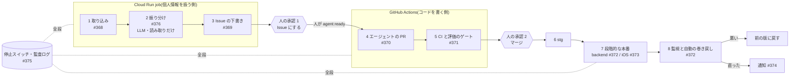

# #365 自己改善ループの全体(段階・自動にしてよい所・人の承認の位置)

> 状態: **決定(2026-11-10)**。オーナー(ko-tarou)の指示で決めた。推奨から変えた所と、個別の指示が無く推奨のまま採った所は [決定(2026-11-10)](#決定2026-11-10) に書いた。正典(`docs/00_decisions.md`)への追記は人が判断する(この変更では触らない)。2026-11-02 作成。
> 対象 Issue: [#365](https://github.com/jphacks/kz_2601/issues/365)(エピック [#364](https://github.com/jphacks/kz_2601/issues/364)。依存: [#299](https://github.com/jphacks/kz_2601/issues/299) ブランチ保護・[#300](https://github.com/jphacks/kz_2601/issues/300) エージェントの規約・[#319](https://github.com/jphacks/kz_2601/issues/319) アプリ内のフィードバック。これに依存: [#366](https://github.com/jphacks/kz_2601/issues/366) 紛れ込む指示・[#367](https://github.com/jphacks/kz_2601/issues/367) フィードバックの個人情報)
> 調べた日: 2026-11-02。コードは `origin/develop`(e576869d)を読んだ。GitHub・Claude の料金と機能は変わるので、決める前に「参考」をもう一度見ること。

## 目次

0. [決定(2026-11-10)](#決定2026-11-10)
1. [結論(推奨)](#結論推奨)
2. [ゴール](#ゴール)
3. [全体の図](#全体の図)
4. [段階ごとの設計](#段階ごとの設計)
5. [変更の種類ごとの自動化の上限](#変更の種類ごとの自動化の上限)
6. [選択肢の表](#選択肢の表)
7. [脅威のまとめ(詳細は #366・#367)](#脅威のまとめ詳細は-366367)
8. [根拠](#根拠)
9. [成果の測り方](#成果の測り方)
10. [進め方(順番と依存)](#進め方順番と依存)
11. [決めてほしいこと](#決めてほしいこと)
12. [参考](#参考)

## 決定(2026-11-10)

オーナーの指示(2026-11-10):「Issue の下書きまでは自動。下書きを Issue にするのと、PR の承認・マージは人。エージェントが PR を作るのは人がはっきり承認した Issue だけ。課金・認可・削除・`.github/` はエージェントの対象外」。個別の指示が無い項目は推奨を採った(「推奨のまま」)。変える時はこの表を直す。

| # | 決めること | 決定 | 推奨との違い |
|---|---|---|---|
| 1 | 人の承認の位置 | **2 回**: 下書きを Issue にする(承認 1)・PR の承認とマージ(承認 2)。段階的な本番の最初の 5 件の昇格も人 | 推奨のまま |
| 2 | エージェントの PR の自動の上限 | **A**(PR まで。マージは毎回人。自分でマージしない) | 推奨のまま |
| 3 | 変更の種類ごとの上限 | 表のとおり。**課金・認可・データの削除・`.github/`**・インフラ・DSL スキーマ・正典はエージェントの対象外 | 推奨のまま |
| 4 | 振り分けの LLM の権限 | **A**(読んで分類を返すだけ。道具なし・決まった形の JSON だけ) | 推奨のまま |
| 5 | 実行の場所 | 段 1〜3 は backend の CLI(`backend/cmd/feedback-loop`)。最初は人が手元か Cloud Run の job で回す。**定期の workflow は今は足さない**(後で) | 推奨の「1〜3 は Cloud Run job」の範囲。GitHub Actions には何も足さない |
| 6 | 失敗の扱い | **B**(追加の直しは 1 回まで)。エージェントの PR の自動化は作らないので、人が起動する時の決まりとして使う([#370 の手順](../backend/features/feedback-loop-agent-pr.md)) | 推奨のまま |
| 7 | 費用の上限 | 表の案を初期値にする。振り分けは 1 回の実行の件数の上限と、月のトークンの上限(超えたら振り分けを止める)で実装 | 推奨のまま(値は運用で見直す) |
| 8 | 停止スイッチの置き場所 | **環境変数 + Firestore の文書**。段ごとに `LOOP_<段>=on` の時だけ動き(既定は止まっている)、Firestore の `loop_control/switches` で段ごと・全体をデプロイ無しで止められる。読めなければ止まる | **変更**。推奨は GitHub のリポジトリ変数。段 1〜3 が GitHub のトークンを持たずに動けるようにするため |
| 9 | #375 の最小の部分を先にするか | 先にする(監査ログと停止スイッチは全段が使う) | 推奨のまま |
| 10 | #299 を #370 の前提にするか | 前提にする | 推奨のまま |
| 11 | 成果の指標 | 「成果の測り方」の表のとおり | 推奨のまま |

段 3(Issue の下書き)は [#367 の選択肢 3-B](367-feedback-pii.md#選択肢-3-下書きの置き場所) に合わせて**変える**: 下書きは公開の Issue にせず、非公開の確認の待ち行列(Firestore の `loop_drafts`)に置く。人が CLI で中身を見て承認した時だけ、LLM を含まないプログラムが要約を公開の Issue にする。投稿先のリポジトリは環境変数で渡し、無ければ何も投稿しない(dry run)。下の「段階ごとの設計」の段 3 の表は、この決定の前の案として残す。

実装: [docs/backend/features/feedback-loop.md](../backend/features/feedback-loop.md)。

## 結論(推奨)

**人が押すのは 2 回だけ(Issue にする承認・マージ)。それ以外の段は自動にしてよいが、各段の権限は「次の段へ渡す物を作る」ことに絞り、どの段も自分を承認できないようにする。**

- **振り分けの LLM は読み取りと分類だけ**。道具・秘密・書き込みの権限を持たず、決まった形の JSON だけを返す。Issue を作るのは LLM ではなく、JSON を検査してから投稿する小さなプログラム。
- **エージェントの PR は絶対に自分でマージしない**。マージは毎回人。ブランチ保護(#299)で仕組みとして強制し、#299 が効くまではエージェントの段を動かさない。
- **課金・認可・データの削除・`.github/`・インフラ・DSL スキーマはエージェントの対象外**。この領域に触れる差分は CI で赤にし、人が自分で直す。
- **実行の場所は 2 つに分ける**。個人情報が入りうるフィードバックを読む段(取り込み・振り分け・下書き)は **Cloud Run の job**、コードを書く段(エージェントの PR)は **GitHub Actions**。公開リポジトリの Actions のログは誰でも読めるので、フィードバックを Actions に通さない。
- **自動にしてよい向きは「止める・戻す」**。本番の巻き戻しは自動、本番への昇格(5% → 25% → 100%)も基準を満たす間は自動。ただし最初の 5 件は昇格ごとに人が承認する。iOS は TestFlight(内部)まで自動、審査への提出は人。
- **停止スイッチは段ごと・既定は止まっている(fail closed)**。GitHub のリポジトリ変数で持ち、各段が開始時に読む。読めなければ止まる。デプロイ無しで効く。
- **費用は段ごとの上限 + 月の上限**。月の上限に達したら、すべての段が自動で止まる(#375)。

## ゴール

エピック #364 の完了の判定をそのまま目標にする。

- フィードバックから PR のマージまで、人が承認を 2 回(Issue 化・マージ)押すだけで流れた実績が 5 件以上
- フィードバックに紛れ込む指示で、エージェントが道具・秘密に届かない(#366 の試験ケース)
- backend の変更が段階的に出て、指標が悪いと自動で戻る(#372)
- 段ごとの停止スイッチと、1 件のフィードバックからリリースまでたどれる監査ログがある(#375)

ゴールに**入れない**もの: iOS の審査への自動の提出、課金・認可・削除の自動の修正、人の承認を省く「信頼できる変更だけ自動マージ」。これらは実績を見てから別の Issue で検討する。

## 全体の図

## 段階ごとの設計

各段について「いま自動にしてよいこと / 後で」「人の承認の位置」「自動の部分の権限(最小)」「止める・戻すもの」を書く。権限の欄は**それ以上を持たせない**という上限の意味。

### 1. 取り込み(#368)

| 項目 | 内容 |
|---|---|
| いま自動 | アプリ内のフィードバック(#319・`feedback/{id}`、`untrusted: true` 付き)を共通の形に写す。クラッシュの急増(#296 Crashlytics)・生成の失敗の急増(`ai.generate` #297)を 1 件のフィードバックとして作る |
| 後で | App Store Connect API でストアのレビューと TestFlight のフィードバックを定期的に取る(API キーの保管を #291 の環境分けの後に決める) |
| 人の承認 | 無し(読むだけで、外に何も出さないため) |
| 権限 | Firestore の `feedback` の読み取り、取り込み先の集まり(例: `loop_inbox`)への書き込みだけ。#367 の伏せ字を**保存の時に**通す。GitHub の権限は無し |
| 止める・戻す | 停止スイッチ `LOOP_INTAKE`。止めても元の `feedback` は残るので、再開すれば続きから取り込める |

### 2. 振り分け(#376)

| 項目 | 内容 |
|---|---|
| いま自動 | **影の運転(shadow)だけ**: LLM が分類・束ね・優先度を付けるが、結果は人の週の振り分け([β の品質ゲート 5 章](../release/beta-quality-gate.md#5-フィードバックの振り分けm6-の手作業版))と比べる記録に使うだけ |
| 後で | 人の判断と 8 割以上一致した週が続いたら(#376 の完了の条件)、結果を 3 の下書きに流す |
| 人の承認 | 無し。この段の結果は 3 で人が見るまで、どこにも効かない |
| 権限 | LLM には**道具を渡さない**。入力は伏せ字済みの本文(引用として隔離)、出力は決まった形の JSON(分類・領域・束の ID・優先度の案・既存 Issue の番号の候補)。JSON はスキーマで検査し、外れたら捨てる。job の SA は `loop_inbox` の読み取りと `loop_triage` への書き込みだけ |
| 止める・戻す | `LOOP_TRIAGE`。誤った振り分けは 3 の人の承認で落ちる。費用の上限(週)に達したら止まる |

### 3. Issue の下書き(#369)

| 項目 | 内容 |
|---|---|
| いま自動 | 束ごとに下書き(症状・再現・完了の条件・関係する領域)を作り、GitHub に `needs-approval` ラベルつきの Issue として出す。既存の Issue があれば「件数と例を足す」コメントの案にする |
| 後で | 週 1 回の一覧で、まとめて承認できる画面 |
| 人の承認 | **ここが承認 1**。人が内容を確かめ、対象外の領域(下の「変更の種類」)でなければ `agent:ready` を**人が**付ける。付けられるのは書き込み権限のある人だけ |
| 権限 | 下書きを書くのは LLM、投稿するのは LLM を含まない小さなプログラム。投稿の前に、原文・個人情報・URL・コードブロックが入っていないかを検査する(#367)。GitHub の権限は Issue の作成とコメントだけ(`issues: write`)の GitHub App のトークン。`needs-approval` 以外のラベルは付けない |
| 止める・戻す | `LOOP_DRAFT`。不要な下書きは人が閉じる。1 週の下書きの数に上限を置き、超えたら出さずに監査ログへ |

### 4. エージェントの PR(#370)

| 項目 | 内容 |
|---|---|
| いま自動 | 人が `agent:ready` を付けた Issue で起動し、自分のブランチに push して PR を作る。PR の本文は Issue へのリンク・変更の要点・試したこと・作者のインラインの自己レビュー(CONTRIBUTING の規約どおり) |
| 後で | 同時に動く数を増やす(最初は 1 本) |
| 人の承認 | 起動そのものが承認 1 の結果。この段の中に人の承認は無い |
| 権限 | **エージェントに渡すのは、人が承認した Issue の本文だけ**(フィードバックの原文・Issue のコメントは渡さない)。トークンは `contents: write`(自分のブランチだけ。保護されたブランチには #299 で書けない)と `pull-requests: write` だけ。**持たせないもの**: マージ、ラベルの付与、Secrets、`id-token: write`(GCP への認証)、デプロイの Environment、リポジトリの設定。起動の条件は「書き込み権限のある人がラベルを付けた」ことだけにし、Issue のコメントでは起動しない |
| 止める・戻す | `LOOP_AGENT`。1 本あたりの時間と費用の上限。失敗したら Issue にコメントして止まる(自動の再試行は下の選択肢の表 4)。対象外の領域に触れた差分は 5 で赤になる |

### 5. CI と評価のゲート(#371)

| 項目 | 内容 |
|---|---|
| いま自動 | 既存の backend-ci / ios-ci / secrets-scan を必須にする(#299)。加えて「対象外の領域に触れていないか」の検査(パスの一覧と照合)。生成(プロンプト・`backend/internal/ai/`)に触れる差分の時だけ `backend/cmd/ai-eval` の回帰を回し、基準を下回ったら赤。結果の表を PR にコメント |
| 後で | iOS の主要な流れの UI テストを必須にする |
| 人の承認 | 無し(機械の判定)。ただし赤を人が「例外で通す」ことはしない。基準を変えるなら別の PR で |
| 権限 | ai-eval は Claude の API キーを使うので、**PR のコードを秘密つきの文脈で動かさない**形にする(詳しくは #366 で決める)。費用は 1 回の上限つき |
| 止める・戻す | 赤ならマージできない(#299)。ai-eval の費用が上限に達したら、その PR は「人が手で評価する」状態にして止まる(緑にはしない) |

### 6. マージと stg

| 項目 | 内容 |
|---|---|
| いま自動 | マージされたら、今の `deploy-cloudrun.yml` が develop から stg に出す(スモークつき) |
| 人の承認 | **ここが承認 2(マージ)**。人がレビューしてマージする。エージェントの PR も人の PR と同じ基準 |
| 権限 | デプロイは今の WIF(`github-deployer`)のまま。エージェントの workflow はこの SA に届かない(`id-token` を持たない・Environment を使えない) |
| 止める・戻す | stg のスモークが赤なら main に進めない(人の判断)。stg は巻き戻しの練習の場にもする(#372 の完了の条件) |

### 7. 段階的な本番

**backend(#372)**

| 項目 | 内容 |
|---|---|
| いま自動 | 無し(今は 100% にすぐ切り替える) |
| 後で | main へのマージで新しいリビジョンを 0% で出し、5% → 25% → 100% と上げる。各段で一定時間、指標を比べる。プロンプト・モデルの版はコードと一緒に版として持ち、どの版で生成したかを記録する(#298) |
| 人の承認 | main へのマージ(develop → main の PR)は人。昇格は**最初の 5 件は段ごとに人が承認**(GitHub の Environment の承認)、実績ができたら自動 |
| 権限 | 昇格と巻き戻しは deploy の workflow だけが行う。エージェントは触れない |
| 止める・戻す | 下の 8 |

**iOS(#373)**

| 項目 | 内容 |
|---|---|
| いま自動 | 無し |
| 後で | release ブランチから TestFlight(内部テスト)まで自動(#311) |
| 人の承認 | **審査への提出と審査メモ(#247)の更新は毎回人**。App Store の段階的なリリース(7 日)を止めるのも人 |
| 権限 | App Store Connect API キーは TestFlight へのアップロードだけに使い、提出の操作は workflow に書かない |
| 止める・戻す | 段階的なリリースの一時停止(人)。審査に出した機能の範囲の外を後からオンにしない(2.5.19。下の「根拠 3」) |

### 8. 監視と自動の巻き戻し(#372)

| 項目 | 内容 |
|---|---|
| いま自動 | 無し(今は [incident-runbook](../ops/incident-runbook.md) で人が戻す) |
| 後で | 各段で 5xx 率・生成の成功率・待ち時間・費用(#295・#297・#298)を前のリビジョンと比べ、基準を下回ったら**前のリビジョンに 100% 戻して通知**する |
| 人の承認 | 戻すのに承認は要らない(安全な向きなので)。戻した後に、もう一度出すかは人が決める |
| 権限 | Cloud Run のトラフィックの切り替えだけ。新しいデプロイはしない |
| 止める・戻す | `LOOP_RELEASE` を止めると、昇格が止まり今の割合のまま(巻き戻しは止めない)。人はいつでも前の版に戻せる |

## 変更の種類ごとの自動化の上限

後ろほど人の確認を厚くする。**課金・認可・削除は自動にしない**(#365 の決めること)。

| 変更の種類 | エージェントが PR を作る | 評価のゲート | 本番への出し方 |
|---|---|---|---|
| プロンプトの調整(`backend/internal/ai/` の新しいファイル・例) | **可** | ai-eval の回帰が必須 | 段階的(自動の昇格・巻き戻し) |
| backend のコード(課金・認可・削除以外) | **可** | 単体テスト・lint・スキーマの一致 | 段階的(自動の昇格・巻き戻し) |
| iOS のコード | **可** | ios-ci(後で UI テスト) | TestFlight まで自動・提出は人 |
| DSL のスキーマ(`docs/dsl/dsl.schema.json`) | **不可**(人が書く) | — | iOS と backend の両方に効き、古い版のアプリを壊しうるため |
| 課金・認可・データの削除・`.github/`・インフラ(`infra/`)・Firestore のルール・正典(`docs/00_decisions.md`) | **不可**。触れたら CI で赤 | — | 人が自分で直す |

対象外の領域は、パスの一覧(例: `backend/internal/appstore/`・`backend/internal/entitlement/`・`backend/internal/auth/`・`backend/cmd/purge/`・`.github/`・`infra/`)としてリポジトリに置き、CI の検査と #369 の承認の両方で使う。一覧の中身は #366 で決める。

## 選択肢の表

### 1. エージェントの PR をどこまで自動にするか

| 選択肢 | 意味 | よい点 | わるい点 |
|---|---|---|---|
| **A. PR まで。マージは毎回人(推奨)** | エージェントは自分のブランチと PR だけ。#299 の保護で bot はマージできない | 正典(マージは人だけ)と同じ。乗っ取られても本番に届かない | 人のレビューの時間がかかる(5 件の実績を作るまでは問題にならない) |
| B. 小さな変更(プロンプトの例だけ等)は自動マージ | 条件を満たせば bot がマージ | 速い | 正典を変える必要がある。「小さい」の判定そのものが攻撃の的になる |
| C. エージェントが別のエージェントの PR を承認してマージ | 人を入れない | 最速 | 自分で自分を承認する形。ゴールの外 |

### 2. 振り分けの LLM の権限

| 選択肢 | 意味 | よい点 | わるい点 |
|---|---|---|---|
| **A. 読んで分類を返すだけ(推奨)** | 道具なし・秘密なし。出力は決まった形の JSON。投稿は別のプログラム | 紛れ込む指示があっても、できることは「分類を間違える」まで。間違いは承認 1 で落ちる | 既存の Issue を自分で検索できないので、候補は事前に渡す一覧から選ぶ |
| B. Issue の検索の道具だけ渡す | 読み取りの GitHub API を道具として使う | 重複の判定が良くなる | 道具の出力に別の外部の文が混ざる。読み取りでも、情報の持ち出しの経路になりうる |
| C. Issue を直接作る | LLM が `issues: write` を持つ | 部品が少ない | 紛れ込む指示が、そのまま公開リポジトリへの書き込みになる |

### 3. 実行の場所

| 選択肢 | 意味 | よい点 | わるい点 |
|---|---|---|---|
| **A. 分ける: 1〜3 は Cloud Run job、4・5 は GitHub Actions(推奨)** | 個人情報を読む段は GCP の中、コードを書く段は使い捨ての runner | フィードバックが公開の Actions のログに出ない。エージェントは GCP の権限を持たない。Cloud Run job は #511・cmd/purge と同じ運用 | 2 か所の設定と監視 |
| B. 全部 GitHub Actions | 定期の workflow が WIF で Firestore を読む | 1 か所 | 公開リポジトリの Actions のログ・成果物は誰でも読める。フィードバックを読む SA の資格がリポジトリの workflow から届く |
| C. 全部 Cloud Run job(Agent SDK) | エージェントも GCP の中で動かす | GitHub の分単価がかからない | コードを書くための作業環境・git の資格を GCP に置くことになる。job の SA が広くなる |
| D. 手元(今の `/jphacks-task`) | 人の端末でエージェントを回す | 今すぐ使える。費用が見える | 自動ではない。段 0 として残す |

非公開のリポジトリへの移行(#306)の後は B のログの問題は小さくなるが、「エージェントに GCP の権限を持たせない」点で A のままでよい。

### 4. 失敗の扱い(エージェントの PR が CI を通らない時)

| 選択肢 | 意味 | よい点 | わるい点 |
|---|---|---|---|
| A. 再試行しない | 失敗したら Issue にコメントして止まる | 費用が読める・暴走しない | 小さな lint の誤りでも人が拾う |
| **B. 1 回の実行の中で直す + CI が赤なら 1 回だけ追加で直す(推奨)** | 実行の中でテストを回して直す。PR の CI が赤なら、同じ PR に 1 回だけ直しを足す。それでも赤なら止まって Issue にコメント | 小さな誤りは自分で直せる。上限が決まっている | 1 本の費用が最大で約 2 倍 |
| C. 緑になるまで | 回数の上限なし | 人の手間が少ない | 費用が読めない。基準を緩める変更に流れる恐れ |

### 5. 費用の上限(値は案。料金を確かめてから決める)

| 対象 | 上限の案 | 超えた時 |
|---|---|---|
| 振り分け(週) | 5 USD | その週の振り分けを止め、人の手作業(β の品質ゲート 5 章)に戻る |
| エージェント 1 本 | 5 USD・30 分・同時 1 本 | その実行を止めて Issue にコメント |
| ai-eval 1 回(PR ごと) | 3 USD | 「人が評価する」状態にして止まる(緑にしない) |
| ループ全体(月) | 100 USD | **全段を自動で止める**(#375)。再開は人 |

Claude の利用は今の ai サービスとは別の API キー・別の予算にして、`ai-cost.sh` の集計と分ける(プロダクトの費用とループの費用を混ぜない)。GitHub Actions の分(macOS は単価が高い)も月の上限に数える。

### 6. 停止スイッチ(#375)

| 選択肢 | 意味 | よい点 | わるい点 |
|---|---|---|---|
| **A. GitHub のリポジトリ変数 `LOOP_INTAKE` / `LOOP_TRIAGE` / `LOOP_DRAFT` / `LOOP_AGENT` / `LOOP_RELEASE`(推奨)** | 各段が開始時に読み、`on` 以外・読めない時は止まる | デプロイ無しで効く。変えられるのは admin だけで、エージェントのトークンでは変えられない。変更の履歴が残る | Cloud Run job も GitHub を読む必要がある(3 の投稿用のトークンで読む) |
| B. Firestore の設定の文書 | `ops/loop` に段ごとの on/off | backend と同じ場所 | エージェントの workflow が読むには GCP の権限が要る(上の 3-A と矛盾) |
| C. Cloud Run の環境変数(#511 と同じ形) | `AI_PAUSED` と同じ | 実績がある | 新しいリビジョンが要る。GitHub 側の段に効かない |

最後の手段として、workflow の無効化(`gh workflow disable`)と Cloud Scheduler の一時停止を runbook に書く。プロダクトの AI を止める `AI_PAUSED`(#511)とは別物で、ループを止めてもユーザーの生成は止まらない。

## 脅威のまとめ(詳細は #366・#367)

ここでは「何を守るか」と「どの段の何で守るか」だけを書く。具体的な対策の中身と試験ケースは #366(紛れ込む指示)と #367(個人情報)で決める。攻撃の手順はこの公開リポジトリに書かない。

| 守るもの | 入ってくる所 | 主に守る段・仕組み | 詳細 |
|---|---|---|---|
| マージ・デプロイの権限 | フィードバックの本文・添付、公開リポジトリの Issue のコメント | エージェントは承認済みの Issue の本文だけを読む / マージは人・#299 / エージェントに `id-token`・Environment を渡さない | #366 |
| 秘密(API キー・WIF) | 同上、PR のコード | 振り分けに道具なし / PR のコードを秘密つきの文脈で動かさない / secrets-scan | #366 |
| ユーザーの個人情報 | フィードバックの本文・スクショ・DSL | 保存の時の伏せ字 / Issue に原文を載せない / フィードバックを Actions に通さない / 保存期間 180 日・アカウントの削除で消える | #367 |
| 予算 | 大量のフィードバック・失敗の繰り返し | フィードバックの 1 日の上限(既存)/ 段ごとの費用の上限 / 月の上限で全停止 | #375 |
| 品質(ユーザーの体験) | エージェントの誤った変更 | 評価のゲート / 段階的なリリースと自動の巻き戻し / 対象外の領域 | #371・#372 |

## 根拠

### 1. すでにある土台(2026-11-02 に develop で確認)

| 土台 | 状態 | ループでの使い道 |
|---|---|---|
| アプリ内のフィードバック(#319・PR #492)[features/feedback.md](../backend/features/feedback.md) | develop にある。`untrusted: true`・同意の版・1 日 5 件・180 日で消える。運営は `cmd/feedback`(読み取りだけ)で読む | 取り込みの主な入口 |
| クラッシュの報告(#296) | 閉じた。Crashlytics | 取り込み(急増を 1 件に) |
| β の品質ゲート(#322)[beta-quality-gate.md](../release/beta-quality-gate.md) | 手作業の振り分けの手順(5 章)がある | 振り分けの「人の正解」・影の運転の比べる相手 |
| ai-eval(`backend/cmd/ai-eval`・`backend/internal/ai/eval/*.json`) | 手で回す。CI には入っていない | 評価のゲート(#371) |
| プロダクトの指標(#297)[product-metrics.md](../metrics/product-metrics.md) | backend のログで出す | 巻き戻しの指標・成果の測り方 |
| AI の費用(#298)[ai-cost.md](../infra/ai-cost.md) | `ai.usage`・`ai.generate` の費用。`scripts/ai-cost.sh` | 巻き戻しの指標(費用)。ループの費用は別に数える |
| AI の一時停止(#511)[ai-pause.md](../infra/ai-pause.md) | 閉じた。`AI_PAUSED` | プロダクトの停止。ループの停止スイッチとは分ける |
| 運用で変える環境変数(#509)[runtime-config.md](../infra/runtime-config.md) | デプロイは `--update-env-vars` | 段階的なリリースでも手で入れた値を消さない前提 |
| deploy の workflow(`.github/workflows/deploy-cloudrun.yml`) | develop → stg、main → prod。100% にすぐ切り替え・スモークつき。WIF はこのリポジトリのトークンだけを受ける | #372 で段階的にする |
| ブランチ保護(#299) | **未適用**(develop の保護は 404)。`scripts/github/setup-branch-protection.sh` はある | エージェントの段の前提。これが効くまで 4 を動かさない |
| エージェントの規約(#300)[CLAUDE.md](../../CLAUDE.md) | 閉じた。「自分でマージしない・承認のラベルを付けない」 | 4 の権限の規約。仕組みでの強制は #299 |

### 2. GitHub の仕組みで気をつける所

- `GITHUB_TOKEN` で作った PR・push では、他の workflow(CI)が起動しない。エージェントの PR で CI を回すには、権限を絞った GitHub App のトークンを使う。そのトークンにもマージ・設定の権限は付けない。
- 公開リポジトリでは誰でも Issue にコメントできる。エージェントの起動はラベル(書き込み権限のある人だけが付けられる)に限り、コメントの本文は入力にしない。
- リポジトリ変数・Environment の承認・ブランチ保護はリポジトリの設定で、エージェントのトークンでは変えられない。変えるのは人(CLAUDE.md の「GitHub のリポジトリ設定を変えない」)。

### 3. iOS は完全な自動にできない

App Store の審査ガイドライン 2.5.2・2.5.19 で、審査の後にコードを足したり、隠した機能を後からオンにしたりすることは禁止。毎回の版は審査を通る。自動で再リリースできるのはサーバー側(プロンプト・backend)だけで、iOS は「PR とビルド(TestFlight の内部テスト)まで自動・提出は人」とする(#364 の注意と同じ)。

### 4. 人が 2 人である

ロードマップでは M6 は「設計 2 週 + 最小のループ 4 週 + 段階リリース 4 週」。人のレビューの量が律速になるので、同時に動くエージェントは 1 本から始め、下書きの数にも週の上限を置く。

## 成果の測り方

週 1 回の振り返り(#375)で次を出す。監査ログ(フィードバック → 束 → Issue → PR → マージの sha → リビジョン → 戻した)から数える。

| 指標 | 定義 | 目安 |
|---|---|---|
| 直るまでの日数 | 最初のフィードバックの日 → その修正が本番で 100% になった日(中央値) | 記録だけ。β の値を基準にする |
| 再発率 | 閉じた Issue に、30 日以内に同じ束のフィードバックが来た割合 | 記録だけ |
| 振り分けの一致率 | 人が付けた分類・優先度と一致した割合 | 8 割以上(#376) |
| エージェントの PR の採用率 | `agent:ready` のうち、大きな直し無しでマージされた割合 | 記録だけ |
| 巻き戻しの率 | 本番に出した変更のうち自動で戻った割合 | 記録だけ |
| 1 件あたりの費用 | ループの月の費用 ÷ マージされた件数 | 記録だけ |

## 進め方(順番と依存)

ロードマップの順番(#365 → #366・#367 → #368 → #376 → #369 → #370 → #371 → #372 → #373、#374・#375 は並行)を基に、**停止スイッチと監査ログ(#375)の最小の部分を、最初の自動の段より前に置く**ことを提案する。

| 段 | Issue | やること | 前提 | 人の承認 |
|---|---|---|---|---|
| 0 | — | 今の手作業(β の品質ゲート 5 章・`/jphacks-task`)を続ける | — | — |
| 1 設計 | #365 | この文書を決める | — | **要る** |
| 1 設計 | #366・#367(並行) | 紛れ込む指示の対策と試験ケース / 個人情報の扱い | #365 | **要る** |
| 1 前提 | #299 | ブランチ保護を効かせる(権限が無ければ #306) | — | **要る**(リポジトリの設定) |
| 2 最小 | #375(前半) | 段ごとの停止スイッチ・費用の上限・監査ログの形 | #365 | PR のレビュー |
| 2 最小 | #368 | 取り込み(アプリ内・クラッシュ・生成の失敗) | #319・#367・#296 | GCP の変更は人 |
| 2 最小 | #376 | 振り分けを影の運転で始め、一致率を測る | #368・#366 | PR のレビュー |
| 2 最小 | #369 | 下書き → 人の承認 → `agent:ready` | #376・#367・#300 | **承認 1 の運用を始める** |
| 2 最小 | #370 | エージェントの PR(GitHub Actions) | #369・#299・#366 | **要る**(GitHub App の作成は人) |
| 2 最小 | #371 | ai-eval と対象外の領域の検査を必須チェックに | #281・#299 | PR のレビュー |
| 3 段階 | #372 | backend の段階的なリリースと自動の巻き戻し(stg で練習してから prod) | #291・#295・#297・#298 | **要る**(prod の workflow) |
| 3 段階 | #373 | iOS は TestFlight まで自動 | #311・#332・#370 | 提出は毎回人 |
| 3 段階 | #374・#375(後半) | 「直りました」の通知・リリースノートの下書き / 週の振り返り | #369・#372 | 出す文言は人 |

段 2 の 5 件の実績(#364 の完了の判定)は、#372 の前でも数えられる(マージまでの流れなので)。

## 決めてほしいこと

| # | 決めること | 推奨 |
|---|---|---|
| 1 | 人の承認の位置 | **2 回(Issue 化・マージ)** + 段階的な本番の最初の 5 件の昇格 |
| 2 | エージェントの PR の自動の上限(選択肢 1) | **A**(PR まで。マージは毎回人) |
| 3 | 変更の種類ごとの上限 | 上の表のとおり。**DSL スキーマ・課金・認可・削除・`.github/`・インフラはエージェントの対象外** |
| 4 | 振り分けの LLM の権限(選択肢 2) | **A**(読んで分類を返すだけ・投稿は別のプログラム) |
| 5 | 実行の場所(選択肢 3) | **A**(1〜3 は Cloud Run job、4・5 は GitHub Actions) |
| 6 | 失敗の扱い(選択肢 4) | **B**(追加の直しは 1 回まで) |
| 7 | 費用の上限(選択肢 5) | 表の案。月の上限で全停止。ループ専用の API キー・予算 |
| 8 | 停止スイッチ(選択肢 6) | **A**(リポジトリ変数・既定は止まっている) |
| 9 | #375 の最小の部分を自動の段より先にするか | **先にする** |
| 10 | #299 が効くまで #370 を始めないか | **始めない** |
| 11 | 成果の指標 | 上の表(直るまでの日数・再発率を主に) |

チェックリスト(オーナーが決めたら印を付ける):

- [x] 1 承認の位置
- [x] 2 エージェントの PR の自動の上限
- [x] 3 変更の種類ごとの上限
- [x] 4 振り分けの LLM の権限
- [x] 5 実行の場所
- [x] 6 失敗の扱い
- [x] 7 費用の上限の値
- [x] 8 停止スイッチの置き場所
- [x] 9 #375 を先にするか
- [x] 10 #299 を #370 の前提にするか
- [x] 11 成果の指標

決まった内容を正典(`docs/00_decisions.md`)に書くかどうかは人が判断する(この PR では変えない)。

## 参考

- [GitHub: Automatic token authentication(`GITHUB_TOKEN` で起動しない workflow)](https://docs.github.com/en/actions/security-for-github-actions/security-guides/automatic-token-authentication)
- [GitHub: Security hardening for GitHub Actions](https://docs.github.com/en/actions/security-for-github-actions/security-guides/security-hardening-for-github-actions)
- [GitHub: Deployments and environments(承認・ブランチの制限)](https://docs.github.com/en/actions/managing-workflow-runs-and-deployments/managing-deployments/managing-environments-for-deployment)
- [GitHub: Variables](https://docs.github.com/en/actions/writing-workflows/choosing-what-your-workflow-does/store-information-in-variables)
- [Claude Code GitHub Actions](https://docs.anthropic.com/en/docs/claude-code/github-actions)
- [Cloud Run: トラフィックの移行・ロールバック](https://cloud.google.com/run/docs/rollouts-rollbacks-traffic-migration)
- [Cloud Run jobs](https://cloud.google.com/run/docs/create-jobs)
- [App Store Review Guidelines(2.5.2・2.5.19)](https://developer.apple.com/app-store/review/guidelines/)
- [App Store の段階的なリリース](https://developer.apple.com/help/app-store-connect/update-your-app/release-a-version-update-in-phases)
- リポジトリ内: [ロードマップ M1〜M6](../roadmap/roadmap-m1-m6.md)、[GitHub の流れ](../02_github_workflow.md)、[CONTRIBUTING.md](../../CONTRIBUTING.md)、[incident-runbook](../ops/incident-runbook.md)、`backend/cmd/feedback`、`backend/cmd/ai-eval`、`.github/workflows/deploy-cloudrun.yml`、`scripts/github/setup-branch-protection.sh`
