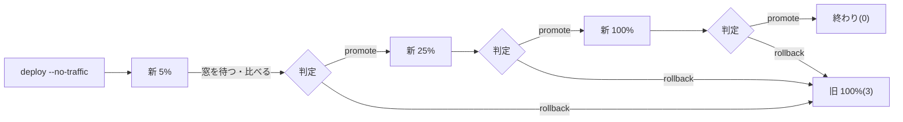

# 段階的なリリース: Cloud Run のトラフィックの分割と自動の巻き戻し(#372)

新しいリビジョンに少しずつトラフィックを移し(既定 5% → 25% → 100%)、段階ごとに新旧のリビジョンの指標を比べ、悪ければ前のリビジョンに 100% 戻すスクリプト `scripts/rollout.sh` の使い方です。

> **スクリプトとテストだけが入っています。deploy の workflow(`.github/workflows/deploy-cloudrun.yml`)にはまだ組み込んでいません。** stg / prod で実際に動かしたこともありません。組み込みと最初の実行は、承認を得てから人が行います(下の「人の作業」)。

## 目次

1. [流れ](#流れ)
2. [使い方](#使い方)
3. [比べる指標](#比べる指標)
4. [閾値の選び方](#閾値の選び方)
5. [人が途中で止める](#人が途中で止める)
6. [人の作業 1: deploy の workflow に組み込む](#人の作業-1-deploy-の-workflow-に組み込む)
7. [人の作業 2: stg でわざと悪い版を出して戻ることを確かめる](#人の作業-2-stg-でわざと悪い版を出して戻ることを確かめる)
8. [わかっている限界](#わかっている限界)

## 流れ



1. deploy の workflow が `gcloud run deploy --no-traffic` で新しいリビジョンを作る(トラフィックは旧のまま)
2. `rollout.sh` が `gcloud run services update-traffic --to-revisions=NEW=5,OLD=95` で 5% を移す
3. `--wait` 秒(既定 300)待ち、その窓のログから新旧の指標を出して判定する
   - **promote**: 次の段階へ
   - **rollback**: `--to-revisions=OLD=100` で戻し、`$GITHUB_STEP_SUMMARY`(あれば)と標準エラーに理由を出して終了コード 3
   - **insufficient**(新のリクエストが少なすぎる): 窓を延ばす(既定 2 回まで)。それでも足りなければ既定は巻き戻し(終了コード 4)
4. 100% の段階も 1 窓見る(旧は受けていないので、新の絶対値だけで判定)

## 使い方

```sh
# dry-run(既定): 出すコマンドを見るだけ。GCP には触らない・認証も要らない
scripts/rollout.sh --env stg --service appconfig

# stg で実行(新 = 最後に作ったリビジョン・旧 = 今いちばん多く受けているリビジョン)
scripts/rollout.sh --env stg --service ai --execute

# prod は --env prod と --execute の両方を書いた時だけ実行する
scripts/rollout.sh --env prod --service appconfig --execute --steps 5,25,50,100 --wait 600

# 模擬: 段階ごとの指標を DIR/<割合>.json から読む(dry-run のまま判定と巻き戻しの流れを見る)
scripts/rollout.sh --env stg --service ai --to-revision new --from-revision old --wait 0 \
  --metrics-dir scripts/testdata/rollout/sim-bad

# 判定だけ / ログの JSON から指標だけ(オフライン)
scripts/rollout.sh --decide metrics.json
scripts/rollout.sh --summarize logs.json --new ai-stg-00002-abc --old ai-stg-00001-xyz
```

| オプション | 既定 | 中身 |
| --- | --- | --- |
| `--env` | (必須) | `stg` か `prod`。サービス名の接尾辞と合わないと止まる(`--env stg --service appconfig-prod` は不可) |
| `--service` | (必須) | `appconfig` / `ai`(`-<env>` を足す)か、`appconfig-stg` のような完全な名前 |
| `--execute` / `--dry-run` | dry-run | 実行するか。`--execute` が無ければ prod でも stg でも何も変えない |
| `--to-revision` / `--from-revision` | 自動 | 新旧のリビジョン。無ければ `gcloud run services describe` から読む |
| `--steps` | `5,25,100` | 新に回す割合。1..100 の増える順・最後は 100 |
| `--wait` | `300` | 1 つの窓の秒数 |
| `--max-extends` | `2` | 指標が足りない時に窓を延ばす回数 |
| `--on-insufficient` | `rollback` | 延ばしても足りない時。`promote` で進める(トラフィックが少ない stg 向け) |
| `--metrics-dir` | なし | 模擬。dry-run だけで使える |

環境変数: `PROJECT_ID`(既定 `jphacks-kz2601`)・`REGION`(既定 `asia-northeast1`)・`LIMIT`(1 窓で読むログの行数・既定 20000)と、下の `ROLLOUT_*`。

要る権限(`--execute`): `roles/run.developer`(update-traffic)と `roles/logging.viewer`。deploy の SA はもう `run deploy` ができるので、組み込みの時に `logging.viewer` があるかを IAM で見ます。

## 比べる指標

ログ(`gcloud logging read`)から、窓の中の新旧のリビジョン(`resource.labels.revision_name`)ごとに出します。形は [observability.md](observability.md) の「ログの形」と [ai-cost.md](ai-cost.md)。

| 指標 | もと | 使うもの |
| --- | --- | --- |
| リクエスト数・5xx 率 | `jsonPayload.event="http.request"`(`/health` は除く) | `status >= 500` の割合 |
| p95 の待ち時間 | 同じ | `duration`(ns → ms)の 95 パーセンタイル |
| Claude の失敗率(ai) | `jsonPayload.event="ai.usage"` | `outcome="error"` の割合 |

**なぜ Cloud Monitoring の `request_count` / `request_latencies` でなくログか**: 監視のアラート([observability.md](observability.md)・`infra/monitoring.tf`)は Cloud Run の組み込みの指標を使っていますが、`gcloud monitoring` には時系列を読むコマンドが無く、Monitoring API を `curl` で叩くことになります。ログなら `scripts/ai-cost.sh` と同じ `gcloud logging read` + `jq` で済み、判定の入力をそのままテストの固定データにできます。ログベースの指標 `ai_claude_calls` / `backend_panics` もログが元なので、見ているものは同じです。違いは、Cloud Run 自身が返した 503(コンテナに届かなかったもの)がログの `http.request` に入らないこと。これが要るなら、`decide` の入力(JSON)はそのままで、`fetch_metrics` を Monitoring API の `timeSeries.list`(`run.googleapis.com/request_count` を `resource.labels.revision_name` で分ける)に替えられます。

費用(#298)はまだ比べていません。`ai.usage` の `est_cost_usd` を同じ形で足せます(下の「限界」)。

## 閾値の選び方

判定は `decide`(純粋な関数・`scripts/rollout-test.sh` で確かめる)。**どれか 1 つでも超えたら rollback**、超えていなくて新のリクエストが少なければ insufficient、それ以外は promote。「ちょうど」は超えていない扱いです。

| 環境変数 | 既定 | 意味 | 選び方 |
| --- | --- | --- | --- |
| `ROLLOUT_MAX_ERROR_RATE` | `0.05` | 新の 5xx 率の上限 | 監視のアラート `error_rate_threshold`(5%)と揃える。リリースで止める線がアラートより緩いと、戻さずに鳴る |
| `ROLLOUT_MAX_ERROR_RATE_DELTA` | `0.01` | 新 − 旧の 5xx 率の差の上限 | 旧も同じ窓で受けているので、外部の障害(Firestore・Claude の落ち)は両方に出て差は小さい。新だけが悪いことを見る線。普段の 5xx 率の揺れ(Logs Explorer で数日分)の 2〜3 倍 |
| `ROLLOUT_MAX_P95_RATIO` | `1.5` | 新の p95 / 旧の p95 の上限 | ai は Claude の待ちで p95 が数十秒あり揺れが大きいので、ai だけ 2 にしてもよい |
| `ROLLOUT_P95_SLACK_MS` | `100` | 差がこれ以下なら比が大きくても通す | appconfig の p95 は数十 ms なので、比だけだと 20ms → 40ms で落ちる。ユーザーが気づかない差 |
| `ROLLOUT_MAX_CLAUDE_FAILURE_RATE` | `0.2` | 新の Claude の失敗率の上限 | 監視の `claude_failure_rate_threshold`(20%)と揃える |
| `ROLLOUT_CLAUDE_FAILURE_MIN_COUNT` | `3` | 失敗がこの件数未満なら率は見ない | 監視の `claude_failure_min_count` と揃える。5% の段階では呼び出しが数件なので、1 件の失敗で戻さないため |
| `ROLLOUT_MIN_REQUESTS` | `20` | 新がこれ未満なら判定しない | 5% の 1 窓に 20 件来るには、全体で 5 分に 400 件。**stg は足りないことが多い**ので、stg は `--on-insufficient promote` か、ジョブの中で負荷(スモーク)を流す |

段階と窓: 5% の窓で 20 件を超える程度のトラフィックがあること、が段階と `--wait` を決める目安です。prod の今のトラフィックなら、5% の段階は `--wait 600` 以上を勧めます。段階を細かくするほど、悪い版を受けるユーザーは減るがリリースは遅くなります。

## 人が途中で止める

- 手元: Ctrl-C。ジョブ: GitHub Actions の Cancel(SIGINT → SIGTERM)
- どちらも、旧のリビジョンに 100% 戻してから終了コード 3 で終わります(待っている間でもすぐ。`sleep` を裏で動かして `wait` しているため)
- 戻さずに今の割合のまま止めたい時は、ジョブを止めずに(または SIGKILL で)止め、あとは手で `gcloud run services update-traffic` を打つ

## 人の作業 1: deploy の workflow に組み込む

> 承認を得てから行う。まだ誰もしていない。`.github/` はこの PR では変えていません。

`deploy-cloudrun.yml` の appconfig / ai の deploy を、次の形に変えます(appconfig の例)。

```yaml
      - name: Deploy appconfig-${{ env.ENV_SUFFIX }} (no traffic)
        run: |
          set -euo pipefail
          gcloud run deploy "appconfig-${ENV_SUFFIX}" \
            --image="$IMAGE" \
            ...(今と同じ)... \
            --no-traffic \
            --tag="sha-${GITHUB_SHA::7}" \
            --quiet

      - name: Staged rollout appconfig-${{ env.ENV_SUFFIX }}
        timeout-minutes: 30
        env:
          PROJECT_ID: ${{ vars.GCP_PROJECT_ID }}
          REGION: ${{ vars.GCP_REGION }}
        run: |
          scripts/rollout.sh --env "$ENV_SUFFIX" --service appconfig --execute \
            --wait "${{ env.ENV_SUFFIX == 'prod' && '600' || '120' }}" \
            ${{ env.ENV_SUFFIX == 'stg' && '--on-insufficient promote' || '' }}
```

| # | やること | 気をつけること |
| --- | --- | --- |
| 1 | `gcloud run deploy` に `--no-traffic` を足す | **初回(サービスがまだ無い)は `--no-traffic` が使えない**。サービスがある前提で足す。`--tag` を付けると、新だけを `https://sha-xxxxxxx---appconfig-stg-....run.app` で叩けて、スモークを 0% のうちに流せる |
| 2 | deploy の後に `rollout.sh --execute` のステップを足す | ステップの `timeout-minutes` は 段階の数 × `--wait` ×(1 + `--max-extends`)より長く |
| 3 | deploy の SA に `roles/logging.viewer` を足す(`infra/` の IAM) | 無いと最初の判定でログが読めず、毎回旧に戻る(下の限界) |
| 4 | 今の「`/health` を叩く」ステップは、100% の後に回す | 0% のうちに `--tag` の URL で叩くとさらに良い |
| 5 | ai は appconfig の rollout が終わってから(順に) | 同時に段階を進めると、どちらの版が悪いか分からない |
| 6 | 失敗の通知 | ジョブの失敗(終了コード 3 / 4)でいつもの通知が飛ぶ。Slack に理由を出すなら `$GITHUB_STEP_SUMMARY` を使う |
| 7 | `scripts-ci.yml` の `ai-cost-test` ジョブに `- run: scripts/rollout-test.sh` を足す | 今は CI で回っていない(shellcheck だけは全 `*.sh` に掛かる)。jq と bash だけで動く・GCP に触らない |
| 8 | 巻き戻した後のイメージ | 次の deploy まで旧のまま。新のリビジョンは 0% で残る(消さない) |

## 人の作業 2: stg でわざと悪い版を出して戻ることを確かめる

Issue の完了の条件「stg でわざと悪い版を出すと、自動で前の版に戻る」の確かめ方です。組み込みの前に、手元から stg に対して行えます(要る権限は上)。

1. 今の stg のリビジョンを控える: `gcloud run services describe appconfig-stg --project=jphacks-kz2601 --region=asia-northeast1 --format='value(status.traffic)'`
2. わざと悪い版を、トラフィック 0 で出す(例: 全リクエストで 500 を返す一行の変更を入れたイメージ・または `/debug/error` を叩く負荷)。`gcloud run deploy appconfig-stg --image=<悪いイメージ> --no-traffic --tag=bad ...`
3. 段階を短くして実行する: `scripts/rollout.sh --env stg --service appconfig --execute --steps 50,100 --wait 120`
4. その間、別の端末で stg の URL に 1 秒 1 回ほどリクエストを流す(5xx の判定に 20 件以上要る)
5. `step 50%: rollback — 5xx rate …` が出て終了コード 3、`describe` で旧が 100% に戻っていることを見る
6. 良い版(今の develop)でも同じ手順を行い、100% まで進むことを見る

## わかっている限界

- **判定のログが読めない時**(権限・API の失敗)は、悪い版かどうか分からないので **旧に 100% 戻します**(終了コード 3)。権限の付け忘れでも毎回戻るので、組み込んだ最初の deploy で気づけます
- `update-traffic` 自体が失敗した時は、その場で止まり(`set -e`)、トラフィックはその時の割合のままです。ジョブの失敗で気づき、手で戻すか、もう一度実行してください
- ログに出ない 5xx(Cloud Run 自身の 503 など)は数えません(上の「比べる指標」)
- 費用(#298 の `est_cost_usd`)と、プロンプト・モデルの版(#298・どの版で生成したか)はまだ比べていません。`summarize` に足せば `decide` に同じ形で入ります
- 1 窓で読むログは `LIMIT` 行まで。超えると古い行が落ちて指標が偏ります(prod のトラフィックが増えたら Monitoring API に替える)
- ai と appconfig は同じイメージなので、片方だけ戻すと版がずれます(ai は appconfig を HTTP で呼ぶだけなので、API の互換が保たれていれば動く)
