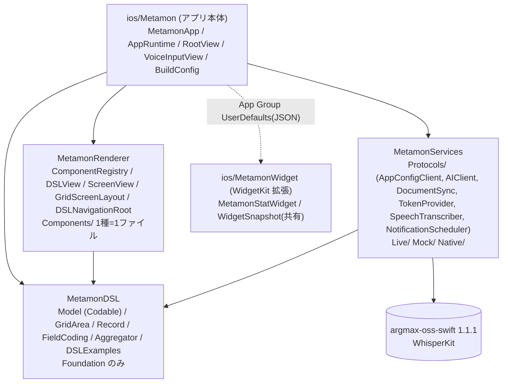
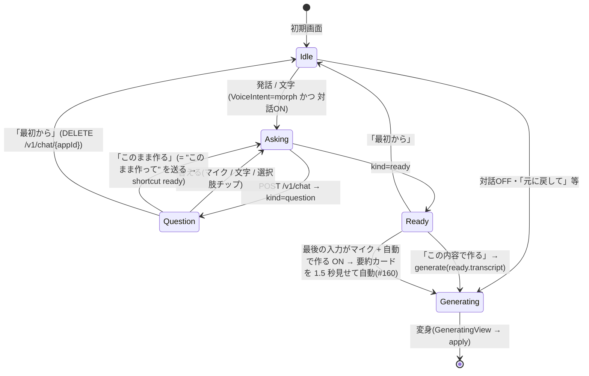

# iOS アーキテクチャ(Metamon / Server-Driven UI)

> 正典は `docs/00_decisions.md`。本書は iOS 側の実装設計。DSL スキーマは統一版 v1 `docs/dsl/README.md`(旧 iOS 案: `docs/ios/dsl-proposal.md`)。**注**: 本書 §2〜§5 の `{{式}}`/`state`/`Interpolator` の記述は v1 で廃止され、`screen.entity` のドラフト + `field` 束縛(`FormDraft`)・`initialScreen` + push/sheet/fullScreen・`app.tabs[]`(TabView)に置き換わった。画面内配置は `area`(6 列 × 可視高さ÷12 行のグリッド)で `GridScreenLayout` が絶対配置する。
> 実装: `ios/Metamon/`(アプリ本体)+ `ios/Packages/{MetamonDSL,MetamonRenderer,MetamonServices}`(ローカル Swift Package)。§1 参照。

## 0. 追加決定の反映(2026-10-24 昼)
| 項目 | 決定 | iOS 側の帰結 |
|---|---|---|
| ユーザーデータ保存先 | **バックエンド(Firestore / appconfig の汎用エンティティ API)** | iOS に永続層を持たない。`entity.*` アクションは全て HTTP。オフライン時のみ最後のレスポンスをメモリ/ディスクにキャッシュ(P2) |
| 2回目以降の改変 | **JSON Patch(RFC 6902)はサーバー側で適用** | iOS はパッチを扱わない。`POST /v1/morph` の応答 or ホットリロード(SSE 通知 → `GET /dsl`)で**最新 DSL 全体**を受け取り差し替えるだけ |
| P0 ネイティブ | **カメラ + ローカル通知** | `camera` コンポーネント / `native: notification.*` を実装済み。位置/センサー/共有は P1(ブリッジに stub) |
| デモ3本 | 家計簿 / トレーニング記録 / 散歩メモ | サンプル DSL は `docs/dsl/examples/*.json`(4 本)をそのままバンドル |
| 認証 | Sign in with Apple → 詰まったら匿名認証 | `TokenProvider` 抽象の裏で切替。UI/ランタイムは影響なし |
| STT | WhisperKit 確定・**導入済み** | `SpeechTranscriber` 抽象。実機 `WhisperKitRecognizer`(model `small`)/ シミュレータ `MockTranscriber`(§6) |
| iOS CI | 5分制限なし | WhisperKit/Firebase 解決込みのビルドでも可 |

## 1. 全体構成(マルチモジュール)

Android のマルチモジュールに相当する **ローカル Swift Package 3 つ + 薄いアプリ本体**。依存の向きは各 `Package.swift` の `dependencies` で固定され、逆向きの import はコンパイルエラーになる。



| モジュール | 場所 | 責務 | 依存 | テスト |
|---|---|---|---|---|
| `MetamonDSL` | `ios/Packages/MetamonDSL` | DSL v1 の Codable モデル、`GridArea`(area 計算)、`Record`/`FieldCoding`/`Aggregator`(クライアント集計)、`DSLExamples` | なし(Foundation) | `swift test`(macOS で可)/ `xcodebuild test` |
| `MetamonRenderer` | `ios/Packages/MetamonRenderer` | SwiftUI View。`ComponentRegistry`(`type` 文字列 → View)、`DSLView`、`ScreenView`、`GridScreenLayout`、`DSLNavigationRoot`(TabView)。Services を知らない | DSL | `xcodebuild test`(schema 全 type の登録チェック) |
| `MetamonServices` | `ios/Packages/MetamonServices` | 外部 I/O の protocol と実装。`Protocols/` と `Live/`(HTTP, WhisperKit)`Mock/` `Native/`(UNUserNotificationCenter)をフォルダで分離。WhisperKit はこのパッケージの依存 | DSL, WhisperKit | `xcodebuild test` |
| アプリ本体 | `ios/Metamon` | `MetamonApp`(組み立て)、`AppRuntime`(状態・アクション実行。`DSLRuntime` に準拠)、`RootView`(モーダル/FAB/オーバーレイ)、`VoiceInputView`、`BuildConfig`(環境 → Services)、`WidgetSnapshotWriter`(stat 集計 → App Group) | 全部 | なし(ロジックは各パッケージへ) |
| ウィジェット | `ios/MetamonWidget` | WidgetKit 拡張(`jp.kz2601.metamon.widget`)。`WidgetSnapshot`(`Shared/`・本体と共用コンパイル)を描画するだけ。§12 | なし(Renderer/DSL を import しない) | なし |

### 1.1 DI(依存性注入)
- **入口は `ios/Metamon/App/BuildConfig.swift` の `BuildConfig.make(environment:)` だけ**。`AppEnvironment`(`.mock` / `.live(appConfigURL:aiURL:)`・どちらか片方だけ live も可)を環境変数 `METAMON_AI_BASE_URL` / `METAMON_APPCONFIG_BASE_URL` / Info.plist から判定し、`Services`(protocol のコンテナ struct。`auth` を含む)を**1回だけ**組み立てる。Mock と本番の切替はこのファイルで完結する。
- `MetamonApp` が `Services` を `AppRuntime(document:services:)` と SwiftUI Environment `\.services`(`App/ServicesEnvironment.swift`)に渡す。View は `@Environment(\.services)` で protocol 越しに使う(例: `VoiceInputView` → `services.transcriber`)。
- Renderer は Services を知らない。必要な能力(DSL、レコード、`run(action)`、ナビ)は `DSLRuntime` protocol(`MetamonRenderer/Host/DSLRuntime.swift`)で宣言し、`AppRuntime` が準拠して `\.dslRuntime` で注入する。`@Observable` なのでプロパティ変更は SwiftUI が追跡する。
- 外部 DI ライブラリは使わない。

### 1.2 ComponentRegistry(コンポーネントが増えても崩れない仕組み)
- `MetamonRenderer/Registry/ComponentRegistry.swift`: schema の `type` 文字列 → View ビルダーの辞書。`DSLView` は辞書を引くだけで `switch` を持たない。
- **追加手順(3 行)**: ① `Components/Leaves/FooLeaf.swift` に View を 1 ファイル作る ② `MetamonDSL` の `ComponentType` に `case foo`(schema にも追加) ③ `ComponentRegistry.standard` に `r.register(.foo) { c, ctx in FooLeaf(c: c, ctx: ctx) }` を 1 行。
- **テストで強制**: `MetamonRendererTests/ComponentRegistryTests` が `docs/dsl/dsl.schema.json` の Container `enum` + Leaf `const` を読み、`ComponentRegistry.standard.registeredTypes` と `ComponentType.allCases` の**双方向一致**を検証する(抜けても余っても赤)。
- `voiceInput` だけは音声機能(Services)に依存するため Renderer ではプレースホルダ。アプリ本体が `ComponentRegistry.standard.registering(.voiceInput) { c, _ in VoiceInputView(prompt: c.prompt) }` で差し替え、`\.componentRegistry` で注入する(`MetamonApp`)。
- ホスト独自のコンポーネント(schema 外)も `register("myType") { ... }` で足せる。

### 1.3 状態管理
`@Observable final class AppRuntime` 1個を `.environment(runtime)`(アプリ内)と `.environment(\.dslRuntime, runtime)`(Renderer 向け)で配る。フォーム入力は画面ごとの `FormDraft`(Renderer)に閉じる。View 側の `@State` は一時 UI(録音フェーズ、PhotosPicker 選択)のみ。

## 2. DSL レンダリング

| 要素 | 実装 | ポイント |
|---|---|---|
| ルート | `AppDocument: Decodable` | `screens: [id: Screen]`、`navigation`、初期 `state` |
| ノード | `struct Node { id, visible, padding, component }` | 共通メタ + 種別 |
| 種別 | `indirect enum Component` | `type` 文字列で分岐する手書き `init(from:)` |
| 未知 type | `.unknown(type:)` | 描画は DEBUG で黄色ラベル、RELEASE で `EmptyView` |
| 既知 type だが props 不正 | `.invalid(type:reason:)` | 同上。画面全体は落とさない |
| 配列中の壊れた要素 | `@Lossy var children: [Node]` | 要素単位で skip |
| 未知 enum 値 | `Lenient.decode(..., fallback:)` | `style: "neon"` → `.primary` |
| 再帰 | `DSLView(node:ctx:)` → `switch component` → 子に `DSLView` | `ForEach(children)`(`Node: Identifiable`) |

```swift
extension Component: Decodable {
    init(from decoder: Decoder) throws {
        let type = try decoder.container(keyedBy: Keys.self).decode(String.self, forKey: .type)
        do {
            switch type {
            case "text":   self = .text(try TextProps(from: decoder))
            case "vstack", "hstack", "zstack": self = .stack(try StackProps(from: decoder)) // axis は type から
            // ...
            default:       self = .unknown(type: type)
            }
        } catch { self = .invalid(type: type, reason: "\(error)") }
    }
}
```

描画スコープ `RenderContext { params, item, index }` を再帰で持ち回り、`list` の行だけ `item/index` を上書きする。

### 生成 DSL の見た目監査(#131)

- **フォーム画面(`screen.entity` あり)は area を「並び順と横幅」だけに使い、高さは中身なり**(`GridScreenLayout` → `FormFlowLayout`)。行が重なる部品は 1 段にまとめ、前の段から 3 行以上下の部品(最下段の削除ボタン等)は少し間を空けて続ける。chart / map / list など面を埋める型だけ area の高さを保つ。AI が入力 section を小さく取っても切れない。
- セルは矩形で clip せず、影のぶん(16pt)外まで描く(カード/ボタンの影が四角く切れて「薄い箱」に見えていた)。
- 行がある list(と list だけの section)はカードを行の高さで止める。空の時だけセル全体に空状態(#84)。
- DEBUG フック: `METAMON_INITIAL_DSL_PATH=<DSL JSON のパス>`(起動時の document をファイルから読む・appId はファイル名ごと)/ `METAMON_INITIAL_SCREEN=<screen>`(タブ 2 枚目などを初期表示)/ `METAMON_SEED_DUMMY=<n>`(モック時、entity の field 型から n 件のダミーレコード。長い文字列・大きい金額を混ぜる)。`METAMON_MOCK=1` と併用。実装は `Metamon/App/DebugDSLOverride.swift`。

## 3. ナビゲーション

| DSL | SwiftUI | 状態 |
|---|---|---|
| `navigation.type = "tab"` + `tabs[]` | `TabView(selection:)` 内に **タブ毎の** `NavigationStack(path:)` | `selectedTab`, `paths[tabId]: [Route]` |
| `navigation.type = "stack"` + `root` | `NavigationStack(path:)` 1本 | `paths["main"]` |
| `navigate` アクション | `NavigationResolver` が行き先で pop / タブ切替 / push を選ぶ(§3.1) | `.navigationDestination(for: Route.self) { ScreenView(route:) }` |
| `back` | `removeLast()` | |
| `present(style: sheet/fullScreen)` | `.sheet(item: $rt.sheet)` / `.fullScreenCover` | `Route: Identifiable` |
| `dismiss` | `sheet = nil; fullScreen = nil` | |

`Route { screen: String, params: [String: JSONValue] }` は `Hashable`。params は push 時に `{{item.id}}` 等を**解決済みの値**で保持するので、遷移先は `{{params.id}}` で参照できる。
DSL 差し替え時(`apply`)は paths/sheet を全部リセットする(画面 id が消えている可能性があるため)。存在しない screen id は `ContentUnavailableView` で表示。

### 3.1 行き先に応じて賢く動く navigate(#113)

`navigate` は常に push していたため、タブの根へ飛んでもタブが切り替わらず、A→B→C→A の循環で戻るが無限に深くなっていた。
解決規則を純粋関数 `NavigationResolver`(`MetamonRenderer/Host/NavigationResolver.swift`)に切り出し、`AppRuntime.navigate` / `close` はその結果(`NavigationState` = paths / selectedTab / sheet / fullScreen)を書き戻すだけにした。**DSL は変えない**(既存の DSL・AI の出力にそのまま効く)。

| 状況 | 動き |
|---|---|
| 行き先が今のスタック(根を含む)にある | そこまで pop(積み直さない) |
| 行き先がタブの根(`app.tabs[].screen`) | そのタブへ切り替え、そのタブのスタックを根まで戻す |
| それ以外 | 今のスタックへ push(従来どおり) |
| モーダル(sheet / full)の中から | まずモーダル内のスタックで pop を試す → 無ければ下の画面(選択中タブ / main)で上 2 行を試し、当たればモーダルを閉じてから適用 → どれでもなければモーダル内に push |
| `presentation: sheet / fullScreen` | 従来どおりモーダルで開く(規則は使わない)。新しいモーダルは根から始める(前のモーダルの積み残しを捨てる) |

- 同じ画面かどうか: 根は recordId を持たないので画面 id だけで一致。push 済みの画面は **screen と recordId が両方一致** した時だけ同じとみなす(別レコードの編集画面は別物として push)。
- `saveRecord` の `screen`(保存後の遷移先)も同じ規則で解決する。シートのフォームで保存 → タブの根へ、ならシートが閉じてタブが切り替わる。
- 明示指定(`navigate.mode = push / replace / root`)は **入れていない**。既定規則で「B からも C へ」「C から A へ」が積み増し無しで動くため。強制 push が要る場面(同じ画面を重ねたい)が出たら Action に任意の `mode` を足す。
- 検証用の例: `docs/dsl/examples/navigation.json`(タブ A / 別タブ、画面 A→B→C→A の循環、C から別タブ、A から C をシートで)。`METAMON_INITIAL_EXAMPLE=navigation` で起動できる。ユニットテストは `MetamonRendererTests/NavigationResolverTests.swift`。

## 4. アクションとデータバインディング

### 4.1 バインディング(読み)
`"{{root.path.to.value}}"` テンプレート。root は `state` / `item` / `index` / `params` / `user`(省略時 state)。配列には `.count` と添字。単独式なら型付き `JSONValue`、文中埋め込みなら文字列連結。`visible` / `disabled` は `truthy` 判定。

### 4.2 バインディング(書き)
入力系(`textField`/`toggle`/`picker`/`camera`)は `bind: "state.draft.title"` を持ち、`AppRuntime.binding(path)` が `Binding<JSONValue>` を返す(`state.` 接頭辞は省略可)。

### 4.3 アクション
| type | 実行先 | 備考 |
|---|---|---|
| `navigate` / `back` / `present` / `dismiss` | ローカル(ナビ) | |
| `setState` | ローカル(`state`) | `value` 内の文字列も `{{}}` 展開 |
| `entity.list` / `create` / `update` / `delete` | **appconfig(Firestore)** | `list` は `into` で state に格納。ユーザーデータは常にサーバー |
| `native` | `NativeBridge` | `feature` 名で分岐、結果は `into` に格納可 |
| `openURL` | UIApplication | |
| `ai.prompt` | ai サービス | 文字で改変(音声と同じ経路) |
| `sequence` | 直列実行 | 「作成→state クリア→再取得→haptic→dismiss」の定石 |

実行は `AppRuntime.run(_:_:) async`(MainActor)。失敗は `toast` に出すだけで握りつぶさない。**ローカル state vs サーバー**の線引き: 入力中の下書き・UI フラグ・取得済み一覧のキャッシュは `state`、永続レコードは全部 entity API。

## 5. ネイティブ機能ブリッジ

| 機能 | 優先 | 公開形 | 実装 | 権限キー |
|---|---|---|---|---|
| マイク(STT) | P0 | `aiVoice` コンポーネント / FAB | AVAudioRecorder → WhisperKit | `NSMicrophoneUsageDescription` |
| カメラ/写真 | P0 | `photoField { field, source }` コンポーネント | **実装済み**(`PhotoFieldLeaf` + `CameraPicker` + `PhotoSourcePolicy`、下記) | `NSCameraUsageDescription`, `NSPhotoLibraryUsageDescription` |
| ローカル通知 | P0 | `native: notification.requestPermission` / `notification.schedule {title, body, inSeconds}` | `UNUserNotificationCenter`(実装済み) | 不要(実行時ダイアログ) |
| 触覚 | P0 | `native: haptic {style}` | `UIImpactFeedbackGenerator`(実装済み) | 不要 |
| URL 起動 | P0 | `openURL` / `native: openURL` | `UIApplication.open`(実装済み) | 不要 |
| 位置 | P1 | `native: location.current → into` / `map` コンポーネント | `CLLocationManager` 1回取得(stub) / MapKit(実装済み) | `NSLocationWhenInUseUsageDescription` |
| モーション/歩数 | P1 | `native: motion.read` | CoreMotion / CMPedometer(stub) | `NSMotionUsageDescription` |
| 共有 | P1 | `native: share {text}` | `UIActivityViewController`(stub) | 不要 |
| オンデバイス AI | P1 | `aiButton { task, input?, entity?, output, prompt?, options? }` コンポーネント | **実装済み**(`AiButtonLeaf` + `Support/OnDeviceAI.swift`・Foundation Models・§18) | 不要(Apple Intelligence の ON は OS 設定) |

### photoField(カメラ)の実装要点(`MetamonRenderer/Components/Leaves/PhotoFieldLeaf.swift`)

| 項目 | 内容 |
|---|---|
| `source` 分岐 | `PhotoSourcePolicy.plan(for:cameraAvailable:)`(純関数)。`camera` → `CameraPicker`、`library` → `PhotosPicker`、`both`/省略/未知 → 「撮影」「写真から選ぶ」の `confirmationDialog` |
| フォールバック | `UIImagePickerController.isSourceTypeAvailable(.camera)` が false(カメラ無し端末)なら source に関わらず写真選択へ。iOS 26 シミュレータは仮想カメラを持つので true を返す(フォールバックは単体テスト `PhotoFieldTests` で担保) |
| カメラ | `CameraPicker`(`UIViewControllerRepresentable` → `UIImagePickerController(.camera)`、背面・静止画・編集無し)を `fullScreenCover` で表示 |
| 権限 | `AVCaptureDevice.authorizationStatus(.video)`。未決定なら要求、拒否/制限なら alert「カメラを使えません」→「設定を開く」(`UIApplication.openSettingsURLString`)/「写真から選ぶ」 |
| エンコード | `PhotoCodec.dataURL(from: UIImage)`:**ピクセル基準で長辺 ≤800px**・renderer scale=1 固定(既定の画面倍率だと 800pt=2400px になる)・JPEG q0.5 → `data:image/jpeg;base64,...` を `FormDraft.values[field]` へ(保存経路は他の入力と同じ `entity.create/update`) |
| 表示 | 値があれば `PhotoView` サムネイル(160pt)+「撮り直す」「削除」、無ければ `label` のボタン 1 つ |

画像は **base64 JPEG 文字列として photo フィールドに置き、entity.create の data に含めて送る**(縮小後 ≈ 数十〜100KB で Firestore ドキュメント 1MB 制限内)。Cloud Storage 経由(URL 化)は P1 以降。
全 usage description は `ios/Metamon/Resources/Info.plist` に記入済み。

## 6. 音声入力画面とホットリロード

```
[録音] WhisperKit.AudioProcessor.startRecordingLive  (AVAudioEngine → 16kHz mono Float32 をメモリに蓄積)
  → [文字起こし] WhisperKit.transcribe(audioArray:, DecodingOptions(language: "ja", chunkingStrategy: .vad))  ※オンデバイス・停止後に一括
  → [意図判定] VoiceIntent.detect: 「元に戻して」→ appconfig restore(ai を呼ばない)/「別のアプリ」→ appId 採番し直し → ai
  → [送信] POST ai /v1/generate { appId, baseVersion, transcript, mode:"auto" }
       (ai: Claude が DSL / JSON Patch 生成 → スキーマ検証 → appconfig に PUT/PATCH(If-Match)→ 最新 DSL を返す)
  → [適用] AppRuntime.apply(doc)  withAnimation(.spring) + RootView.id(version) + transition。DocumentCache にも保存
```

### WhisperKit 実装要点(`Services/Live/WhisperKitRecognizer.swift`)

| 項目 | 内容 |
|---|---|
| パッケージ | `https://github.com/argmaxinc/argmax-oss-swift` **1.1.1 固定**(`exactVersion`)。WhisperKit は v1.0.0 で Argmax OSS SDK に統合され、旧 URL `argmaxinc/WhisperKit` は同リポジトリへリダイレクト。product は `WhisperKit` のみリンク(`ArgmaxCore` は `@_exported`) |
| モデル | `BuildConfig.whisperModel`(環境変数 `METAMON_WHISPER_MODEL` / Info.plist `MetamonWhisperModel`、既定 **`small`**)。短縮名は `openai_whisper-small` に解決し、Hugging Face `argmaxinc/whisperkit-coreml` から取得 |
| 配置 | `Application Support/WhisperKit/models/argmaxinc/whisperkit-coreml/openai_whisper-small/`(約 500MB)。`MelSpectrogram/AudioEncoder/TextDecoder.mlmodelc` + `config.json` が揃っていればオフラインでも Hub に問い合わせずロード |
| DL と状態 | `prepare()` を `AppRuntime.bootstrap()` が起動直後に呼ぶ。`status`: `notDownloaded → downloading(downloadProgress 0〜1) → loading(CoreML ロード + ANE 特化 prewarm) → ready → recognizing`。失敗は `.failed(message)` で UI に「再試行」ボタン |
| 権限 | `AudioProcessor.requestRecordPermission()`(`NSMicrophoneUsageDescription`、記入済み)。`NSSpeechRecognitionUsageDescription` は Apple Speech フォールバック用に残置(WhisperKit 自体は不要) |
| 録音 | 録音前に **自前で** `AVAudioSession(.playAndRecord, .default, [.defaultToSpeaker, .allowBluetooth])` + `setActive(true)`(WhisperKit 側は `try?` で失敗を握りつぶすため。カメラ/AVCaptureSession の後でも record 系に戻す)→ `startRecordingLive(callback: nil)` → 停止で `audioSamples` を取り出し `purgeAudioSamples`。`precheck`: 0 サンプル=`noAudioCaptured`・0.5 秒未満=`tooShort`・ピーク < 0.001(-60dBFS)=`silent` を **理由付き `TranscriberFailure`** として throw(toast にそのまま日本語で出る) |
| 診断 | `lastDiagnostics: TranscriberDiagnostics`(録音秒数・サンプル数・ピーク/RMS・セッション category/mode・入力ルート・権限・モデル状態・失敗理由)。`[Voice]` プレフィックスで stdout と os_log(subsystem `jp.kz2601.metamon` category `voice`)に `recording started` / `stopped samples=N duration=S peak=…` / `transcribe result text="…"` を出す。実機ログ: `xcrun devicectl device process launch --console --device <id> jp.kz2601.metamon` |
| 制約 | シミュレータでは `#if targetEnvironment(simulator)` で `MockTranscriber` + 文字入力のみ(マイク非表示)。ストリーミング(途中結果)は未対応=停止後に一括。`small` のメモリは推論時 ~1GB 弱、初回 prewarm は 30〜90 秒 |

### 音声画面 → 生成中 → 変身 の状態遷移(2026-10-24 刷新)

デザイントークン(色・角丸・余白・影)は `ios/Metamon/App/Theme.swift` に集約し、音声画面・生成中・サインイン・設定で共用する(Renderer の部品は触らない)。
生成アプリ側(Renderer の全部品)のトークンは `MetamonRenderer/Support/RenderTheme.swift`(色の正典。本体 Theme の色はこれを参照)で、方針は **[`docs/ios/design-system.md`](design-system.md)**(#89: タイポ・ブランド色の使い所・面・角丸・影・モーション・アイコン推定・部品ごとの仕様)。生成アプリは `app.theme.primaryColor` を使わず常に Tailor It ブランド(藍→青緑・アイコンの紺に合わせる #102)で描く。
初期状態(`voiceEntry = fullscreen`)は `RootView` が `DSLNavigationRoot` ではなく `VoiceInputView` を直接全面に描く(背景を画面いっぱいに敷くため)。生成後の FAB シートも同じ View。

```
VoiceInputView.phase                         AppRuntime.morphJob               RootView
 idle ──tap──▶ listening ──tap──▶ transcribing ──text──▶ (送信) ─▶ create / edit ──apply──▶ nil
   │ 例文チップ / 文字入力 ─────────────────────────────▶ (送信) ─┘                      │
   └ 準備中(モデル DL/ロード)はマイク灰色・タップ不可                               summaryBanner 3〜5s
```

| 画面状態 | 判定 | UI |
|---|---|---|
| idle(準備完了) | `transcriber.isReady` | ブランドグラデーションのマイク + ゆっくり呼吸するリング(3.2s 周期・`TimelineView`)、"タップして話す"、例文チップ(タップで即送信)、文字入力 |
| idle(準備中) | `status` が notDownloaded/downloading/loading | マイク灰色・無効、下に DL 進捗 / 読み込み中 |
| listening | 録音中 | 赤〜珊瑚のマイク + 外へ広がる波紋 ×3(擬似音量で振幅が揺れる ※ `SpeechTranscriber` に音量 API が無いため実音量連動は未対応)、"聞いています…" |
| transcribing | `stopAndTranscribe` 待ち | 波形バー、"文字起こし中…"。結果はカードに 1 文字ずつ(`TypewriterText`)表示してから送信 |
| 生成中 create | `morphJob.kind == .create`(現在 DSL が voice-only) | 全画面 `GeneratingView`: 見出し=「認識テキスト」、6×12 スケルトングリッド(セルが斜めに光り、3s ごとにレイアウト案が入れ替わる)、段階文言、経過秒 |
| 生成中 edit | `morphJob.kind == .edit` | シートを閉じ、現在画面を 45% + blur 1.5 で薄くし、上部に `EditingIndicator` カプセル(「変更を反映しています…」+ 発話) |
| 変身 | `apply(doc)` | **同じ `withAnimation(.spring 0.65)` の中で** `document` 差し替えと `morphJob = nil` → 生成中オーバーレイ fade out と新ツリー scale(0.96→1)+fade in がクロスフェード |
| 要約 | `summaryBanner` | 画面上部のカード(sparkles + summary)を 3〜5 秒(文字数÷12 でクランプ)表示して自動で消える。タップで即閉じ |
| 位置ハイライト | `PositionHint.anchor(in: summary)` | summary に「右下/左上/上部/一番下/中央/右/左…」が含まれれば、その領域を淡い円で 2 回ほど脈打たせる(部品単位ではなく領域。DSL と summary に対応が無いため) |

**生成中の文言表**(`GeneratingStage`。ai-eval 2026-10-24 §5 の実測 create p50 6.6s / p95 8.7s、edit p50 1.7s と 01 §4 の警告 20s / フォールバック 30s に対応)

| 経過 | stage | create の文言 | edit の文言 | 備考 |
|---|---|---|---|---|
| 0〜3s | normal | どんなアプリにするか考えています… | 変更を反映しています… | |
| 3〜6s | normal | 必要な画面とデータを決めています… | 〃 | |
| 6〜9s | normal | 画面を組み立てています… | 〃 | create p50 はここで完了 |
| 9〜10s | normal | 細部を整えています… | 〃 | (以後 3s 周期で巡回) |
| 10〜20s | slow | もう少しかかっています… | 〃 | `area` 再生成 1 回 ≒ +7s |
| 20〜30s | warning | 時間がかかっています。もう少しだけお待ちください(橙) | 〃(橙) | backend 警告ライン |
| 30s〜 | fallback | 混み合っています。安全なテンプレートに切り替えています… + **キャンセル** | 〃 + **中止** | backend はテンプレ DSL へフォールバック。キャンセルは `AppRuntime.cancelMorph()`(Task cancel → URLSession 中断)。HTTP timeout 45s |
| 失敗 | — | **状態カード**(下表・#60)。トーストは使わない | 〃(画面上部にコンパクト版) | 画面は元のまま。主ボタン「もう一度」は同じ発話で再送 |
| キャンセル | — | 下部トースト「生成をキャンセルしました」(軽微) | 〃 | 画面は元のまま |

**設定シート**(音声画面右上の歯車・旧 `uid …` フッターの置き換え): アカウント(匿名 / Apple・uid・ログアウト)、音声モデル(モデル名・状態・再試行)、対話(「チャットで相談してから作る」トグル・#75 / #186)、アプリをリセット(初期状態に戻す = DSL を `initial`、`DeviceAppID.rotate()` で appId を作り直す。サーバーの旧データは残る)、接続先(ai / appconfig / バージョン)、アカウントを削除(サーバーは論理削除・端末のデータは消す・#119・§7)。

DEBUG フック: `METAMON_AUTO_ANON=1`(起動時に匿名サインイン)、`METAMON_AUTO_TRANSCRIPT="…"`(起動直後に 1 回発話。対話 ON なら下記の対話を自動で進めて生成まで待つ)。シミュレータでもマイクは表示され、`MockTranscriber` が定型文を返す。

### 生成・改変の前の対話(clarify・#75 / backend #74 → チャット基本化 #184 / #186)

初期(音声)画面の **新規作成(create)も、作ったアプリの音声シートでの改変(edit)も**、最初の発話を即反映せずチャットでやり取りする。
AI は kind で返す: `answer`(質問に答えるだけ・任意の `suggestions` はチップ)/ `question`(聞き返し・チップ)/ `proposal`(案のカード 1〜3 枚・各「これでいく」)/ `ready`(要約カード +「これでいく」)。
**アプリが変わるのは「これでいく」で generate を呼んだ時だけ**。edit の「これでいく」は音声シートを閉じて本体側の生成中表示に任せる(画面マップの文脈があれば先頭に付ける)。
声だけで進めた時の ready の自動実行(#160)は **create だけ**。edit は聞き間違いで今のアプリを変えないよう、必ず「これでいく」を押す。

| kind | 表示(`ClarifyFlow.offer`) | 副ボタン(`ClarifyFlow.shortcut`) |
|---|---|---|
| answer | 吹き出し(+ suggestions のチップ) | create「このまま作る」/ edit なし |
| question | 吹き出し(大)+ チップ | create「このまま作る」/ edit「このまま反映」 |
| proposal | 吹き出し + 案のカード(`chat.option.choose`)→ `AppRuntime.choose(_:)` が `instruction` で generate | create「このまま作る」/ edit なし |
| ready | 要約カード(create = brief / edit = 指示文)+「これでいく」(`chat.build`) | なし |



| 項目 | 実装 |
|---|---|
| 契約 | `POST /v1/chat` `{appId, messages[{role,text}], locale?, mode: create\|edit, capabilities: ["answer","proposal"]}` → `{kind: answer\|question\|proposal\|ready, text, suggestions?, options?[{id,title,detail,instruction}], mode?, turn, brief?, transcript?, source}`(#184 会話の取り決め。iOS は mode と capabilities を常に送る。知らない kind は answer 扱い)。`DELETE /v1/chat/{appId}` → 204。generate は無変更で `ready.transcript` を `text`(iOS 実装は `transcript` キー。backend は両方受ける)に渡す |
| 履歴 | iOS は手元の全履歴を毎回送る(2 件以上はサーバー状態を置き換える契約 → ai 再起動・30 分失効でも続く)。新規会話の 1 発目は `DELETE` を待たずに 1 件だけ POST し、応答の `turn != 1`(前の会話に追記された)の時だけ `DELETE` を await して送り直す(`MetamonServices/Clarify/ClarifyFlow.startConversation`・#160)。DELETE を投げっぱなしにしないのは、POST の後に届くと新しい会話の brief を消して「このまま作る」の即答が遅くなるため |
| 状態 | `AppRuntime.chatBubbles` / `chatPending` / `chatTurn` / `clarifyEnabled`。ロジックは `App/AppRuntime+Clarify.swift`(`submitUtterance` / `say` / `buildNow` / `buildFromChat` / `resetChat`) |
| UI | `Features/Voice/ClarifyChatView.swift`。右 = ユーザー(書き起こし)、左 = AI。最新の質問だけ title3 で大きく。質問中は選択肢チップ +「このまま作る」(常時)、ready は要約カード(brief: 名前・目的・記録する・見られる)+「この内容で作る」。入力は小さいマイク(録音は `VoiceInputView` のまま)+ 文字 |
| 生成への受け渡し | `AppRuntime.generate(_:)`(意図判定を通さない。AI のまとめ文を「元に戻して」等に誤判定させない)。圏外保留・状態カードは既存どおり |
| リセット | 「最初から」・生成開始・`apply()`(別アプリへの切替 / 新規 appId / 生成完了)で会話を捨てて `DELETE`。初期画面はシートではないので「閉じる」は無い |
| エラー | 既存の状態カード(`ErrorPresentation.origin = .chat`)。主ボタン「もう一度」は同じ履歴を再送(生成ではない)。失敗タイトルは「質問をうまく用意できませんでした」。「このまま作る」で chat が落ちていたら、これまでの発話をつないで生成に進む |
| 設定 | 設定 >「チャットで相談してから作る」(既定 ON・UserDefaults。OFF は create も edit も一発で反映)。`METAMON_CLARIFY=0/1` が優先。その下に「答えがそろったら自動で作る」(既定 ON・`METAMON_CLARIFY_AUTOBUILD=0/1` が優先)。最後の入力がマイクの時だけ ready で自動生成(待ち中はボタンが「まもなく作ります…」、タップで即生成、「最初から」で取消)。文字・チップで答えた時は従来どおりボタン |
| 計測 | DEBUG で 1 ラリーごとに `[Metamon] chat timing: turn=N kind=K stt= pre= net= render= total=`(録音停止 → 文字起こし完了 → POST 開始 → 応答受信 → 吹き出し表示。文字入力は stt/pre が `-`)。`ChatTiming`(MetamonServices) |
| DEBUG | `METAMON_AUTO_TRANSCRIPT="日記" METAMON_AUTO_REPLIES="写真も残したい\|もう作って" METAMON_AUTO_PAUSE=5` で 質問 → 答え → … → ready →「この内容で作る」まで無人で通す(返答が尽きたら「このまま作る」)。`METAMON_CLARIFY=0` で従来の即生成。`METAMON_AUTO_SOURCE=voice` で音声入力として扱い、ready の自動生成を通す。`METAMON_INITIAL_EXAMPLE=kakeibo` と組み合わせると音声シートを開いて edit の対話になる(answer / proposal はそこで止まる。`METAMON_AUTO_CHOOSE=1` で案の 1 枚目を選ぶ)。モックは「?」「可能」等 → answer、「見やすく」→ proposal 2 案、edit のその他の指示 → ready |

### エラー状態表(#60・2026-10-24 深夜)

原則: **エラーはトーストに頼らず状態カード**(`ErrorPresentation` + `ErrorCard`: アイコン・1 文・主ボタン・副ボタン)に統一し、どの失敗でも「次に何をすればいいか」が画面に残る。
カードは初期画面 / 音声シートでは `VoiceInputView` の中(マイクの下)、生成後(edit)の失敗は音声シートが閉じているので `RootView` が画面上部にコンパクト版を出す。
文言は `Features/Voice/ErrorCopy.swift` に集約(Greeting と同じ方針)。失敗の分類は Services の `FailureKind.classify(error)` が 1 箇所で行い、UI は分類だけを見る。
トーストに残すのは軽微なもの(保存失敗・キャンセル・「これ以上前の状態はありません」等)だけ。

| 状況 | 判定(`FailureKind`) | 表示(カード) | 主ボタン | 副ボタン | 自動復帰 |
|---|---|---|---|---|---|
| 生成ボタン押下時に圏外 | `recordSync.connectivity.isOnline == false`(送る前) | 「オフラインです」「接続が戻ったら自動で送ります」+ 発話 | 今すぐ送る | やめる(保留を取り消す) | **復帰で 1 回だけ自動送信**(`DeferredSend`。新しい発話が来たら保留は置き換え) |
| 生成中に圏外になった / 接続断で失敗 | 到達性 offline を検知して `morphTask` をキャンセル / `URLError` notConnected・connectionLost・cannotConnectToHost | 「通信が切れました」「接続を確認して、もう一度お試しください」 | もう一度(同じ発話で再送) | 閉じる | なし(手動) |
| ai 5xx(500/502/503) | `.busy(retryAfter:)` | 「混み合っています」「少し時間をおいて、もう一度お試しください」 | もう一度 | 閉じる | なし。30 秒超の生成中は従来どおり「混み合っています。安全なテンプレートに切り替えています…」+ キャンセル |
| ai 429 | `.busy(retryAfter: Retry-After)` | 〃(`Retry-After` があれば「N 秒ほど待ってから」) | もう一度 | 閉じる | **HTTP 層が `Retry-After`(上限 15s・無ければ 2s)待って 1 回自動再送**。2 回目も 429 ならカード |
| タイムアウト(45s)/ 504 | `.timeout` | 「時間がかかりすぎました」「サーバーの応答がありませんでした。もう一度お試しください」 | もう一度 | 閉じる | なし |
| 401(Firebase ID トークン失効) | HTTP 層: `idToken(forceRefresh: true)` → 値が変われば同じリクエストを 1 回再送(ai / appconfig 共通) | 成功すれば何も出ない | — | — | **自動(1 回)** |
| 401 が再取得後も続く | `.sessionExpired` | 「サインインの有効期限が切れました」「もう一度サインインしてください」 | サインイン | 閉じる | `AuthSession.expire()` → サインアウト → `SignInView` に同じ 1 文を表示 |
| appconfig 409(version 競合) | `.conflict`(ai 側の baseVersion 無しリトライでも解けなかった時) | バナー「別の端末で更新されていたため、最新の状態に合わせました。もう一度お話しください」 | — | — | **`GET /dsl` で最新を取り直して `apply()`** |
| 4xx(入力不備など)/ 分類不能 | `.rejected(message)` / `.other` | 「生成に失敗しました」+ サーバーの message | もう一度 | 閉じる | なし |
| ユーザーのキャンセル | `.cancelled` | トースト「生成をキャンセルしました」 | — | — | — |
| 起動時にサーバー到達不能 | `restoreFromServer` 失敗 | トースト「オフライン: 最後に取得したアプリ(vN)を表示しています」(キャッシュ無しなら「サーバーに接続できません」) | — | — | 到達性 online 復帰で `GET /dsl` を取り直す |
| レコード取得失敗(#85) | `refresh()` 失敗 & ローカルにも無い → `AppRuntime.failed` に entity | list / table / timeline / chart: 「読み込めませんでした」+ **再試行**、stat: `—`、calendar: 文言 + 再試行(空状態「まだありません」「¥0」と区別) | 再試行(`load(force:)`) | — | 到達性 online 復帰で `failed` の entity を読み直す |

自動再送の方針: **POST を二重実行し得る失敗(5xx / タイムアウト / 接続断)は自動再送しない**(ai の生成はべき等でない)。自動で再送するのは 401(トークン差し替え)と 429(サーバーが待てと言った)だけ、それぞれ 1 回。

DEBUG フック(シミュレータ E2E): `METAMON_E2E_OFFLINE_SECONDS=<n>`(#70。n 秒間 offline → online。生成もこの到達性を見るので「圏外 → 保留 → 復帰で自動送信」を通せる)、`METAMON_E2E_PRESS_PRIMARY_AFTER=<秒>`(その時点で出ている状態カードの主ボタンを押す。「もう一度」の経路を無人で通す)。ai を必ず 500 にするスタブは `METAMON_AI_BASE_URL=http://127.0.0.1:<port>` で向ける。

bootstrap の順序(#86): `recordSync.start()` → 到達性監視 → `GET /dsl` 復元 → ポーリング開始 → **通知の同期(許可ダイアログ)は最後に `Task {}` で投げて await しない** → DEBUG フック。ダイアログに答えるまで復元・同期が止まらない。

生成後も **マイク FAB**(ランタイム側、DSL 外)から同じシートを開いて再改変できる。初期 DSL は `voiceInput` 1画面のみ。
#### マイク FAB の位置(ピクチャーインピクチャー風・#52)

FAB 本体は `ios/Metamon/App/VoiceFab.swift`。判定ロジックは純粋関数 `FabDock`(`MetamonRenderer/Screen/FabDock.swift`・`FabDockTests`)。

| 項目 | 挙動 |
|---|---|
| 初期位置 | **左下**(`Theme.Layout.fabDefaultSide`)。DSL の「追加」ボタンは右下 `D11:F12` が定番なので被らない側。タブバーがある時は `fabBottomInset(hasTabs:)` でその上 |
| ドラッグ | 10pt 以上動かすとドラッグ(`DragGesture(minimumDistance: 10, coordinateSpace: .global)`)。離すと最寄りの左右の辺へ spring で吸着。辺は慣性込みの予測位置(`predictedEndTranslation`)で選ぶ。縦位置は自由(上限 = 領域上端から `fabTopReserve` 64pt・ナビバーにかからない) |
| 隠す | 離した時の中心 x(実位置 or 予測位置)が端から `fabSize × 0.3` 以内 → 本体は画面外、辺に取っ手(幅 14pt・触れる幅 32pt)だけ残る |
| 戻す | 取っ手のタップ / 内側へ 20pt 以上引く。取っ手の長押しは変身一覧 |
| 部品回避 | 吸着した側の最下段 2 列(左 A〜B / 右 E〜F)に部品があれば、その上端まで上げる(#83)。Renderer が `GridBottomObstructionKey`(左)/ `GridBottomTrailingObstructionKey`(右)で上端 y を上げる。ユーザーが下げても退避位置より下には置かない(`FabDock.displayedBottom`) |
| 背の高い部品 | 最下段に寄せた操作部品ではない背の高い list / table / section 等(背景扱い)は FAB が上に浮く。代わりに `VoiceFab` が止まっている矩形(global)を `VoiceFabFrameKey` で上げ、`RootView` が環境値 `fabFrame` で Renderer に渡す。`GridCell` のセル内スクロール(と area 無しで積んだ画面スクロール)は、FAB と重なる分だけ末尾に `contentMargins` を足し、最後の行を FAB の上までスクロールで出せる(#157・`FabClearance.contentMargin`)。隠れている / 非表示 / 横に重ならない時は 0 |
| 保存 | `@AppStorage`: `fab.side`(leading/trailing)・`fab.bottom`(下端からの距離。-1 = 自動)・`fab.hidden`。アプリごとではなく Tailor It 共通 |
| 維持 | フォーム表示中は出さない(#83)・生成中は沈めて触れない。Reduce Motion では吸着アニメを 0.12s の easeOut に短縮 |
| VoiceOver | 本体: 「話しかけて変える」+ アクション「変身一覧」「反対側へ移動」「端に隠す」。取っ手: 「話しかけて変える。ダブルタップで表示」+「変身一覧」 |

ジェスチャ競合: `Button` は残し(VoiceOver・押下ハイライト)、長押しとドラッグを `simultaneousGesture` で重ねる。FAB が指に付いて動くので離した瞬間に Button のタップも発火する → ドラッグ認識時に `suppressTap`、長押し発火時に `longPressFired` を立ててタップを捨てる(次に指が触れた瞬間 = `LongPressGesture.onChanged` でリセット、ドラッグ後は 0.3s 後にも解除)。長押しの許容移動は 10pt でドラッグしきい値と揃える(先に 10pt 動けば長押し失敗 = ドラッグ、0.45s 静止で変身一覧)。長押し発火後のドラッグは無視。

DEBUG フック: `METAMON_FAB_POSITION=left|right[-hidden][:<下端距離>]`(例 `right-hidden:360`)/ `auto`(初期状態に戻す)。simctl でドラッグを再現しにくいので保存値を直接書く。

### 復元・元に戻す・新規作成 の状態遷移(appconfig 接続・2026-10-24 夕)

```
起動 ── DocumentCache に最後の DSL があれば即描画(animated: false)
  └─ bootstrap(live) ── GET /dsl ──┬─ 200: server.version > 表示中 → apply(remote)      … 別端末/ai 直叩きの変更も取り込む
                                   │        server.version < 表示中 → 表示を保つ(server が巻き戻った時の保険)
                                   └─ 失敗: cache があれば表示 + toast「オフライン: 最後に取得したアプリ(vN)」/ 無ければ toast「サーバーに接続できません」
  └─ startSync(): 前面時のみ RealtimeDocumentSync を購読(SSE `GET /events` + フォールバックのポーリング・#82)。
       version が進んだら apply(アニメ) + バナー「アプリが更新されました(version N)」。操作中(シート/全画面/push/音声シート)は閉じるまで保留
       records の変化通知 → 表示中の entity だけ 250ms デバウンスして refresh(フォームの下書きは ScreenView の @State なので消えない)

発話 ── VoiceIntent.detect(text)
  ├─ .undo   (「元に戻して」「戻して」「取り消して」「アンドゥ」「ひとつ前」…)
  │      → GET /versions(新しい順)→ current の直下の version を target
  │      → POST /versions/{target}/restore(新 version N+1 として積む)→ GET /dsl → apply(アニメ)
  │      → バナー「ひとつ前の状態(version target)に戻しました」。target が無ければ toast「これ以上前の状態はありません」
  │      → サーバーが履歴を返せない時(mock / 障害)はローカル履歴(直近 10 件)にフォールバック
  ├─ .newApp (発話頭が「別のアプリ」「新しいアプリ」…)
  │      → DeviceAppID.rotate() で appId を採番し直し初期状態(v0)に戻してから ai へ(= create 扱い・全画面「変身中」)。前のアプリはサーバーに残る
  └─ .morph  → 従来どおり POST ai /v1/generate {appId, baseVersion, transcript}
```

| 状態 | 保持場所 | 備考 |
|---|---|---|
| DSL(正典) | appconfig(Firestore)。`GET /dsl` の `ETag: "<version>"` | iOS からの `PUT/PATCH /dsl` は使わない(書き込みは ai 経由。If-Match 競合は ai 側で解決) |
| DSL キャッシュ | `DocumentCache`(Application Support/metamon-dsl/<appId>.json・封筒の生 JSON) | `HTTPAppConfigClient` と `HTTPAIClient` が成功時に書く。オフライン起動と即描画のみに使う |
| レコード | appconfig `records`(G4)。iOS は `AppRuntime.records` にキャッシュ | `apply()` で破棄し画面が要求する entity を `load(entities:)` で遅延取得。`POST` は `clientId`(UUID)で冪等(通信断の再送で二重登録しない)。422 `invalid_record` は `details.field` を DSL の Field 名に引き直して toast |
| version 履歴 | appconfig `versions`(restore は `source.kind = restore`) | `undo()` は常に「サーバーの current の直下」へ戻す(ローカルの version とズレていてもサーバー基準) |
| appId | `DeviceAppID`(UserDefaults) | 「アプリをリセット」と「別のアプリ」で rotate。旧 appId のデータは削除しない |

**ホットリロード方式**
| 案 | 仕組み | 評価 |
|---|---|---|
| A. ポーリング(Day1) | 前面時のみ 5 秒毎 `GET /v1/apps/{id}/dsl` + `If-None-Match: "<version>"`。304 なら何もせず、200 で version が進んだら apply | **フォールバックとして残す**(`PollingDocumentSync`。DEBUG `METAMON_REALTIME=0` でこれだけに戻せる) |
| B. SSE(**Day2・採用・#82**) | `GET /v1/apps/{id}/events` を `URLSession.bytes(for:)` で読む。backend が Firestore snapshot listener を持ち「何が変わったか」だけ流す | ルール変更不要・iOS に Firestore SDK を足さない・ローカル(エミュレータ)で完結検証できる。50 秒ごとの `bye` で張り直し |
| C. Firestore onSnapshot | iOS に FirebaseFirestore SDK を追加し `apps/{id}` を listen | 不採用: Firestore ルールの全面拒否を開ける必要があり(認可が API と二重化)、gRPC/abseil で CI ビルドが重くなる |

**`RealtimeDocumentSync`(`MetamonServices/Live`)の動作**

| 受信 / 状況 | 動作 |
|---|---|
| `hello{version}` | `.realtime(true)`。version が表示より新しければ `GET /dsl`(切断中の変化を拾う) |
| `dsl{version}` | `GET /dsl`(If-None-Match)→ `.document` → `AppRuntime.hotReload`(操作中は保留) |
| `records{entity}` | `.records(entity:)` → `AppRuntime` が表示中の entity なら 250ms デバウンスで `refresh`(=`pull` 全件置換・未送信行は残る) |
| `bye` | 予定終了。即再接続(ポーリングに落とさない) |
| `bye` 無しの切断 / 非 200 / 40 秒無音 | `.realtime(false)` → 指数バックオフ(1→30 秒)で再接続。401 は次回 `idToken(forceRefresh: true)` |
| ポーリング | リスナー稼働中 60 秒・停止中 5 秒で `GET /dsl`(If-None-Match) |
| 購読が戻った(false→true)/ 前面復帰 | 表示中の entity を全部 refresh(取りこぼし防止) |

実測(2026-10-24・Firestore エミュレータ + appconfig `AUTH_MODE=dev` + iPhone 17 シミュレータ): curl(別ユーザー)で public entity に投稿 → シミュレータの一覧に出るまで **442 ms**(SSE 到達は 38 ms、残りはデバウンス 250 ms + pull)。`scripts/realtime-smoke.sh`(curl のみ)で再現できる。

### 複数アプリの切替「変身一覧」(#51)と起動時の挨拶(#42)(2026-10-24 夜)

私たちが持つ常設 UI は **マイク(FAB / 初期画面の大きなマイク)だけ**。メタ操作は全部ここに集約する(FAB = Tailor It 本体、画面の残りは変身した姿)。

| 操作 | 意味 | 実装 |
|---|---|---|
| **タップ** | 「このアプリを変える」発話(従来どおり) | `Button` → `showVoiceSheet` |
| **長押し**(0.45s・`Theme.Layout.fabLongPressSeconds`) | メタ操作 = **変身一覧シート** | `.simultaneousGesture(LongPressGesture)` → `AppRuntime.openSwitcher()`。触覚 `.sensoryFeedback(.impact)`。VoiceOver は accessibilityAction「変身一覧」 |
| 音声「○○に切り替えて / ○○を開いて / ○○に変身して」 | 名前で切替 | `VoiceIntent.switchApp(name)` → `switchApp(named:)`: `GET /apps` の name と照合(完全一致→前方一致→部分一致・`AppNameMatch`)。1 件なら切替、曖昧/無ければ toast + 一覧を開く |
| 音声「アプリ一覧 / 変身一覧 / 別のアプリに切り替えて(名前なし)」 | 一覧を開く | `VoiceIntent.listApps` → `openSwitcher()` |

```
変身一覧シート(Features/Switcher/AppSwitcherSheet.swift)
  ├─ カード(横スクロール): サムネ(無ければ名前のイニシャル + ブランドグラデ)・名前・最終更新・現在のアプリに「使用中」。読み込み中はスケルトン
  │     タップ → AppRuntime.switchApp(to:): 今の画面をサムネに撮る → DeviceAppID.set(appId) → GET /dsl(失敗時 DocumentCache)→ apply()(変身アニメ)→ startSync()
  │                 records は apply() で破棄し、画面が要求する entity を load(entities:) の既存経路で読み直す
  ├─ 「+ 新しいアプリ」 → startFresh(.newApp): DeviceAppID.rotate() + 初期状態(音声画面)。挨拶は「新しいアプリですね」
  └─ 「Tailor It に戻る(初期画面)」 → startFresh(.home): 同上。挨拶は「おかえりなさい。次は何を作りますか?」
一覧の取得: GET /v1/apps(uid スコープ・HTTPAppConfigClient.listApps)→ AppSummary.visible(): status=archived と未生成(currentVersion<=1)を除外、現在のアプリを先頭、以降は更新日時順
            失敗時は AppListCache(Application Support/metamon-dsl/apps.json)の保存済み一覧(toast「オフライン」)
サムネ: AppThumbnailStore(Application Support/metamon-thumbs/<appId>.jpg・1/3 スケール JPEG)。撮るのは「切替・一覧を開く直前」と「apply の 1.2 秒後(RootView.onChange(version))」
        取得はキーウィンドウの drawHierarchy(ImageRenderer は NavigationStack/TabView を描けないため)
```

**起動時の挨拶(#42)** — 文言は `Features/Voice/Greeting.swift` の 1 箇所(多言語化 #44 ではこのファイルを差し替える)。時間帯(5〜10 時おはよう / 11〜17 時こんにちは / 他こんばんは)を前置き。

| 状況(`Greeting.Context`) | 判定 | 見出し |
|---|---|---|
| firstVisit | 起動回数 0(`UserDefaults metamon.visitCount`・`Greeting.launchIsReturning`)| どんなアプリが欲しいですか? |
| returning | 2 回目以降の起動で初期画面 | おかえりなさい。今日は何を作りますか? |
| newApp | 変身一覧「+ 新しいアプリ」/ 発話「別のアプリ」(`AppRuntime.homeEntry = .newApp`) | 新しいアプリですね。どんなアプリにしますか? |
| home | 「Tailor It に戻る」/ アプリのリセット(`.home`) | おかえりなさい。次は何を作りますか? |
| editing | 既にアプリがある(FAB からの音声シート) | このアプリをどう変えますか? |

初期画面の見出しは DSL の `voiceInput.prompt` ではなく Greeting を使う(生成アプリ内の `voiceInput` 部品は従来どおり `prompt` を表示)。

DEBUG フック: `METAMON_AUTO_SWITCHER=1`(起動 2.5 秒後に変身一覧を開く)。`METAMON_AUTO_TRANSCRIPT="家計簿に切り替えて"` で音声切替も通せる。

### シェアと「探す」(#49 #50)(2026-10-24 夜)

| 入口 | 動き | 実装 |
|---|---|---|
| 変身一覧の各カード右上の共有ボタン | `ShareAppSheet`: `POST /apps/{id}/share` → QR(`tailorit://import/<token>`)・`ShareLink`(Web フォールバック URL + アプリ URL)・コピー・取り消し。下段で「探す」へ公開/非公開(説明・タグ) | `Features/Share/ShareAppSheet.swift`。発行済みトークンは `SharingUI.issued` に保持(開くたびに増やさない) |
| `tailorit://import/<token>`(QR / リンク) | `POST /shares/{token}/import` → 返った appId に `switchApp`(変身アニメ)→ 要約カード「シェアされた「◯◯」を追加しました」 | `Info.plist` の `CFBundleURLTypes`、`SharingHooks`(RootView に 1 行)の `onOpenURL` → `AppRuntime.openShareURL` |
| 初期画面下部「みんなが作ったアプリを探す」 | `DiscoverSheet`: 検索(250ms 間引き)・人気/新着・カード(名前・作者・利用数・説明・部品アイコン・タグ)→「入れる」で `POST /public-apps/{id}/install` → 変身 | `Features/Share/DiscoverSheet.swift`。導線は `VoiceInputView` に 1 行(`DiscoverEntry`) |

- サービスは `MetamonServices` の `SharingClient`(`HTTPSharingClient`)。`Services.sharing` は appconfig が live の時だけ非 nil で、モック起動では導線ごと出さない。
- 共有データ(scope: shared/public)を持つアプリは受け取ると**元の appId に参加**する(backend architecture §3.2)。要約カードに「みんなの投稿も見られます」を添える。
- DEBUG フック: `METAMON_AUTO_SHARE=1`(変身一覧 → 今のアプリのシェアシート)/ `METAMON_AUTO_IMPORT=<token>`(リンクを開いたのと同じ経路。`simctl openurl` は OS の確認ダイアログで止まるため)/ `METAMON_AUTO_DISCOVER=1`(+ `METAMON_AUTO_INSTALL=<公開 id>`)。
- 注意: 端末ローカルの `DocumentCache` / レコードキャッシュは uid を区別しないので、同じ端末で `METAMON_DEV_UID` を切り替えると前ユーザーのキャッシュが一瞬見える(サーバーは正しく分離)。2 ユーザー検証はアプリを入れ直してから行う。

### リリース申請(#76)(2026-10-24 夜)

| 入口 | 動き | 実装 |
|---|---|---|
| 変身一覧の各カード右上「…」メニュー →「単体アプリとしてリリースを申請」 | `ReleaseRequestSheet`: 用途の一言(必須・200 字)と連絡先(任意・100 字)→ `POST /apps/{id}/release-requests` →「受け付けました」+ 今の status。申請中なら開いた時点で「申請済みです」+ status(冪等) | `Features/Share/ReleaseRequestSheet.swift`(シート・`AppCardActions`・`ReleaseStatusBadge`・`ReleaseUI`) |
| 変身一覧のカード | 申請済みのアプリは「…」の下に小さなバッジ(受付 / 検討中 / リリース予定 / 見送り)。一覧を開くたびに `GET /release-requests` 1 回で全カード分を取る | `AppSwitcherSheet` は overlay を `AppCardActions` に差し替え + `.sheet` / `.task` の 2 行だけ |

- カード右上はシェア直行ボタンから「…」メニュー(「シェア・公開」/「単体アプリとしてリリースを申請」)に変えた。シェアの中身(`ShareAppSheet`)は変更なし。
- サービスは `ReleaseRequestClient`(`HTTPReleaseRequestClient`)。`Services.releaseRequests` は sharing と同じく live の時だけ非 nil。
- status は管理者が Firestore コンソールで書き換える(backend architecture §3.3)。未知の値は「受付」扱い。
- DEBUG フック: `METAMON_AUTO_RELEASE=1`(変身一覧 → 申請シート)+ `METAMON_AUTO_RELEASE_APP=<appId>` / `METAMON_AUTO_RELEASE_PURPOSE=<文>`(入力 → 送信 → 3 秒後に閉じてバッジ)/ `METAMON_AUTO_RELEASE_CONTACT`。

## 7. 認証(実装済み)

```
SignInView ──Sign in with Apple──▶ ASAuthorizationAppleIDCredential(identityToken, nonce=SHA256(raw))
   │                                   │ AuthSession.completeAppleSignIn
   │                                   ▼
   │                      AuthService.signInWithApple(idToken, rawNonce, fullName)
   │                      = OAuthProvider.appleCredential → Auth.signIn(with:)
   └──「ログインせずに使う」──▶ AuthService.signInAnonymously()
                                       │
                                       ▼ currentUser(uid)
            AuthTokenProvider.idToken() = user.getIDToken()  ──▶ HTTP.send: Authorization: Bearer <ID token>
                                       │
                                       ▼
                    HTTPAIClient POST {ai}/v1/generate {appId, baseVersion?, transcript, mode:"auto"}
                                       ▼
                    {appId, version, mode, dsl, summary} → AppRuntime.apply(dsl) + toast(summary)
```

| 項目 | 実装 |
|---|---|
| protocol | `MetamonServices/Protocols/AuthService.swift`: `currentUser: AuthUser?(uid, isAnonymous, displayName)`・`stateChanges()`・`signInWithApple(idToken:nonce:fullName:)`・`signInAnonymously()`・`signOut()`・`idToken(forceRefresh:)` |
| Live | `Live/FirebaseAuthService.swift`(firebase-ios-sdk **13.1.1 固定・product は FirebaseAuth のみ**)。`FirebaseBootstrap.configureIfAvailable()` は plist がバンドルに無ければクラッシュせず false(→ Mock に落ちる) |
| Mock | `Mock/MockAuthService.swift`: 固定 uid `mock00-fixed-uid`。`AppEnvironment.mock` と Preview/テスト用。トークンは nil(ヘッダ無し) |
| Bearer | `Live/AuthTokenProvider.swift` が `AuthService.idToken(forceRefresh:false)` を `TokenProvider` として供給。`HTTP.send` が毎リクエスト付与(更新は Firebase SDK 任せ) |
| 画面 | `Metamon/Features/Auth/SignInView.swift`(`SignInWithAppleButton` + 匿名ボタン)。`AuthSession`(@Observable)の `user == nil` の間だけ `MetamonApp` が表示。nonce は `AppleNonce.random()`(生値→Firebase)/`sha256`(→Apple) |
| ログアウト | `VoiceInputView` 最下部の `uid 先頭6桁` ラベル(Menu)→ ログアウト。デバッグ用に目立たせない |
| アカウント削除(#119) | 設定シートの「アカウントを削除」(赤)→ 確認「アカウントとすべてのアプリが使えなくなります。元に戻せません」→ `AuthSession.deleteAccount`(`Features/Auth/AccountDeletion.swift`): ⓪ Apple ユーザーのみ Apple 再認証(nonce 付き)→ Firebase を再認証(requiresRecentLogin の回避)→ `authorizationCode` で `revokeAppleToken`(Firebase `revokeToken`。どちらも失敗しても続行・再認証キャンセルなら中止)。以降は `AccountDeletionFlow`(Services・順番をユニットテスト済み): ① `DELETE /v1/me`(サーバーは論理削除・以後 410。失敗ならここで止めて何も消さない) ② `AuthService.deleteCurrentUser()` = Firebase `User.delete()`(同じ Apple ID で次にサインインすると新しい uid = 新規ユーザー)。`requiresRecentLogin` なら Apple 再認証→もう一度。それでも失敗ならログを残して続行 ③ `AppRuntime.wipeLocalData()`: `RecordSyncEngine.wipe()`(オフライン DB と未送信キュー)・`DocumentCache.removeAll()`(DSL とアプリ一覧)・サムネ・App Group(ウィジェット)・`UserDefaults`・ローカル通知を消し、`resetToInitial()` で新しい appId の初期状態に ④ サインアウト → `SignInView`。匿名ユーザーも同じ(⓪を飛ばす)。WhisperKit のモデル(端末内・個人データではない)は再ダウンロードを避けるため残す。E2E: `METAMON_AUTO_SETTINGS=1 METAMON_E2E_DELETE_ACCOUNT=<秒>` |
| entitlements | `project.yml` → `Metamon/Metamon.entitlements` に `com.apple.developer.applesignin: [Default]`。自動署名(`-allowProvisioningUpdates`)が App ID に capability を付ける |
| 初期化順 | `MetamonApp.init`: `FirebaseBootstrap.configureIfAvailable()` → `BuildConfig.make()` → `AuthSession(service: services.auth)` |
| Go 側 | `firebase.google.com/go/v4/auth` の `VerifyIDToken`。`uid` を entity レコードの owner に使う(ai は受け取った Bearer を appconfig へ転送するだけ) |

### 環境変数(ai と appconfig は別々に live にできる)
| 用途 | 実行時 env | Info.plist キー(build setting から展開) | 既定(project.yml) | 未設定時 |
|---|---|---|---|---|
| ai | `METAMON_AI_BASE_URL` | `MetamonAIBaseURL` = `$(METAMON_AI_BASE_URL)` | `https://ai-stg-378953239426.asia-northeast1.run.app` | `MockAIClient` |
| appconfig | `METAMON_APPCONFIG_BASE_URL`(旧 `METAMON_API_BASE_URL` も可) | `MetamonAppConfigBaseURL` = `$(METAMON_APPCONFIG_BASE_URL)` | `https://appconfig-stg-378953239426.asia-northeast1.run.app` | `InMemoryAppConfigClient` + `NoopDocumentSync`(`isLive=false`) |
| 全モック | `METAMON_MOCK=1` | — | — | URL 設定を無視して `AppEnvironment.mock` |
| 開発用 uid | `METAMON_DEV_UID=<uid>`(DEBUG のみ) | — | — | `AUTH_MODE=dev` のローカル backend 向けに Bearer へ固定 uid を送る(`StaticTokenProvider`)。staging/本番(Firebase 検証)には通らない |

- 両方未設定 = `AppEnvironment.mock`(認証もモック)。どちらか設定 = `.live(appConfigURL:aiURL:)`(認証は Firebase、plist 無しなら Mock に警告付きで降格)。
- appId は `DeviceAppID.current`(UserDefaults の UUID・端末固定)。appconfig は未知の appId を `GET /dsl` 時に version 1(初期状態)で自動作成するので iOS は `POST /apps` を呼ばない。version ズレ(409 `version_conflict`)は `HTTPAIClient` が `baseVersion` 無しで 1 回だけ再試行。
- ai 契約: 成功 `{appId, version, previousVersion, mode(full|patch), dsl, patch?, summary, transcript, source, latencyMs, meta}`、失敗 `{error:{code,message,details?}}`(`APIError.server` → toast に message)。タイムアウト 45s(`HTTP.defaultTimeout`)。
- appconfig 契約(PR #32・`HTTPAppConfigClient`): `GET /v1/apps/{appId}/dsl`(`ETag: "<version>"`・`If-None-Match` で 304)/ `GET /versions`(新しい順・`VersionSummary`)/ `POST /versions/{n}/restore`(201 `VersionSummary` → 続けて `GET /dsl`)/ records `GET`(`pageSize=200`・`nextPageToken` を最大 5 ページ追う)・`POST`(`{data, clientId}`・通信断時は同じ clientId で 1 回再送)・`PATCH`(`{data}`・null で項目削除)・`DELETE`(204)。エラー封筒 `{error:{code,message,details?,requestId?}}` は `APIError.server(status:code:message:details:)`。`details.field` は `APIError.field`。
- HTTP キャッシュは使わない(`HTTP.session` = ephemeral・`urlCache = nil`・`reloadIgnoringLocalAndRemoteCacheData`)。`GET /dsl` は `Cache-Control: no-cache` + ETag だが `URLSession.shared` が再検証せず古い 200 を返し、起動時復元が 1 つ前の version になる事象が staging E2E で出た。鮮度は自前の `If-None-Match` と `DocumentCache` で管理する。
- ATS: `NSAllowsLocalNetworking` のみ(LAN の `http://<IP>:8081` 用)。`NSAllowsArbitraryLoads` は入れない。

### ローカル DB と同期(Issue #48・実装済み)

```
Renderer ──load(entities)──▶ AppRuntime.refresh(entity)
                               │ 1. recordSync.cached(appId, entity)      ← RecordStore(JSON)を即表示(スケルトン→ローカル)
                               │ 2. recordSync.pull(appId, entity)        ← GET /records 全件 → store.replace(未送信行は残す)→ UI 置換
                               ▼
            saveRecord / deleteRecord ──▶ recordSync.save / delete
                               │ RecordStore に即反映(pendingOp=create|update|delete)→ records[entity] を返して画面を進める(楽観的 UI)
                               ▼
                          SyncQueue(actor・FIFO・queue.json に永続化)
                               │ POST(clientId=op.id で冪等)/ PATCH / DELETE を 1 件ずつ
                               │ 失敗: 通信断・5xx・401 → 指数バックオフ(0.5s×2^n・最大 5 回)→ 停止(paused)
                               │       404/409/412 → 競合: 未送信印を落とし conflict → AppRuntime が refresh(サーバー優先)+ toast
                               │       400/422 → 拒否: 操作破棄(create はローカル行も削除)+ toast
                               ▼ 成功: 仮 id(local-<clientId>)→ サーバー id に差し替え・pendingOp=none → sent → records[entity] 読み直し
   再開トリガー: NWPathMonitor のオンライン復帰 / 前面復帰(setForeground) / 設定「今すぐ同期」 / 新しい書き込み
```

| 項目 | 実装 |
|---|---|
| DB | `MetamonServices/Local/RecordStore.swift`(actor)。**FileManager + JSON**: `Application Support/metamon-records/<appId>/<entity>.json` に `LocalRecord{appId, entity, recordId, data, createdAt, updatedAt, pendingOp, clientId}` の配列。SwiftData/SQLite にしなかった理由: 1 entity ≤ 1000 件・読みは entity 単位全件なのでファイル=索引(appId, entity)で足りる / `DocumentCache` と同じ流儀でスキーマ移行・ModelContainer を抱えない / macOS `swift test` でそのまま動く。万単位になったら同 I/F で SQLite 化 |
| 差分取得 | appconfig の `GET /records` は `filterField` に entity の Field しか受けない(`buildFilter`)ため `updatedAfter` 相当が無い → **全件取得で置換**(`store.replace`)。未送信行(`pendingOp != none`)だけ残す。`lastUpdatedAt` は将来の差分 API 用に用意済み |
| 書き込み | `RecordSyncEngine.save/delete`(`Local/RecordSyncEngine.swift`・`@MainActor @Observable`)。create は仮 id `local-<clientId>`、update はキー単位マージ(PATCH と同義・DSL から消えた項目もローカルで保持)、delete は行を `pendingOp=delete` にして一覧から隠す |
| キュー | `Local/SyncQueue.swift`(actor)。積む時に畳む: create+update → create に併合 / create+delete → 両方消す(サーバーに行かない)/ update+update → 1 つ。送信後は仮 id → サーバー id の別名表を持ち、後続の update/delete を引き直す。`BackoffPolicy(base 0.5s, ×2, maxAttempts 5)`。`sleep` を差し替えられるのでテストは待たない |
| 冪等 | `AppConfigClient.create(appId:entity:data:clientId:)` を追加(既定実装は clientId 無視)。`HTTPAppConfigClient` は `{data, clientId}` を送り、再送でも同じ clientId |
| 到達性 | `Local/Connectivity.swift`: `NetworkPathConnectivity`(`NWPathMonitor`)/ `ManualConnectivity`(テスト・E2E)。オンライン復帰で `queue.resume()` |
| DSL 変更 | 行は entity/field の増減に関わらず保持(`data` は丸ごと)。消えた field は Renderer が参照しないだけ。「別のアプリ」「リセット」で appId が変わっても旧 appId のファイルは消さない(サーバーにも残る) |
| 設定シート | 「データ」節: `同期: 最新 / 未送信 N 件 / 送信中 / オフライン(・未送信 N 件)` + 「今すぐ同期」(`RecordSyncEngine.status/pendingCount/isOnline`) |
| E2E | DEBUG `METAMON_E2E_OFFLINE_SECONDS=<n>`(`Metamon/App/RecordSyncFactory.swift`): n 秒間レコード API を `URLError(.notConnectedToInternet)` にし到達性も offline → n 秒後に online。`METAMON_AUTO_RECORD` と併用して「圏外保存 → 即表示 → 復帰で送信」を通す |
| テスト | `MetamonServicesTests/RecordSyncTests.swift`: Store CRUD/永続化/置換、キューの順序・畳み込み・同一 clientId 再送・バックオフ・5 回で停止→再開・競合、エンジンのオフライン→オンライン送信 |

## 8. DSL スキーマ
→ 統一版 v1: `docs/dsl/README.md`(決定表)+ `docs/dsl/dsl.schema.json`。旧 iOS 案は `docs/ios/dsl-proposal.md`。

## 9. デモ3本の DSL 表現可能性
| デモ | 画面 | 使う部品 | 不足 |
|---|---|---|---|
| 家計簿 | 一覧/追加/詳細/設定 | list, card, textField(number), picker, camera, notification | 合計金額の集計(`{{sum}}` 無し)→ 一覧取得時に backend が `summary` を返すか、`entity.list` の `query.aggregate` で対応 |
| トレーニング記録 | 種目一覧/記録/履歴 | list, picker, toggle, progress, notification(リマインド) | 日付入力(`datePicker` 未定義 → v0 は textField、v0.1 で追加候補) |
| 散歩メモ | 地図/メモ一覧/写真 | map, camera, textField(multiline), list | `location.current`(P1 stub)→ 実機で CoreLocation 実装が必要 |

## 10. リスクと対処
| リスク | 影響 | 対処 |
|---|---|---|
| WhisperKit モデル DL(`small` ~500MB)初回に数分 | デモで待たされる | 起動直後に `prepare()` を非同期実行、DL 中は進捗バー表示(実装済み)。**会場 Wi-Fi 前提にせず前日に実機へ DL 済みにする**(一度 DL すればオフラインでロード)。文字入力フォールバック(実装済み)を常に残す |
| WhisperKit はシミュレータで実用不可(CoreML/ANE) | 開発中の検証 | シミュレータは `MockTranscriber` + 文字入力のみ(実装済み)。音声は実機のみ |
| Firebase + WhisperKit の SwiftPM 解決が遅い | CI/初回ビルド | CI 5分制限なしの決定済み。DerivedData キャッシュ(`actions/cache`) |
| Swift 6 コンパイラ + strict concurrency | 警告/エラー増 | **Swift 5 言語モード + `targeted`** に固定(project.yml)。Model は全て `Sendable`、UI 寄りは `@MainActor`。Swift 6 モード移行はハッカソン後 |
| AI が生成する DSL の揺れ(未知 type/typo) | クラッシュ | 未知は無視・不正は skip の設計(§2)。サーバー側スキーマ検証と二重防御 |
| `RootView.id(version)` で全ツリー再生成 | 入力中の内容が消える | 仕様として許容(改変=アプリ再生成)。version が同じなら再生成しない |
| Firestore 1MB/doc | 画像 base64 | 圧縮+縮小。超えるなら Cloud Storage |
| Sign in with Apple の Capability/Team 設定 | 実機動作が止まる | 匿名認証へ即切替(§7)。`DEVELOPMENT_TEAM` は `METAMON_TEAM_ID` 環境変数で注入 |
| Widget(ホーム画面ウィジェット)の可変性 | 期待値ズレ | **実装済み(§12)**: DSL を動的描画せず、本体が `stat` 先頭 3 個を集計した**文字列**だけを App Group で渡す固定レイアウト。更新は本体起動中のみ(WidgetKit の予算内) |
| 実機 iPhone 13 のみ・カメラはシミュレータ不可 | 検証の遅れ | カメラ v0 を PhotosPicker にしたので UI 動線はシミュレータで確認可能 |

## 11. ビルド/実行
```sh
cd ios
./scripts/sync-firebase-plist.sh               # GoogleService-Info.plist をリポ外からコピー(git-ignored。無ければ認証モック)
METAMON_TEAM_ID=CHP337D75C xcodegen generate   # .xcodeproj 生成(コミットしない)。Team を注入
xcodebuild -scheme Metamon -destination 'platform=iOS Simulator,name=iPhone 17' build CODE_SIGNING_ALLOWED=NO
xcodebuild -scheme Metamon -destination 'platform=iOS Simulator,name=iPhone 17' test CODE_SIGNING_ALLOWED=NO   # 3 パッケージのテストを一括
(cd Packages/MetamonDSL && swift test)         # DSL だけなら macOS で数秒
# 実機(ai をローカル LAN で live にする例。appconfig 未指定ならインメモリのまま)
xcodebuild -scheme Metamon -destination 'id=<DEVICE_ID>' -allowProvisioningUpdates DEVELOPMENT_TEAM=CHP337D75C build METAMON_AI_BASE_URL=http://$(ipconfig getifaddr en0):8081
xcrun devicectl device install app --device <DEVICE_ID> <path/to/Metamon.app>
xcrun devicectl device process launch --device <DEVICE_ID> jp.kz2601.metamon
# 実サーバー接続: build setting(上記)か Scheme の環境変数 METAMON_AI_BASE_URL / METAMON_APPCONFIG_BASE_URL(未設定なら全モック)。§7 参照
```

## 12. ホーム画面ウィジェット(WidgetKit・実装済み・Issue #39)
生成アプリの `stat`(今月の支出など)をホーム画面に出す。**DSL を Widget 側で描画しない**(WidgetKit は静的タイムライン + メモリ上限 30MB で Renderer と相性が悪い)。本体で集計し、文字列だけを渡す。

```
AppRuntime.apply() / refresh()  ──▶ WidgetSnapshotWriter.write(dsl:records:)
   stat 先頭 3 個を Aggregator で集計(StatLeaf と同じ式)
   ──▶ WidgetSnapshot {appName, stats[{label, value}], updatedAt} を JSON で
       UserDefaults(suiteName: "group.jp.kz2601.metamon") に保存
   ──▶ WidgetCenter.shared.reloadAllTimelines()
MetamonWidget(拡張) ──▶ WidgetSnapshot.load() を描画(systemSmall=1 個 / systemMedium=最大 3 個横並び)
```

| 項目 | 内容 |
|---|---|
| ターゲット | `MetamonWidget`(xcodegen `type: app-extension`、`com.apple.widgetkit-extension`、Bundle ID `jp.kz2601.metamon.widget`、本体に埋め込み) |
| 共有 | App Group `group.jp.kz2601.metamon`(本体・拡張両方の entitlements)。モデル `ios/MetamonWidget/Shared/WidgetSnapshot.swift` は**両ターゲットにコンパイル**(パッケージ化しない) |
| 本体側の変更 | `AppRuntime.apply()` 末尾と `refresh()` のレコード代入直後の 1 行ずつ + `BuildConfig.appGroupID`。実装は `ios/Metamon/App/WidgetSnapshotWriter.swift` に集約 |
| stat の選び方 | 画面順(initialScreen → タブ順 → 残り)で `type: stat` を先頭 3 個。初期状態(`isVoiceOnly`)ならスナップショットを消す |
| 値が未取得の時 | `records[entity]` が nil(apply 直後)なら前回スナップショットの同じ stat(entity|aggregate|field|label キー)の値を引き継ぐ。無ければ「—」 |
| 表示 | ブランドグラデーションの薄い背景、数値は `.rounded` 太字 `.monospacedDigit()`、下部にアプリ名(+medium は更新時刻)。データ無しは「Tailor It でアプリを作るとここに数字が出ます」。タップで本体起動(`widgetURL(metamon://widget)`) |
| 更新頻度(制約) | 本体がフォアグラウンドで DSL 適用/レコード更新した時に即時 + 30 分毎のタイムライン再読込(値は前回のまま)。**本体を開かずにレコードが増えても(別端末・ホットリロード未受信)ウィジェットは古い**。値が変わらない時は reload しない(WidgetKit の 1 日の更新予算を節約) |
| 実機署名 | App Group capability を **本体と拡張の 2 つの App ID** に付ける必要がある。`xcodebuild -allowProvisioningUpdates DEVELOPMENT_TEAM=<TEAM>` の自動署名で付与される(有料 Program 必須)。通らない時は Apple Developer > Identifiers > App Groups で `group.jp.kz2601.metamon` を作成 → 両 App ID の Capabilities で App Groups にチェック |
| シミュレータ | 署名なし(`CODE_SIGNING_ALLOWED=NO`)でも App Group の UserDefaults は動く。ウィジェットの配置はホーム画面長押し → + → 「Tailor It」 |

## 13. アクセシビリティ最低限(Renderer・Issue #68)
生成アプリ側(Renderer の全部品)で Dynamic Type・VoiceOver・コントラスト・Reduce Motion の最低線を守る。本体(`ios/Metamon/`)は対象外。

| 観点 | 方針 | 実装箇所 |
|---|---|---|
| Dynamic Type | セル高は `area` 固定なので「文字を切る」のではなく**セル内スクロール(`FadingScrollView`)に逃がす**。アクセシビリティサイズ(`dynamicTypeSize.isAccessibilitySize`)では image/map/chart/gauge など面を自前で埋める型以外は全部内側スクロール。stat は数値 `minimumScaleFactor(0.6)`・ラベル縮小 1 行・カード余白を sm に詰めて 1 行高のセルでも数値が見える、button の高さ 48 は `@ScaledMetric` で追従し 2 行まで折り返し、list の行は trailing を下段に落とす(`AnyLayout`) | `Screen/GridScreenLayout.swift` `GridCell.scrollsInside` / `StatLeaf` / `ButtonLeaf.RenderButtonStyle` / `Support/ListRow.swift` / `BadgeLeaf` / `CalendarLeaf.dayCell` |
| VoiceOver | 部品 1 つ = 1 要素で意味を読む。stat=「ラベル, 値」(`accessibilityLabel/Value`)、list 行=「title, subtitle, trailing」+ `isButton` と `accessibilityAction`(onTapGesture は VoiceOver から呼べないため)、photoField=「レシートを撮る, ボタン, カメラを開きます」、calendar の日=「10月24日 金曜日, 記録2件」+ `isSelected`、gauge/progressBar=ラベル+値。装飾(icon 部品・list のアイコン/chevron・timeline のレール・EmptyPlaceholder のアイコン・曜日行)は `accessibilityHidden(true)`。toggle/picker/slider/stepper/datePicker は SwiftUI 標準に任せる | 各 Leaf / `ListRow` / `PhotoView` |
| コントラスト | schema の `SemanticColor` red/green/orange/blue はシステム色だとライトで 2.2〜4.0:1 しか無い。`SemanticPalette`(ライト/ダーク別の固定トーン)に置き換え、面(白 / #1C1C1E)と badge のピル(同色 15%)の両方で **4.5:1 以上**を `SemanticColorContrastTests` が検算する(表は下)。`RGB.readableForeground` は背景輝度で黒/白を返すヘルパー | `Support/SemanticColor.swift` / `Tests/MetamonRendererTests/SemanticColorContrastTests.swift` |
| Reduce Motion | `StaggeredAppear`(変身の受け側)はスキップ済み。加えて `FadingScrollView` のフェード切替・button の押下スケール・calendar の月送り・progressBar の値変化を `accessibilityReduceMotion` で無効化(即時反映) | `GridScreenLayout` / `ButtonLeaf` / `CalendarLeaf` / `ProgressBarLeaf` |

`SemanticPalette` のコントラスト比(WCAG 相対輝度、面 = secondarySystemGroupedBackground):

| 色 | ライト(hex / 対白 / 対ピル) | ダーク(hex / 対#1C1C1E / 対ピル) | 旧システム色(ライト 対白) |
|---|---|---|---|
| red | #BE1C16 / 6.24 / 4.83 | #FF6961 / 6.03 / 4.84 | #FF3B30 / 3.55 |
| green | #107030 / 6.21 / 4.98 | #48D66E / 9.01 / 6.66 | #34C759 / 2.22 |
| orange | #964C00 / 6.31 / 5.03 | #FFAA3C / 8.97 / 6.64 | #FF9500 / 2.20 |
| blue | #0054BE / 6.97 / 5.47 | #5AA0FF / 6.41 / 5.02 | #007AFF / 4.02 |

既知の残課題: primary button の白文字 × AccentColor(#587AF0)は 3.85:1(本体の asset catalog 側。太字 17pt なので AA Large の 3:1 は満たす)。確認は `xcrun simctl ui <udid> content_size accessibility-large` / `appearance dark` で kakeibo・training・walk を表示して行う。

## 14. 計算ロジック(Expr・computed・ref・settlement / Issue #101)

割り勘のように「画面はできたが裏の計算が無い」を埋めるため、DSL に計算式 `Expr` を足した(backend #100 と共通契約)。
**契約の正典は `docs/dsl/expressions.md`(とスキーマ `$defs/Expr`)**。本節は iOS 実装の対応表で、食い違ったら expressions.md が勝つ。

| 置き場所 | 意味 | iOS 実装 |
|---|---|---|
| `Field.computed: Expr` | 読み取り専用の算出フィールド(行 = そのレコード)。**Record に保存しない** | `DSLRuntime.viewRecords(for:)` が computed を data に合成した表示用レコードを返す → list / table / timeline / stat(aggregate の field)/ chart(groupBy・field)/ sort がそのまま扱える |
| フォーム内の computed(防御) | 契約上 computed に入力部品は束縛できない(backend がエラー)。それでも来た場合は読み取り専用行にし、入力中のドラフトで**ライブ更新** | `FormFieldOverride`(`DSLView` で 1 箇所振り分け)→ `ComputedFieldRow`。`FormDraft` は `storedFields` だけを持ち・送る |
| `Stat.value: Expr` | aggregate の代替(行なし・`ref` 不可)。`value` のときは `entity/field/filter` を書かない(agg の中に書く) | `StatLeaf.exprValue`(アイコン既定は `function`) |
| `Field.type = ref` + `refEntity` | 別 entity のレコード参照。保存値はレコード id。入力は `picker`(それ以外の入力部品は backend がエラー) | 表示は `rt.display(_:field:)` が見出し(titleField → 最初の string)に解決。フォームは `RefPickerRow`(0 件なら「先に◯◯を追加してください」) |
| `settlement` leaf | balance(正=受け取る/負=払う)から「A → B ¥1,200」 | `Settlement.transfers`(貪欲法・1 円未満は 0)+ `SettlementLeaf` |

- 評価器 `MetamonDSL/Logic/ExprEvaluator.swift`。値は `ExprValue`(number/string/bool/date)、評価不能(ゼロ除算・型不一致・参照なし)は `nil` → 表示「—」(`FieldCoding.unavailable`)。深さ ≤ 8・循環なしは backend が保証する。iOS は防御として循環と入れ子 48 段超も `nil` にする。
- リテラルは number / string / boolean(`null` は契約外)。iOS のデコードは寛容に `null` も受ける。
- `agg.filter.value` の Expr(例 `{"ref":"id"}`)は**外側の行**で評価してから照合する。`agg.filter` は単体 or 配列(AND)。部品レベルの `filter`(list / stat / chart …)はスキーマ上 1 つだけ(iOS は配列も読める)。
- progressBar / gauge の `value` は従来どおり数値リテラルのみ(Expr にしない)。
- 性能: `rt.evaluator()` は全 entity のレコード + computed 定義のハッシュを署名にして評価器を使い回す(computed / agg の結果をメモ)。10 行 × 支出 100 件程度なら 1 画面 1 回の評価で済む。
- レコード取得対象は `AppDSL.entitiesNeeded(by:)`(部品の entity + computed の agg 先 + ref 先を推移的に)。
- op 一覧・JSON 形は `docs/dsl/expressions.md` §2-3 / `docs/dsl/dsl.schema.json` の `$defs`(`Expr` / `ExprRef` / `ExprAgg` / `ExprOp` / `ExprIf`)。`weekday` は Calendar 準拠(日=1 … 土=7)。
- 確認: `METAMON_MOCK=1 METAMON_INITIAL_EXAMPLE=warikan`(モック seed にメンバー 3 人・支出 3 件 → 合計 ¥15,000・1 人 ¥5,000・精算 じろう→たろう ¥5,000 / はなこ→たろう ¥500)、フォームは `METAMON_AUTO_OPEN=expense_form:sheet:record`。BMI は `METAMON_INITIAL_EXAMPLE=bmi`(seed 2 件 → 22.5 / 22.9・平均 22.7)。

## 15. Siri / ショートカット(App Intents・実装済み・Issue #80)
作ったアプリを Siri とショートカットアプリから呼べるようにする。**DSL は変えない**(アプリを作れば `GET /v1/apps` に出て、そのまま Intent の候補になる)。

| Intent | フレーズ(例) | 動き |
|---|---|---|
| `AddRecordIntent`「記録を追加」 | 「Tailor It で家計簿に記録」→「ランチ 800円」 | **アプリを開かずに** 1 件追加(`openAppWhenRun = false`)。数値項目が足りなければ「金額はいくつですか?」と聞き返す |
| `OpenTailorAppIntent`「アプリを開く」(`OpenIntent`) | 「Tailor It で筋トレ記録を開く」 | そのアプリに変身した状態で起動(変身一覧と同じ `switchApp`) |
| `TalkToTailorItIntent`「話しかける」 | 「Tailor It で話しかける」 | 音声シートを開いた状態で起動(初期画面なら音声画面そのまま) |

```
Siri / ショートカット ──(本体プロセス内で実行。拡張ターゲットは作らない)──▶ IntentHost.shared
   MetamonApp.init で register(runtime)   … 唯一の AppRuntime / RecordSyncEngine を共有(ローカル DB を二重に開かない)
   bootstrap 完了で markReady()           … 保留中の「開く/話しかける」を実行・フレーズ候補を更新
記録を追加: RecordTargetEntity(アプリ × entity)→ DocumentCache の DSL → QuickRecord.build → recordSync.save(画面の保存と同じ)
   → SyncQueue が appconfig へ送る(最大 4 秒待って「追加しました」。送れなければ「接続が戻ったら送ります」)
```

| 項目 | 内容 |
|---|---|
| 記録追加の方式 | **本体プロセス内の Intent + 既存のローカル DB / SyncQueue**(App Group 共有でも `openAppWhenRun` 受け渡しでもない)。App Intents は本体ターゲットに置くと本体が背面起動されて `perform` が走る。RecordStore は actor + メモリキャッシュなので、別プロセス(拡張)から同じファイルに書くとキャッシュ不整合で上書きし合う。本体内なら同じインスタンスを使えて新しい共有層が要らない |
| 一言の解釈(`MetamonDSL/Records/QuickRecord.swift`) | 「ランチ 800円」→ タイトル系(titleField → 最初の string/text。enum ならオプション一致)と数値 1 つ(**単位一致**: 回→unit 回 / kg→unit kg / 円→currency → 最初の required 数値 → 最初の数値)。他の項目はフォームと同じ既定値(date の now・enum の先頭)。文中に enum のオプション名があればそれに合わせる(「交通費 300円」)。単体テスト `QuickRecordTests` |
| 記録先の候補 | `RecordTargetEntity` = `<appId>/<entityId>`。フォーム画面を持つ entity を先に。entity が 1 つなら「家計簿」、複数なら「家計簿 › 支出」。DSL は `DocumentCache` 優先で、無いアプリだけ `GET /dsl`(最大 12 アプリ) |
| 名前照合 | 「家計簿アプリ」等も音声切替と同じ `AppNameMatch`。曖昧なら候補を全部返して Siri に選ばせる |
| フレーズの学習 | パラメータ入りフレーズは `TailorItShortcuts.updateAppShortcutParameters()` 時点の候補で学習される。`AppRuntime.apply()` 末尾(DSL 差し替えのたび・2 秒まとめ)と bootstrap 完了で呼ぶ |
| Siri の聞き取り | `Info.plist` の `INAlternativeAppNames` に「テイラーイット」「テーラーイット」。フレーズは `CFBundleDevelopmentRegion = ja` なので日本語で直書き |
| 背面起動の注意 | 記録追加は bootstrap 前でも動く(`recordSync.start()` を Intent 側で呼ぶ)。返した後にプロセスが止められても行とキューはファイルに残り、次回起動で送る。開く/話しかけるは bootstrap(`GET /dsl` の復元)と競合しないよう、準備前なら保留して `markReady()` で実行 |
| E2E(DEBUG) | シミュレータはショートカットアプリのタップ自動化が無いので、`METAMON_E2E_INTENT=add:家計簿:ランチ 800円` / `open:筋トレ` / `talk` で起動直後に本物の Intent 型・Query 経由で実行する(`Features/Intents/IntentE2E.swift`) |
| HealthKit | 実装済み(#167・下記 §15.1) |

### 15.1 ヘルスデータ(`healthStat` / `Field.health`・Issue #167)

| 項目 | 内容 |
|---|---|
| 部品 | `healthStat { metric: steps\|weight, period?: today\|week, label, target? }`(entity 不要)。today = 数値(steps は target で達成率バー)、week = 7 日のグラフ。書き込みは `Field.health: "weight"`(新規保存時にヘルスケアの体重へ 1 件) |
| 歩数の読み方 | **CoreMotion(`CMPedometer`)を優先**(capability 不要・`NSMotionUsageDescription` だけ・端末に直近 7 日分)。歩数計の無い端末(シミュレータ)は HealthKit の `stepCount` を日ごとに合計 |
| 体重 | HealthKit `bodyMass`(kg)。読み取りは直近 30 日(today)/ 7 日(week)の各日の最新値。書き込みは `AppRuntime.writeHealthFields`(`saveRecord` の直後・レコード保存とは独立) |
| 実装 | `MetamonRenderer/Support/HealthData.swift`(`HealthDataSource` protocol・`LiveHealthData`・`MockHealthData`・`HealthData.source`)、`Components/Leaves/HealthStatLeaf.swift`、本体 `Features/Health/AppRuntime+Health.swift` |
| 権限・不可時 | 初回表示で許可ダイアログ(モーションとフィットネス / ヘルスケア)。拒否 → 「ヘルスケアへのアクセスが許可されていません」、端末非対応 → 「この端末ではヘルスデータを使えません」、体重が 0 件 → 「ヘルスケアに体重の記録がありません」(HealthKit は読み取りの拒否をアプリに教えないので、拒否でも 0 件表示になる)。書き込み拒否は保存後のトースト |
| モック | `METAMON_MOCK=1` で `MockHealthData`(今日 6,240 歩・7 日の歩数と 62.4→61.8 kg の固定値)。例 `METAMON_INITIAL_EXAMPLE=health METAMON_MOCK=1` |
| 署名 | `project.yml` の Metamon entitlements に `com.apple.developer.healthkit: true` / `com.apple.developer.healthkit.access: []`、Info.plist に `NSHealthShareUsageDescription` / `NSHealthUpdateUsageDescription` / `NSMotionUsageDescription`。`xcodebuild -allowProvisioningUpdates DEVELOPMENT_TEAM=CHP337D75C` の自動署名で App ID に HealthKit が付くことを確認済み(2026-10-25・プロファイルに `com.apple.developer.healthkit` が入る)。付かない場合は Apple Developer > Identifiers > `jp.kz2601.metamon` > Capabilities で HealthKit にチェック → プロファイル再生成 |
| 実機での確認 | `METAMON_INITIAL_EXAMPLE=health` か「毎日の歩数を見たい」で生成 → 初回の許可で「許可」→ 今日の歩数・7 日の棒グラフ。体重タブで記録 → 「ヘルスケアにも保存しました」→ ヘルスケアアプリの体重に入る。設定 > プライバシー > モーションとフィットネスで OFF にすると拒否表示 |

## 16. 多言語対応(ja / en・Issue #44 / #45 の iOS 側)

- **String Catalog**: 本体 `Metamon/Resources/Localizable.xcstrings`、ウィジェット `MetamonWidget/Localizable.xcstrings`、Renderer `Packages/MetamonRenderer/Sources/MetamonRenderer/Resources/Localizable.xcstrings`(`defaultLocalization: "ja"` + `Bundle.module`)。キーは**日本語のソース文字列**(開発言語 ja)。ja も明示して `ja.lproj` を出す(英語端末で「日本語」を選んだ時の解決用)。
- **単一ソース**: `LanguagePreference.shared`(Renderer・`@Observable`)。`setting`(system / ja / en)は UserDefaults `metamon.appLanguage`。`code` は "ja" | "en"、`locale` は書式用。
- **切替は即時**: ルートで `.environment(\.locale, LanguagePreference.shared.locale)` を注入 → `Text("…")` リテラルはその Locale で引き直される。`String` を返す文言は本体 `L10n.tr("…")` / Renderer `L("…")`(lproj を直接引く)。body 内で呼ぶので Observation で再描画される。`static let` の文言は `static var` にする(起動時の言語で固定されないように)。
- **書くときのルール**: SwiftUI に直接渡すリテラル(`Text` / `Button` / `Label` / `Section` / `accessibilityLabel` 等)はそのまま。三項演算子・変数・`String` 返しは `L10n.tr`。Renderer 内は全部 `L()`(リテラルは Bundle.main を引いてしまうため)。新しい文言は xcstrings に en を追加(キーの補間は `%@` / `%lld`、補間ありのキーでは `%` を `%%`)。
- **端末の AppleLanguages は書き換えない**。権限ダイアログ・システム UI・ウィジェット(別プロセス)は端末の言語のまま。
- **生成の locale(#45)**: 設定で言語を明示 → generate / chat に `locale` を送る。「自動」は送らない(backend が発話の文字種で判定)。WhisperKit の `language` は `LanguagePreference.code`(録音ごとに読む)。
- **翻訳しないもの**: DSL 内の文言(AI が locale に合わせて生成)、Services のログ、FieldIcon のキーワード、音声意図判定の語彙。通貨は DSL の `currency` が円前提なので英語 UI でも `¥`。
- 確認: `-metamon.appLanguage en`(起動引数で UserDefaults を上書き)/ `-AppleLanguages "(en)"`、設定シートは `METAMON_AUTO_SETTINGS=1`。


## 17. バックグラウンド(タイマー・同期・位置 / Issue #38)

方針: **バックグラウンド実行には頼らない**。OS が裏で動かしてくれる保証はないので、「時刻を保存して戻った時に計算し直す」「終わる時刻にローカル通知を予約する」「前面に戻った瞬間に取り直す」で補う。

### 17.1 タイマー(`timerDisplay`)
- 状態は `TimerRun { base(一時停止までの累計秒), startedAt(走行中の開始時刻) }` だけ持ち、表示秒は毎回 `now` から計算(`MetamonRenderer/Support/TimerClock.swift`)。
- `TimerRunStore`(UserDefaults・キー `metamon.timer.<アプリ名>/<画面>/<部品 id>`)に保存。アプリを殺しても、次に開いた時に残り時間 / 完了(00:00)を正しく出す。
- 終了通知は純粋関数 `TimerNotificationPlan.decide` で判定: **countdown が走行中で scenePhase が active 以外になった時だけ** 終了時刻に予約(識別子 `timer.<キー>`)、active に戻ったら取り消し。inactive(コントロールセンター・許可ダイアログ・App スイッチャー)でも予約するのは、スイッチャーからの強制終了でも通知を残すため(active で取り消すので重複しない)。
- 通知許可は countdown を初めて開始した時に求める。拒否されていても画面上のタイマーは正しく動く。
- 見た目(`TimerDisplayLeaf` の body)は変更していない。

### 17.2 同期
- **前面復帰**(`AppRuntime.setForeground(true)` → `catchUpAfterBackground()`・`AppRuntime+Background.swift`): 未送信キュー(`SyncQueue`)を流す → live なら DSL を `fetchDocumentIfChanged` で取り直し `hotReload`(操作中は保留)→ 表示中の entity の records を pull。背面中は SSE を止めているので、その間の取りこぼしをここで埋める。
- **裏の定期同期**: `BGAppRefreshTask`(識別子 `jp.kz2601.metamon.refresh`・Info.plist の `BGTaskSchedulerPermittedIdentifiers` と `UIBackgroundModes: fetch`)。scenePhase が background になった時と、タスク実行の冒頭で次回分を予約(最短 15 分・実際の間隔は OS 任せ)。中身は前面復帰と同じ `syncAll`。SwiftUI の `.backgroundTask(.appRefresh(...))` で受ける。
- Background Modes(fetch)は Info.plist だけで有効になり、App ID の capability 操作は要らない。
- 確認: 実機で背面にして Xcode の一時停止 → `e -l objc -- (void)[[BGTaskScheduler sharedScheduler] _simulateLaunchForTaskWithIdentifier:@"jp.kz2601.metamon.refresh"]` → 続行。**シミュレータでは `submit` が常に `BGTaskSchedulerErrorDomain 1`(unavailable)で失敗し発火もしない**ので、実機でのみ確認できる。

### 17.3 位置の継続記録(locationTracker・Issue #168)
以前は「Always 権限・審査・電池の説明が重い」として見送った。**Always を要求しない形**に組み直して実装した。

| 見送り理由 | どう避けたか |
|---|---|
| Always 権限が要る | **When In Use だけ**。背面での継続は `CLBackgroundActivitySession`(iOS 17+)+ Info.plist `UIBackgroundModes: location`。使用中に開始した記録は、使用中許可のまま背面でも続く(Apple の想定する「使用中に始めた作業の継続」) |
| 審査で常時位置の理由を問われる | 常時は取らない。**使う人が「記録を開始」を押した時だけ**・既定オフ。セッション中は OS がステータスバーに青い位置インジケータを出す(隠せない)ので、記録中であることが常に見える |
| 電池 | `CLLocationUpdate.liveUpdates(.fitness)`。保存は `Track.shouldKeep` で間引く(精度 50 m 超は捨て、25 m 動くか 5 分経った時だけ 1 点)。**自動停止**(既定 1 時間・最大 4 時間)と、記録中は赤い「記録を停止」ボタン |

構成:
- `LocationTracking`(Renderer `Support/`・アプリ全体で 1 つ): 権限(When In Use のみ要求)→ `CLBackgroundActivitySession` を作る → liveUpdates → 間引き → `DSLRuntime.createRecord` で 1 点 1 レコード(ローカル DB → 同期キュー。saveRecord と同じ経路)。画面を移っても続く。アプリを切り替えて記録先の entity が無くなったら保存しない。
- `LocationTrackerLeaf`: 開始 / 停止・経過時間・距離・点の数・自動停止までの残り。拒否時は「設定を開く」。別の部品で記録中なら「その記録を停止」だけ。
- 表示は既存部品の拡張: `mapView.kind: "route"`(時刻順の線・始点 / 終点の印・最新の記録にカメラ)、`stat.aggregate: "distance" | "duration"`。点列の計算は `Track`(MetamonDSL・純粋ロジック・`TrackTests`)。
- モック(`METAMON_MOCK=1`): 権限を聞かず `Track.mockRoute`(東京駅の北西 約 1.2 km・13 点)を 2 秒ごとに流す。シミュレータの実位置は `xcrun simctl location <UDID> set 35.68,139.76` / `start` で与える。
- E2E(DEBUG): `METAMON_MOCK=1 METAMON_INITIAL_EXAMPLE=walk_route METAMON_E2E_TRACKER_START=tracker` で表示時に記録開始。

**審査向けの説明文(下書き・App Review Notes)**:
> Tailor It lets users build small personal apps by voice. One optional component, "route recording", records the user's walk/run route. Location is used only after the user explicitly taps "Start recording" on that screen; it is off by default. We request "When In Use" permission only (never "Always"). While a recording is in progress the app continues in the background using CLBackgroundActivitySession, and iOS shows the blue location indicator the whole time. Recording stops when the user taps "Stop recording" or automatically after 1 hour (max 4 hours). Recorded points are stored as the user's own records in the app and are not shared with third parties or used for advertising.
>
> (日本語) 位置情報は、利用者が「記録を開始」を押した時だけ使い、既定はオフです。「使用中のみ許可」だけを求め、「常に許可」は求めません。記録中は背面でも続け、その間 iOS の青い位置インジケータが常に表示されます。「記録を停止」か 1 時間(最長 4 時間)で自動停止します。記録した地点は利用者自身の記録としてのみ保存し、第三者提供・広告には使いません。

注意(残課題): 記録中に別の画面へ移ると停止ボタンはその部品の画面にしか無い(背面では青いインジケータ・自動停止で担保)。アプリ全体の「記録中」バーは未実装。

### 17.4 シミュレータでの確認手順(ヘッドレス)
- `METAMON_E2E_TIMER_START=<部品 id>`(DEBUG)で、表示時に timerDisplay を開始する。例: `METAMON_INITIAL_EXAMPLE=gallery-structure METAMON_AUTO_OPEN=memo_form:sheet METAMON_E2E_TIMER_START=timer` → `xcrun simctl launch <UDID> com.apple.Preferences` で背面化 → 60 秒後に通知 → アプリを起動し直すと 00:00。
- 同期は `METAMON_E2E_OFFLINE_SECONDS` + `METAMON_AUTO_RECORD` でオフライン記録 → 背面 → 前面で `[Metamon] background(foreground): ...` を確認。

## 18. オンデバイス AI 部品 `aiButton`(Foundation Models・Issue #78)

**AI 部品はオンデバイス完結。入力もプロンプトも結果も端末外に出ない**(クラウド API を呼ばない・課金なし)。アプリを生成する Claude(backend)とは別物で、生成されたアプリの「中」で動く AI。

| 項目 | 内容 |
|---|---|
| 実行 | `LanguageModelSession(instructions:)` → `respond(to:)`。classify は `DynamicGenerationSchema(anyOf: 候補)` の guided generation で候補外を出させない(候補は DSL 由来の動的な値なので静的な `@Generable enum` ではなく動的スキーマ。制約付き生成の仕組みは同じ) |
| 入力 | `input` field の値 / 省略時はフォーム全体(output 以外・写真/位置は除く)/ `entity` 指定時はそのレコードの新しい順 `limit` 件(既定 20)。上限 3000 文字(モデルのコンテキスト約 4k トークン) |
| 出力 | `output` field の**ドラフト**に入れるだけ。保存はユーザーが保存ボタンで行う。classify は候補に正規化(候補外なら入れずにエラー表示) |
| 可用性 | `SystemLanguageModel.default.availability` を表示時・前面復帰時に再評価。`deviceNotEligible` / `appleIntelligenceNotEnabled` / `modelNotReady` / iOS 26 未満 → ボタン無効 +「この端末では AI を使えません: 理由」 |
| ビルド | FoundationModels を触るのは `Support/OnDeviceAI.swift` だけ。`#if canImport(FoundationModels)` + `if #available(iOS 26, *)`、フレームワークは weak link(`LC_LOAD_WEAK_DYLIB` を確認済み)なので deployment target は iOS 17 のまま |
| テスト | `AiButtonTests`(可用性→文言の分岐・SDK の Availability からの写像・リクエスト組み立て・classify 正規化)。モデル実行そのものは実機で確認 |

実機での確認: Apple Intelligence 対応機(iPhone 15 Pro 以降・iOS 26+)で 設定 > Apple Intelligence と Siri を ON → モデルのダウンロード完了を待つ → `METAMON_INITIAL_EXAMPLE=diary_ai` か「AI 日記を作って」で生成 → 「書く」→ 本文を入力 →「AI で要約」「気分を判定」。機内モードでも動くこと(=端末外に出ていない)を確認する。

## 19. 近距離共有(nearbyShare・MultipeerConnectivity / Issue #36)

対面で記録を渡す最小版。インターネット・サインイン不要で、OS が Wi-Fi(P2P)/ Bluetooth を自動で選ぶ MultipeerConnectivity を使う。

| 役割 | 実装 | 中身 |
|---|---|---|
| leaf | `NearbyShareLeaf`(Renderer) | 送る範囲を決めて `DSLRuntime.shareNearby(entity:records:)` を呼ぶだけ。フォーム画面(`screen.entity == entity`)は入力中の 1 件(未保存でも今の値)、それ以外はその entity の新しい順 最大 50 件。0 件なら押せない |
| データ・判定 | `NearbyShare`(MetamonDSL・純粋ロジック) | `Header`(送信者・appId・entity id/名・保存フィールドの id+型・件数)を招待の context に、`Payload`(Header + レコード)を接続後に 1 回、受信側は `Ack` を返す。JSON。未知キーは無視、レコード内の未知フィールド・型違い・null は `sanitize` で捨てる |
| 通信 | `NearbyService`(アプリ本体 `Features/Nearby/`) | `MCSession(encryptionPreference: .required)`。送信シートを開いている間だけ browse、相手を選ぶと招待(30 秒)→ 接続で送信 → Ack で完了表示して切断 |
| 受信 UI | `NearbySheets`(RootView の根とモーダル内に付ける) | 招待が来ると「◯◯さんから「出席」が 3 件届きました」の確認。**承認した時だけ招待を受ける**(勝手に受け取らない)。取り込めない時は理由だけ出して断る |

取り込み判定(`NearbyShare.decide`):
- 同じ appId → 同じ id の entity があれば受け取る(DSL の版違いで増減したフィールドは `sanitize` が捨てる)。
- 別 appId → **同じ entity id かつ保存フィールドの id+型の集合が一致**する時だけ。`ref` フィールドは相手端末のレコード id なので捨てる。
- 招待時に判定し、データ到着時にも今開いているアプリで判定し直す(承認後にアプリを切り替えた場合)。受け取りは最大 200 件。
- 追加は `RecordSyncEngine.save`(ローカル DB に即反映・サーバー送信はキュー)→ `reloadLocal`。

待ち受け(advertise)は **前面にいて、今のアプリのどこかに `nearbyShare` がある間だけ**。Issue の案「起動中は常に」から変えた理由: advertise した瞬間に iOS のローカルネットワーク許可ダイアログが出るため、使わないアプリ(と初回起動の音声画面)で出さない。受け取る側も同じアプリを開いている前提なので実害は無い。

Info.plist: `NSLocalNetworkUsageDescription` と `NSBonjourServices`(`_tailorit-mc._tcp` / `_udp`。`NearbyService.serviceType = "tailorit-mc"` と一致)。

**Core Bluetooth(BLE 直叩き)は後続**: MultipeerConnectivity が Bluetooth を内部で使うので iOS 同士はこれで足りる。BLE を直接使う意味があるのは Android / マイコン等の非 Apple 端末やバックグラウンドでのビーコン的な検出だが、GATT のサービス設計・分割転送(MTU ~180B)・ペアリング UX・`NSBluetoothAlwaysUsageDescription` とバックグラウンドモードが要り、デモの範囲を超える。必要になったら `NearbyShare.Payload` をそのまま運ぶ別トランスポートとして足す。

確認:
- 単体: `NearbyShareTests`(MetamonDSL・`swift test` で macOS 上で回る)。エンコード/デコード・未知キー・取り込み判定・sanitize・件数上限。
- シミュレータ 2 台(同じ Mac)で送受信できた。DEBUG 用の環境変数: 送信側 `METAMON_AUTO_NEARBY_SEND=<entity>`(起動 3 秒後にシートを開き最初の相手へ送る)/ 受信側 `METAMON_AUTO_NEARBY_ACCEPT=1`(確認を 2 秒見せて受け取る)。例は `METAMON_INITIAL_EXAMPLE=attendance_nearby METAMON_MOCK=1`。
- 実機 2 台: 両方に同じビルドを入れ、両方で同じアプリ(例: 出席カード)を開く → 初回はローカルネットワークの許可を「許可」→ 送る側で「近くの先生に送る」→ 相手の名前をタップ → 受け取る側で「受け取る」→ 一覧に増え、送る側に「◯◯さんに N 件届きました」。Wi-Fi と Bluetooth はオンにしておく(同じ Wi-Fi でなくてよい)。

### 19.1 音楽プレーヤーと友だちからの曲リクエスト(`musicPlayer`・Issue #412)

運転中に音楽を流し、同乗の友だちのスマホから曲を足す。**音はこの端末だけが鳴らす**(iOS は端末どうしで音声を中継できない。Bluetooth で友だちの端末をつないで流す形は不可)。

| 役割 | 実装 | 中身 |
|---|---|---|
| leaf | `MusicPlayerLeaf`(Renderer) | 今の曲(ジャケット・曲名・アーティスト)・前へ / 再生・一時停止 / 次へ・承認待ちのリクエスト(追加 / 見送る / Spotify で探す)・再生待ち。「曲を探す」シートで検索して追加、または近くの人にリクエスト。前面の間は 1 秒ごとに状態を読み直す |
| 状態 | `MusicSession.shared`(Renderer・`@Observable`) | 再生元・今の状態・承認待ち(`MusicRequestInbox`)。部品とアプリ本体(近距離の受信)が同じものを使う |
| 再生元 | `MusicPlayback` protocol → `AppleMusicPlayback`(MusicKit `ApplicationMusicPlayer` + `MusicCatalogSearchRequest`)/ `FakeMusicPlayback`(テスト・`METAMON_MOCK=1`) | id があればカタログから、無ければ「曲名 アーティスト」の検索の 1 曲目を再生待ちの最後へ。空なら再生を始める |
| データ・判定 | `MusicSong` / `MusicRequestRules` / `MusicRequestInbox` / `MusicLinks`(MetamonDSL・純粋ロジック) | 曲名・アーティスト各 100 文字・id 40 文字(英数字とドット)・ジャケットは https だけ。承認待ちは 20 件まで(古い順に捨てる)。同じ曲(id か 曲名 + アーティスト)は重ねない |
| 通信 | 既存の `NearbyService`(`NearbyShare.Header.song`) | 曲は招待の context(Header)に載せ、レコードは送らない。受ける側は確認ダイアログを出さずに接続し、Ack を返す(承認は部品の一覧で・`autoAccept` ならそのまま再生待ちへ)。受けないアプリ(allowRequests の musicPlayer が無い)なら黙って断る。古い端末は `song` を無視し「このアプリには「曲のリクエスト」がない」で断る |

- 待ち受けは `nearbyShare` と同じく前面 & 今のアプリが受ける部品を持つ間だけ(`AppDSL.usesNearbyReceive` = nearbyShare か allowRequests の musicPlayer)。
- **イヤホンのボタン・ロック画面・コントロールセンター**: `ApplicationMusicPlayer` はシステムの再生 UI(Now Playing)に出るので、OS がそのまま操作する(アプリ側に `MPRemoteCommandCenter` の実装は要らない)。再生はシステム側なので Background Modes の audio は付けていない(アプリを閉じても続くかは実機で確認する)。
- 使えない時の表示(`MusicAvailability`): 未確認 →「Apple Music を使う」ボタン / 拒否 → 設定の場所 / 制限 / 契約なし(検索とリクエストはできる・再生はできない)/ 使えない端末。
- **Spotify は開くだけ**: Spotify iOS SDK(App Remote)は入れない。Spotify の開発者登録(クライアント ID・リダイレクト URI)・Premium・開発モードは登録した少人数だけ・一般公開には Spotify の審査が要り、端末の Spotify アプリが前面にいる間しか操作できないため。リクエストの行と検索シートに `https://open.spotify.com/search/<曲名 アーティスト>` のリンクだけ出す(Spotify アプリがあれば OS がアプリで開く・`LSApplicationQueriesSchemes` 不要)。
- Info.plist: `NSAppleMusicUsageDescription`(審査用ビルドでも残す)。`NSLocalNetworkUsageDescription` は文言に「曲のリクエスト」を足した。
- **人の作業(Apple Developer)**: App ID `jp.kz2601.metamon` の **App Services → MusicKit** を有効にする(Certificates, Identifiers & Profiles → Identifiers → App ID → App Services タブ)。MusicKit は entitlement ファイルではなく App ID 側の設定で、無いとカタログの検索・再生が失敗する(開発者トークンは OS が自動で作る)。自動署名の `-allowProvisioningUpdates` では付かない。
- 審査用ビルド(`APP_STORE_REVIEW`): 再生は残し、リクエストの UI(送る・承認待ち)を部品の中で外す(`Features/Nearby` ごと外れるので受信もしない)。AI 側は allowedComponents に nearbyShare が無い時、allowRequests を使わないよう制限の注記を足す(`backend/internal/ai/music_rules.go`)。

確認:
- 単体: `MusicRequestTests`(MetamonDSL・検証・承認待ち・近距離の判定・Spotify のリンク)、`MusicPlayerTests`(Renderer・偽のプレーヤーで再生待ち・リクエストの受け取り・契約なし・描画)。
- シミュレータ: `METAMON_INITIAL_EXAMPLE=drive_music METAMON_MOCK=1` で偽のカタログ(音は出ない)。MusicKit の実際の再生はシミュレータ不可。
- 実機 2 台(要 MusicKit の App Service と Apple Music の契約): 両方で「ドライブ BGM」を開く → 受ける側で「Apple Music を使う」→ 許可 → 曲を探して再生 → 送る側で「曲を探す」→ 曲名でリクエスト → 相手の名前をタップ → 受ける側の「リクエスト」に出る → 「追加」で再生待ちへ。イヤホンのボタン・ロック画面での一時停止 / 次へも確認する。

## 20. 画面マップ(Issue #116)

作ったアプリの画面のつながりを図で見せ、選んだ画面を文脈にして声で直す。

- **入口**: 変身一覧の「使用中」カード右下の「画面マップ」/ 設定シート「アプリ」節(音声シートから開いた設定のみ。初期状態では出さない)
- **グラフ**: `MetamonRenderer/Host/ScreenGraph.swift`(純粋関数・`ScreenGraphTests`)。backend `pkg/dsl/nav.go` の NavEdges / NavRoots / Reachable と同じ考え方
  - 辺: button / toolbar / list の行タップ / calendar の日付タップの `navigate` と、`saveRecord` の保存後遷移先。同じ from→to は矢印 1 本にまとめる(すべて sheet / fullScreen なら破線)
  - 根: タブの根(タブ順)、タブが無ければ initialScreen。タブの有無は iOS の描画と同じ `hasTabs`(2 個以上。nav.go は 1 個でもタブ扱い)
  - 段: 根を 0 段目に BFS の深さで下へ。段の中は見つかった順。到達できない画面は最後の段に文書順で薄く・破線枠
- **描画**(`Metamon/Features/ScreenMap/`): カードは段ごとに中央揃え、幅に収まらなければ横スクロール。矢印は Canvas。下向きは直線、上向き・往復は進行方向の左へ曲げ、同じ段どうしはカードの下を回す
- **この画面について話す**: カードを選ぶと出入りの一覧とボタン。押すと `ScreenMapUI.context` をセットして音声シートを開き、上部にチップ「画面「B」について話す」(× で外す)。送信時に **transcript の先頭へ「画面「B」(id: b)で: 」を付ける**(API の契約は変えない。「元に戻して」等の意図判定は付ける前の文で行う)。文脈は 1 回送ると消える
- 確認: `METAMON_INITIAL_EXAMPLE=navigation METAMON_AUTO_SCREEN_MAP=b`(画面 b を選んだ状態で開く)、`METAMON_AUTO_SCREEN_MAP_TALK=1` で音声シートまで進む

## 21. キーボードの扱い(#143)

方針: 標準の SwiftUI の挙動(セーフエリアのキーボード領域 + ScrollView)に任せ、足りない所だけ補う。`.ignoresSafeArea(.keyboard)` は計測用の背景以外では使わない。

| 場所 | 扱い | 実装 |
|---|---|---|
| グリッド画面(`GridScreenLayout`) | 行の高さはキーボード前の高さで固定し、縮んだ可視領域は外側の `ScrollView` でスクロールさせる(以前は `GeometryReader` の高さ ÷ 12 がキーボードで縮み、セルが潰れて隣のセルと重なっていた) | 背景の `GeometryReader` に `.ignoresSafeArea(.keyboard)` を付けて `stableHeight` を測り、`GridLayoutHeight.resolve` で `max(今の高さ, stableHeight)` を使う |
| フォーカスした入力欄 | キーボードが上がり切ってから可視領域(保存バーとキーボードの上)の中央へスクロール。標準の自動スクロールだけだと保存バーの裏に半分隠れていた | 入力 leaf は `.keyboardAnchor(c, $focused)`(`.id("input:<部品 id>")` + フォーカス時に `focusedInputReporter` へ報告)。グリッドの `ScrollViewReader` が 350ms 後と 700ms 後に `scrollTo(.center)` |
| 保存バー(`FormSaveBar`) | `safeAreaInset(.bottom)` なのでキーボードの上に乗る。手動の padding は足さない。背景は `.ignoresSafeArea(.container, edges: .bottom)`(ホームインジケータ下だけ塗る) | iOS 26 はキーボードのツールバー(「完了」)がセーフエリアの外に浮くので、キーボード表示中だけ `KeyboardState.toolbarClearance`(36pt)持ち上げる。閉じれば元の位置 |
| マイク FAB | キーボード表示中は隠す(入力欄・「完了」に被るため) | `KeyboardState.shared.isVisible`(keyboardWillShow / WillHide)→ `FabVisibility.isShown`。ハードウェアキーボードの候補バー(高さ 120pt 以下)は「出ていない」扱い |
| 閉じる手段 | ① 下スワイプ(`.scrollDismissesKeyboard(.interactively)`)② 部品の無い所をタップ ③ キーボード上の「完了」(数値キーパッドには return が無いため、全入力共通で付ける) | ③ は `ScreenView` の `ToolbarItemGroup(placement: .keyboard)`(leaf ごとに付けるとフィールド数だけ重複するため画面に 1 つ) |
| 音声画面 / 発話シート(`VoiceInputView`) | 文字入力中はマイク・例文・「探す」を畳み、見出しと入力欄だけにする(縦に収まらず、入力欄がキーボードの裏に、ロゴがステータスバーに重なっていた) | `@FocusState typing` で分岐 |
| 対話(`ClarifyChatView`) | 入力行は VStack の最下段なのでキーボードの上に付いて動く。キーボードが上がった後に最新の吹き出しへスクロールし直す | `.onChange(of: typing)` → 350ms 後に `scrollToEnd` |
| シェアシート | `.scrollDismissesKeyboard(.interactively)` | |

DEBUG フック(ヘッドレス確認用): `METAMON_AUTO_FOCUS=<部品 id か field>` で表示 3 秒後にその入力欄へフォーカス、`METAMON_AUTO_BLUR=<秒>` でさらに n 秒後に閉じる。`voice`(音声画面)/ `voice-sheet`(生成後に発話シートを開いて入力)/ `chat`(対話の返答欄)も可。例: `METAMON_MOCK=1 METAMON_INITIAL_EXAMPLE=gallery-input METAMON_AUTO_OPEN=checkin_form METAMON_AUTO_FOCUS=pin`。ヘッドレス起動のシミュレータはハードウェアキーボード未接続なのでソフトキーボードが出る。

## 22. アプリ内課金「Tailor It Pro」(StoreKit 2・Issue #77 の最小形)

外部アカウント(RevenueCat・App Store Connect)を使わず、**StoreKit 2 + ローカルの StoreKit Configuration** だけで動く形。本番の商品登録は後続。

### 22.1 売るもの・上限
| 項目 | 値 | 理由 |
|---|---|---|
| 商品 | 「Tailor It Pro」月額の自動更新サブスク 1 つ(`jp.kz2601.metamon.pro.monthly`・¥500/月) | 生成ごとにサーバー(ai)側の LLM 費用がかかり続けるので、買い切りより月額が費用構造に合う。¥500 は Issue の想定額に合わせた |
| 無料 | **新規作成(初期画面からの生成)を 1 日 3 回まで** | 「試せる」回数は残しつつ、費用の大半を占める新規生成だけを数える |
| 数えないもの | 生成後の改変(「ここを変えて」)・失敗 / キャンセルした生成・元に戻す | 体験の中心(話しかけて直す)を止めない。失敗で枠が減ると不公平 |
| Pro | 新規作成が無制限 | |

商品 ID・無料回数の正典は `MetamonServices/Purchase/ProProducts.swift`(本番の ID に差し替える時はここと `.storekit` を直す)。

### 22.2 構成
| 層 | ファイル | 役割 |
|---|---|---|
| 判定(純粋関数) | `MetamonServices/Purchase/CreationQuota.swift` | `CreationQuota.decide(used:isPro:limitDisabled:)` → unlimited / allowed(残り) / blocked。`CreationLedger` は端末のローカル日付で 1 日ごとにリセット。保存は `CreationUsageStore`(UserDefaults) |
| StoreKit 2 | `MetamonServices/Purchase/ProEntitlementStore.swift` | `Product.products(for:)`・`purchase()`・`Transaction.currentEntitlements` で権利を決め直す・`Transaction.updates` を起動時から監視・`AppStore.sync()` で復元。取り消し / 期限切れは無効(`ProEntitlement.isActive`) |
| 司令塔 | `Metamon/Features/Purchase/ProGate.swift` | 無料枠 + 権利 + 上限シートの表示状態。`admitNewApp()`(枠切れなら上限シートを出して false)/ `recordNewApp()`(成功時だけ数える) |
| UI | `Features/Purchase/PaywallSheet.swift`・`ProSettingsSection.swift` | 上限シート(説明・価格・購入・復元・閉じる)と設定の「Tailor It Pro」セクション |
| 入口 | `AppRuntime.generate(_:)` | `dsl.isVoiceOnly`(= 新規作成)の時だけ `admitNewApp()` → 送信 → 成功したら `recordNewApp()`。対話(#75)の「この内容で作る」もここを通る |

### 22.3 回数は端末で数える(サーバー強制は後続)
- いまは UserDefaults に保存するだけなので、**アプリの削除・端末の時計の変更で回避できる**。ハッカソンの段階では「課金導線の体験」を作ることを優先した。
- 本番化する時は ai サービス(`POST /v1/generate` の新規作成)側で uid ごとの日次カウンタを持ち、超過は 402 を返す → iOS は 402 を上限シートに繋ぐ。権利はサーバーが App Store Server API(または RevenueCat の webhook)で確認する。

### 22.4 デモ端末で上限に当たらないようにする
- **DEBUG ビルドは既定で制限なし**(設定の「Tailor It Pro」に DEBUG のみ「回数制限を無効にする(デモ用)」トグル・既定 ON)。Release は既定で制限あり・トグルは出ない。
- 上限シートを確認したい時は起動時の環境変数 `METAMON_IAP_ENFORCE=1`(トグルに関係なく制限を有効)・`METAMON_IAP_FREE_LIMIT=<n>`(無料回数の上書き)。

### 22.5 StoreKit Configuration(ローカルのテスト購入)
- `ios/StoreKit/TailorItPro.storekit` を `project.yml` の Scheme(`targets.Metamon.scheme.storeKitConfiguration`)に設定済み。**Xcode で Run(⌘R)するとシミュレータでもテスト購入できる**(Apple ID・App Store Connect 不要・実決済なし)。購入履歴は Xcode の Debug > StoreKit > Manage Transactions で消せる。
- `xcrun simctl launch` で起動した場合は Scheme の構成が効かないため商品が取れず、上限シートは「価格を取得できませんでした」になる(購入ボタンは押せない)。
- テスト: 判定の純粋関数は `MetamonServicesTests/PurchaseTests.swift`。購入 → 権利は `ios/MetamonTests/PurchaseFlowTests.swift`(アプリをホストにした `SKTestSession`)。ただし **xcodebuild(CLI)からの実行では SKTestSession が `SKInternalErrorDomain Code=3` で構成を保存できず商品が空になる**(Xcode 26.5 で実測)ため、購入部分は skip する。Xcode の ⌘U で実行して確認する。
- 試した上で採らなかった方法: パッケージのテストで SKTestSession(ホストアプリが無く商品が空)、アプリ内で StoreKitTest を dlopen(XCTest 構成が無いと `abort`)。

### 22.6 本番化の手順(後続・外部アカウントの操作が要る)
**App Store Connect(StoreKit 2 のまま)**
1. Agreements, Tax, and Banking で有料 App 契約・口座・税務を有効化(アカウント保有者)。
2. App(`jp.kz2601.metamon`)の「サブスクリプション」でグループ「Tailor It Pro」を作り、商品 ID `jp.kz2601.metamon.pro.monthly`・期間 1 か月・価格(¥500 相当)・表示名と説明(日英)・審査用スクリーンショットを登録。
3. Sandbox テスターを作り、実機の 設定 > App Store > サンドボックスアカウント でサインインしてテスト購入。
4. 審査提出時はサブスクを App のバージョンに添付。アプリ内に利用規約・プライバシーポリシーへのリンク、上限シートに価格・期間・自動更新の説明(実装済み)が要る。
5. サーバー強制(18.3)を入れる場合は App Store Server API のキー(.p8)を発行し、ai / appconfig で権利を検証。App Store Server Notifications V2 の URL を設定。

**RevenueCat に移す場合**
1. RevenueCat でプロジェクトを作り、App Store Connect の App 内課金キー(In-App Purchase Key)と共有シークレットを登録。
2. Entitlement `pro` を作り、上の商品を Offering に紐付け。
3. iOS は `ProEntitlementStore` を RevenueCat SDK(`Purchases.configure` + `appUserID` = Firebase uid・`customerInfo.entitlements["pro"]`)の実装に差し替える。`ProGate` / UI はそのまま使える(権利の読み口が `isPro` だけなので)。
4. サーバー側は RevenueCat の webhook か REST API で uid の権利を確認する。
5. 有料機能の確認カード(22.7)は同じ「Tailor It Pro」の権利を見るだけなので、RevenueCat に移しても変更不要。

### 22.7 有料機能の確認カード(チャットの「これでいく」・Issue #77 の残り)
有料のクラウド機能を使うアプリを作る時、生成の**前**に「〇〇には Tailor It Pro(¥500 / 月)が必要です」→「購入して作る」/「この機能なしで作る」を選んでもらう。

| 項目 | 決定 |
|---|---|
| 何が有料か | backend の `paid_features.json`(1 か所・docs/backend/architecture.md §6.8)。初期は「みんなで共有するデータ」(共有データ型アプリ)だけ。iOS は判定を持たず、`POST /v1/chat` の ready の `requiresPro` / `paidFeatures` / `freeTranscript`、案の `options[].requiresPro` / `freeInstruction` を見るだけ |
| 出す時 | ready の「これでいく」(`buildFromChat`・声の自動生成も含む)と案の「これでいく」(`choose`)。判定は `MetamonServices/Purchase/PaidFeatureCheck.swift`(純粋関数) |
| 出さない時 | **Pro 会員** / **回数制限が無効の時(DEBUG ビルドの既定 = デモ端末)**。`METAMON_IAP_ENFORCE=1` で DEBUG でも出る(`ProGate.isEnforced` と同じ扱い・22.4)/ 旧 backend(`requiresPro` 無し)/ ready の transcript 以外の予備文で作る時 |
| カード | `ClarifyChatView` の「これでいく」の位置(`PaidFeatureCard`・create は初期画面、edit は音声シートの中)。購入して作る = `ProEntitlementStore.purchase` → 成功したら有料機能込みの文で生成(キャンセル・承認待ちはカードに残る)/ この機能なしで作る = `freeTranscript`(`freeInstruction`)で生成 / × = チャットに戻る。話し直すとカードは閉じて次の応答で判定し直す |
| 実装 | `Features/Purchase/AppRuntime+PaidFeature.swift`(`holdForPaidConfirm` / `purchaseAndBuild` / `buildWithoutPaidFeatures` / `dismissPaidConfirm`)。モック ai は「みんなで / 共有 / 掲示板 / 投稿」を含む ready に `requiresPro` を付ける |
| テスト | `MetamonServicesTests/PaidFeatureCheckTests.swift`(出し分け・JSON の新旧)・`MetamonTests/PaidFeatureConfirmTests.swift`(カード → なしで作る・無効化中は出ない・やめる / 話し直し・案)・UI `testPaidFeatureCardBuildWithoutFeature` |
| 限界(後続) | サーバー強制なし(22.3 と同じ)。チャット OFF の即生成・「このまま作る」の予備文はカードを通らない |

## 23. UI テスト(XCUITest・Issue #165)

simctl ではタップ・ドラッグ・長押しができないので、指の操作はターゲット `MetamonUITests`(`ios/MetamonUITests/`・bundle.ui-testing)で確認する。Metamon スキームの test に入っている(並列実行なし)。

| 項目 | 内容 |
|---|---|
| 起動 | すべてモック `METAMON_MOCK=1`。`METAMON_FAB_POSITION=auto` で前のテストが保存した FAB の位置を毎回初期化。初期アプリは `METAMON_INITIAL_EXAMPLE` |
| 要素の特定 | accessibilityIdentifier(見た目・挙動は変えない): `voice.fab` / `voice.fabHandle`(FAB と取っ手)、`voice.settings`(音声シートの設定 = シートが開いた目印)、`switcher.close` / `switcher.cardMenu` / `switcher.share`(変身一覧・カードの「…」メニューと中の「シェア・公開」)、`share.close`(シェアシート)、`chat.chip`(対話の選択肢)、`chat.option.choose`(案のカードの「これでいく」・#186)。既存の `chat.build` / `chat.buildNow` も使う |
| シェア | モックはサーバーが無く変身一覧が空・シェアボタンも出ないので、DEBUG フック `METAMON_MOCK_SHARING=1` で一覧に 2 件入れ、端末内で完結する `DebugSharingClient` を使う(`Metamon/App/DebugMockSharing.swift`) |
| 言語 | 文言で探す要素があるので起動引数 `-AppleLanguages (ja) -AppleLocale ja_JP -metamon.appLanguage ja` で日本語に固定(シミュレータの既定は英語で、英語だと吹き出し・QR のラベルが変わる) |
| 一覧のチェック丸 | 丸は VoiceOver では行の操作(accessibilityAction)にまとめて隠しているので、行の左端 +30pt を座標でタップする。行の value(`未チェック` / `チェック済み`)で判定 |

| テスト | 確認すること |
|---|---|
| `testFabTapOpensVoiceSheet` | FAB タップ → 音声シートが開く(変身一覧は開かない) |
| `testFabLongPressOpensOnlySwitcher` | FAB 長押し → 変身一覧だけ開く(離した瞬間のタップで音声シートが開かない) |
| `testFabDragRightSnapsToTrailingWithoutOpeningSheet` | 画面の 6 割まで運んで離す → 右端に吸着し、音声シート・変身一覧が開かない |
| `testFabFlickOffEdgeHidesAndHandleRestores` | 右端の外へ弾く → 取っ手だけ残る → 取っ手のタップで FAB が戻る |
| `testClarifyChipAdvancesChat` | `METAMON_AUTO_TRANSCRIPT=日記`(+ `METAMON_AUTO_PAUSE=600` で自動返答を止める)→ 質問のチップをタップ → 吹き出しに答えが出て「この内容で作る」に進む |
| `testListCheckCircleMarksDone` | 買い物リストの「牛乳」の丸をタップ → チェック済み(フォームは開かない) |
| `testSwitcherCardShareOpensShareSheet` | 長押しで変身一覧 → カードの「…」メニュー →「シェア・公開」→ シェアシート(QR)が開く |
| `testKakeiboAddExpenseAppearsInList` | 家計簿「支出を追加」→ 金額・メモを入力 → 保存 → 一覧に増える |

手元での実行(PC 負荷対策: xcodebuild は同時 1 本・シミュレータ 1 台・並列なし):
```sh
cd ios && xcodegen generate
xcrun simctl list devices booted | grep -c Booted   # 0 を確認(シミュレータは全体で 1 台。新しく作らない = 初回起動のキャッシュ作り直しで PC が発熱する)
xcodebuild -scheme Metamon -destination 'id=<共有の iPhone 17 の UDID>' \
  -only-testing:MetamonUITests -parallel-testing-enabled NO \
  -resultBundlePath /tmp/uitest.xcresult test CODE_SIGNING_ALLOWED=NO
# 失敗時のスクショ: xcrun xcresulttool export attachments --path /tmp/uitest.xcresult --output-path <dir>
```

実測(2026-10-25・iPhone 17 シミュレータ): 8 本すべて成功。テスト本体 約 80〜100 秒、起動済みキャッシュのあるシミュレータで約 2 分強(新規作成したシミュレータだと初回起動込みで約 4 分)。build-for-testing は差分で 10 秒〜1 分。
注意: 取っ手で FAB を戻した直後は、accessibilityHidden の解除がアクセシビリティツリーに反映されるまで少し遅れることがある。テストは `exists` を待ってから実際にタップして確かめる(`isHittable` は SwiftUI の `.position` 配置で偽になることがあるので使わない)。
CI: `ios-ci.yml` の test ステップは project.yml に `bundle.unit-test` がある時だけ動く(現状はスキップ)。#166 で `MetamonTests` が入ると Metamon スキームの test が CI で動き、UI テストも一緒に回る(+3〜4 分。10 分以内なので CI に載せる方針)。CI で重すぎる・不安定なら `-skip-testing:MetamonUITests` を足して手元実行だけに戻す。
