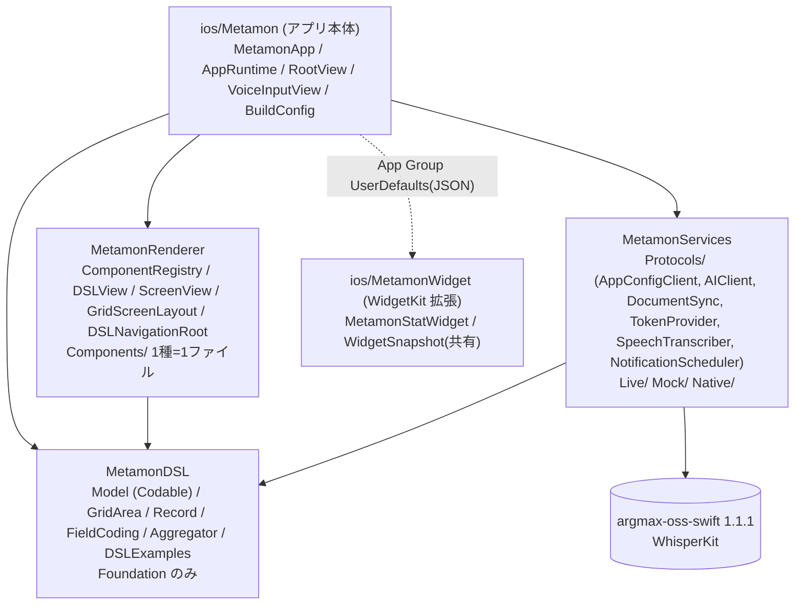

# iOS アーキテクチャ(Metamon / Server-Driven UI)

> 正典は `docs/00_decisions.md`。本書は iOS 側の実装設計。DSL スキーマは統一版 v1 `docs/dsl/README.md`(旧 iOS 案: `docs/ios/dsl-proposal.md`)。**注**: 本書 §2〜§5 の `{{式}}`/`state`/`Interpolator` の記述は v1 で廃止され、`screen.entity` のドラフト + `field` 束縛(`FormDraft`)・`initialScreen` + push/sheet/fullScreen・`app.tabs[]`(TabView)に置き換わった。画面内配置は `area`(6 列 × 可視高さ÷12 行のグリッド)で `GridScreenLayout` が絶対配置する。
> 実装: `ios/Metamon/`(アプリ本体)+ `ios/Packages/{MetamonDSL,MetamonRenderer,MetamonServices}`(ローカル Swift Package)。§1 参照。

## 0. 追加決定の反映(2026-10-24 昼)
| 項目 | 決定 | iOS 側の帰結 |
|---|---|---|
| ユーザーデータ保存先 | **バックエンド(Firestore / appconfig の汎用エンティティ API)** | iOS に永続層を持たない。`entity.*` アクションは全て HTTP。オフライン時のみ最後のレスポンスをメモリ/ディスクにキャッシュ(P2) |
| 2回目以降の改変 | **JSON Patch(RFC 6902)はサーバー側で適用** | iOS はパッチを扱わない。`POST /v1/morph` の応答 or ホットリロード(SSE 通知 → `GET /dsl`)で**最新 DSL 全体**を受け取り差し替えるだけ |
| P0 ネイティブ | **カメラ + ローカル通知** | `camera` コンポーネント / `native: notification.*` を実装済み。位置/センサー/共有は P1(ブリッジに stub) |
| デモ3本 | 家計簿 / トレーニング記録 / 散歩メモ | サンプル DSL は `docs/dsl/examples/*.json`(4 本)をそのままバンドル |
| 認証 | Sign in with Apple → 詰まったら匿名認証 | `TokenProvider` 抽象の裏で切替。UI/ランタイムは影響なし |
| STT | WhisperKit 確定・**導入済み** | `SpeechTranscriber` 抽象。実機 `WhisperKitRecognizer`(model `small`)/ シミュレータ `MockTranscriber`(§6) |
| iOS CI | 5分制限なし | WhisperKit/Firebase 解決込みのビルドでも可 |

## 1. 全体構成(マルチモジュール)

Android のマルチモジュールに相当する **ローカル Swift Package 3 つ + 薄いアプリ本体**。依存の向きは各 `Package.swift` の `dependencies` で固定され、逆向きの import はコンパイルエラーになる。



| モジュール | 場所 | 責務 | 依存 | テスト |
|---|---|---|---|---|
| `MetamonDSL` | `ios/Packages/MetamonDSL` | DSL v1 の Codable モデル、`GridArea`(area 計算)、`Record`/`FieldCoding`/`Aggregator`(クライアント集計)、`DSLExamples` | なし(Foundation) | `swift test`(macOS で可)/ `xcodebuild test` |
| `MetamonRenderer` | `ios/Packages/MetamonRenderer` | SwiftUI View。`ComponentRegistry`(`type` 文字列 → View)、`DSLView`、`ScreenView`、`GridScreenLayout`、`DSLNavigationRoot`(TabView)。Services を知らない | DSL | `xcodebuild test`(schema 全 type の登録チェック) |
| `MetamonServices` | `ios/Packages/MetamonServices` | 外部 I/O の protocol と実装。`Protocols/` と `Live/`(HTTP, WhisperKit)`Mock/` `Native/`(UNUserNotificationCenter)をフォルダで分離。WhisperKit はこのパッケージの依存 | DSL, WhisperKit | `xcodebuild test` |
| アプリ本体 | `ios/Metamon` | `MetamonApp`(組み立て)、`AppRuntime`(状態・アクション実行。`DSLRuntime` に準拠)、`RootView`(モーダル/FAB/オーバーレイ)、`VoiceInputView`、`BuildConfig`(環境 → Services)、`WidgetSnapshotWriter`(stat 集計 → App Group) | 全部 | なし(ロジックは各パッケージへ) |
| ウィジェット | `ios/MetamonWidget` | WidgetKit 拡張(`jp.kz2601.metamon.widget`)。`WidgetSnapshot`(`Shared/`・本体と共用コンパイル)を描画するだけ。§12 | なし(Renderer/DSL を import しない) | なし |

### 1.1 DI(依存性注入)
- **入口は `ios/Metamon/App/BuildConfig.swift` の `BuildConfig.make(environment:)` だけ**。`AppEnvironment`(`.mock` / `.live(appConfigURL:aiURL:)`・どちらか片方だけ live も可)を環境変数 `METAMON_AI_BASE_URL` / `METAMON_APPCONFIG_BASE_URL` / Info.plist から判定し、`Services`(protocol のコンテナ struct。`auth` を含む)を**1回だけ**組み立てる。Mock と本番の切替はこのファイルで完結する。
- `MetamonApp` が `Services` を `AppRuntime(document:services:)` と SwiftUI Environment `\.services`(`App/ServicesEnvironment.swift`)に渡す。View は `@Environment(\.services)` で protocol 越しに使う(例: `VoiceInputView` → `services.transcriber`)。
- Renderer は Services を知らない。必要な能力(DSL、レコード、`run(action)`、ナビ)は `DSLRuntime` protocol(`MetamonRenderer/Host/DSLRuntime.swift`)で宣言し、`AppRuntime` が準拠して `\.dslRuntime` で注入する。`@Observable` なのでプロパティ変更は SwiftUI が追跡する。
- 外部 DI ライブラリは使わない。

### 1.2 ComponentRegistry(コンポーネントが増えても崩れない仕組み)
- `MetamonRenderer/Registry/ComponentRegistry.swift`: schema の `type` 文字列 → View ビルダーの辞書。`DSLView` は辞書を引くだけで `switch` を持たない。
- **追加手順(3 行)**: ① `Components/Leaves/FooLeaf.swift` に View を 1 ファイル作る ② `MetamonDSL` の `ComponentType` に `case foo`(schema にも追加) ③ `ComponentRegistry.standard` に `r.register(.foo) { c, ctx in FooLeaf(c: c, ctx: ctx) }` を 1 行。
- **テストで強制**: `MetamonRendererTests/ComponentRegistryTests` が `docs/dsl/dsl.schema.json` の Container `enum` + Leaf `const` を読み、`ComponentRegistry.standard.registeredTypes` と `ComponentType.allCases` の**双方向一致**を検証する(抜けても余っても赤)。
- `voiceInput` だけは音声機能(Services)に依存するため Renderer ではプレースホルダ。アプリ本体が `ComponentRegistry.standard.registering(.voiceInput) { c, _ in VoiceInputView(prompt: c.prompt) }` で差し替え、`\.componentRegistry` で注入する(`MetamonApp`)。
- ホスト独自のコンポーネント(schema 外)も `register("myType") { ... }` で足せる。

### 1.3 状態管理
`@Observable final class AppRuntime` 1個を `.environment(runtime)`(アプリ内)と `.environment(\.dslRuntime, runtime)`(Renderer 向け)で配る。フォーム入力は画面ごとの `FormDraft`(Renderer)に閉じる。View 側の `@State` は一時 UI(録音フェーズ、PhotosPicker 選択)のみ。

## 2. DSL レンダリング

| 要素 | 実装 | ポイント |
|---|---|---|
| ルート | `AppDocument: Decodable` | `screens: [id: Screen]`、`navigation`、初期 `state` |
| ノード | `struct Node { id, visible, padding, component }` | 共通メタ + 種別 |
| 種別 | `indirect enum Component` | `type` 文字列で分岐する手書き `init(from:)` |
| 未知 type | `.unknown(type:)` | 描画は DEBUG で黄色ラベル、RELEASE で `EmptyView` |
| 既知 type だが props 不正 | `.invalid(type:reason:)` | 同上。画面全体は落とさない |
| 配列中の壊れた要素 | `@Lossy var children: [Node]` | 要素単位で skip |
| 未知 enum 値 | `Lenient.decode(..., fallback:)` | `style: "neon"` → `.primary` |
| 再帰 | `DSLView(node:ctx:)` → `switch component` → 子に `DSLView` | `ForEach(children)`(`Node: Identifiable`) |

```swift
extension Component: Decodable {
    init(from decoder: Decoder) throws {
        let type = try decoder.container(keyedBy: Keys.self).decode(String.self, forKey: .type)
        do {
            switch type {
            case "text":   self = .text(try TextProps(from: decoder))
            case "vstack", "hstack", "zstack": self = .stack(try StackProps(from: decoder)) // axis は type から
            // ...
            default:       self = .unknown(type: type)
            }
        } catch { self = .invalid(type: type, reason: "\(error)") }
    }
}
```

描画スコープ `RenderContext { params, item, index }` を再帰で持ち回り、`list` の行だけ `item/index` を上書きする。

## 3. ナビゲーション

| DSL | SwiftUI | 状態 |
|---|---|---|
| `navigation.type = "tab"` + `tabs[]` | `TabView(selection:)` 内に **タブ毎の** `NavigationStack(path:)` | `selectedTab`, `paths[tabId]: [Route]` |
| `navigation.type = "stack"` + `root` | `NavigationStack(path:)` 1本 | `paths["main"]` |
| `navigate` アクション | `paths[currentTab].append(Route)` | `.navigationDestination(for: Route.self) { ScreenView(route:) }` |
| `back` | `removeLast()` | |
| `present(style: sheet/fullScreen)` | `.sheet(item: $rt.sheet)` / `.fullScreenCover` | `Route: Identifiable` |
| `dismiss` | `sheet = nil; fullScreen = nil` | |

`Route { screen: String, params: [String: JSONValue] }` は `Hashable`。params は push 時に `{{item.id}}` 等を**解決済みの値**で保持するので、遷移先は `{{params.id}}` で参照できる。
DSL 差し替え時(`apply`)は paths/sheet を全部リセットする(画面 id が消えている可能性があるため)。存在しない screen id は `ContentUnavailableView` で表示。

## 4. アクションとデータバインディング

### 4.1 バインディング(読み)
`"{{root.path.to.value}}"` テンプレート。root は `state` / `item` / `index` / `params` / `user`(省略時 state)。配列には `.count` と添字。単独式なら型付き `JSONValue`、文中埋め込みなら文字列連結。`visible` / `disabled` は `truthy` 判定。

### 4.2 バインディング(書き)
入力系(`textField`/`toggle`/`picker`/`camera`)は `bind: "state.draft.title"` を持ち、`AppRuntime.binding(path)` が `Binding<JSONValue>` を返す(`state.` 接頭辞は省略可)。

### 4.3 アクション
| type | 実行先 | 備考 |
|---|---|---|
| `navigate` / `back` / `present` / `dismiss` | ローカル(ナビ) | |
| `setState` | ローカル(`state`) | `value` 内の文字列も `{{}}` 展開 |
| `entity.list` / `create` / `update` / `delete` | **appconfig(Firestore)** | `list` は `into` で state に格納。ユーザーデータは常にサーバー |
| `native` | `NativeBridge` | `feature` 名で分岐、結果は `into` に格納可 |
| `openURL` | UIApplication | |
| `ai.prompt` | ai サービス | 文字で改変(音声と同じ経路) |
| `sequence` | 直列実行 | 「作成→state クリア→再取得→haptic→dismiss」の定石 |

実行は `AppRuntime.run(_:_:) async`(MainActor)。失敗は `toast` に出すだけで握りつぶさない。**ローカル state vs サーバー**の線引き: 入力中の下書き・UI フラグ・取得済み一覧のキャッシュは `state`、永続レコードは全部 entity API。

## 5. ネイティブ機能ブリッジ

| 機能 | 優先 | 公開形 | 実装 | 権限キー |
|---|---|---|---|---|
| マイク(STT) | P0 | `aiVoice` コンポーネント / FAB | AVAudioRecorder → WhisperKit | `NSMicrophoneUsageDescription` |
| カメラ/写真 | P0 | `photoField { field, source }` コンポーネント | **実装済み**(`PhotoFieldLeaf` + `CameraPicker` + `PhotoSourcePolicy`、下記) | `NSCameraUsageDescription`, `NSPhotoLibraryUsageDescription` |
| ローカル通知 | P0 | `native: notification.requestPermission` / `notification.schedule {title, body, inSeconds}` | `UNUserNotificationCenter`(実装済み) | 不要(実行時ダイアログ) |
| 触覚 | P0 | `native: haptic {style}` | `UIImpactFeedbackGenerator`(実装済み) | 不要 |
| URL 起動 | P0 | `openURL` / `native: openURL` | `UIApplication.open`(実装済み) | 不要 |
| 位置 | P1 | `native: location.current → into` / `map` コンポーネント | `CLLocationManager` 1回取得(stub) / MapKit(実装済み) | `NSLocationWhenInUseUsageDescription` |
| モーション/歩数 | P1 | `native: motion.read` | CoreMotion / CMPedometer(stub) | `NSMotionUsageDescription` |
| 共有 | P1 | `native: share {text}` | `UIActivityViewController`(stub) | 不要 |

### photoField(カメラ)の実装要点(`MetamonRenderer/Components/Leaves/PhotoFieldLeaf.swift`)

| 項目 | 内容 |
|---|---|
| `source` 分岐 | `PhotoSourcePolicy.plan(for:cameraAvailable:)`(純関数)。`camera` → `CameraPicker`、`library` → `PhotosPicker`、`both`/省略/未知 → 「撮影」「写真から選ぶ」の `confirmationDialog` |
| フォールバック | `UIImagePickerController.isSourceTypeAvailable(.camera)` が false(カメラ無し端末)なら source に関わらず写真選択へ。iOS 26 シミュレータは仮想カメラを持つので true を返す(フォールバックは単体テスト `PhotoFieldTests` で担保) |
| カメラ | `CameraPicker`(`UIViewControllerRepresentable` → `UIImagePickerController(.camera)`、背面・静止画・編集無し)を `fullScreenCover` で表示 |
| 権限 | `AVCaptureDevice.authorizationStatus(.video)`。未決定なら要求、拒否/制限なら alert「カメラを使えません」→「設定を開く」(`UIApplication.openSettingsURLString`)/「写真から選ぶ」 |
| エンコード | `PhotoCodec.dataURL(from: UIImage)`:**ピクセル基準で長辺 ≤800px**・renderer scale=1 固定(既定の画面倍率だと 800pt=2400px になる)・JPEG q0.5 → `data:image/jpeg;base64,...` を `FormDraft.values[field]` へ(保存経路は他の入力と同じ `entity.create/update`) |
| 表示 | 値があれば `PhotoView` サムネイル(160pt)+「撮り直す」「削除」、無ければ `label` のボタン 1 つ |

画像は **base64 JPEG 文字列として photo フィールドに置き、entity.create の data に含めて送る**(縮小後 ≈ 数十〜100KB で Firestore ドキュメント 1MB 制限内)。Cloud Storage 経由(URL 化)は P1 以降。
全 usage description は `ios/Metamon/Resources/Info.plist` に記入済み。

## 6. 音声入力画面とホットリロード

```
[録音] WhisperKit.AudioProcessor.startRecordingLive  (AVAudioEngine → 16kHz mono Float32 をメモリに蓄積)
  → [文字起こし] WhisperKit.transcribe(audioArray:, DecodingOptions(language: "ja", chunkingStrategy: .vad))  ※オンデバイス・停止後に一括
  → [意図判定] VoiceIntent.detect: 「元に戻して」→ appconfig restore(ai を呼ばない)/「別のアプリ」→ appId 採番し直し → ai
  → [送信] POST ai /v1/generate { appId, baseVersion, transcript, mode:"auto" }
       (ai: Claude が DSL / JSON Patch 生成 → スキーマ検証 → appconfig に PUT/PATCH(If-Match)→ 最新 DSL を返す)
  → [適用] AppRuntime.apply(doc)  withAnimation(.spring) + RootView.id(version) + transition。DocumentCache にも保存
```

### WhisperKit 実装要点(`Services/Live/WhisperKitRecognizer.swift`)

| 項目 | 内容 |
|---|---|
| パッケージ | `https://github.com/argmaxinc/argmax-oss-swift` **1.1.1 固定**(`exactVersion`)。WhisperKit は v1.0.0 で Argmax OSS SDK に統合され、旧 URL `argmaxinc/WhisperKit` は同リポジトリへリダイレクト。product は `WhisperKit` のみリンク(`ArgmaxCore` は `@_exported`) |
| モデル | `BuildConfig.whisperModel`(環境変数 `METAMON_WHISPER_MODEL` / Info.plist `MetamonWhisperModel`、既定 **`small`**)。短縮名は `openai_whisper-small` に解決し、Hugging Face `argmaxinc/whisperkit-coreml` から取得 |
| 配置 | `Application Support/WhisperKit/models/argmaxinc/whisperkit-coreml/openai_whisper-small/`(約 500MB)。`MelSpectrogram/AudioEncoder/TextDecoder.mlmodelc` + `config.json` が揃っていればオフラインでも Hub に問い合わせずロード |
| DL と状態 | `prepare()` を `AppRuntime.bootstrap()` が起動直後に呼ぶ。`status`: `notDownloaded → downloading(downloadProgress 0〜1) → loading(CoreML ロード + ANE 特化 prewarm) → ready → recognizing`。失敗は `.failed(message)` で UI に「再試行」ボタン |
| 権限 | `AudioProcessor.requestRecordPermission()`(`NSMicrophoneUsageDescription`、記入済み)。`NSSpeechRecognitionUsageDescription` は Apple Speech フォールバック用に残置(WhisperKit 自体は不要) |
| 録音 | 録音前に **自前で** `AVAudioSession(.playAndRecord, .default, [.defaultToSpeaker, .allowBluetooth])` + `setActive(true)`(WhisperKit 側は `try?` で失敗を握りつぶすため。カメラ/AVCaptureSession の後でも record 系に戻す)→ `startRecordingLive(callback: nil)` → 停止で `audioSamples` を取り出し `purgeAudioSamples`。`precheck`: 0 サンプル=`noAudioCaptured`・0.5 秒未満=`tooShort`・ピーク < 0.001(-60dBFS)=`silent` を **理由付き `TranscriberFailure`** として throw(toast にそのまま日本語で出る) |
| 診断 | `lastDiagnostics: TranscriberDiagnostics`(録音秒数・サンプル数・ピーク/RMS・セッション category/mode・入力ルート・権限・モデル状態・失敗理由)。`[Voice]` プレフィックスで stdout と os_log(subsystem `jp.kz2601.metamon` category `voice`)に `recording started` / `stopped samples=N duration=S peak=…` / `transcribe result text="…"` を出す。実機ログ: `xcrun devicectl device process launch --console --device <id> jp.kz2601.metamon` |
| 制約 | シミュレータでは `#if targetEnvironment(simulator)` で `MockTranscriber` + 文字入力のみ(マイク非表示)。ストリーミング(途中結果)は未対応=停止後に一括。`small` のメモリは推論時 ~1GB 弱、初回 prewarm は 30〜90 秒 |

### 音声画面 → 生成中 → 変身 の状態遷移(2026-10-24 刷新)

デザイントークン(色・角丸・余白・影)は `ios/Metamon/App/Theme.swift` に集約し、音声画面・生成中・サインイン・設定で共用する(Renderer の部品は触らない)。
初期状態(`voiceEntry = fullscreen`)は `RootView` が `DSLNavigationRoot` ではなく `VoiceInputView` を直接全面に描く(背景を画面いっぱいに敷くため)。生成後の FAB シートも同じ View。

```
VoiceInputView.phase                         AppRuntime.morphJob               RootView
 idle ──tap──▶ listening ──tap──▶ transcribing ──text──▶ (送信) ─▶ create / edit ──apply──▶ nil
   │ 例文チップ / 文字入力 ─────────────────────────────▶ (送信) ─┘                      │
   └ 準備中(モデル DL/ロード)はマイク灰色・タップ不可                               summaryBanner 3〜5s
```

| 画面状態 | 判定 | UI |
|---|---|---|
| idle(準備完了) | `transcriber.isReady` | ブランドグラデーションのマイク + ゆっくり呼吸するリング(3.2s 周期・`TimelineView`)、"タップして話す"、例文チップ(タップで即送信)、文字入力 |
| idle(準備中) | `status` が notDownloaded/downloading/loading | マイク灰色・無効、下に DL 進捗 / 読み込み中 |
| listening | 録音中 | 赤〜珊瑚のマイク + 外へ広がる波紋 ×3(擬似音量で振幅が揺れる ※ `SpeechTranscriber` に音量 API が無いため実音量連動は未対応)、"聞いています…" |
| transcribing | `stopAndTranscribe` 待ち | 波形バー、"文字起こし中…"。結果はカードに 1 文字ずつ(`TypewriterText`)表示してから送信 |
| 生成中 create | `morphJob.kind == .create`(現在 DSL が voice-only) | 全画面 `GeneratingView`: 見出し=「認識テキスト」、6×12 スケルトングリッド(セルが斜めに光り、3s ごとにレイアウト案が入れ替わる)、段階文言、経過秒 |
| 生成中 edit | `morphJob.kind == .edit` | シートを閉じ、現在画面を 45% + blur 1.5 で薄くし、上部に `EditingIndicator` カプセル(「変更を反映しています…」+ 発話) |
| 変身 | `apply(doc)` | **同じ `withAnimation(.spring 0.65)` の中で** `document` 差し替えと `morphJob = nil` → 生成中オーバーレイ fade out と新ツリー scale(0.96→1)+fade in がクロスフェード |
| 要約 | `summaryBanner` | 画面上部のカード(sparkles + summary)を 3〜5 秒(文字数÷12 でクランプ)表示して自動で消える。タップで即閉じ |
| 位置ハイライト | `PositionHint.anchor(in: summary)` | summary に「右下/左上/上部/一番下/中央/右/左…」が含まれれば、その領域を淡い円で 2 回ほど脈打たせる(部品単位ではなく領域。DSL と summary に対応が無いため) |

**生成中の文言表**(`GeneratingStage`。ai-eval 2026-10-24 §5 の実測 create p50 6.6s / p95 8.7s、edit p50 1.7s と 01 §4 の警告 20s / フォールバック 30s に対応)

| 経過 | stage | create の文言 | edit の文言 | 備考 |
|---|---|---|---|---|
| 0〜3s | normal | どんなアプリにするか考えています… | 変更を反映しています… | |
| 3〜6s | normal | 必要な画面とデータを決めています… | 〃 | |
| 6〜9s | normal | 画面を組み立てています… | 〃 | create p50 はここで完了 |
| 9〜10s | normal | 細部を整えています… | 〃 | (以後 3s 周期で巡回) |
| 10〜20s | slow | もう少しかかっています… | 〃 | `area` 再生成 1 回 ≒ +7s |
| 20〜30s | warning | 時間がかかっています。もう少しだけお待ちください(橙) | 〃(橙) | backend 警告ライン |
| 30s〜 | fallback | 混み合っています。安全なテンプレートに切り替えています… + **キャンセル** | 〃 + **中止** | backend はテンプレ DSL へフォールバック。キャンセルは `AppRuntime.cancelMorph()`(Task cancel → URLSession 中断)。HTTP timeout 45s |
| 失敗 | — | **状態カード**(下表・#60)。トーストは使わない | 〃(画面上部にコンパクト版) | 画面は元のまま。主ボタン「もう一度」は同じ発話で再送 |
| キャンセル | — | 下部トースト「生成をキャンセルしました」(軽微) | 〃 | 画面は元のまま |

**設定シート**(音声画面右上の歯車・旧 `uid …` フッターの置き換え): アカウント(匿名 / Apple・uid・ログアウト)、音声モデル(モデル名・状態・再試行)、アプリをリセット(初期状態に戻す = DSL を `initial`、`DeviceAppID.rotate()` で appId を作り直す。サーバーの旧データは残る)、接続先(ai / appconfig / バージョン)。

DEBUG フック: `METAMON_AUTO_ANON=1`(起動時に匿名サインイン)、`METAMON_AUTO_TRANSCRIPT="…"`(起動直後に 1 回生成)。シミュレータでもマイクは表示され、`MockTranscriber` が定型文を返す。

### エラー状態表(#60・2026-10-24 深夜)

原則: **エラーはトーストに頼らず状態カード**(`ErrorPresentation` + `ErrorCard`: アイコン・1 文・主ボタン・副ボタン)に統一し、どの失敗でも「次に何をすればいいか」が画面に残る。
カードは初期画面 / 音声シートでは `VoiceInputView` の中(マイクの下)、生成後(edit)の失敗は音声シートが閉じているので `RootView` が画面上部にコンパクト版を出す。
文言は `Features/Voice/ErrorCopy.swift` に集約(Greeting と同じ方針)。失敗の分類は Services の `FailureKind.classify(error)` が 1 箇所で行い、UI は分類だけを見る。
トーストに残すのは軽微なもの(保存失敗・キャンセル・「これ以上前の状態はありません」等)だけ。

| 状況 | 判定(`FailureKind`) | 表示(カード) | 主ボタン | 副ボタン | 自動復帰 |
|---|---|---|---|---|---|
| 生成ボタン押下時に圏外 | `recordSync.connectivity.isOnline == false`(送る前) | 「オフラインです」「接続が戻ったら自動で送ります」+ 発話 | 今すぐ送る | やめる(保留を取り消す) | **復帰で 1 回だけ自動送信**(`DeferredSend`。新しい発話が来たら保留は置き換え) |
| 生成中に圏外になった / 接続断で失敗 | 到達性 offline を検知して `morphTask` をキャンセル / `URLError` notConnected・connectionLost・cannotConnectToHost | 「通信が切れました」「接続を確認して、もう一度お試しください」 | もう一度(同じ発話で再送) | 閉じる | なし(手動) |
| ai 5xx(500/502/503) | `.busy(retryAfter:)` | 「混み合っています」「少し時間をおいて、もう一度お試しください」 | もう一度 | 閉じる | なし。30 秒超の生成中は従来どおり「混み合っています。安全なテンプレートに切り替えています…」+ キャンセル |
| ai 429 | `.busy(retryAfter: Retry-After)` | 〃(`Retry-After` があれば「N 秒ほど待ってから」) | もう一度 | 閉じる | **HTTP 層が `Retry-After`(上限 15s・無ければ 2s)待って 1 回自動再送**。2 回目も 429 ならカード |
| タイムアウト(45s)/ 504 | `.timeout` | 「時間がかかりすぎました」「サーバーの応答がありませんでした。もう一度お試しください」 | もう一度 | 閉じる | なし |
| 401(Firebase ID トークン失効) | HTTP 層: `idToken(forceRefresh: true)` → 値が変われば同じリクエストを 1 回再送(ai / appconfig 共通) | 成功すれば何も出ない | — | — | **自動(1 回)** |
| 401 が再取得後も続く | `.sessionExpired` | 「サインインの有効期限が切れました」「もう一度サインインしてください」 | サインイン | 閉じる | `AuthSession.expire()` → サインアウト → `SignInView` に同じ 1 文を表示 |
| appconfig 409(version 競合) | `.conflict`(ai 側の baseVersion 無しリトライでも解けなかった時) | バナー「別の端末で更新されていたため、最新の状態に合わせました。もう一度お話しください」 | — | — | **`GET /dsl` で最新を取り直して `apply()`** |
| 4xx(入力不備など)/ 分類不能 | `.rejected(message)` / `.other` | 「生成に失敗しました」+ サーバーの message | もう一度 | 閉じる | なし |
| ユーザーのキャンセル | `.cancelled` | トースト「生成をキャンセルしました」 | — | — | — |
| 起動時にサーバー到達不能 | `restoreFromServer` 失敗 | トースト「オフライン: 最後に取得したアプリ(vN)を表示しています」(キャッシュ無しなら「サーバーに接続できません」) | — | — | 到達性 online 復帰で `GET /dsl` を取り直す |
| レコード取得失敗(#85) | `refresh()` 失敗 & ローカルにも無い → `AppRuntime.failed` に entity | list / table / timeline / chart: 「読み込めませんでした」+ **再試行**、stat: `—`、calendar: 文言 + 再試行(空状態「まだありません」「¥0」と区別) | 再試行(`load(force:)`) | — | 到達性 online 復帰で `failed` の entity を読み直す |

自動再送の方針: **POST を二重実行し得る失敗(5xx / タイムアウト / 接続断)は自動再送しない**(ai の生成はべき等でない)。自動で再送するのは 401(トークン差し替え)と 429(サーバーが待てと言った)だけ、それぞれ 1 回。

DEBUG フック(シミュレータ E2E): `METAMON_E2E_OFFLINE_SECONDS=<n>`(#70。n 秒間 offline → online。生成もこの到達性を見るので「圏外 → 保留 → 復帰で自動送信」を通せる)、`METAMON_E2E_PRESS_PRIMARY_AFTER=<秒>`(その時点で出ている状態カードの主ボタンを押す。「もう一度」の経路を無人で通す)。ai を必ず 500 にするスタブは `METAMON_AI_BASE_URL=http://127.0.0.1:<port>` で向ける。

bootstrap の順序(#86): `recordSync.start()` → 到達性監視 → `GET /dsl` 復元 → ポーリング開始 → **通知の同期(許可ダイアログ)は最後に `Task {}` で投げて await しない** → DEBUG フック。ダイアログに答えるまで復元・同期が止まらない。

生成後も **マイク FAB**(ランタイム側、DSL 外)から同じシートを開いて再改変できる。初期 DSL は `voiceInput` 1画面のみ。
FAB の位置は `Theme.Layout.fabAlignment`(**左下**)の 1 箇所で決める。DSL の「追加」ボタンは右下 `D11:F12` に置かれるのが定番で、右下 FAB だと被るため左下に移した(タブバーがある時は `fabBottomInset(hasTabs:)` でその上に逃がす)。

### 復元・元に戻す・新規作成 の状態遷移(appconfig 接続・2026-10-24 夕)

```
起動 ── DocumentCache に最後の DSL があれば即描画(animated: false)
  └─ bootstrap(live) ── GET /dsl ──┬─ 200: server.version > 表示中 → apply(remote)      … 別端末/ai 直叩きの変更も取り込む
                                   │        server.version < 表示中 → 表示を保つ(server が巻き戻った時の保険)
                                   └─ 失敗: cache があれば表示 + toast「オフライン: 最後に取得したアプリ(vN)」/ 無ければ toast「サーバーに接続できません」
  └─ startSync(): 前面時のみ RealtimeDocumentSync を購読(SSE `GET /events` + フォールバックのポーリング・#82)。
       version が進んだら apply(アニメ) + バナー「アプリが更新されました(version N)」。操作中(シート/全画面/push/音声シート)は閉じるまで保留
       records の変化通知 → 表示中の entity だけ 250ms デバウンスして refresh(フォームの下書きは ScreenView の @State なので消えない)

発話 ── VoiceIntent.detect(text)
  ├─ .undo   (「元に戻して」「戻して」「取り消して」「アンドゥ」「ひとつ前」…)
  │      → GET /versions(新しい順)→ current の直下の version を target
  │      → POST /versions/{target}/restore(新 version N+1 として積む)→ GET /dsl → apply(アニメ)
  │      → バナー「ひとつ前の状態(version target)に戻しました」。target が無ければ toast「これ以上前の状態はありません」
  │      → サーバーが履歴を返せない時(mock / 障害)はローカル履歴(直近 10 件)にフォールバック
  ├─ .newApp (発話頭が「別のアプリ」「新しいアプリ」…)
  │      → DeviceAppID.rotate() で appId を採番し直し初期状態(v0)に戻してから ai へ(= create 扱い・全画面「変身中」)。前のアプリはサーバーに残る
  └─ .morph  → 従来どおり POST ai /v1/generate {appId, baseVersion, transcript}
```

| 状態 | 保持場所 | 備考 |
|---|---|---|
| DSL(正典) | appconfig(Firestore)。`GET /dsl` の `ETag: "<version>"` | iOS からの `PUT/PATCH /dsl` は使わない(書き込みは ai 経由。If-Match 競合は ai 側で解決) |
| DSL キャッシュ | `DocumentCache`(Application Support/metamon-dsl/<appId>.json・封筒の生 JSON) | `HTTPAppConfigClient` と `HTTPAIClient` が成功時に書く。オフライン起動と即描画のみに使う |
| レコード | appconfig `records`(G4)。iOS は `AppRuntime.records` にキャッシュ | `apply()` で破棄し画面が要求する entity を `load(entities:)` で遅延取得。`POST` は `clientId`(UUID)で冪等(通信断の再送で二重登録しない)。422 `invalid_record` は `details.field` を DSL の Field 名に引き直して toast |
| version 履歴 | appconfig `versions`(restore は `source.kind = restore`) | `undo()` は常に「サーバーの current の直下」へ戻す(ローカルの version とズレていてもサーバー基準) |
| appId | `DeviceAppID`(UserDefaults) | 「アプリをリセット」と「別のアプリ」で rotate。旧 appId のデータは削除しない |

**ホットリロード方式**
| 案 | 仕組み | 評価 |
|---|---|---|
| A. ポーリング(Day1) | 前面時のみ 5 秒毎 `GET /v1/apps/{id}/dsl` + `If-None-Match: "<version>"`。304 なら何もせず、200 で version が進んだら apply | **フォールバックとして残す**(`PollingDocumentSync`。DEBUG `METAMON_REALTIME=0` でこれだけに戻せる) |
| B. SSE(**Day2・採用・#82**) | `GET /v1/apps/{id}/events` を `URLSession.bytes(for:)` で読む。backend が Firestore snapshot listener を持ち「何が変わったか」だけ流す | ルール変更不要・iOS に Firestore SDK を足さない・ローカル(エミュレータ)で完結検証できる。50 秒ごとの `bye` で張り直し |
| C. Firestore onSnapshot | iOS に FirebaseFirestore SDK を追加し `apps/{id}` を listen | 不採用: Firestore ルールの全面拒否を開ける必要があり(認可が API と二重化)、gRPC/abseil で CI ビルドが重くなる |

**`RealtimeDocumentSync`(`MetamonServices/Live`)の動作**

| 受信 / 状況 | 動作 |
|---|---|
| `hello{version}` | `.realtime(true)`。version が表示より新しければ `GET /dsl`(切断中の変化を拾う) |
| `dsl{version}` | `GET /dsl`(If-None-Match)→ `.document` → `AppRuntime.hotReload`(操作中は保留) |
| `records{entity}` | `.records(entity:)` → `AppRuntime` が表示中の entity なら 250ms デバウンスで `refresh`(=`pull` 全件置換・未送信行は残る) |
| `bye` | 予定終了。即再接続(ポーリングに落とさない) |
| `bye` 無しの切断 / 非 200 / 40 秒無音 | `.realtime(false)` → 指数バックオフ(1→30 秒)で再接続。401 は次回 `idToken(forceRefresh: true)` |
| ポーリング | リスナー稼働中 60 秒・停止中 5 秒で `GET /dsl`(If-None-Match) |
| 購読が戻った(false→true)/ 前面復帰 | 表示中の entity を全部 refresh(取りこぼし防止) |

実測(2026-10-24・Firestore エミュレータ + appconfig `AUTH_MODE=dev` + iPhone 17 シミュレータ): curl(別ユーザー)で public entity に投稿 → シミュレータの一覧に出るまで **442 ms**(SSE 到達は 38 ms、残りはデバウンス 250 ms + pull)。`scripts/realtime-smoke.sh`(curl のみ)で再現できる。

### 複数アプリの切替「変身一覧」(#51)と起動時の挨拶(#42)(2026-10-24 夜)

私たちが持つ常設 UI は **マイク(FAB / 初期画面の大きなマイク)だけ**。メタ操作は全部ここに集約する(FAB = Tailor It 本体、画面の残りは変身した姿)。

| 操作 | 意味 | 実装 |
|---|---|---|
| **タップ** | 「このアプリを変える」発話(従来どおり) | `Button` → `showVoiceSheet` |
| **長押し**(0.45s・`Theme.Layout.fabLongPressSeconds`) | メタ操作 = **変身一覧シート** | `.simultaneousGesture(LongPressGesture)` → `AppRuntime.openSwitcher()`。触覚 `.sensoryFeedback(.impact)`。VoiceOver は accessibilityAction「変身一覧」 |
| 音声「○○に切り替えて / ○○を開いて / ○○に変身して」 | 名前で切替 | `VoiceIntent.switchApp(name)` → `switchApp(named:)`: `GET /apps` の name と照合(完全一致→前方一致→部分一致・`AppNameMatch`)。1 件なら切替、曖昧/無ければ toast + 一覧を開く |
| 音声「アプリ一覧 / 変身一覧 / 別のアプリに切り替えて(名前なし)」 | 一覧を開く | `VoiceIntent.listApps` → `openSwitcher()` |

```
変身一覧シート(Features/Switcher/AppSwitcherSheet.swift)
  ├─ カード(横スクロール): サムネ(無ければ名前のイニシャル + ブランドグラデ)・名前・最終更新・現在のアプリに「使用中」。読み込み中はスケルトン
  │     タップ → AppRuntime.switchApp(to:): 今の画面をサムネに撮る → DeviceAppID.set(appId) → GET /dsl(失敗時 DocumentCache)→ apply()(変身アニメ)→ startSync()
  │                 records は apply() で破棄し、画面が要求する entity を load(entities:) の既存経路で読み直す
  ├─ 「+ 新しいアプリ」 → startFresh(.newApp): DeviceAppID.rotate() + 初期状態(音声画面)。挨拶は「新しいアプリですね」
  └─ 「Tailor It に戻る(初期画面)」 → startFresh(.home): 同上。挨拶は「おかえりなさい。次は何を作りますか?」
一覧の取得: GET /v1/apps(uid スコープ・HTTPAppConfigClient.listApps)→ AppSummary.visible(): status=archived と未生成(currentVersion<=1)を除外、現在のアプリを先頭、以降は更新日時順
            失敗時は AppListCache(Application Support/metamon-dsl/apps.json)の保存済み一覧(toast「オフライン」)
サムネ: AppThumbnailStore(Application Support/metamon-thumbs/<appId>.jpg・1/3 スケール JPEG)。撮るのは「切替・一覧を開く直前」と「apply の 1.2 秒後(RootView.onChange(version))」
        取得はキーウィンドウの drawHierarchy(ImageRenderer は NavigationStack/TabView を描けないため)
```

**起動時の挨拶(#42)** — 文言は `Features/Voice/Greeting.swift` の 1 箇所(多言語化 #44 ではこのファイルを差し替える)。時間帯(5〜10 時おはよう / 11〜17 時こんにちは / 他こんばんは)を前置き。

| 状況(`Greeting.Context`) | 判定 | 見出し |
|---|---|---|
| firstVisit | 起動回数 0(`UserDefaults metamon.visitCount`・`Greeting.launchIsReturning`)| どんなアプリが欲しいですか? |
| returning | 2 回目以降の起動で初期画面 | おかえりなさい。今日は何を作りますか? |
| newApp | 変身一覧「+ 新しいアプリ」/ 発話「別のアプリ」(`AppRuntime.homeEntry = .newApp`) | 新しいアプリですね。どんなアプリにしますか? |
| home | 「Tailor It に戻る」/ アプリのリセット(`.home`) | おかえりなさい。次は何を作りますか? |
| editing | 既にアプリがある(FAB からの音声シート) | このアプリをどう変えますか? |

初期画面の見出しは DSL の `voiceInput.prompt` ではなく Greeting を使う(生成アプリ内の `voiceInput` 部品は従来どおり `prompt` を表示)。

DEBUG フック: `METAMON_AUTO_SWITCHER=1`(起動 2.5 秒後に変身一覧を開く)。`METAMON_AUTO_TRANSCRIPT="家計簿に切り替えて"` で音声切替も通せる。

## 7. 認証(実装済み)

```
SignInView ──Sign in with Apple──▶ ASAuthorizationAppleIDCredential(identityToken, nonce=SHA256(raw))
   │                                   │ AuthSession.completeAppleSignIn
   │                                   ▼
   │                      AuthService.signInWithApple(idToken, rawNonce, fullName)
   │                      = OAuthProvider.appleCredential → Auth.signIn(with:)
   └──「ログインせずに使う」──▶ AuthService.signInAnonymously()
                                       │
                                       ▼ currentUser(uid)
            AuthTokenProvider.idToken() = user.getIDToken()  ──▶ HTTP.send: Authorization: Bearer <ID token>
                                       │
                                       ▼
                    HTTPAIClient POST {ai}/v1/generate {appId, baseVersion?, transcript, mode:"auto"}
                                       ▼
                    {appId, version, mode, dsl, summary} → AppRuntime.apply(dsl) + toast(summary)
```

| 項目 | 実装 |
|---|---|
| protocol | `MetamonServices/Protocols/AuthService.swift`: `currentUser: AuthUser?(uid, isAnonymous, displayName)`・`stateChanges()`・`signInWithApple(idToken:nonce:fullName:)`・`signInAnonymously()`・`signOut()`・`idToken(forceRefresh:)` |
| Live | `Live/FirebaseAuthService.swift`(firebase-ios-sdk **13.1.1 固定・product は FirebaseAuth のみ**)。`FirebaseBootstrap.configureIfAvailable()` は plist がバンドルに無ければクラッシュせず false(→ Mock に落ちる) |
| Mock | `Mock/MockAuthService.swift`: 固定 uid `mock00-fixed-uid`。`AppEnvironment.mock` と Preview/テスト用。トークンは nil(ヘッダ無し) |
| Bearer | `Live/AuthTokenProvider.swift` が `AuthService.idToken(forceRefresh:false)` を `TokenProvider` として供給。`HTTP.send` が毎リクエスト付与(更新は Firebase SDK 任せ) |
| 画面 | `Metamon/Features/Auth/SignInView.swift`(`SignInWithAppleButton` + 匿名ボタン)。`AuthSession`(@Observable)の `user == nil` の間だけ `MetamonApp` が表示。nonce は `AppleNonce.random()`(生値→Firebase)/`sha256`(→Apple) |
| ログアウト | `VoiceInputView` 最下部の `uid 先頭6桁` ラベル(Menu)→ ログアウト。デバッグ用に目立たせない |
| entitlements | `project.yml` → `Metamon/Metamon.entitlements` に `com.apple.developer.applesignin: [Default]`。自動署名(`-allowProvisioningUpdates`)が App ID に capability を付ける |
| 初期化順 | `MetamonApp.init`: `FirebaseBootstrap.configureIfAvailable()` → `BuildConfig.make()` → `AuthSession(service: services.auth)` |
| Go 側 | `firebase.google.com/go/v4/auth` の `VerifyIDToken`。`uid` を entity レコードの owner に使う(ai は受け取った Bearer を appconfig へ転送するだけ) |

### 環境変数(ai と appconfig は別々に live にできる)
| 用途 | 実行時 env | Info.plist キー(build setting から展開) | 既定(project.yml) | 未設定時 |
|---|---|---|---|---|
| ai | `METAMON_AI_BASE_URL` | `MetamonAIBaseURL` = `$(METAMON_AI_BASE_URL)` | `https://ai-stg-378953239426.asia-northeast1.run.app` | `MockAIClient` |
| appconfig | `METAMON_APPCONFIG_BASE_URL`(旧 `METAMON_API_BASE_URL` も可) | `MetamonAppConfigBaseURL` = `$(METAMON_APPCONFIG_BASE_URL)` | `https://appconfig-stg-378953239426.asia-northeast1.run.app` | `InMemoryAppConfigClient` + `NoopDocumentSync`(`isLive=false`) |
| 全モック | `METAMON_MOCK=1` | — | — | URL 設定を無視して `AppEnvironment.mock` |
| 開発用 uid | `METAMON_DEV_UID=<uid>`(DEBUG のみ) | — | — | `AUTH_MODE=dev` のローカル backend 向けに Bearer へ固定 uid を送る(`StaticTokenProvider`)。staging/本番(Firebase 検証)には通らない |

- 両方未設定 = `AppEnvironment.mock`(認証もモック)。どちらか設定 = `.live(appConfigURL:aiURL:)`(認証は Firebase、plist 無しなら Mock に警告付きで降格)。
- appId は `DeviceAppID.current`(UserDefaults の UUID・端末固定)。appconfig は未知の appId を `GET /dsl` 時に version 1(初期状態)で自動作成するので iOS は `POST /apps` を呼ばない。version ズレ(409 `version_conflict`)は `HTTPAIClient` が `baseVersion` 無しで 1 回だけ再試行。
- ai 契約: 成功 `{appId, version, previousVersion, mode(full|patch), dsl, patch?, summary, transcript, source, latencyMs, meta}`、失敗 `{error:{code,message,details?}}`(`APIError.server` → toast に message)。タイムアウト 45s(`HTTP.defaultTimeout`)。
- appconfig 契約(PR #32・`HTTPAppConfigClient`): `GET /v1/apps/{appId}/dsl`(`ETag: "<version>"`・`If-None-Match` で 304)/ `GET /versions`(新しい順・`VersionSummary`)/ `POST /versions/{n}/restore`(201 `VersionSummary` → 続けて `GET /dsl`)/ records `GET`(`pageSize=200`・`nextPageToken` を最大 5 ページ追う)・`POST`(`{data, clientId}`・通信断時は同じ clientId で 1 回再送)・`PATCH`(`{data}`・null で項目削除)・`DELETE`(204)。エラー封筒 `{error:{code,message,details?,requestId?}}` は `APIError.server(status:code:message:details:)`。`details.field` は `APIError.field`。
- HTTP キャッシュは使わない(`HTTP.session` = ephemeral・`urlCache = nil`・`reloadIgnoringLocalAndRemoteCacheData`)。`GET /dsl` は `Cache-Control: no-cache` + ETag だが `URLSession.shared` が再検証せず古い 200 を返し、起動時復元が 1 つ前の version になる事象が staging E2E で出た。鮮度は自前の `If-None-Match` と `DocumentCache` で管理する。
- ATS: `NSAllowsLocalNetworking` のみ(LAN の `http://<IP>:8081` 用)。`NSAllowsArbitraryLoads` は入れない。

### ローカル DB と同期(Issue #48・実装済み)

```
Renderer ──load(entities)──▶ AppRuntime.refresh(entity)
                               │ 1. recordSync.cached(appId, entity)      ← RecordStore(JSON)を即表示(スケルトン→ローカル)
                               │ 2. recordSync.pull(appId, entity)        ← GET /records 全件 → store.replace(未送信行は残す)→ UI 置換
                               ▼
            saveRecord / deleteRecord ──▶ recordSync.save / delete
                               │ RecordStore に即反映(pendingOp=create|update|delete)→ records[entity] を返して画面を進める(楽観的 UI)
                               ▼
                          SyncQueue(actor・FIFO・queue.json に永続化)
                               │ POST(clientId=op.id で冪等)/ PATCH / DELETE を 1 件ずつ
                               │ 失敗: 通信断・5xx・401 → 指数バックオフ(0.5s×2^n・最大 5 回)→ 停止(paused)
                               │       404/409/412 → 競合: 未送信印を落とし conflict → AppRuntime が refresh(サーバー優先)+ toast
                               │       400/422 → 拒否: 操作破棄(create はローカル行も削除)+ toast
                               ▼ 成功: 仮 id(local-<clientId>)→ サーバー id に差し替え・pendingOp=none → sent → records[entity] 読み直し
   再開トリガー: NWPathMonitor のオンライン復帰 / 前面復帰(setForeground) / 設定「今すぐ同期」 / 新しい書き込み
```

| 項目 | 実装 |
|---|---|
| DB | `MetamonServices/Local/RecordStore.swift`(actor)。**FileManager + JSON**: `Application Support/metamon-records/<appId>/<entity>.json` に `LocalRecord{appId, entity, recordId, data, createdAt, updatedAt, pendingOp, clientId}` の配列。SwiftData/SQLite にしなかった理由: 1 entity ≤ 1000 件・読みは entity 単位全件なのでファイル=索引(appId, entity)で足りる / `DocumentCache` と同じ流儀でスキーマ移行・ModelContainer を抱えない / macOS `swift test` でそのまま動く。万単位になったら同 I/F で SQLite 化 |
| 差分取得 | appconfig の `GET /records` は `filterField` に entity の Field しか受けない(`buildFilter`)ため `updatedAfter` 相当が無い → **全件取得で置換**(`store.replace`)。未送信行(`pendingOp != none`)だけ残す。`lastUpdatedAt` は将来の差分 API 用に用意済み |
| 書き込み | `RecordSyncEngine.save/delete`(`Local/RecordSyncEngine.swift`・`@MainActor @Observable`)。create は仮 id `local-<clientId>`、update はキー単位マージ(PATCH と同義・DSL から消えた項目もローカルで保持)、delete は行を `pendingOp=delete` にして一覧から隠す |
| キュー | `Local/SyncQueue.swift`(actor)。積む時に畳む: create+update → create に併合 / create+delete → 両方消す(サーバーに行かない)/ update+update → 1 つ。送信後は仮 id → サーバー id の別名表を持ち、後続の update/delete を引き直す。`BackoffPolicy(base 0.5s, ×2, maxAttempts 5)`。`sleep` を差し替えられるのでテストは待たない |
| 冪等 | `AppConfigClient.create(appId:entity:data:clientId:)` を追加(既定実装は clientId 無視)。`HTTPAppConfigClient` は `{data, clientId}` を送り、再送でも同じ clientId |
| 到達性 | `Local/Connectivity.swift`: `NetworkPathConnectivity`(`NWPathMonitor`)/ `ManualConnectivity`(テスト・E2E)。オンライン復帰で `queue.resume()` |
| DSL 変更 | 行は entity/field の増減に関わらず保持(`data` は丸ごと)。消えた field は Renderer が参照しないだけ。「別のアプリ」「リセット」で appId が変わっても旧 appId のファイルは消さない(サーバーにも残る) |
| 設定シート | 「データ」節: `同期: 最新 / 未送信 N 件 / 送信中 / オフライン(・未送信 N 件)` + 「今すぐ同期」(`RecordSyncEngine.status/pendingCount/isOnline`) |
| E2E | DEBUG `METAMON_E2E_OFFLINE_SECONDS=<n>`(`Metamon/App/RecordSyncFactory.swift`): n 秒間レコード API を `URLError(.notConnectedToInternet)` にし到達性も offline → n 秒後に online。`METAMON_AUTO_RECORD` と併用して「圏外保存 → 即表示 → 復帰で送信」を通す |
| テスト | `MetamonServicesTests/RecordSyncTests.swift`: Store CRUD/永続化/置換、キューの順序・畳み込み・同一 clientId 再送・バックオフ・5 回で停止→再開・競合、エンジンのオフライン→オンライン送信 |

## 8. DSL スキーマ
→ 統一版 v1: `docs/dsl/README.md`(決定表)+ `docs/dsl/dsl.schema.json`。旧 iOS 案は `docs/ios/dsl-proposal.md`。

## 9. デモ3本の DSL 表現可能性
| デモ | 画面 | 使う部品 | 不足 |
|---|---|---|---|
| 家計簿 | 一覧/追加/詳細/設定 | list, card, textField(number), picker, camera, notification | 合計金額の集計(`{{sum}}` 無し)→ 一覧取得時に backend が `summary` を返すか、`entity.list` の `query.aggregate` で対応 |
| トレーニング記録 | 種目一覧/記録/履歴 | list, picker, toggle, progress, notification(リマインド) | 日付入力(`datePicker` 未定義 → v0 は textField、v0.1 で追加候補) |
| 散歩メモ | 地図/メモ一覧/写真 | map, camera, textField(multiline), list | `location.current`(P1 stub)→ 実機で CoreLocation 実装が必要 |

## 10. リスクと対処
| リスク | 影響 | 対処 |
|---|---|---|
| WhisperKit モデル DL(`small` ~500MB)初回に数分 | デモで待たされる | 起動直後に `prepare()` を非同期実行、DL 中は進捗バー表示(実装済み)。**会場 Wi-Fi 前提にせず前日に実機へ DL 済みにする**(一度 DL すればオフラインでロード)。文字入力フォールバック(実装済み)を常に残す |
| WhisperKit はシミュレータで実用不可(CoreML/ANE) | 開発中の検証 | シミュレータは `MockTranscriber` + 文字入力のみ(実装済み)。音声は実機のみ |
| Firebase + WhisperKit の SwiftPM 解決が遅い | CI/初回ビルド | CI 5分制限なしの決定済み。DerivedData キャッシュ(`actions/cache`) |
| Swift 6 コンパイラ + strict concurrency | 警告/エラー増 | **Swift 5 言語モード + `targeted`** に固定(project.yml)。Model は全て `Sendable`、UI 寄りは `@MainActor`。Swift 6 モード移行はハッカソン後 |
| AI が生成する DSL の揺れ(未知 type/typo) | クラッシュ | 未知は無視・不正は skip の設計(§2)。サーバー側スキーマ検証と二重防御 |
| `RootView.id(version)` で全ツリー再生成 | 入力中の内容が消える | 仕様として許容(改変=アプリ再生成)。version が同じなら再生成しない |
| Firestore 1MB/doc | 画像 base64 | 圧縮+縮小。超えるなら Cloud Storage |
| Sign in with Apple の Capability/Team 設定 | 実機動作が止まる | 匿名認証へ即切替(§7)。`DEVELOPMENT_TEAM` は `METAMON_TEAM_ID` 環境変数で注入 |
| Widget(ホーム画面ウィジェット)の可変性 | 期待値ズレ | **実装済み(§12)**: DSL を動的描画せず、本体が `stat` 先頭 3 個を集計した**文字列**だけを App Group で渡す固定レイアウト。更新は本体起動中のみ(WidgetKit の予算内) |
| 実機 iPhone 13 のみ・カメラはシミュレータ不可 | 検証の遅れ | カメラ v0 を PhotosPicker にしたので UI 動線はシミュレータで確認可能 |

## 11. ビルド/実行
```sh
cd ios
./scripts/sync-firebase-plist.sh               # GoogleService-Info.plist をリポ外からコピー(git-ignored。無ければ認証モック)
METAMON_TEAM_ID=CHP337D75C xcodegen generate   # .xcodeproj 生成(コミットしない)。Team を注入
xcodebuild -scheme Metamon -destination 'platform=iOS Simulator,name=iPhone 17' build CODE_SIGNING_ALLOWED=NO
xcodebuild -scheme Metamon -destination 'platform=iOS Simulator,name=iPhone 17' test CODE_SIGNING_ALLOWED=NO   # 3 パッケージのテストを一括
(cd Packages/MetamonDSL && swift test)         # DSL だけなら macOS で数秒
# 実機(ai をローカル LAN で live にする例。appconfig 未指定ならインメモリのまま)
xcodebuild -scheme Metamon -destination 'id=<DEVICE_ID>' -allowProvisioningUpdates DEVELOPMENT_TEAM=CHP337D75C build METAMON_AI_BASE_URL=http://$(ipconfig getifaddr en0):8081
xcrun devicectl device install app --device <DEVICE_ID> <path/to/Metamon.app>
xcrun devicectl device process launch --device <DEVICE_ID> jp.kz2601.metamon
# 実サーバー接続: build setting(上記)か Scheme の環境変数 METAMON_AI_BASE_URL / METAMON_APPCONFIG_BASE_URL(未設定なら全モック)。§7 参照
```

## 12. ホーム画面ウィジェット(WidgetKit・実装済み・Issue #39)
生成アプリの `stat`(今月の支出など)をホーム画面に出す。**DSL を Widget 側で描画しない**(WidgetKit は静的タイムライン + メモリ上限 30MB で Renderer と相性が悪い)。本体で集計し、文字列だけを渡す。

```
AppRuntime.apply() / refresh()  ──▶ WidgetSnapshotWriter.write(dsl:records:)
   stat 先頭 3 個を Aggregator で集計(StatLeaf と同じ式)
   ──▶ WidgetSnapshot {appName, stats[{label, value}], updatedAt} を JSON で
       UserDefaults(suiteName: "group.jp.kz2601.metamon") に保存
   ──▶ WidgetCenter.shared.reloadAllTimelines()
MetamonWidget(拡張) ──▶ WidgetSnapshot.load() を描画(systemSmall=1 個 / systemMedium=最大 3 個横並び)
```

| 項目 | 内容 |
|---|---|
| ターゲット | `MetamonWidget`(xcodegen `type: app-extension`、`com.apple.widgetkit-extension`、Bundle ID `jp.kz2601.metamon.widget`、本体に埋め込み) |
| 共有 | App Group `group.jp.kz2601.metamon`(本体・拡張両方の entitlements)。モデル `ios/MetamonWidget/Shared/WidgetSnapshot.swift` は**両ターゲットにコンパイル**(パッケージ化しない) |
| 本体側の変更 | `AppRuntime.apply()` 末尾と `refresh()` のレコード代入直後の 1 行ずつ + `BuildConfig.appGroupID`。実装は `ios/Metamon/App/WidgetSnapshotWriter.swift` に集約 |
| stat の選び方 | 画面順(initialScreen → タブ順 → 残り)で `type: stat` を先頭 3 個。初期状態(`isVoiceOnly`)ならスナップショットを消す |
| 値が未取得の時 | `records[entity]` が nil(apply 直後)なら前回スナップショットの同じ stat(entity|aggregate|field|label キー)の値を引き継ぐ。無ければ「—」 |
| 表示 | ブランドグラデーションの薄い背景、数値は `.rounded` 太字 `.monospacedDigit()`、下部にアプリ名(+medium は更新時刻)。データ無しは「Tailor It でアプリを作るとここに数字が出ます」。タップで本体起動(`widgetURL(metamon://widget)`) |
| 更新頻度(制約) | 本体がフォアグラウンドで DSL 適用/レコード更新した時に即時 + 30 分毎のタイムライン再読込(値は前回のまま)。**本体を開かずにレコードが増えても(別端末・ホットリロード未受信)ウィジェットは古い**。値が変わらない時は reload しない(WidgetKit の 1 日の更新予算を節約) |
| 実機署名 | App Group capability を **本体と拡張の 2 つの App ID** に付ける必要がある。`xcodebuild -allowProvisioningUpdates DEVELOPMENT_TEAM=<TEAM>` の自動署名で付与される(有料 Program 必須)。通らない時は Apple Developer > Identifiers > App Groups で `group.jp.kz2601.metamon` を作成 → 両 App ID の Capabilities で App Groups にチェック |
| シミュレータ | 署名なし(`CODE_SIGNING_ALLOWED=NO`)でも App Group の UserDefaults は動く。ウィジェットの配置はホーム画面長押し → + → 「Tailor It」 |

## 13. アクセシビリティ最低限(Renderer・Issue #68)
生成アプリ側(Renderer の全部品)で Dynamic Type・VoiceOver・コントラスト・Reduce Motion の最低線を守る。本体(`ios/Metamon/`)は対象外。

| 観点 | 方針 | 実装箇所 |
|---|---|---|
| Dynamic Type | セル高は `area` 固定なので「文字を切る」のではなく**セル内スクロール(`FadingScrollView`)に逃がす**。アクセシビリティサイズ(`dynamicTypeSize.isAccessibilitySize`)では image/map/chart/gauge など面を自前で埋める型以外は全部内側スクロール。stat は数値 `minimumScaleFactor(0.6)`・ラベル縮小 1 行・カード余白を sm に詰めて 1 行高のセルでも数値が見える、button の高さ 48 は `@ScaledMetric` で追従し 2 行まで折り返し、list の行は trailing を下段に落とす(`AnyLayout`) | `Screen/GridScreenLayout.swift` `GridCell.scrollsInside` / `StatLeaf` / `ButtonLeaf.RenderButtonStyle` / `Support/ListRow.swift` / `BadgeLeaf` / `CalendarLeaf.dayCell` |
| VoiceOver | 部品 1 つ = 1 要素で意味を読む。stat=「ラベル, 値」(`accessibilityLabel/Value`)、list 行=「title, subtitle, trailing」+ `isButton` と `accessibilityAction`(onTapGesture は VoiceOver から呼べないため)、photoField=「レシートを撮る, ボタン, カメラを開きます」、calendar の日=「10月24日 金曜日, 記録2件」+ `isSelected`、gauge/progressBar=ラベル+値。装飾(icon 部品・list のアイコン/chevron・timeline のレール・EmptyPlaceholder のアイコン・曜日行)は `accessibilityHidden(true)`。toggle/picker/slider/stepper/datePicker は SwiftUI 標準に任せる | 各 Leaf / `ListRow` / `PhotoView` |
| コントラスト | schema の `SemanticColor` red/green/orange/blue はシステム色だとライトで 2.2〜4.0:1 しか無い。`SemanticPalette`(ライト/ダーク別の固定トーン)に置き換え、面(白 / #1C1C1E)と badge のピル(同色 15%)の両方で **4.5:1 以上**を `SemanticColorContrastTests` が検算する(表は下)。`RGB.readableForeground` は背景輝度で黒/白を返すヘルパー | `Support/SemanticColor.swift` / `Tests/MetamonRendererTests/SemanticColorContrastTests.swift` |
| Reduce Motion | `StaggeredAppear`(変身の受け側)はスキップ済み。加えて `FadingScrollView` のフェード切替・button の押下スケール・calendar の月送り・progressBar の値変化を `accessibilityReduceMotion` で無効化(即時反映) | `GridScreenLayout` / `ButtonLeaf` / `CalendarLeaf` / `ProgressBarLeaf` |

`SemanticPalette` のコントラスト比(WCAG 相対輝度、面 = secondarySystemGroupedBackground):

| 色 | ライト(hex / 対白 / 対ピル) | ダーク(hex / 対#1C1C1E / 対ピル) | 旧システム色(ライト 対白) |
|---|---|---|---|
| red | #BE1C16 / 6.24 / 4.83 | #FF6961 / 6.03 / 4.84 | #FF3B30 / 3.55 |
| green | #107030 / 6.21 / 4.98 | #48D66E / 9.01 / 6.66 | #34C759 / 2.22 |
| orange | #964C00 / 6.31 / 5.03 | #FFAA3C / 8.97 / 6.64 | #FF9500 / 2.20 |
| blue | #0054BE / 6.97 / 5.47 | #5AA0FF / 6.41 / 5.02 | #007AFF / 4.02 |

既知の残課題: primary button の白文字 × AccentColor(#587AF0)は 3.85:1(本体の asset catalog 側。太字 17pt なので AA Large の 3:1 は満たす)。確認は `xcrun simctl ui <udid> content_size accessibility-large` / `appearance dark` で kakeibo・training・walk を表示して行う。
