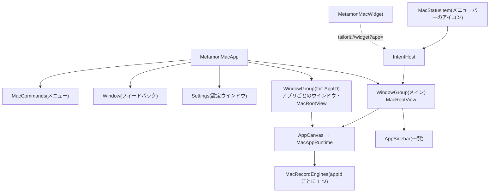

# Mac のアプリの作り(コードの共有・置き換え層・ウインドウとメニュー)

Mac 版(`MetamonMac`・#929)のコードがどう組み立てられているかをまとめます。OS の機能との連携は [system-integration.md](system-integration.md)、操作の決まりは [interactions.md](interactions.md)、iOS 側は [../ios/architecture.md](../ios/architecture.md) にあります。方針(なぜネイティブの SwiftUI か)は [../decisions/363-desktop-strategy.md](../decisions/363-desktop-strategy.md) です。

- 表のファイル名は `origin/develop` の `748767fd6` で確かめました。
- ビルド・起動・テストの手順は [../../ios/README.md](../../ios/README.md) にあります。

## 目次

- [ターゲットとフォルダ](#ターゲットとフォルダ)
- [共有の決まり](#共有の決まり)
- [置き換え層(Support/Platform)](#置き換え層supportplatform)
- [MacAppRuntime と iOS の AppRuntime](#macappruntime-と-ios-の-appruntime)
- [ウインドウ・サイドバー・メニューバー・ウィジェット](#ウインドウサイドバーメニューバーウィジェット)
- [記録の同期とプッシュ](#記録の同期とプッシュ)

## ターゲットとフォルダ

`ios/project.yml` に iOS と並べて Mac のターゲットを置きます。Xcode のプロジェクトは 1 つです。

| ターゲット | 種類 | ソース | 役目 |
|---|---|---|---|
| `MetamonMac` | アプリ(macOS 14〜) | `ios/MetamonMac/`・`ios/Shared/`・`ios/Metamon/` の一部のファイル | Mac の殻。`PRODUCT_NAME` は `Tailor It`、モジュール名は `Metamon` |
| `MetamonMacWidget` | WidgetKit の拡張 | `ios/MetamonMacWidget/`・`ios/MetamonWidget/` の一部 | デスクトップ・通知センターのウィジェット |
| `MetamonMacTests` | 単体テスト | `ios/MetamonMacTests/` | アプリをホストにしたテスト(mac-ci で回す) |
| `MetamonMacUITests` | UI テスト | `ios/MetamonMacUITests/` | キーボード操作など。scheme では skipped |

`ios/MetamonMac/App/` の中:

| フォルダ | 中身 |
|---|---|
| `Shell/` | 画面の骨格。`MacRootView`(サイドバー + 中央)・`AppSidebar`・`AppCanvas`・`MacCommands`(メニュー)・`MacAppWindows`(アプリごとのウインドウ) |
| `Runtime/` | 生成したアプリを動かす `MacAppRuntime` と `+` の拡張、記録の置き場(`MacRecordVault`・`MacRecordEngines`・`MacRecordResend`) |
| `Compose/` | アプリを作る・直す会話(`MacComposeSession`・`ComposeSheet`)と作ったアプリの一覧(`MacAppLibrary`) |
| `Services/` | DI の入口 `MacServices`・ログイン `MacAccount` |
| `MenuBar/`・`Widget/`・`Push/`・`Intents/`・`Links/` | OS との連携([system-integration.md](system-integration.md)) |
| `Settings/`・`Onboarding/`・`Purchase/`・`Feedback/`・`Voice/`・`Theme/`・`ScreenMap/` | 設定ウインドウ・初回の案内・課金・フィードバック・声の入力・見た目・画面マップ |

## 共有の決まり

| 層 | 場所 | Mac の扱い |
|---|---|---|
| DSL | `ios/Packages/MetamonDSL` | そのまま共有(Foundation だけ) |
| 描画 | `ios/Packages/MetamonRenderer` | そのまま共有。OS の差は `Support/Platform/` に寄せる |
| 通信・端末の機能 | `ios/Packages/MetamonServices` | そのまま共有。iOS だけの API(`AVAudioSession` など)は `#if os(iOS)`、Mac だけの物は `Native/MacAudioInput.swift` など |
| UIKit に依存しないアプリの部品 | `ios/Shared/` | 両方のターゲットにコンパイルする(画面の移動 `RuntimeNavigating`・確認 `RuntimeConfirm`・保存の前段 `RecordActionSteps`・記録 `RecordBook`・文言など) |
| iOS の本体のファイル | `ios/Metamon/` の一部 | `project.yml` の `MetamonMac` の `sources` に 1 ファイルずつ書いて共有する(例: `AuthSession.swift`・`ErrorCopy.swift`・`TailorItIntents.swift`)。`AppRuntime` に依存するファイルは入れない |
| Mac だけ | `ios/MetamonMac/` | 殻・ウインドウ・メニュー・`MacAppRuntime` |

決まり:

- iOS の動きを変えない。iOS 側の差分は「置き換え層の名前で呼ぶ」だけにする([363 の「コードの共有の形」](../decisions/363-desktop-strategy.md#コードの共有の形))。
- `#if os(macOS)` は、まず置き換え層(`Support/Platform/`)に閉じる。部品のファイルの中の短い分岐は許しているが、増やす前に置き換え層に出せないかを見る。`748767fd6` の時点で、Renderer の `Support/Platform/` の外に OS の分岐(`#if os(...)` / `#if canImport(UIKit)`)を持つファイルは 59 あります。
- iOS の本体のファイルを Mac でも使う時は、移すのではなく `project.yml` に 1 行足す(同じファイルを 2 つのターゲットでコンパイルする)。`AppRuntime` に触るなら `ios/Shared/` に純粋な部分を出す。

## 置き換え層(Support/Platform)

`ios/Packages/MetamonRenderer/Sources/MetamonRenderer/Support/Platform/`:

| ファイル | 中身 |
|---|---|
| `PlatformImage.swift` | `PlatformImage`(`UIImage` / `NSImage`)・画像の描画(`PlatformGraphics`) |
| `PlatformSystem.swift` | `PlatformColor`・設定を開く・VoiceOver・触覚・画面を消さない など(`PlatformSystem`) |
| `PlatformViewModifiers.swift` | iOS だけの SwiftUI 修飾子を Mac では何もしない / 同等品にする |
| `PlatformPasteboard.swift` | クリップボード |
| `PlatformPDF.swift` | PDF の書き出し |
| `PlatformMap.swift` | 地図 |
| `MacDisplayLeaves.swift`・`MacDisplayLeafModifiers.swift`・`MacInputLeaves.swift` | 表示・入力の部品の Mac 版 |
| `MacCamera.swift`・`ContinuityCameraImport.swift`・`MacVideoPlayerView.swift` | カメラ・連係カメラ・動画 |
| `MacUnavailableView.swift` | Mac で描けない部品の「この Mac では使えません」の枠 |

Mac で描けない部品は `ClientCapabilities.macUnavailableComponents`(`healthStat`・`sensorValue`・`locationTracker`・`dashcam`)で、AI にも作らせません。申告と登録の一致は `ios/MetamonMacTests/MacPlatformDeclarationTests.swift` で確かめます。

## MacAppRuntime と iOS の AppRuntime

iOS の `AppRuntime`(`ios/Metamon/App/AppRuntime.swift`)はアプリ全体で 1 つで、アプリの一覧・会話・生成した画面をまとめて持ちます。Mac の `MacAppRuntime`(`ios/MetamonMac/App/Runtime/MacAppRuntime.swift`)は**中央に開いた生成アプリ 1 つ分**だけを持ち、アプリを切り替えると作り直します(`AppCanvas` の `.id(app.id)`)。一覧と会話は別の型が持ちます。

| iOS(`AppRuntime` と `+` の拡張) | Mac |
|---|---|
| `AppRuntime.swift`(画面の移動・アクション・記録) | `MacAppRuntime.swift`。画面の移動 `RuntimeNavigating`・確認 `RuntimeConfirm`・記録 `RecordBook` は `ios/Shared/Runtime/` を共有 |
| `+AppList`・`+Delete`(アプリの一覧・削除) | `Compose/MacAppLibrary.swift` と `Shell/AppSidebar.swift` |
| `+Chat`・`+Clarify`・`+BuildStage`(作る・直す会話) | `Compose/MacComposeSession.swift`・`Compose/ComposeSheet.swift` |
| `+PostBuildNotice` | `Shell/MacPostBuildNotices.swift`(順番は共有の `PostBuildNotice`) |
| `+Calendar` | `+Calendar`(手順は共有の `CalendarActionSteps`) |
| `+Export` | `+Export`(保存・共有・プリント)と `+Menu`(ファイル > 書き出し・プリント) |
| `+FixRequest` | `+FixRequest`(依頼文は共有の `FixRequest`) |
| `+AIChat`・`Purchase/+AIText` | `+AIText`(aiButton・aiGenerate・aiChat) |
| `Voice/+Dictation`・`Voice/+AudioFileTranscription` | `+Dictation`・`+AudioFileTranscription` |
| `Feeds/+Feeds` | `+Feeds` |
| `Retention/+Retention` | `+Retention` |
| `Share/+Members`・`Share/+Moderation`・`Matching/+Matching` | `+Social`・`MacSocial.swift`・`MacSocialDialogs.swift` |
| `Nearby/+Nearby` | `MacNearby.swift`(すれ違い通信は無し) |
| `Health/+Health` | `MacHealthNote.swift`(ヘルスケアには書かず一言で知らせる) |
| `+Notifications` | `MacRuntimeNotifications.swift`・`MacUpcomingNotifications.swift` |
| `+Intents` | `Intents/MacIntentHost.swift`(Intent の型は共有) |
| `Push/+Push` | `Push/MacPushHost.swift` |
| `Share/+Handoff` | `Links/MacHandoff.swift` |
| 「下に引いて更新」 | `+Reload`(表示 > 再読み込み ⌘R) |
| (iOS に無い) | `+Discard`(保存していない入力を捨てる前の確認)・`+Menu`(メニューから今の画面に向ける操作) |
| `+LiveActivity`・`Follows/+Follows` | Mac には無い。アクションが来たら一言で知らせる(「ライブアクティビティは iPhone だけで表示されます」「フォローは Mac では使えません」)。知らない種類は「このボタンは Mac ではまだ使えません」 |

## ウインドウ・サイドバー・メニューバー・ウィジェット

| 部分 | ファイル | 決まり |
|---|---|---|
| メインのウインドウ | `MetamonMacApp.swift`・`Shell/MacRootView.swift` | 左にサイドバー(iOS のアプリの切り替えのシートに当たる・常に出す)、中央に選んだアプリ、上にツールバー |
| アプリごとのウインドウ | `Shell/MacAppWindows.swift` | `WindowGroup(for: AppID.self)`。中身はメインと同じ `MacRootView` でサイドバーを畳む。同じアプリのウインドウ同士は記録のエンジンを共有する(`MacRecordEngines`) |
| メニュー | `Shell/MacCommands.swift` | 今のウインドウの状態を `focusedSceneValue` で受け、有効 / 無効を変える |
| メニューバー | `MenuBar/MacStatusItem.swift` | `MenuBarExtra` ではなく `NSStatusItem` + `NSPopover`。一覧と記録は `IntentHost` から読む |
| ウィジェット | `ios/MetamonMacWidget/`・`App/Widget/MacWidgetLinkReceiver.swift` | 本体が App Group に書いた `WidgetSnapshot` を描くだけ。押すと `IntentHost` の「開く」で一覧から選ぶ |

詳しい決まりは [system-integration.md](system-integration.md) の「メニューバーとログイン時に開く」「ウィジェット」「アプリごとのウインドウ」にあります。

## 記録の同期とプッシュ

| 項目 | Mac | iOS との差 |
|---|---|---|
| 置き場 | `Runtime/MacRecordVault.swift`。サーバーにあるアプリは appconfig(`RecordSyncEngine` + `HTTPAppConfigClient`・iOS と同じ)、それ以外は端末だけ(`LocalAppConfigClient`)。`Application Support/metamon-mac-records/<appId>/` | 同梱の例は一時フォルダのメモリ上の appconfig |
| エンジン | `Runtime/MacRecordEngines.swift`。appId ごとに 1 つ。ウインドウは借りて返す | iOS はウインドウが 1 つなので要らない |
| 送り直し | `Runtime/MacRecordResend.swift`。前に来た・スリープから戻った・ネットワークが戻った時と一定間隔。送っている間は App Nap を止める | iOS は前面に戻った時 |
| 状態の表示 | `Runtime/MacSyncStatusToolbar.swift`。送り切っていない時だけツールバーに出す | iOS は設定の「同期」 |
| プッシュ | `Push/MacPushHost.swift`。トークンの送り方は共有の `PushDeviceRegistrar`、OS とのやり取りだけ Mac 用 | 審査用の版では外す。詳しくは [system-integration.md「プッシュ通知」](system-integration.md#プッシュ通知) |
