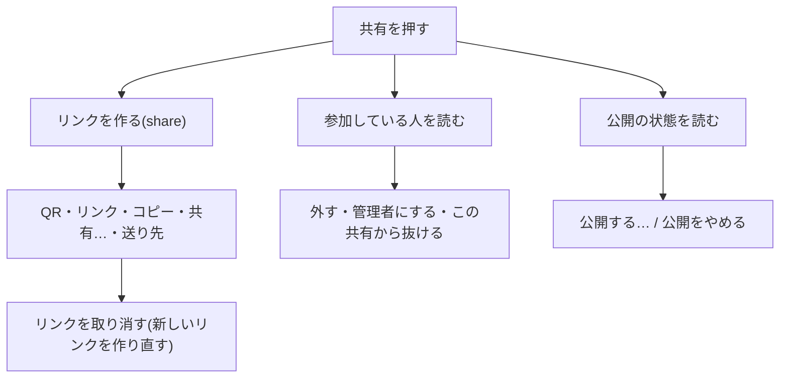

# Mac の共有・公開・「アプリを探す」・リリース申請

Mac 版(`MetamonMac`)で、作ったアプリを人に渡す・公開する・人のアプリを探して入れる流れをまとめます。作りの全体は [architecture.md](architecture.md)、OS との連携は [system-integration.md](system-integration.md)、iOS 側は [../ios/architecture.md](../ios/architecture.md) にあります。

- 表のファイル名は `origin/epic/god` の `f502d2543` で確かめました。コードは `ios/MetamonMac/App/Links/` にあります。
- 「推測」と書いた所は、コードから読み取れなかったことです。
- 親 Issue は #1040(関連 #974・#2069・#2070・#2071)。

## 目次

- [入口](#入口)
- [流れ](#流れ)
- [iOS との差](#ios-との差)
- [決めること](#決めること)

## 入口

| 入口 | 場所 | 押せる条件 | コード |
|---|---|---|---|
| アプリを探す(メニュー) | メニューバー「アプリ」の「みんなのアプリを探す…」(⇧⌘F) | サインイン済み・サーバーにつながっている・ほかのシートが閉じている | `MacCommands`・`MacRootView.canDiscover`・`MacDiscoverModel.isAvailable` |
| リリース申請 | まだ無い | - | #2071(未着手) |
| 共有(ツールバー) | ツールバー右の「共有」。押すと共有シートが開く | 自分が作ったアプリで、サーバーに保存済み・サインイン済み・共有の API がある | `MacShareAppModel.canShare`・`MacRootView.openShare` |
| 共有のリンクを開く | `tailorit://import/<token>`・`https://tailor-it.app/s/<token>`(Universal Links) | サインイン後(前に届いたリンクは保留) | `MacLinkReceiver`・`MacShareFlow` |

押せない時のヘルプは「サーバーに保存した自分のアプリだけ共有できます」(アプリを選んでいない時は「アプリを選ぶと共有できます」)です。⌘F はサイドバーの検索なので、「探す」は ⇧⌘F にしています。共有のボタンにショートカットは付けていません。

## 流れ

### 共有シート(`MacShareAppSheet`)

開くと次を並行して読み込みます。幅は 460、中身は `ScrollView`(高さは最大 560)です。

| 欄 | できること | コード |
|---|---|---|
| QR | アプリのリンク(`info.url`、無ければ Web のリンク)を QR にする。カメラで読むと Tailor It で開く | `MacShareAppModel.qrText` |
| 送り先 | LINE は共有の画面(未インストールなら Web)を開く。Slack・Discord は文面をコピーしてからアプリ(無ければ Web)を開き、貼り付けてもらう | `MacShareTarget` |
| みんなに公開 | ひとこと説明・タグ(スペース区切り)を入れて「公開する…」→ 注意の確認(4 つ)→ 公開。公開中は「N 人がインストール」と「公開をやめる」。表示できない言葉があった欄は赤く囲む | `MacPublishModel`・`MacPublishSection` |
| 参加している人 | 共有の記録があるアプリだけ欄を出す。外す・管理者にする・自分が抜ける。外した直後はリンクの取り消しへ誘う | `MacSharedMembersModel` |
| リンク | 受け取る人がブラウザでも開ける https(`webUrl`)を先に渡す。コピーと、OS の共有メニュー(`ShareLink`)がある | `MacShareAppModel.link`・`copyLink` |
| リンクを取り消す | 今のリンクを取り消し、新しいリンクを作る。Handoff に渡すリンクも入れ替える | `MacShareAppModel.revoke`・`MacHandoffLinks` |

- 公開の状態は、新着の一覧(`searchPublicApps(query: "", sort: "new")`)から自分の掲載を探して決めます。読めなければ「公開していない」扱いです。
- 公開・公開をやめるが失敗しても表示は変えず、一言だけ出します。

### 共有のリンクを受け取る(`MacShareFlow`)

1. リンクが届く(URL スキーム・Universal Links)。共有のリンクでなければ何もしない。
2. サーバーにつながっていなければ案内を出す(「リンクをコピー」ができる)。
3. サインインが済むまで保留し、済んだら 1 回だけ開く(`PendingShareLink`)。
4. プレビューを取る。記録を共有するアプリで自分のでなければ「参加」、そうでなければ「追加」の確認シート。
5. 参加では「参加すると」の説明と表示名(任意・最大 64 字・前回の名前を初期値にする)を出す。
6. 取り込み → アプリの中身を取る → 一覧に足して開く(`MacRootView` が `adopted` を受ける)。
7. 起動の途中に届いたものは、同意・チュートリアルが閉じきってから出す(#1885)。

失敗の一言は、参加できない理由(403)・持てるアプリの数・取り消し済み(404)・その他の順に決まります(`MacShareFlow.failureMessage`)。

### アプリを探す(`MacDiscoverModel`・`MacDiscoverView`)

- 検索語と並び順(既定は人気順)で `searchPublicApps` を呼ぶ。入力中は 250ms 間引き、取り消した検索の結果は書かない。
- 「入れる」で `install(publicAppId:)` → 中身を取って一覧に足し、そのアプリを開く。共有データに参加した時だけ、サイドバーの「共有されたアプリ」に出す。
- 持てるアプリの数に達したら置き換えのシートを出し、1 つ空いたら入れ直す。
- 通報・ブロックは自分の掲載以外に出す。ブロックしたら検索を読み直す。

### リリース申請

Mac にはまだありません(#2071)。iOS にある申請の画面と、申請の状況のバッジの Mac 版を作る Issue で、入口はサイドバーのアプリの右クリックか共有シートの予定です(Issue の記載。実装はありません)。

## iOS との差

| 項目 | iOS | Mac |
|---|---|---|
| 共有の入口 | アプリの切り替えのシート(`AppSwitcherSheet`)の `ShareAppSheet` | ツールバーの「共有」から開くシート(`MacShareAppSheet`) |
| 探す の入口 | `DiscoverSheet` | メニュー「みんなのアプリを探す…」(⇧⌘F)から開くシート |
| 送り先 | iOS の共有シートの文面を使う | Mac は `MacShareTarget`(LINE・Slack・Discord)。文面は iOS と同じ「Tailor It で「名前」を使ってみて」+ リンク |
| 参加の確認 | 通知の切り替えなどの行がある | 共有シート・通知の切り替えがまだ無いので、その 2 行は出さない(コードのコメントによる) |
| リリース申請 | あり(`ReleaseRequestSheet`) | なし(#2071) |
| ショートカット | なし | 「探す」は ⇧⌘F。共有のボタンには付けていない |
| 審査用の版 | 外す(下表) | 外す(下表)。ただし URL スキームの登録は Info.plist に残る |

### 審査用の版(`APP_STORE_REVIEW`)で外すもの

審査用の版全体は [../ios/review-build.md](../ios/review-build.md#mac-の審査用の版) にあります。この文書に関わる所だけ書きます。

| 外すもの | どう外すか |
|---|---|
| 「探す」(メニュー・シート・モデル) | `#if !APP_STORE_REVIEW`。メニューの項目ごと出さない |
| 共有シート・「みんなに公開」・参加している人 | `#if !APP_STORE_REVIEW`。ツールバーの「共有」は押せない(`canShare` が false)。ヘルプは「このアプリを共有する」のまま |
| 共有のリンクを受ける・Handoff | `MacLinkReceiver`・`MacHandoff` ごと外す。届いても何もしない |
| Universal Links の権限 | `MetamonMac-Review.entitlements` から `associated-domains` を外す |

- 通常の版と審査用の版でファイルの中身を変えず、`#if` で丸ごと囲みます。

## 決めること

- 推測: Mac のリリース申請の入口(右クリックか共有シートか)は #2071 で決まる。
- 決めること: 審査に出す前に、Mac の `Info.plist` に残る `CFBundleURLTypes`(`tailorit://`)を消すかどうか([../ios/review-build.md](../ios/review-build.md#mac-の審査用の版)に同じ注意がある)。
