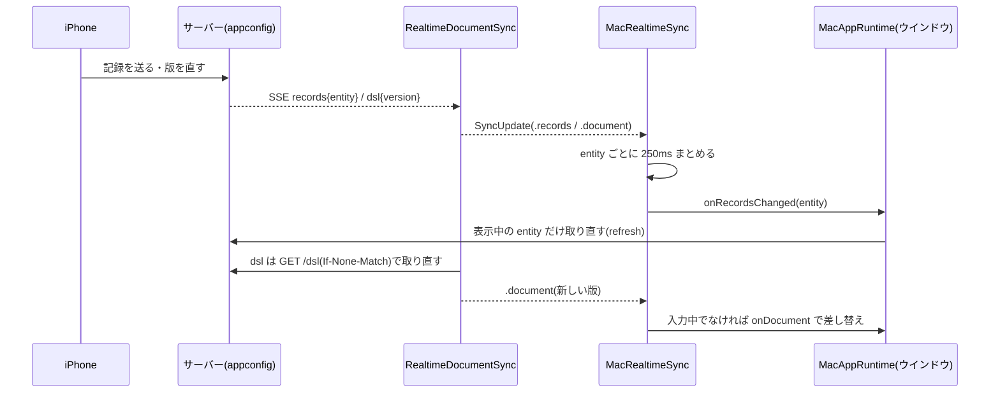

# iPhone で入れた記録が Mac に出るまで

iPhone など別の端末で入れた記録・直したアプリの版が、Mac の開いている画面に出るまでの流れをまとめます。作りの全体は [architecture.md](architecture.md)(特に [記録の同期とプッシュ](architecture.md#記録の同期とプッシュ))、iOS 側は [../ios/architecture.md](../ios/architecture.md) にあります。

- 表のファイル名は `origin/epic/god` の `f502d2543` で確かめました。
- 親 Issue は #1040(関連 #2072・#976)。「推測」と書いた所は、コードから読み取れなかったことです。

## 目次

- [全体の流れ](#全体の流れ)
- [購読の張り方](#購読の張り方)
- [いつ何をするか](#いつ何をするか)
- [送信待ちの送り直し](#送信待ちの送り直し)
- [App Nap](#app-nap)
- [決めること](#決めること)

## 全体の流れ

サーバーが知らせるのは「何が変わったか」だけです。本体は、これまでの API で取り直します(正は API)。

## 購読の張り方

| 項目 | 決まり | コード |
|---|---|---|
| 購読の元 | iOS と同じ `RealtimeDocumentSync`。SSE(`GET /v1/apps/{id}/events`)を読み、切れたら指数バックオフ(1 秒から最大 30 秒)で張り直す。その間は 5 秒ごと、つながっている間も保険として 60 秒ごとに版を取りに行く | `RealtimeDocumentSync`・`MacServices.sync` |
| 本数 | 開いているアプリごとに 1 本。同じアプリを開いたウインドウが複数あっても共有する | `MacRealtimeSync.entries` |
| 借りる・返す | ウインドウ(`MacAppRuntime`)は `acquire` で借り、捨てる時に `release`。最後の 1 つが返したら購読をやめる | `AppCanvas`・`MacAppRuntime+Realtime` |
| 張るアプリ | サーバーにあるアプリだけ。端末だけのアプリ・同梱の例は張らない。接続先が無い時(モック)は nil | `AppCanvas`(`server != nil`) |
| 始める版 | 借りた時のアプリの版の次から | `acquire(appId:version:)` |
| 止める時 | サインアウト・アカウント削除で全部やめる | `MacLocalWipe`→`stopAll` |

## いつ何をするか

| きっかけ | することが | コード |
|---|---|---|
| 他の端末で記録が変わった(`records`) | entity ごとに 250ms まとめ、借りている全員へ。ウインドウは、すでに読み込んだ(表示中の)entity だけ取り直す。未表示の entity は開いた時に読む | `scheduleRefresh`・`realtimeRecordsChanged` |
| 他の端末でアプリの版が上がった(`dsl`) | 今より新しい版だけ受け、アプリの一覧(`MacAppLibrary.applyRemoteVersion`)に当てる。作ったアプリでサーバーにあるものだけ。履歴には積まない | `handle`・`applyRemoteVersion` |
| ウインドウが入力・操作の途中 | 版の差し替えを待つ(中央をランタイムごと作り直すと下書きが消えるため)。1 秒ごとに見て、終われば最新の 1 件だけ当てる | `offer`・`isInteractingForHotReload` |
| 購読が切れて戻った(`.realtime(true)`) | 切れていた間の取りこぼしに備え、表示中の entity を全部取り直す。つながったことを最初に知らせた時は取り直さない | `handle`(`resumed`) |
| スリープから戻った・画面のスリープから戻った | 購読を張り直し、表示中の entity を取り直す(`force: true`) | `MacRecordResend.install`→`resume(force:)` |
| 回線が戻った | 1 秒待って(各エンジンの到達性が追いつくのを待つ)から、同じく張り直して取り直す(`force: true`) | 同上 |
| ウインドウが前に来た | 購読が生きていなければ(`listening != true`)だけ張り直して取り直す。生きていれば取りこぼしが無いので何もしない(`force: false`) | `resume(force:)` |
| サーバーが予定の終了を知らせた(`bye`・約 50 秒ごと) | すぐ張り直す。ポーリングには落とさない | `RealtimeDocumentSync.listen` |
| 認証が切れた(401) | トークンを取り直して張り直す | 同上 |

- 一度の「前に来た」「スリープ明け」「回線の復帰」で、送信待ちの送り直しと購読の張り直しが同じ合図で動きます(`MacRecordResend.onResume`)。

## 送信待ちの送り直し

Mac で入れた記録が送れなかった時の列(`RecordSyncEngine` / `SyncQueue`)は iOS と同じです。Mac は「前面に戻った」の代わりに、次で全部のエンジンを流し直します(`MacRecordResend`)。

| きっかけ | 内容 |
|---|---|
| ウインドウが前に来た・スリープ明け・回線の復帰 | 送り直す。購読も張り直す |
| 起動中の一定間隔(60 秒・App Nap 中にまとめて起こされてよい) | 送信待ちがあるエンジンだけ送り直す。連続失敗で止まった列もここで再開 |
| スリープの前 | 取り消し待ちの削除を列に積む(寝ている間に消えないように) |
| ツールバーの状態表示を押す | そのアプリの列を今すぐ送り直す。オフラインの時は押せない |

- 同じエンジンで同時に 2 回は走らず、1 回の送り直しは最長 30 秒まで待ちます。
- 状態の表示は、送り切っていない時だけツールバーに出ます(「未送信 N 件」「送信中」「オフライン」。`MacSyncStatusToolbar`)。
- 開いていないアプリの列は、開くまでエンジンが無いので流れません(`MacRecordVault.liveEngines` は開いているアプリの分。推測: 開いていないアプリの送信待ちは次に開くまで残る)。

## App Nap

macOS は見えていないアプリの動きを止めることがあるため、動かす間だけ `ProcessInfo.beginActivity(.userInitiatedAllowingIdleSystemSleep)` を持ちます(`MacSendActivity`。何本重なっても 1 つの activity にまとめる)。

| 持つ所 | 持つ間 | 理由の文字列 |
|---|---|---|
| `MacRealtimeSync` | 購読が 1 本でもある間(最初の `acquire` から最後の `release` まで) | `Listening for changes from other devices` |
| `MacRecordResend` | 送り直している間 | `Sending records to the server` |

- システム全体のスリープは止めません(`AllowingIdleSystemSleep`)。スリープから戻ったら上の表の通り張り直します。

## 決めること

- 推測: スリープの間に切れた購読は、戻った時の `resume(force: true)` で張り直すと読める(スリープ中の挙動は実機では確かめていない)。
- 決めること: Mac が起動していて、どのウインドウも開いていない間は購読しない。その間の変化を通知で知らせるかは、プッシュ(#982)の範囲([system-integration.md「プッシュ通知」](system-integration.md#プッシュ通知))で決める。
- テストは `ios/MetamonMacTests/MacRealtimeSyncTests.swift` と `MacRecordResendTests.swift` にあります。
