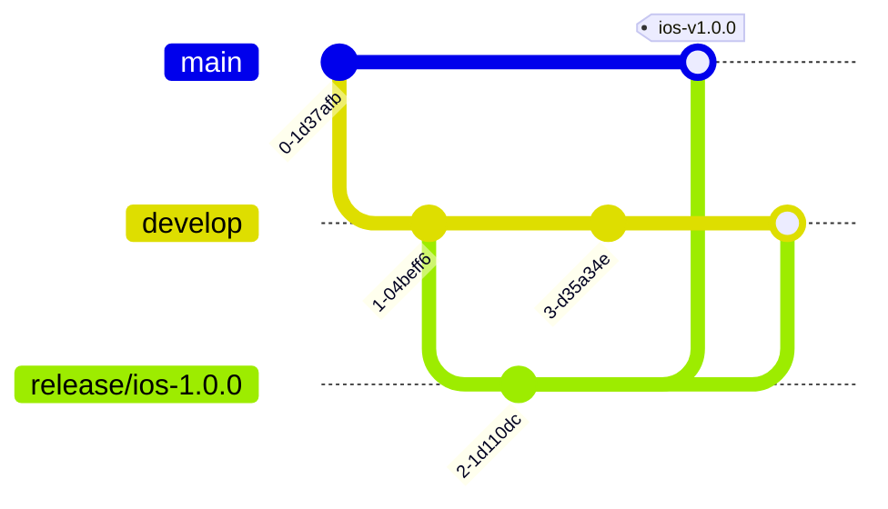

# リリースの手順(版の付け方・release ブランチ・変更履歴)

#303。長期開発での iOS と backend の出し方。ハッカソン当日の手順は [`2026-10-25-runbook.md`](2026-10-25-runbook.md)(当日専用・参考)。
ブランチの基本は [`../00_decisions.md`](../00_decisions.md) の「Git運用」と [`../02_github_workflow.md`](../02_github_workflow.md) に合わせる。

## 目次
1. [前提](#1-前提)
2. [版の付け方](#2-版の付け方)
3. [ブランチの流れ(release / hotfix)](#3-ブランチの流れrelease--hotfix)
4. [変更履歴(PR のラベル → GitHub Release)](#4-変更履歴pr-のラベル--github-release)
5. [チェックリスト: backend だけ出す](#5-チェックリスト-backend-だけ出す)
6. [チェックリスト: iOS を出す](#6-チェックリスト-ios-を出す)
7. [チェックリスト: hotfix](#7-チェックリスト-hotfix)
8. [人の承認が要る操作](#8-人の承認が要る操作)

## 1. 前提

| 項目 | 内容 | 出典 |
|---|---|---|
| 自動デプロイ | `develop` に push → `ai-stg` / `appconfig-stg`、`main` に push → `ai-prod` / `appconfig-prod`。`backend/**` か workflow 自体が変わった時だけ | `.github/workflows/deploy-cloudrun.yml` |
| 手動デプロイ | `workflow_dispatch`(環境を選ぶ)。指定した ref をそのままデプロイする | 同上 |
| デプロイ後の確認 | `/health` が 200 → スモーク(結果は job summary の表) | 同上 |
| `release/*` | push してもデプロイされない(対象は develop / main だけ)。CI は PR で走る | 各 workflow の `on:` |
| マージ方式 | `feature/*` → develop は Squash、develop / `release/*` / `hotfix/*` → main は Merge commit | `02_github_workflow.md` |
| min-instances | デプロイのたびに `--min-instances=0` に戻る。prod で 1 にしている時は、main へのデプロイ後にやり直す | `deploy-cloudrun.yml` |
| DB | stg と prod は同じ Firestore `(default)` を使う。データを壊す変更は stg でも本番データに効く | `docs/infra/gcp-setup.md` |

## 2. 版の付け方

### 2.1 iOS

| 値 | 形 | 置き場所 | ルール |
|---|---|---|---|
| 版 `MARKETING_VERSION` | SemVer `X.Y.Z` | `ios/project.yml` の `settings.base`(アプリ・ウィジェットの Info.plist は `$(MARKETING_VERSION)` を読むだけ) | 出す単位で上げる。X = 大きな作り直し・古い DSL を読めなくなる、Y = 機能の追加、Z = 修正だけ |
| ビルド番号 `CURRENT_PROJECT_VERSION` | 正の整数 | 同上 | App Store Connect に上げるたびに +1。**版が変わっても戻さない**(全期間で増え続ける)。同じ番号は二度と上げられない |

- 上げ方は [`ios/scripts/bump-build.sh`](../../ios/scripts/bump-build.sh)。`project.yml` を書き換えるだけ(コミット・タグはしない)。
  ```sh
  ios/scripts/bump-build.sh                  # ビルド番号 +1(TestFlight に上げ直す時)
  ios/scripts/bump-build.sh --version 1.1.0  # 版を変えて、ビルド番号も +1
  ios/scripts/bump-build.sh --build 42       # 番号を指定(今より大きい数だけ)
  ```
- 上げた変更は PR で develop(または `release/*`)に入れる。アーカイブは上げた後のコミットから作る。
- 今後の案(未実装): CI でアーカイブ・アップロードするようになったら、そのジョブで `bump-build.sh --build <App Store Connect の最新 + 1>` を走らせる。今は手元でアーカイブしているので手動。
- **最初の App Store 版の案: `1.0.0`(今は `0.1.0` / ビルド番号 `1`)**。`bump-build.sh --version 1.0.0` で `1.0.0` / ビルド `2` になる。

### 2.2 backend

- タグ: **`backend-vX.Y.Z`**。prod へのデプロイが緑になった main のマージコミットに付ける。
- X = 古い版の iOS アプリが壊れる変更(API・DSL の互換が切れる。原則しない)、Y = API・機能の追加、Z = 修正だけ。
- 古い iOS アプリは端末に残り続ける。backend は**今ストアにある iOS の版すべて**と互換を保つ。
- 最初のタグは、この手順で初めて prod に出す時に `backend-v1.0.0` とする。

### 2.3 iOS のタグ

- タグ: **`ios-vX.Y.Z`**。審査に出して通ったビルドのコミットに付ける(TestFlight だけのビルドには付けない)。ビルド番号は Release の本文に書く。
- タグ・GitHub Release を作るのは人(§8)。

## 3. ブランチの流れ(release / hotfix)

### 3.1 release

普段は develop → main の PR で出してよい(backend の小さな変更など)。**凍結が要る時**(iOS の審査に出す・大きめの backend)だけ `release/*` を切る。



1. 切る: `git switch develop && git pull && git switch -c release/<ios|backend>-X.Y.Z`(iOS と backend を一緒に出す時は `release/X.Y.Z` でよい)。
2. 凍結: `release/*` には**リリースに要る修正だけ**を PR で入れる(新機能は入れない)。版・ビルド番号の変更もここで行う。
3. stg で確かめる(backend を含む時): `release/*` は自動ではデプロイされない。`gh workflow run deploy-cloudrun.yml --ref release/<...> -f environment=staging` で stg に出す。この間に develop に backend の PR が入ると stg が上書きされるので、凍結中は develop への backend のマージを控えるか、出し直す。
4. 出す: `release/*` → main の PR(Merge commit)。**マージ = prod デプロイ**(人)。
5. 戻す: `release/*` → develop の PR(Merge commit)。凍結中の修正を develop に取り込む。
6. タグと Release(§4)。終わったら `release/*` を消す。

### 3.2 hotfix

`main` から `hotfix/<topic>` を切る → main に PR(prod)→ develop にも PR(取り込み)。backend は Z を上げてタグ、iOS は Z を上げて審査に出す(§7)。

## 4. 変更履歴(PR のラベル → GitHub Release)

- 分類は [`.github/release.yml`](../../.github/release.yml)。PR のラベルで分ける。

| ラベル | Release での見出し |
|---|---|
| `enhancement` | 新機能 |
| `bug` | 不具合の修正 |
| `backend` | backend |
| `documentation` | ドキュメント |
| ラベル無し・その他 | その他 |
| `duplicate` / `invalid` / `wontfix` | 載せない |

- PR を作る時に、上のどれかのラベルを付ける(付け忘れると「その他」に入る)。
- Release の作り方(人が実行):
  ```sh
  gh release create backend-v1.1.0 --target <main のマージコミット> \
    --title "backend v1.1.0" --generate-notes --notes-start-tag backend-v1.0.0
  ```
  - `--notes-start-tag` は**同じ種類の前のタグ**を必ず指定する(iOS と backend のタグが同じリポジトリに混ざるので、省くと別系統のタグから数えてしまう)。
  - 自動の本文は範囲内の PR を全部並べる(iOS・backend を区別しない)。関係ない PR は手で消し、要点を先頭に数行書く。
- `CHANGELOG.md` は作らない。GitHub Release を変更履歴とする。
- 今後の案(人がラベルを作る): `ios` ラベル、載せたくない PR 用の `skip-changelog` ラベル。作ったら `release.yml` に足す。

## 5. チェックリスト: backend だけ出す

1. [ ] develop の deploy-cloudrun(staging)が緑・スモークの表が全部 PASS。
2. [ ] `scripts/demo-check.sh stg` などで stg を実際に触って確かめる。
3. [ ] develop → main の PR を作る(本文に §4 の下書き)。CI 3 本(`backend-ci` / `ios-ci` / `secrets-scan`)が緑。
4. [ ] **【人】main にマージ(Merge commit)= prod デプロイ。**
5. [ ] main の deploy-cloudrun(production)が緑・スモーク PASS。`cd backend && make smoke-prod`。
6. [ ] min-instances を 1 にしている運用なら設定し直す(GCP の権限がある人)。
7. [ ] **【人】** `backend-vX.Y.Z` のタグと Release を作る(§4)。
8. [ ] 戻す時: Cloud Run の前のリビジョンにトラフィックを戻す(`gcloud run services update-traffic <svc> --to-revisions=<rev>=100`)→ 原因を hotfix で直す。

## 6. チェックリスト: iOS を出す

1. [ ] `release/ios-X.Y.Z` を切る(§3.1)。
2. [ ] `ios/scripts/bump-build.sh --version X.Y.Z` → PR で `release/*` に入れる。
3. [ ] 審査用の版の確認([`../ios/review-build.md`](../ios/review-build.md)): `./scripts/build-review.sh build` が通る・「外れたことの確かめ方」を行う(以下のスクリプトは `ios/` で実行)。
4. [ ] 接続先の prod(ai / appconfig)が新しい版に必要な API を持っている(要るなら backend を先に出す・§5)。
5. [ ] **【人】** 実機でアーカイブ: `./scripts/build-review.sh archive -allowProvisioningUpdates DEVELOPMENT_TEAM=<TEAM_ID> CODE_SIGN_STYLE=Automatic`。
6. [ ] **【人】** Organizer か `xcodebuild -exportArchive` で App Store Connect にアップロード → TestFlight で実機確認。直すなら修正 PR → `bump-build.sh`(ビルド番号 +1)→ 5 から。
7. [ ] **【人】** App Store Connect: 栄養ラベル・審査メモ([`../store/app-review-notes.md`](../store/app-review-notes.md))・掲載文がこのバイナリと一致 → 審査に提出。
8. [ ] 通ったら: `release/*` → main(**【人】マージ**)と → develop の PR。backend に変更が無ければ prod デプロイは走らない。
9. [ ] **【人】** `ios-vX.Y.Z` のタグと Release(本文にビルド番号)。ストアでの公開(手動 / 自動)を選ぶ。
10. [ ] 審査の期間中・公開後は prod の backend を止めない。

## 7. チェックリスト: hotfix

1. [ ] `git switch main && git pull && git switch -c hotfix/<topic>`。
2. [ ] 直す。iOS なら `bump-build.sh --version X.Y.(Z+1)`。
3. [ ] main への PR。CI 緑。backend なら可能な範囲で stg に出して確かめる(`gh workflow run deploy-cloudrun.yml --ref hotfix/<topic> -f environment=staging`)。
4. [ ] **【人】main にマージ = prod デプロイ。** §5 の 5〜7(backend)/ §6 の 5〜9(iOS)。
5. [ ] develop にも同じ修正の PR(`hotfix/*` → develop)。取りこぼすと次のリリースで戻ってしまう。

## 8. 人の承認が要る操作

| 操作 | 理由 |
|---|---|
| main へのマージ(develop / `release/*` / `hotfix/*` から) | **prod に自動デプロイされる**。bot はマージ不可 |
| `deploy-cloudrun` の手動実行で `production` を選ぶ | prod デプロイ |
| タグの push・GitHub Release の作成 | 公開される記録 |
| アーカイブ・App Store Connect へのアップロード・審査提出・公開 | 署名と Apple のアカウントが要る |
| Cloud Run の設定(min-instances・トラフィックの戻し)・IAM | GCP の権限が要る |
| ラベルの追加・ブランチ保護の変更 | リポジトリの設定 |
